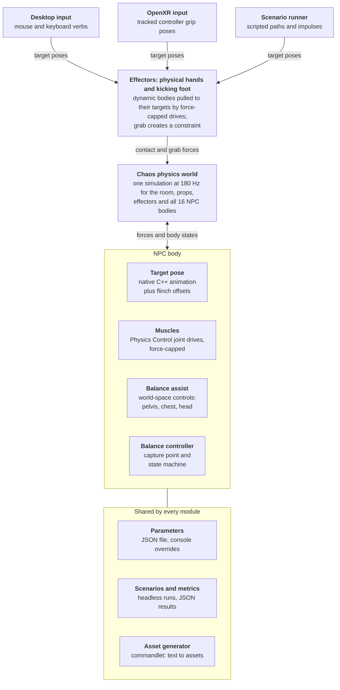
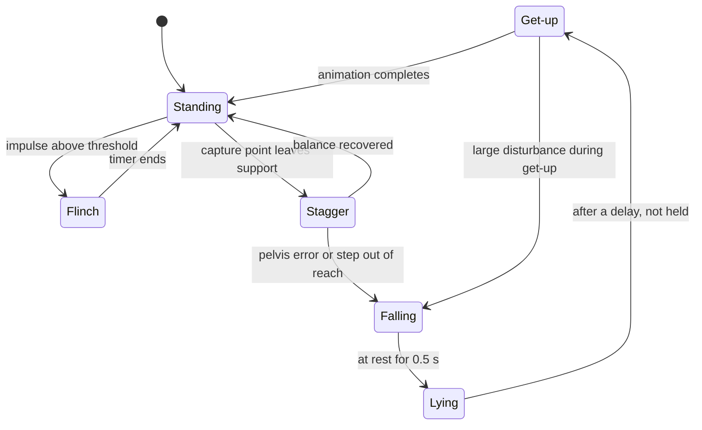
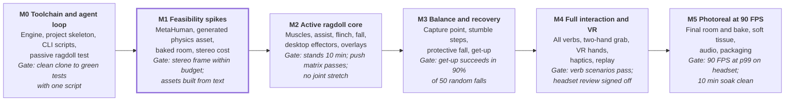

# Physics Sandbox PRD & Technical Plan

Nov 22, 2026 · @Sviat K

The prototype is feasible on Unreal Engine 5.8 with stock Chaos physics, provided three expectations are set now.

- **"Physically accurate" means physically plausible.** The body is a simulated ragdoll with real masses and joint limits that tracks animation through capped muscle drives. Staying upright needs a small non-physical assist, as it does in every shipped game of this kind. Biomechanical balance from first principles is a research problem and is out of scope.
- **Photoreal at 90 FPS in VR means baked lighting.** Lumen and Nanite in stereo remain experimental and unsupported by Epic. A static room loses nothing by baking, and the frame goes to the character.
- **AI-first means roughly nine-tenths CLI.** Building, asset generation, tuning and testing run headless. Account sign-ins, asset claiming, and judging feel in a headset stay with a person.

Three unknowns decide the schedule and are measured first: the MetaHuman's stereo rendering cost, Chaos joint stiffness under grab loads, and whether the physics asset and room can be generated from text.

## Key decisions

| Area | Choice | Why | Rejected |
| --- | --- | --- | --- |
| Engine | UE 5.8.4, Launcher build | Latest stable; Physics Control is production-ready in it; described as the last planned UE5 major | 5.9 Preview (lightly tested, final in 2027); source build (160 GB or more, not needed) |
| Physics | Chaos world simulation with `UPhysicsControlComponent` | Two-way collision with room, props and hands; Chaos Visual Debugger; Epic's maintained path | Rigid Body anim node (one-way world collision); Jolt, MuJoCo and Box3D plugins (a second physics world with no skeletal or VR story) |
| Body control | Joint drives, weak world-space assist, capture-point state machine | What shipped games converge on; buildable and tunable by a small team | Learned controllers (no training path inside UE, days of training); full procedural walking balance |
| Timing | Synchronous physics, fixed 90 Hz with 2 substeps | No interpolation latency between hands and picture | Async physics (kept as fallback) |
| Rendering | Deferred, baked lighting, TAA at 85% headset render scale; DLSS to be evaluated in M5 | Best fidelity per millisecond for a static room | Lumen in VR (desktop tier only); forward renderer (kept as fallback) |
| Character | MetaHuman, Optimized assembly, hair cards | Highest fidelity; scriptable assembly; free at this scale | Character Creator 5 (kept as fallback) |
| XR | Built-in OpenXR plugin, no vendor SDK | One code path for every PCVR headset | Meta XR plugin (not needed on PC); SteamVR plugin (removed from the engine) |
| Player contact | Force-capped dynamic effectors | Correct momentum transfer; same model in desktop, VR and tests | Kinematic hands (infinite mass) |
| Authoring | Text specs plus a generator commandlet; native animation instance | Agents edit text and regenerate; nothing depends on editor clicks | Blueprint and Animation Blueprint logic; third-party MCP servers |
| Testing | JSON scenarios, headless, fixed step, JSON metrics | Fast, repeatable, readable by agents | Functional tests placed in binary maps; Gauntlet (built for device farms) |

## Product requirements

The product is one room, one NPC and one player; it succeeds when the NPC's body reacts to contact the way a person's would, in both desktop and VR, and when an AI agent can prove that from the command line.

### Goals

- **Believable body.** Every reaction comes from simulation: contact forces, joint limits, muscle-like drives and balance. Canned hit animations are not the mechanism.
- **One simulation, two front ends.** Desktop and VR drive the same physical hands and the same NPC code. Only the source of the hand targets differs.
- **Agent-operable.** Build, asset generation, tuning, testing and packaging all run from CLI with machine-readable results.
- **Measurable.** Physical behaviour is covered by reproducible scenarios with numeric pass criteria, so tuning is a search rather than a judgement call.
- **Photoreal at 90 FPS.** High-fidelity character, materials and lighting inside an 11.1 ms stereo frame.

### Non-goals for the prototype

- Combat design, health, scoring, progression or NPC behaviour beyond standing, reacting and recovering.
- NPC locomotion beyond balance-recovery steps.
- Wounds, blood, dismemberment or bone breakage.
- Multiplayer, save games, menus beyond a debug panel.
- Standalone headset builds (Quest native) or consoles.

### Interaction verbs

| Verb | Desktop input | VR input | Expected physical outcome |
| --- | --- | --- | --- |
| Slap | Aim, tap light-strike key | Open hand swung into the body | Head or limb deflects, torso sways, NPC stays standing |
| Punch | Aim, click; hold to wind up | Fist swung into the body | Local recoil propagates to torso; stagger or step above a threshold |
| Kick | Aim, kick key | Scripted leg strike aimed by gaze or controller | Large impulse low on the body; leg buckles or NPC falls |
| Push | Hold push key with hand on body | Hands pressed against the body | Sustained force; lean, recovery step, then fall |
| Grab | Hold grab on a body part | Grip on a body part | Constraint at contact point; part follows hand up to a force cap |
| Drag | Move while grabbing | Move or pull while gripping | Body follows; standing NPC stumbles, fallen NPC slides with friction |
| Knock down | Any of the above at high energy | Same | Loss of balance, protective fall, rest, get-up |

### Functional requirements

| ID | Requirement | Priority |
| --- | --- | --- |
| FR-1 | NPC stands under full simulation, tracking an idle animation, with no drift or jitter for 10 minutes | Must |
| FR-2 | Contact anywhere on the body produces a reaction scaled by impulse that propagates through the joints | Must |
| FR-3 | Balance: small pushes absorbed by sway, medium pushes by a recovery step, large pushes cause a fall | Must |
| FR-4 | Falls show protective reflexes (arms brace, head tucks), no self-penetration, and come to rest | Must |
| FR-5 | NPC gets up from prone, supine or side rest poses and returns to idle | Must |
| FR-6 | Any body part can be grabbed with one or two hands, pulled, lifted within a force cap, and dragged | Must |
| FR-7 | NPC collides with walls, floor, furniture and loose props | Must |
| FR-8 | Desktop and VR share one pawn, one hand model and one NPC; the build runs flat with no headset attached | Must |
| FR-9 | Desktop test tools: free camera, pause, single-step, slow motion, NPC reset, calibrated impulse tool, drag handle | Must |
| FR-10 | VR: OpenXR tracked controllers drive physical hands; smooth locomotion and snap turn | Must |
| FR-11 | All physical parameters live in a text file, hot-reload at runtime and can be overridden from console or CLI | Must |
| FR-12 | Text-defined scenarios run headless from CLI and write JSON metrics plus an exit code | Must |
| FR-13 | Debug overlays: centre of mass, support polygon, joint drive targets, contacts, controller state | Must |
| FR-14 | Physics recording and screenshot or video capture can be triggered from CLI | Must |
| FR-15 | Impact audio and VR haptics scaled by impulse | Should |
| FR-16 | Soft-tissue secondary motion on face and torso under impact | Should |
| FR-17 | Skin flush at impact sites driven by a material mask | Could |

### Non-functional requirements

| ID | Requirement | Target |
| --- | --- | --- |
| NFR-1 | PCVR frame rate on the reference machine (RTX 5080, Ryzen 7 9800X3D, 32 GB) | 90 FPS, 99th-percentile frame time at or under 11.1 ms, no reprojection during the standard interaction scenario |
| NFR-2 | Desktop frame rate at 2560×1440 | 120 FPS or better |
| NFR-3 | Reproducibility | Same build, machine and scenario give metrics within stated tolerances on every run |
| NFR-4 | Blueprint dependency | No gameplay logic in Blueprint; binary assets are imported or generated from text |
| NFR-5 | Setup | One script takes a clean clone to a running build |
| NFR-6 | Agent loop time | Incremental compile plus headless scenario suite under 5 minutes |

## Hardest problems

Balance that looks alive, and joints that stay rigid when the player hauls on them, are the two problems most likely to decide whether the prototype convinces. The list is ranked by risk to that outcome.

| # | Problem | Why it is hard | Approach | Fallback |
| --- | --- | --- | --- | --- |
| 1 | Stagger and balance without a marionette look | Enough assist to stand reads as strings; too little and the NPC topples at a touch | Three balance levels; assist confined to pelvis, chest and head; assist share tracked as a metric and driven down | Animated stumble steps with higher assist; accept earlier falls |
| 2 | Joint stability under grab and drag loads | Chaos joints soften and stretch under load at low step rates; a capped-force hand pulling 80 kg is the worst case | 180 Hz simulation, mass ratios under 10, capped drives, non-linear joint solver, stretch metric as a gate | Async physics at a higher rate; release the grab when stretch crosses a limit |
| 3 | Tuning a large parameter space | Strength and damping interact across joints and states; the Half Sword developers call this their hardest problem | One parameter file, per-state groups, automated sweeps against the scenario suite | Fewer joint groups; fixed ratios between stiffness and damping |
| 4 | Get-up from arbitrary poses | Limbs tangled, body against a wall or over furniture; a blend from any pose can pop or clip | Prone and supine animations selected by pelvis orientation; roll to a clear pose first; clearance check; ramped strength | Longer blend with stronger assist; nudge the body into open floor before rising |
| 5 | Photoreal character in stereo at 90 FPS | No published stereo cost for a MetaHuman; strand hair and the face rig are expensive | Measure at Milestone 1 before the room is built; hair cards, lower face LOD, DLSS | Forward renderer with MSAA; Character Creator 5 character |
| 6 | Binary assets from text | Physics assets, maps and animation logic are normally made in the editor | Generator commandlet in an editor module; native animation instance; each route proven at Milestone 0 or 1 | Epic's MCP physics-asset toolset; a few minutes of human editor work per asset |
| 7 | Fast strikes | A fist moving 8 m/s travels 4 cm per 180 Hz step and can tunnel or spike impulses | Continuous collision on hands, feet and head; swept query; impulse clamp | Thicker collision shapes on limbs |
| 8 | Repeatable tests on a solver without a determinism guarantee | Parallel solving can reorder work between runs | Fixed timestep, fixed spawn order, measured deviation at Milestone 0 | Tolerance bands and repeated runs |
| 9 | Stereo bugs in the 5.8 deferred path | Open reports of right-eye errors with instanced stereo | Avoid the affected features; validate on a headset at Milestone 1 | Forward renderer; UE 5.7.4 |

## Architecture

The player side and the NPC side never call each other; they meet only as rigid bodies in the Chaos world. That keeps each module small and lets a test replace the player entirely.



*Architecture: desktop, VR and tests drive the same effectors in one physics world.*

Read top down: three interchangeable sources produce target poses, effectors turn them into forces, and the NPC body answers through the same solver.

### Modules

| Module | Kind | Responsibility |
| --- | --- | --- |
| `SandboxCore` | Runtime | Parameter store with JSON loading, hot reload and console variables; metric types; logging |
| `SandboxBody` | Runtime | NPC actor, Physics Control setup, muscles, balance assist, balance controller, state machine, reactions, native animation instance |
| `SandboxInteraction` | Runtime | Effector component, grab constraints, strike verbs, target-source interface; player pawn with desktop and OpenXR sources, cameras, locomotion |
| `SandboxScenario` | Runtime | Scenario loader and runner, metrics recorder, session recorder, debug overlays and console commands |
| `SandboxEditor` | Editor only | `GenerateAssets` commandlet: physics asset, room map, art import |

### Rules that keep it simple

- `SandboxBody` and `SandboxInteraction` do not depend on each other. The body learns about hits from its own contact events; a grab is a constraint on whatever body the hand touched.
- Both depend only on `SandboxCore`. `SandboxScenario` depends on all three and nothing depends on it.
- One interface carries the desktop and VR split: a target source returns a pose and a grip value per effector each tick.
- No Blueprint classes. Actors, components, input and the game mode are C++; the map contains only static geometry and lighting.
- Engine plugins used: Physics Control, OpenXR, DLSS. No third-party gameplay plugins.

### Repository layout

```
Source/              C++ modules
Config/Tuning/       parameter JSON
Specs/               physics asset and room specs
Scenarios/           scenarios and metric baselines
Tools/               CLI scripts
Content/Imported/    art, tracked in Git LFS
Content/Generated/   generator output
```

## Active ragdoll design

The NPC is a fully simulated skeletal mesh in the Chaos world at all times. Joint drives make it track an animation pose, a weak world-space assist keeps it upright, and a small state machine changes drive strengths as balance is lost and regained.

### Control stack

1. **Target pose.** Idle, stumble, protective and get-up animations evaluated in native C++ produce the pose the body tries to reach.
2. **Muscles.** Parent-space spring-damper controls on every joint, created through `UPhysicsControlComponent`, pull each body toward the target pose. Each has a force cap.
3. **Balance assist.** World-space controls on pelvis, chest and head, plus foot-planting controls. This is the one non-physical force in the system and the main dial between "marionette" and "falls over".
4. **Balance controller.** Custom C++ computes centre of mass, its velocity, the support polygon from foot contacts and the capture point. It chooses sway, a recovery step or a fall.
5. **Reactions.** Impacts weaken muscles in the hit region for a fraction of a second and add a flinch offset to the target pose. Falling switches to a protective pose.

Physics Control is [marked production-ready in UE 5.8](https://dev.epicgames.com/documentation/en-us/unreal-engine/unreal-engine-5-8-release-notes?application_version=5.8) and its API is fully callable from C++. It only tracks poses; layers 4 and 5 and the state machine are ours to write. Epic's Game Animation Sample for 5.8 is reported to include a powered-ragdoll character built on the same component. It is the first reference to study, and M0 confirms what it contains.

All bodies stay dynamic in every state and the NPC has no character capsule. Epic staff report joint stretching when kinematic and simulated bodies are mixed on one mesh under async physics, which is our fallback timing mode. A single regime also keeps the states continuous.

### States



*NPC state machine: losing balance walks the NPC through six states and back to Standing.*

| State | Balance assist | Muscle strength | Target pose | Leaves when |
| --- | --- | --- | --- | --- |
| Standing | Normal; feet planted | High | Idle | Impulse above flinch threshold; capture point leaves the support polygon |
| Flinch | Normal | Hit region weakened for 0.2 to 0.5 s | Idle plus flinch offset | Timer ends |
| Stagger | Reduced | High in legs, normal elsewhere | Stumble step toward the capture point | Centre of mass back over support for 0.3 s; or pelvis error or capture point beyond step reach |
| Falling | Zero | Low stiffness, high damping | Protective: arms toward the fall, chin tucked | Body speed below threshold for 0.5 s |
| Lying | Zero | Very low | None | At rest, not held, after a delay |
| Get-up | Ramps from zero to normal | Ramps to high | Get-up animation matched to prone or supine | Animation completes; or a large disturbance returns it to Falling |

Being grabbed is not a state. A grab constraint is an external force like any other, and the balance controller responds to its effect.

Balance is built in three levels so each milestone has a working character. Level 0 is the assist alone. Level 1 adds capture-point fall detection and animated stumble steps. Level 2, a stretch goal, places the stepping foot procedurally.

### Physics asset

Sixteen bodies and fifteen joints: pelvis, two spine segments, head, and per side upper arm, forearm, hand, thigh, shank and foot. Capsules everywhere, boxes for feet and chest, no fingers, no convex hulls. Collision is off between adjacent bodies and on between arms and torso and between the legs.

Masses follow de Leva's 1996 segment fractions, here for an 80 kg male. Every parent-to-child mass ratio stays under 10, which the joint solver needs.

| Body | Share of body mass (%) | Mass (kg) |
| --- | --- | --- |
| Pelvis | 11.17 | 8.9 |
| Lower spine | 16.33 | 13.1 |
| Chest | 15.96 | 12.8 |
| Head and neck | 6.94 | 5.6 |
| Upper arm, each | 2.71 | 2.2 |
| Forearm, each | 1.62 | 1.3 |
| Hand, each | 0.61 | 0.5 |
| Thigh, each | 14.16 | 11.3 |
| Shank, each | 4.33 | 3.5 |
| Foot, each | 1.37 | 1.1 |

Leg values were checked against [a paper reproducing de Leva's table](https://pmc.ncbi.nlm.nih.gov/articles/PMC9602786/table/healthcare-10-02054-t005). Trunk, head and arm values were not confirmed against the original and need a check before they are locked.

Joint limits start about 10% inside clinical range of motion ([WikEM table](<https://wikem.org/wiki/Joint_ROM_(Table)>)). Knees and elbows are hinges.

| Joint | Starting limits (degrees) |
| --- | --- |
| Knee | Flexion 0 to 150 |
| Elbow | Flexion 0 to 140 |
| Hip | Flexion 100, extension 30, abduction 40, adduction 20, rotation 40 in and 50 out |
| Shoulder | Flexion 180, extension 50, abduction 180, rotation 90 each way |
| Ankle | Plantar flexion 20, dorsiflexion 30 |
| Neck | Flexion 60, extension 75, lateral 45, rotation 80 |
| Spine, total | Flexion 45, extension 25, lateral 25, rotation 30 |
| Wrist | Flexion 60, extension 60 |

### Solver and timing

- **Synchronous physics, fixed 90 Hz step, two substeps.** The simulation runs at 180 Hz with no interpolation latency between hands and render. Async physics adds about two fixed steps of delay and leaves game-thread control targets stale.
- **Fixed engine timestep in tests.** Headless runs force a constant frame delta so results do not depend on wall-clock time.
- **Joint solver.** Start with the default linear solver and 8 position iterations. Switch the NPC's joints to the non-linear solver (`p.Chaos.Solver.Joint.UseLinearSolver 0`) if limbs stretch under load; Epic documents it as more stable and more expensive.
- **Stability rules.** Soft limits, capped drive forces, projection off for bodies in contact, inertia conditioning on, continuous collision only on hands, feet and head.
- **Fallback.** If frame drops destabilise the body, move to async physics at 180 Hz and run control logic in simulation callbacks.

### Tunable parameters

Every number above is a parameter in one text file, grouped as follows.

| Group | Parameters |
| --- | --- |
| Muscles | Strength, damping and force cap per joint group (spine, neck, arms, legs), per state |
| Balance assist | Linear and angular strength for pelvis, chest, head and feet, per state |
| Thresholds | Flinch impulse, stagger and fall conditions, rest speed and time |
| Reactions | Weakening factor, spread to neighbouring chains, recovery time |
| Get-up | Delay, ramp duration, pose-match tolerance |
| Body | Total mass, segment fractions, joint limits, friction, restitution |
| Solver | Substeps, iteration counts, joint solver type |
| Effectors | Mass, spring, damper, force cap, strike speeds, grab break force |

## Interaction: one effector model for desktop and VR

The player touches the NPC only through effectors: dynamic rigid bodies pulled toward a target pose by a force-capped spring. Desktop, VR and automated tests differ only in where the target pose comes from.

### The effector

- Each hand, and one foot for kicks, is a dynamic body with real mass. A kinematic hand behaves as infinite mass and launches whatever it touches, so it is ruled out.
- A spring-damper drive pulls the body to its target. The force cap is the player's strength; spring and damper set responsiveness.
- The visible hand follows the physics body, not the controller. The gap between them is what conveys weight and resistance.
- Grab creates a constraint between the effector and the touched NPC body at the contact point. Two hands create two constraints. The force cap is what makes an 80 kg body heavy to lift and drag.
- Fast strikes use continuous collision detection plus a swept query, so a fist cannot tunnel through a forearm between steps.

### Target sources

| Source | Mode | How the target pose is produced |
| --- | --- | --- |
| OpenXR grip poses | VR | Tracked controller pose each frame |
| Virtual hands | Desktop | Hands rest in front of the camera; the aim ray picks a reach point; each verb plays a parametric trajectory toward it (wind-up, peak speed, follow-through) |
| Scenario script | Headless tests | Trajectories read from the scenario file, or calibrated impulses applied directly to a named body |

VR has no foot tracking, so the kick is a scripted leg effector in both modes, aimed by gaze or controller direction. Strike speeds are parameters; starting values are 6 m/s for a slap, 8 m/s for a punch and 10 m/s for a kick, to be tuned.

### Desktop test conveniences

- **Impulse tool.** Click a body to apply a chosen impulse in N·s along the aim ray. It bypasses the hands, so results are calibrated and repeatable.
- **Drag handle.** A spring from the cursor to the clicked body, for pulling limbs and posing the NPC.
- **Time control.** Pause, single-step, slow motion.
- **Reset.** Return the NPC to standing at the spawn point, or to any saved pose.
- **Record and replay.** A live session's effector targets can be saved as a scenario file. A bug found by hand becomes a regression test.
- **Cameras.** First-person, free-fly and orbit around the NPC.

### VR specifics

- Haptic amplitude follows contact impulse. There is no hit-stop; freezing the view in VR is uncomfortable.
- The player body is a capsule with smooth stick locomotion and snap turn. It pushes the NPC with a capped force instead of passing through.
- Hand tracking without controllers is out of scope for the prototype.

## Rendering and performance

Bake the room's lighting and spend the frame on the character: deferred renderer, baked global illumination, one shadowed movable light on the NPC, and DLSS. Lumen stays a desktop-only quality tier.

### Renderer options

| Option | Status in VR | Role |
| --- | --- | --- |
| Deferred + baked GI + reflection captures + DLSS/DLAA | Supported path; zero runtime GI cost; full skin, eye and decal shading | Baseline for VR and desktop |
| Forward + MSAA + baked GI | VR Template default and the cheapest; loses screen-space reflections, contact shadows and Nanite | Tested fallback if deferred stereo bugs block us |
| Deferred + Lumen + Nanite | Epic documents it as [experimental and not officially supported in XR](https://dev.epicgames.com/documentation/en-us/unreal-engine/nanite-and-lumen-for-xr-in-unreal-engine); community reports range from 40 to 90 FPS on older engines and cards, none on this hardware | Desktop-only scalability tier |

A static room gains nothing from dynamic GI that a bake does not give at higher quality. The only dynamic object that matters is the NPC, lit by a Volumetric Lightmap plus one movable shadow-casting key light.

### Configuration

- DX12, deferred shading, instanced stereo, built-in OpenXR plugin.
- NVIDIA DLSS plugin 8.7.2, which [supports UE 5.5 to 5.8](https://forums.developer.nvidia.com/t/nvidia-dlss-unreal-engine-plugin-archive/377564). DLAA where headroom allows, DLSS Quality otherwise.
- Lighting baked with CPU Lightmass by default. [GPU Lightmass is still Beta](https://dev.epicgames.com/documentation/unreal-engine/gpu-lightmass-global-illumination-in-unreal-engine) with crash reports on 5.6 to 5.8, so it is used only if it proves stable.
- Kept off in VR because of open stereo bugs or unsupported combinations in 5.8.x: MegaLights, volumetric fog, TSR below 100% screen percentage, DLSS Frame Generation, and VRS foveation ([not compatible with DLSS](https://dev.epicgames.com/documentation/en-us/unreal-engine/xr-performance-features-in-unreal-engine)).
- Runtime reprojection (ASW, SteamVR motion smoothing) is a safety net, not a design target. It smears fast hand motion, which is the core of this product.

### Character

- **Source: MetaHuman, UE Optimized assembly.** Free under the UE EULA below $1M revenue, and Creator has a [Python API for create, assemble and export](https://dev.epicgames.com/documentation/metahuman/metahuman-creator-python-scripting-in-unreal-engine). Auto-rig and texture download need one interactive Epic sign-in.
- **VR settings:** hair cards instead of strands, face LOD 1 or 2. Strand hair in stereo is assumed unaffordable until measured.
- **Physics asset:** built on primary bones only. Twist and corrective joints stay animation-driven; adding or renaming joints breaks Creator compatibility.
- **Alternative: Character Creator 5.** Freer skeleton and mesh editing and a simpler custom physics asset, at about $299 and with a weaker face rig. It is the fallback if the MetaHuman skeleton fights the physics asset.
- **Soft tissue:** spring-driven jiggle bones on cheeks and torso, impact-triggered morph targets, and a material mask for skin flush. Each is sub-millisecond. Chaos Flesh and ML Deformer are out of scope for the prototype.

### Room

- One interior of about 5 m by 4 m, static shell and furniture, plus 5 to 10 simulated props (chair, table, bottles).
- [Megascans is free on Fab again](https://80.lv/articles/entire-quixel-megascans-library-now-available-for-free/) as of November 2026. Fab has no public API, so a human claims the chosen assets once.
- Scriptable CC0 sources fill the rest: the [Poly Haven API](https://github.com/Poly-Haven/Public-API) and [ambientCG API](https://docs.ambientcg.com/api/v3/).

### Frame budget

These are planning estimates, not measurements. Milestone 1 replaces them with numbers from the reference machine.

| Thread | Budget | Main items |
| --- | --- | --- |
| Game | 4 ms | Physics 1 to 1.5 ms; animation and face rig 1 to 2 ms |
| Render | 4 ms | Draw submission for two eyes |
| GPU | 8.5 to 9 ms | Base pass and shadows about 3; character about 2; lighting and reflections about 1; post and DLSS about 2 |

The remaining 2 ms of GPU time is headroom for the compositor and, on Quest over Link, video encoding. Quest 3 stereo is about 9 megapixels at 90 Hz, close to the pixel rate of 4K at 100 FPS.

## AI-agent development workflow

Agents work through a small set of CLI scripts that build, generate assets, run headless scenarios and return JSON. Text files are the source of truth, binary assets are build outputs, and a human is needed only for a short list of mostly one-time steps.

### Text as the source of truth

| What | Authored as | Becomes engine data by |
| --- | --- | --- |
| Gameplay, physics control, tools | C++ in `Source/` | `Build.bat` |
| Physical parameters | JSON in `Config/Tuning/` | Loaded at runtime, hot-reloaded, overridable by console variable |
| Physics asset: bodies, shapes, masses, limits | JSON spec | Editor-module commandlet using `FPhysicsAssetUtils` and constraint templates |
| Room layout and lighting | JSON spec | Commandlet builds the map; lighting bake commandlet |
| Animation logic | Native `UAnimInstance` with a custom proxy | Compiled; no Animation Blueprint |
| Input mappings | C++ creating input actions at startup | Compiled; no input assets |
| Test scenarios | JSON in `Scenarios/` | Read by the scenario runner |
| Imported art: meshes, textures, animations, MetaHuman | Source files in Git LFS | Import script through editor Python |

Animation Blueprint graphs are the one asset type with no scripting route: [Python can create the asset but cannot populate its graph](https://forums.unrealengine.com/t/creating-animation-blueprints-control-rigs-using-python-scripting/136188). The native animation instance removes the need.

### Command set

Each script wraps one engine command, prints machine-readable output and returns a meaningful exit code.

| Script | Wraps | Returns |
| --- | --- | --- |
| `build` | `Build.bat <Project>Editor Win64 Development -WaitMutex` | Compiler errors in `file(line): error` form |
| `gen-assets` | `UnrealEditor-Cmd.exe -run=GenerateAssets` | `Content/Generated/` plus a result JSON |
| `test` | `-ExecCmds="Automation RunTest <filter>;Quit" -nullrhi -unattended` | Test report JSON |
| `scenario` | `-game -nullrhi` with a fixed timestep and a scenario file | Metrics JSON, pass or fail |
| `sweep` | Several `scenario` processes in parallel with parameter overrides | One results table |
| `shot` | `-game -RenderOffscreen` with timed screenshots | PNG files the agent reads |
| `perf` | `-game -emulatestereo -csvprofile` | Frame-time percentiles |
| `package` | `RunUAT.bat BuildCookRun` | Packaged Win64 build |

### The loop

1. Edit C++, a parameter file or a spec.
2. Run `build` if code changed; fix errors until it is clean.
3. Run `gen-assets` if a spec changed.
4. Run the scenario suite headless.
5. Compare metrics with the thresholds and with the committed baseline.
6. For visual questions, run `shot` and inspect the images.
7. Commit when green, with updated baselines.

### Guardrails for agents

- A `CLAUDE.md` and `AGENTS.md` at the repo root hold the commands, the module map and the rules. `Intermediate/`, `Binaries/` and `Saved/` are excluded from context.
- No Live Coding. It [cannot add new reflected functions](https://dev.epicgames.com/documentation/unreal-engine/unreal-mcp-in-unreal-editor?application_version=5.8); the agent closes the editor, builds, and relaunches.
- Every script writes a result file. Editor Python can exit with success after an error, so exit codes alone are not trusted.
- A task is done when its scenarios pass, not when the agent says so.
- Epic's official MCP server is Experimental in 5.8. It is used for inspection when convenient and nothing depends on it. Third-party MCP servers are not used.

### Toolchain

- **Engine:** UE 5.8.4 installed through the Epic Games Launcher, about 60 GB. A source build needs 160 GB or more and is not required.
- **Compiler:** Visual Studio 2026 is already on this machine and is [Epic's recommended version for 5.8](https://dev.epicgames.com/documentation/unreal-engine/setting-up-visual-studio-development-environment-for-cplusplus-projects-in-unreal-engine). The MSVC 14.50 toolset must be added and pinned: the default 14.51 toolset [breaks 5.8 source builds](https://forums.unrealengine.com/t/ue-5-8-fails-to-compile-with-visual-studio-2026-hash-map-missing-source-fix/2732357).
- **Other:** Windows SDK 10.0.22621, the version the installed engine's `Windows_SDK.json` prefers (newer SDKs are accepted); the engine bundles its own .NET.
- **Version control:** Git with LFS for `.uasset`, `.umap` and source art. `Content/Generated/` is ignored if regeneration proves fast and deterministic.

### What still needs a human

| Step | How often |
| --- | --- |
| Epic account sign-in, EULA and engine install in the Launcher | Once |
| Administrator approval for Visual Studio components | Once |
| MetaHuman cloud sign-in for auto-rig and texture download | Once per character |
| Claiming Megascans and other Fab assets | Once per asset set |
| Meta XR Simulator install and sign-in | Once |
| Headset sessions to judge feel, weight and comfort | Every milestone gate |
| Sign-off on visual quality and on whether motion looks natural | Every milestone gate |

## Physics testing and diagnostics

Every physical behaviour has a scenario: a JSON file that places the NPC, applies scripted stimuli at fixed times, simulates at a fixed step with no rendering, and writes metrics. Tuning then becomes a measured search an agent can run unattended.

### Scenario format

```json
{
  "name": "push_chest_front_80",
  "duration_s": 6.0,
  "npc": { "pose": "standing" },
  "events": [
    { "t": 1.0, "type": "impulse", "body": "chest",
      "impulse_ns": 80, "direction": [1, 0, 0] }
  ],
  "expect": {
    "end_state": "Standing",
    "fell": false,
    "max_joint_stretch_cm": 2.0
  }
}
```

Event types are a direct impulse on a named body, an effector trajectory (strike or push), a grab with a hand path, and a parameter override. Recorded live sessions replay through the same format.

### Standard suite

Thresholds are starting targets to be tightened as tuning matures.

| Family | Stimulus | Passes when |
| --- | --- | --- |
| Stand | No input for 10 simulated minutes | Pelvis drift under 5 cm, no state change, no visible jitter at rest |
| Push matrix | Impulses of 10, 30, 80 and 200 N·s at head, chest and thigh from 8 directions | Outcome class (stand, step, fall) matches the table; left and right results are symmetric |
| Strikes | Slap, punch and kick trajectories at head, torso and leg | No tunnelling; peak joint angular velocity under 30 rad/s; target region visibly displaced |
| Grab and drag | Lift an arm; pull a standing NPC; drag a fallen NPC 2 m with one and two hands | Joint stretch under 3 cm; hand force stays at its cap; no blow-up |
| Fall and rest | Knockdowns from 8 directions | Comes to rest within 3 s; kinetic energy never rises without input; penetration under 2 cm |
| Get-up | 50 randomised falls, including against a wall and furniture | Returns to Standing in 90% of runs at Milestone 3, 95% at Milestone 5 |
| Soak | 10 minutes of random stimuli | No NaN, no body outside the room, no stretch above threshold |
| Repeatability | Any scenario run twice | Identical trajectory hash, or deviation inside a stated tolerance |
| Performance | Scripted interaction with stereo rendering | 99th-percentile frame time at or under 11.1 ms; physics step time within budget |

For scale, an 80 kg person walking at 1.25 m/s carries 100 N·s of momentum, and a 200 N·s impulse changes the body's speed by 2.5 m/s.

### Metrics recorded on every run

- State timeline, time upright, fall time and direction.
- Centre-of-mass path and the capture-point margin to the support polygon.
- **Assist share:** the fraction of supporting force that comes from the world-space assist. It is the numeric proxy for the marionette look and should fall as balance improves.
- Peak joint angular velocity, maximum joint stretch, joint-limit violation.
- Maximum penetration depth and tunnelling count.
- Kinetic-energy trace and time to rest.
- Physics step time, average and worst.
- A hash of all body transforms at fixed checkpoints.

### Diagnostic tools

| Tool | Triggered by | Used for |
| --- | --- | --- |
| Chaos Visual Debugger | [`p.Chaos.StartVDRecording` and `p.Chaos.StopVDRecording`](https://dev.epicgames.com/documentation/en-us/unreal-engine/recording-to-file?application_version=5.8) | Frame-by-frame replay of particles, contacts and joints; a human opens the recording in the editor |
| Engine debug draw | `p.Chaos.DebugDraw.Enabled 1`, `p.Chaos.Solver.DebugDrawJoints` | Joint frames, shapes and sleep state in the live view |
| Project overlay | Console command | Centre of mass, support polygon, capture point, state, drive targets against actual pose |
| Offscreen screenshots | `shot` script | Images an agent can inspect at marked moments of a scenario |
| CSV profiler and Unreal Insights | `-csvprofile`, `-trace=cpu,gpu,frame` | Frame-time breakdown per thread |
| Meta XR Simulator | [`metavr` CLI](https://developers.meta.com/horizon/documentation/unreal/xrsim-getting-started/) | Smoke test of the OpenXR path with no headset |

### Parameter sweeps

`sweep` launches several headless runs in parallel, each with a parameter override file, and gathers their metrics into one table. An agent uses it for coordinate searches over muscle strength, damping and assist, and keeps the best set as the new baseline.

### Limits of automation

- **Determinism is not guaranteed.** Epic documents none for Chaos, and solver parallelism grew in 5.6 to 5.8. Milestone 0 measures run-to-run deviation; if runs are not identical, tests use tolerance bands and repeated runs.
- **Headless animation needs forcing.** With no renderer nothing counts as recently rendered, so the NPC mesh is set to always tick its pose. One comparison against an offscreen-rendered run confirms the two agree.
- **Metrics catch instability, not charm.** Whether motion looks natural is judged by a human from rendered clips at each gate.

## Milestones and acceptance criteria

Six milestones, each closed by a gate an agent can check from CLI and, from M1 on, a short human review in the headset. The first two exist to retire the three unknowns before the expensive work begins.



*Roadmap: feasibility is settled at M1, before the ragdoll work starts.*

A rough estimate is 13 to 16 weeks with agents implementing and one person reviewing at gates. M3 carries the most uncertainty.

### M0: Toolchain and agent loop (about 1 week)

Install UE 5.8.4 and the MSVC 14.50 toolset. Create the C++ project with its five modules, the CLI scripts and `CLAUDE.md`. Drop the stock mannequin as a passive ragdoll through scenario runner v0.

- [x] One script takes a clean clone to a passing test run
- [x] A drop-test scenario runs headless at a fixed step and writes metrics JSON
- [x] Run-to-run deviation is measured and the tolerance policy is written down
- [x] Headless and offscreen-rendered runs give matching bone transforms
- [x] An agent completes an edit, build and test cycle without the editor GUI

**M0 completed on 22 November 2026.** A clean-state bootstrap takes 98 s. Three headless runs and one rendered run of each scenario gave identical per-frame hashes. A headless scenario simulates about 10 times faster than real time. Details are in `docs/testing.md`. One deviation from the plan: the passive ragdoll is the stock UE5 mannequin copied from the engine's templates, because the engine's tutorial character explodes when fully simulated.

### M1: Feasibility spikes (about 2 weeks)

Assemble and import the MetaHuman. Generate the physics asset from its JSON spec. Generate and bake a graybox room from CLI. Launch through OpenXR and measure stereo cost. Hang the ragdoll from one hand constraint to stress the joints.

- [x] Character in the baked test room renders in stereo within 9 ms of GPU time at headset resolution
- [x] Regenerated physics asset matches the spec's body count, masses and limits, checked by a test
- [x] The lighting bake completes from the command line
- [x] The same build launches in VR with `-vr` and flat with `-nohmd`
- [x] Joint stretch under an 80 kg hanging load stays under 3 cm
- [x] Renderer path, character source and solver settings are confirmed or switched to their fallbacks

**M1 completed on 22 November 2026.** The MetaHuman is created by script; the physics asset (16 bodies, 80 kg) and the test room are generated from JSON specs; lighting bakes from the command line; hanging the body from one hand stretches no joint by more than 0.49 cm. In the PlayStation VR2 the test scene takes 7.1 ms of GPU time (7.8 ms at the 99th percentile) at 90 FPS with TAA and an 85% render scale; at SteamVR's full target it takes 10.6 ms. The owner confirmed the choices: deferred renderer with baked lighting and TAA, MetaHuman, synchronous physics at 90 Hz with two substeps. DLSS evaluation is deferred to M5. Deviations: collision shapes and joint frames come from the stock MetaHuman asset as a template, joint limits are still the stock values, and flat launches switch the OpenXR plugin off because `-nohmd` alone costs 26 s at start-up. Measurements are in `docs/testing.md`.

### M2: Active ragdoll core (about 3 weeks)

Muscles, balance assist at level 0, and the Standing, Flinch, Falling and Lying states. Parameter file with hot reload. Desktop pawn with effectors, impulse tool, drag handle and overlays.

- [ ] Stand scenario passes: 10 minutes, drift under 5 cm
- [ ] Push matrix: 10 N·s never causes a fall, 200 N·s always does, left and right agree
- [ ] Strike scenarios show no tunnelling and no joint above 30 rad/s
- [ ] No scenario shows joint stretch above 2 cm
- [ ] A parameter edit takes effect in a running session
- [ ] Physics step averages 1.5 ms or less

### M3: Balance and recovery (3 to 4 weeks)

Capture-point controller, Stagger with stumble steps, protective fall pose, Get-up from prone and supine, assist-share metric, parameter sweeps.

- [ ] 30 N·s pushes are absorbed without a fall; 80 N·s pushes produce a recovery step or a fall as the outcome table states
- [ ] Get-up succeeds in 90% of 50 randomised falls
- [ ] Standing assist share is at most half its M2 value
- [ ] Every fall comes to rest within 3 s with no energy gain
- [ ] Human review of rendered clips: it reads as a person losing balance, not a puppet

### M4: Full interaction and VR (2 to 3 weeks)

All seven verbs on desktop, one- and two-handed grab and drag, the kick effector, OpenXR hands, locomotion and haptics, session record and replay.

- [ ] Every verb has a passing scenario
- [ ] Grab and drag scenarios meet the stretch and force-cap criteria
- [ ] One binary runs flat and in VR, with VR-specific code confined to the target source
- [ ] A recorded desktop session replays to the same outcome
- [ ] The OpenXR path passes a smoke test in Meta XR Simulator
- [ ] Headset review: hands feel weighted, nothing launches, no discomfort

### M5: Photoreal at 90 FPS (2 to 3 weeks)

Final room art and lighting bake, character shading, soft-tissue motion, impact audio, performance tuning and packaging.

- [ ] 99th-percentile frame time at or under 11.1 ms in the headset during the standard interaction scenario
- [ ] Desktop holds 120 FPS at 2560×1440
- [ ] 10-minute soak is clean and get-up succeeds in 95% of runs
- [ ] The packaged Win64 build runs outside the development environment
- [ ] Visual sign-off on room, character and motion

## Risks and open questions

The technical risks sit in the Hardest problems table. What remains are assumptions the research could not confirm and decisions that are yours.

### Assumptions to verify

| Assumption | Why it is uncertain | Verified at |
| --- | --- | --- |
| The MetaHuman licence permits this use | The EULA text could not be retrieved; no violence clause is known, and the licence grants no likeness rights | Confirmed: the owner read the licence on 22 November 2026 and accepts it |
| Unreal Build Tool finds Visual Studio 2026 without editor settings | One 5.8.1 user needed to set a preference in the editor first | M0 |
| Fixed-timestep flags (`-UseFixedTimeStep`, `-FPS`, `-deterministic`) behave as expected in 5.8 | Long-standing flags, not re-confirmed against current docs | M0 |
| Skeletal animation and physics evaluate fully under `-nullrhi` | Extrapolated from dedicated-server behaviour | M0 |
| Lighting can be baked by commandlet | Lightmass regressions are reported on 5.6 to 5.8 | M1 |
| A MetaHuman in stereo fits a 2 ms GPU share | No published measurement exists | M1 |
| Generator code can set every constraint limit and profile | Engine APIs exist, but coverage for this spec is untested | M1 |
| Segment mass fractions for trunk, head and arms | Not checked against the original paper | M1 |

### Decisions for you

- [x] **Does the NPC depict a real person?** A recognisable likeness raises likeness-rights and store-policy questions and changes the character pipeline. The plan assumes a fictional character.

  Decided 22 November 2026: a fictional character, for now. Revisit before any change toward a real likeness.

- [x] **Which headset is the reference?** Quest 3 over Link or Virtual Desktop adds video-encoding load; a native PCVR headset does not. It sets the resolution in every performance gate.

  Decided 22 November 2026: PlayStation VR2 through the official PC adapter. It runs on SteamVR, which is installed and is the active OpenXR runtime on the development machine. The link is DisplayPort, so there is no video-encoding load. The panels are 2000×2040 per eye at 90 or 120 Hz; SteamVR's actual render target is larger than the panel and is read from SteamVR at the M1 gate.

- [ ] **Private prototype or public release?** Release brings content-rating and licence checks that a private build can skip.
- [ ] **Budget for paid content.** Character Creator 5 is about $299; animation and interior packs vary. The plan works with free sources but paid packs save time.
- [ ] **Agent permissions.** May agents install software, run multi-hour sweeps unattended and commit directly, or should each be approved?
- [ ] **NPC build.** The spec defaults to an 80 kg adult male; mass and proportions change every tuning value.

## Sources

Research was done on 22 November 2026. Forum threads are anecdotal and are marked as such where the plan relies on them.

**Engine and physics**

- [Unreal Engine 5.8 release notes](https://dev.epicgames.com/documentation/en-us/unreal-engine/unreal-engine-5-8-release-notes?application_version=5.8) and [release thread](https://forums.unrealengine.com/t/unreal-engine-5-8-released/2729274); [5.8.4 hotfix](https://forums.unrealengine.com/t/5-8-4-hotfix-released/2842775); [5.9 Preview thread](https://forums.unrealengine.com/t/2852840)
- [UPhysicsControlComponent API](https://dev.epicgames.com/documentation/en-us/unreal-engine/API/Plugins/PhysicsControl/UPhysicsControlComponent?application_version=5.8)
- [Physics constraint reference](https://dev.epicgames.com/documentation/en-us/unreal-engine/physics-constraint-reference-in-unreal-engine?application_version=5.8) and [physics project settings](https://dev.epicgames.com/documentation/en-us/unreal-engine/physics-settings-in-the-unreal-engine-project-settings?application_version=5.8)
- [Chaos Visual Debugger: recording to file](https://dev.epicgames.com/documentation/en-us/unreal-engine/recording-to-file?application_version=5.8)
- [Game Animation Sample updated for 5.8](https://www.unrealengine.com/tech-blog/download-the-latest-game-animation-sample-project-now-updated-for-ue-5-8)
- Forum: [async physics and Physics Control](https://forums.unrealengine.com/t/async-physics-and-physics-control/2838779); [Chaos determinism](https://forums.unrealengine.com/t/chaos-physics-determinism/151350)
- Alternatives reviewed: [UnrealJolt](https://github.com/Yadhu-S/UnrealJolt), [URLab (MuJoCo)](https://github.com/URLab-Sim/UnrealRoboticsLab)

**Active ragdoll practice**

- [Physical animation in Jedi: Fallen Order](https://gamedeveloper.com/programming/leveraging-physical-animation-to-sell-force-powers-in-i-jedi-fallen-order-i-)
- [Landfall on physics in TABS](https://gamedeveloper.com/design/how-landfall-games-finds-the-fun-in-physics-engines)
- [Boneworks physics design](https://gamedeveloper.com/design/how-classical-game-mechanics-and-physics-converge-in-vr-hit-i-boneworks-i-)
- [Half Sword developer interview](https://store.epicgames.com/news/how-half-sword-makes-bloody-brutal-medieval-combat-feel-real)
- [Epic: physics-driven animation](https://dev.epicgames.com/documentation/unreal-engine/physics-driven-animation-in-unreal-engine)
- [Capture point, Pratt et al. 2006](https://www.cs.utexas.edu/~shivaram/readings/b2hd-PrattCDG2006.html); [SIMBICON](https://www.cs.ubc.ca/~van/papers/Simbicon.htm); [DReCon](https://montreal.ubisoft.com/en/drecon-data-driven-responsive-control-of-physics-based-characters/)
- [HurricaneVR: tuning physical hand strength](https://cloudwalker2020.github.io/HurricaneVR-Docs/manual/rig/pdstrength.html); [VRPuppetHands](https://github.com/szanuj/VRPuppetHands)
- [Segment masses after de Leva](https://pmc.ncbi.nlm.nih.gov/articles/PMC9602786/table/healthcare-10-02054-t005); [joint range of motion](<https://wikem.org/wiki/Joint_ROM_(Table)>)

**Rendering and VR**

- [Nanite and Lumen for XR](https://dev.epicgames.com/documentation/en-us/unreal-engine/nanite-and-lumen-for-xr-in-unreal-engine); [features by rendering path](https://dev.epicgames.com/documentation/en-us/unreal-engine/supported-features-by-rendering-path-for-desktop-with-unreal-engine); [XR performance features](https://dev.epicgames.com/documentation/en-us/unreal-engine/xr-performance-features-in-unreal-engine)
- [GPU Lightmass](https://dev.epicgames.com/documentation/unreal-engine/gpu-lightmass-global-illumination-in-unreal-engine)
- [NVIDIA DLSS plugin archive](https://forums.developer.nvidia.com/t/nvidia-dlss-unreal-engine-plugin-archive/377564)
- Forum: [instanced stereo in 5.8](https://forums.unrealengine.com/t/instanced-stereo-deferred-rendering-broken-in-5-8/2736359); [Lightmass issues in 5.7](https://forums.unrealengine.com/t/5-7-lightmass-issues-crashes-and-bugs/2694991)
- [UE 5.8 performance highlights, Tom Looman](https://tomlooman.com/unreal-engine-5-8-performance-highlights/)
- [Command-line arguments reference](https://dev.epicgames.com/documentation/en-us/unreal-engine/unreal-engine-command-line-arguments-reference)
- [Meta XR Simulator](https://developers.meta.com/horizon/documentation/unreal/xrsim-getting-started/)
- [MetaHuman licence](https://www.metahuman.com/license); [MetaHuman Creator Python scripting](https://dev.epicgames.com/documentation/metahuman/metahuman-creator-python-scripting-in-unreal-engine)
- [Megascans free on Fab](https://80.lv/articles/entire-quixel-megascans-library-now-available-for-free/); [Poly Haven API](https://github.com/Poly-Haven/Public-API); [ambientCG API](https://docs.ambientcg.com/api/v3/)

**Toolchain and automation**

- [Visual Studio setup for Unreal](https://dev.epicgames.com/documentation/unreal-engine/setting-up-visual-studio-development-environment-for-cplusplus-projects-in-unreal-engine); forum: [MSVC 14.51 and 5.8](https://forums.unrealengine.com/t/ue-5-8-fails-to-compile-with-visual-studio-2026-hash-map-missing-source-fix/2732357), [VS 2026 detection](https://forums.unrealengine.com/t/5-8-1-project-fails-to-build-with-visual-studio-2026/2743331)
- [Editor Python scripting](https://dev.epicgames.com/documentation/en-us/unreal-engine/scripting-the-unreal-editor-using-python); [running automation tests](https://dev.epicgames.com/documentation/en-us/unreal-engine/run-automation-tests-in-unreal-engine); [CQTest](https://dev.epicgames.com/documentation/unreal-engine/cqtest-test-framework-for-unreal-engine)
- [Unreal MCP in the editor](https://dev.epicgames.com/documentation/unreal-engine/unreal-mcp-in-unreal-editor?application_version=5.8)
- Forum: [editing physics assets via Python](https://forums.unrealengine.com/t/editing-physics-assets-via-python/142027); [Animation Blueprints via Python](https://forums.unrealengine.com/t/creating-animation-blueprints-control-rigs-using-python-scripting/136188)
- [Using Claude Code with Unreal Engine](https://store.algosyntax.com/tutorials/unreal-engine/how-to-use-claude-code-with-unreal-engine/)
