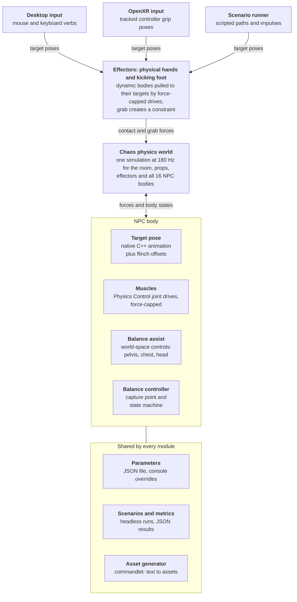
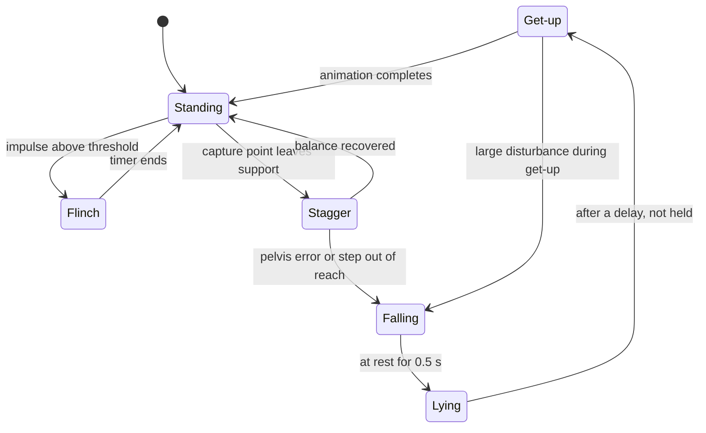

# Physics Sandbox PRD & Technical Plan

Nov 22, 2026 · @Sviat K

The prototype is feasible on Unreal Engine 5.8 with stock Chaos physics, provided three expectations are set now.

- **"Physically accurate" means physically plausible.** The body is a simulated ragdoll with real masses and joint limits that tracks animation through capped muscle drives. Staying upright needs a small non-physical assist, as it does in every shipped game of this kind. Biomechanical balance from first principles is a research problem and is out of scope.
- **Photoreal at 90 FPS in VR means baked lighting.** Lumen and Nanite in stereo remain experimental and unsupported by Epic. A static room loses nothing by baking, and the frame goes to the character.
- **AI-first means roughly nine-tenths CLI.** Building, asset generation, tuning and testing run headless. Account sign-ins, asset claiming, and judging feel in a headset stay with a person.

Three unknowns decide the schedule and are measured first: the MetaHuman's stereo rendering cost, Chaos joint stiffness under grab loads, and whether the physics asset and room can be generated from text.

## Key decisions

| Area | Choice | Why | Rejected |
| --- | --- | --- | --- |
| Engine | UE 5.8.4, Launcher build | Latest stable; Physics Control is production-ready in it; described as the last planned UE5 major | 5.9 Preview (lightly tested, final in 2027); source build (160 GB or more, not needed) |
| Physics | Chaos world simulation with `UPhysicsControlComponent` | Two-way collision with room, props and hands; Chaos Visual Debugger; Epic's maintained path | Rigid Body anim node (one-way world collision); Jolt, MuJoCo and Box3D plugins (a second physics world with no skeletal or VR story) |
| Body control | Joint drives, weak world-space assist, capture-point state machine | What shipped games converge on; buildable and tunable by a small team | Learned controllers (no training path inside UE, days of training); full procedural walking balance |
| Timing | Synchronous physics, fixed 90 Hz with 2 substeps | No interpolation latency between hands and picture | Async physics (kept as fallback) |
| Rendering | Deferred, baked lighting, TAA at 85% headset render scale; DLSS to be evaluated in M5 | Best fidelity per millisecond for a static room | Lumen in VR (desktop tier only); forward renderer (kept as fallback) |
| Character | MetaHuman, Optimized assembly, hair cards | Highest fidelity; scriptable assembly; free at this scale | Character Creator 5 (kept as fallback) |
| XR | Built-in OpenXR plugin, no vendor SDK | One code path for every PCVR headset | Meta XR plugin (not needed on PC); SteamVR plugin (removed from the engine) |
| Player contact | Force-capped dynamic effectors | Correct momentum transfer; same model in desktop, VR and tests | Kinematic hands (infinite mass) |
| Authoring | Text specs plus a generator commandlet; native animation instance | Agents edit text and regenerate; nothing depends on editor clicks | Blueprint and Animation Blueprint logic; third-party MCP servers |
| Testing | JSON scenarios, headless, fixed step, JSON metrics | Fast, repeatable, readable by agents | Functional tests placed in binary maps; Gauntlet (built for device farms) |

## Product requirements

The product is one room, one NPC and one player; it succeeds when the NPC's body reacts to contact the way a person's would, in both desktop and VR, and when an AI agent can prove that from the command line.

### Goals

- **Believable body.** Every reaction comes from simulation: contact forces, joint limits, muscle-like drives and balance. Canned hit animations are not the mechanism.
- **One simulation, two front ends.** Desktop and VR drive the same physical hands and the same NPC code. Only the source of the hand targets differs.
- **Agent-operable.** Build, asset generation, tuning, testing and packaging all run from CLI with machine-readable results.
- **Measurable.** Physical behaviour is covered by reproducible scenarios with numeric pass criteria, so tuning is a search rather than a judgement call.
- **Photoreal at 90 FPS.** High-fidelity character, materials and lighting inside an 11.1 ms stereo frame.

### Non-goals for the prototype

- Combat design, health, scoring, progression or NPC behaviour beyond standing, reacting, recovering and the actions of FR-19 to FR-21.
- NPC locomotion beyond balance-recovery steps and what FR-19 to FR-21 need (until 24 November 2026: balance-recovery steps only).
- Wounds, blood, dismemberment or bone breakage.
- Multiplayer, save games, menus beyond a debug panel.
- Standalone headset builds (Quest native) or consoles.

### Interaction verbs

| Verb | Desktop input | VR input | Expected physical outcome |
| --- | --- | --- | --- |
| Slap | Aim, tap light-strike key | Open hand swung into the body | Head or limb deflects, torso sways, NPC stays standing |
| Punch | Aim, click; hold to wind up | Fist swung into the body | Local recoil propagates to torso; stagger or step above a threshold |
| Kick | Aim, kick key | Scripted leg strike aimed by gaze or controller | Large impulse low on the body; leg buckles or NPC falls |
| Push | Hold push key with hand on body | Hands pressed against the body | Sustained force; lean, recovery step, then fall |
| Grab | Hold grab on a body part | Grip on a body part | Constraint at contact point; part follows hand up to a force cap |
| Drag | Move while grabbing | Move or pull while gripping | Body follows; standing NPC stumbles, fallen NPC slides with friction |
| Knock down | Any of the above at high energy | Same | Loss of balance, protective fall, rest, get-up |
| Hold an object | Hold grab on an object; the strike and push keys then use it; release to drop or throw | Grip on an object with one or two hands; release to drop or throw | The object follows the hand up to a force and torque cap; a strike, push or throw with it acts by its own mass and speed |

### Functional requirements

| ID | Requirement | Priority |
| --- | --- | --- |
| FR-1 | NPC stands under full simulation, tracking an idle animation, with no drift or jitter for 10 minutes | Must |
| FR-2 | Contact anywhere on the body produces a reaction scaled by impulse that propagates through the joints | Must |
| FR-3 | Balance: small pushes absorbed by sway, medium pushes by a recovery step, large pushes cause a fall | Must |
| FR-4 | Falls show protective reflexes (arms brace, head tucks), no self-penetration, and come to rest | Must |
| FR-5 | NPC gets up from prone, supine or side rest poses and returns to idle; a body that is hit, pushed or held while it gets up answers as at any other time (FR-18) | Must |
| FR-6 | Any body part can be grabbed with one or two hands, pulled, lifted within a force cap, and dragged | Must |
| FR-7 | NPC collides with walls, floor, furniture and loose props | Must |
| FR-8 | Desktop and VR share one pawn, one hand model and one NPC; the build runs flat with no headset attached | Must |
| FR-9 | Desktop test tools: free camera, pause, single-step, slow motion, NPC reset, calibrated impulse tool, drag handle | Must |
| FR-10 | VR: OpenXR tracked controllers drive physical hands; smooth locomotion and snap turn | Must |
| FR-11 | All physical parameters live in a text file, hot-reload at runtime and can be overridden from console or CLI | Must |
| FR-12 | Text-defined scenarios run headless from CLI and write JSON metrics plus an exit code | Must |
| FR-13 | Debug overlays: centre of mass, support polygon, joint drive targets, contacts, controller state | Must |
| FR-14 | Physics recording and screenshot or video capture can be triggered from CLI | Must |
| FR-15 | Impact audio and VR haptics scaled by impulse | Should |
| FR-16 | Soft-tissue secondary motion on face and torso under impact | Should |
| FR-17 | Skin flush at impact sites driven by a material mask | Could |
| FR-18 | The body can be interacted with at every moment and in every state, getting up included: it is always a simulated body that feels a hit, a push and a grab and answers them. No state makes it kinematic or deaf to contact (owner, 24 November 2026) | Must |
| FR-19 | The NPC gets up from the floor, walks to a chair around the furniture and sits down on it (owner, 24 November 2026) | Must |
| FR-20 | The NPC picks a fallen chair up, sets it on its legs and sits down on it (owner, 24 November 2026) | Must |
| FR-21 | An NPC that ends up under the table gets out: it crawls out or overturns the table (owner, 24 November 2026) | Must |
| FR-22 | The player takes a blunt object with one or two hands, holds it, strikes and pushes the NPC with it, throws it and puts it down (owner, 24 November 2026) | Must |
| FR-23 | Simple facial expressions by impulse and body state: eyes shut, pain, fright, calm, and blinking (owner, 24 November 2026) | Should |

### Non-functional requirements

| ID | Requirement | Target |
| --- | --- | --- |
| NFR-1 | PCVR frame rate on the reference machine (RTX 5080, Ryzen 7 9800X3D, 32 GB) | 90 FPS, 99th-percentile frame time at or under 11.1 ms, no reprojection during the standard interaction scenario |
| NFR-2 | Desktop frame rate at 2560×1440 | 120 FPS or better |
| NFR-3 | Reproducibility | Same build, machine and scenario give metrics within stated tolerances on every run |
| NFR-4 | Blueprint dependency | No gameplay logic in Blueprint; binary assets are imported or generated from text |
| NFR-5 | Setup | One script takes a clean clone to a running build |
| NFR-6 | Agent loop time | Incremental compile plus headless scenario suite under 5 minutes |

## Hardest problems

Balance that looks alive, and joints that stay rigid when the player hauls on them, are the two problems most likely to decide whether the prototype convinces. The list is ranked by risk to that outcome.

| # | Problem | Why it is hard | Approach | Fallback |
| --- | --- | --- | --- | --- |
| 1 | Stagger and balance without a marionette look | Enough assist to stand reads as strings; too little and the NPC topples at a touch | Three balance levels; assist confined to pelvis, chest and head; assist share tracked as a metric and driven down | Animated stumble steps with higher assist; accept earlier falls |
| 2 | Joint stability under grab and drag loads | Chaos joints soften and stretch under load at low step rates; a capped-force hand pulling 80 kg is the worst case | 180 Hz simulation, mass ratios under 10, capped drives, non-linear joint solver, stretch metric as a gate | Async physics at a higher rate; release the grab when stretch crosses a limit |
| 3 | Tuning a large parameter space | Strength and damping interact across joints and states; the Half Sword developers call this their hardest problem | One parameter file, per-state groups, automated sweeps against the scenario suite | Fewer joint groups; fixed ratios between stiffness and damping |
| 4 | Get-up from arbitrary poses | Limbs tangled, body against a wall or over furniture; a blend from any pose can pop or clip | Prone and supine animations selected by pelvis orientation; roll to a clear pose first; clearance check; ramped strength | Longer blend with stronger assist; nudge the body into open floor before rising |
| 5 | Photoreal character in stereo at 90 FPS | No published stereo cost for a MetaHuman; strand hair and the face rig are expensive | Measure at Milestone 1 before the room is built; hair cards, lower face LOD, DLSS | Forward renderer with MSAA; Character Creator 5 character |
| 6 | Binary assets from text | Physics assets, maps and animation logic are normally made in the editor | Generator commandlet in an editor module; native animation instance; each route proven at Milestone 0 or 1 | Epic's MCP physics-asset toolset; a few minutes of human editor work per asset |
| 7 | Fast strikes | A fist moving 8 m/s travels 4 cm per 180 Hz step and can tunnel or spike impulses | Continuous collision on hands, feet and head; swept query; impulse clamp | Thicker collision shapes on limbs |
| 8 | Repeatable tests on a solver without a determinism guarantee | Parallel solving can reorder work between runs | Fixed timestep, fixed spawn order, measured deviation at Milestone 0 | Tolerance bands and repeated runs |
| 9 | Stereo bugs in the 5.8 deferred path | Open reports of right-eye errors with instanced stereo | Avoid the affected features; validate on a headset at Milestone 1 | Forward renderer; UE 5.7.4 |
| 10 | Walking under full simulation (M4b) | Balance has to hold while the body moves, and a push on the way must be answered as it is from a stance | A recorded walk as the muscles' target, as in the get-up, with steps placed by the capture point; a stand of many walks | Slow single steps; a stronger assist while walking |
| 11 | Setting a fallen chair on its legs (M4b) | Bending over with a load, hands without fingers, a wrist whose model is weak, a chair that lies any way | The capped grab of M4 for the NPC's own hands; the simple ways it lies first; a bounded number of tries | Another chair, or stay standing |

## Architecture

The player side and the NPC side never call each other; they meet only as rigid bodies in the Chaos world. That keeps each module small and lets a test replace the player entirely.



*Architecture: desktop, VR and tests drive the same effectors in one physics world.*

Read top down: three interchangeable sources produce target poses, effectors turn them into forces, and the NPC body answers through the same solver.

### Modules

| Module | Kind | Responsibility |
| --- | --- | --- |
| `SandboxCore` | Runtime | Parameter store with JSON loading, hot reload, console and command-line overrides; metric types; logging |
| `SandboxBody` | Runtime | NPC actor, Physics Control setup, muscles, balance assist, balance controller, state machine, reactions, native animation instance |
| `SandboxInteraction` | Runtime | Effector component, grab constraints, strike verbs, target-source interface; player pawn with desktop and OpenXR sources, cameras, locomotion |
| `SandboxScenario` | Runtime | Scenario loader and runner, metrics recorder, the interactive session that puts character and player into one world, session recorder, debug overlays and console commands |
| `SandboxEditor` | Editor only | `GenerateAssets` commandlet: physics asset, room map, art import |

### Rules that keep it simple

- `SandboxBody` and `SandboxInteraction` do not depend on each other. The body learns about hits from its own contact events; a grab is a constraint on whatever body the hand touched. The two test tools that need the character itself, the calibrated impulse and the reset, are requests the pawn raises and `SandboxScenario` carries out.
- Both depend only on `SandboxCore`. `SandboxScenario` depends on all three and nothing depends on it.
- One interface carries the desktop and VR split: a target source returns a pose and a grip value per effector each tick.
- No Blueprint classes. Actors, components, input and the game mode are C++; the map contains only static geometry and lighting.
- Engine plugins used: Physics Control, OpenXR, DLSS. No third-party gameplay plugins.
- What decides what the NPC does (the actions of M4b; later a language model or a health system) only asks the body's controller and writes nothing to the body. In a scenario its answers are recorded ones, so that a run repeats (owner, 24 November 2026).

### Repository layout

```
Source/              C++ modules
Config/Tuning/       parameter JSON
Specs/               physics asset and room specs
Scenarios/           scenarios and metric baselines
Tools/               CLI scripts
Content/Imported/    art, tracked in Git LFS
Content/Generated/   generator output
```

## Active ragdoll design

The NPC is a fully simulated skeletal mesh in the Chaos world at all times. Joint drives make it track an animation pose, a weak world-space assist keeps it upright, and a small state machine changes drive strengths as balance is lost and regained.

### Control stack

1. **Target pose.** Idle, stumble, protective and get-up animations evaluated in native C++ produce the pose the body tries to reach.
2. **Muscles.** Parent-space spring-damper controls on every joint, created through `UPhysicsControlComponent`, pull each body toward the target pose. Each has a force cap.
3. **Balance assist.** World-space controls on pelvis, chest and head, plus foot-planting controls. This is the one non-physical force in the system and the main dial between "marionette" and "falls over".
4. **Balance controller.** Custom C++ computes centre of mass, its velocity, the support polygon from foot contacts and the capture point. It chooses sway, a recovery step or a fall.
5. **Reactions.** Impacts weaken muscles in the hit region for a fraction of a second and add a flinch offset to the target pose. Falling switches to a protective pose.

Physics Control is [marked production-ready in UE 5.8](https://dev.epicgames.com/documentation/en-us/unreal-engine/unreal-engine-5-8-release-notes?application_version=5.8) and its API is fully callable from C++. It only tracks poses; layers 4 and 5 and the state machine are ours to write. Epic's Game Animation Sample for 5.8 is reported to include a powered-ragdoll character built on the same component. It is the first reference to study, and M0 confirms what it contains.

All bodies stay dynamic in every state and the NPC has no character capsule. Epic staff report joint stretching when kinematic and simulated bodies are mixed on one mesh under async physics, which is our fallback timing mode. A single regime also keeps the states continuous.

### States



*NPC state machine: losing balance walks the NPC through six states and back to Standing.*

| State | Balance assist | Muscle strength | Target pose | Leaves when |
| --- | --- | --- | --- | --- |
| Standing | Normal; feet planted | High | Idle | Impulse above flinch threshold; capture point leaves the support polygon |
| Flinch | Normal | Hit region weakened for 0.2 to 0.5 s | Idle plus flinch offset | Timer ends |
| Stagger | Reduced | High in legs, normal elsewhere | Stumble step toward the capture point | Centre of mass back over support for 0.3 s; or pelvis error or capture point beyond step reach |
| Falling | Zero | Low stiffness, high damping | Protective: arms toward the fall, chin tucked | Body speed below threshold for 0.5 s |
| Lying | Zero | Very low | None | At rest, not held, after a delay |
| Get-up | Ramps from zero to normal | Ramps to high | Get-up animation matched to prone or supine | Animation completes; or a large disturbance returns it to Falling |

Being grabbed is not a state. A grab constraint is an external force like any other, and the balance controller responds to its effect.

As built in M2: Standing, Flinch, Falling and Lying exist; Stagger and Get-up are M3. Without the capture point, Standing and Flinch end in Falling when the pelvis leaves its place by more than a threshold (distance, height or tilt), and Lying is where the body stays. The values of every state and the thresholds between them are in `Config/Tuning/body.json`.

As built in M3 part 6: Get-up exists. A body that has lain still for a while takes the recorded get-up whose first pose lies most like it does and follows it under simulation, the recording waiting for the body; a large disturbance (the pelvis thrown 30 cm off the recording, the body lifted, or 3 s without progress) returns it to Falling, and it tries again.

As built in M3 part 3: the capture point decides. Inside the support, or outside by no more than the ankles and hips bring back, the body stands; further out it needs a step, and until Stagger exists (part 4) the assist holds it and the run says so; when the capture point would be beyond a step's reach by the time a step lands, the body falls at once. The pelvis's distance from its anchor no longer decides anything; a pelvis that sinks or tilts too far still ends standing as a lost posture.

Balance is built in three levels so each milestone has a working character. Level 0 is the assist alone. Level 1 adds capture-point fall detection and animated stumble steps. Level 2, a stretch goal, places the stepping foot procedurally.

### Physics asset

Sixteen bodies and fifteen joints: pelvis, two spine segments, head, and per side upper arm, forearm, hand, thigh, shank and foot. Capsules everywhere, boxes for feet and chest, no fingers, no convex hulls. Collision is off between adjacent bodies and on between arms and torso and between the legs.

As built in M2: shapes come from the stock MetaHuman asset except the feet, which are boxes written out in the spec with a flat sole on the floor (the chest is still capsules). Joints are the generator's own, built from an anatomical description in the spec (limb direction, bending axis, a range per axis), with the right side as the mirror image of the left; the stock asset's joint positions, axes and motors all break a fully simulated body. The format is in `Specs/README.md`.

Corrected in M3: until then the generated asset had no collision between any two of its bodies (see the M3 section). Now every pair collides except the jointed ones and four pairs whose shapes overlap in the reference pose, which the spec names: the two thighs, the pelvis and the chest, the lower spine and each thigh.

Masses follow de Leva's 1996 segment fractions, here for an 80 kg male. Every parent-to-child mass ratio stays under 10, which the joint solver needs.

| Body | Share of body mass (%) | Mass (kg) |
| --- | --- | --- |
| Pelvis | 11.17 | 8.9 |
| Lower spine | 16.33 | 13.1 |
| Chest | 15.96 | 12.8 |
| Head and neck | 6.94 | 5.6 |
| Upper arm, each | 2.71 | 2.2 |
| Forearm, each | 1.62 | 1.3 |
| Hand, each | 0.61 | 0.5 |
| Thigh, each | 14.16 | 11.3 |
| Shank, each | 4.33 | 3.5 |
| Foot, each | 1.37 | 1.1 |

Leg values were checked against [a paper reproducing de Leva's table](https://pmc.ncbi.nlm.nih.gov/articles/PMC9602786/table/healthcare-10-02054-t005). Trunk, head and arm values were not confirmed against the original and need a check before they are locked.

Joint limits start about 10% inside clinical range of motion ([WikEM table](<https://wikem.org/wiki/Joint_ROM_(Table)>)). Knees and elbows are hinges. As built in M2 the table is in force, except the shoulder, which the engine's single limit cone can only approximate, and the knee, which has 2 degrees of slack past straight; the choices made where the table leaves room are listed in `Specs/README.md`.

| Joint | Starting limits (degrees) |
| --- | --- |
| Knee | Flexion 0 to 150 |
| Elbow | Flexion 0 to 140 |
| Hip | Flexion 100, extension 30, abduction 40, adduction 20, rotation 40 in and 50 out |
| Shoulder | Flexion 180, extension 50, abduction 180, rotation 90 each way |
| Ankle | Plantar flexion 20, dorsiflexion 30 |
| Neck | Flexion 60, extension 75, lateral 45, rotation 80 |
| Spine, total | Flexion 45, extension 25, lateral 25, rotation 30 |
| Wrist | Flexion 60, extension 60 |

### Solver and timing

- **Synchronous physics, fixed 90 Hz step, two substeps.** The simulation runs at 180 Hz with no interpolation latency between hands and render. Async physics adds about two fixed steps of delay and leaves game-thread control targets stale.
- **Fixed engine timestep in tests.** Headless runs force a constant frame delta so results do not depend on wall-clock time.
- **Joint solver.** The default linear solver, with 64 position iterations on the NPC's own bodies (decided in M2: at the engine default of 8 a standing body does not converge and its feet creep; the cost is 0.40 ms per frame against 0.26). Switch the NPC's joints to the non-linear solver (a per-joint setting of the physics asset) if limbs stretch under load; Epic documents it as more stable and more expensive.
- **Stability rules.** Soft limits, capped drive forces, projection off for bodies in contact, inertia conditioning on, continuous collision only on hands, feet and head.
- **Fallback.** If frame drops destabilise the body, move to async physics at 180 Hz and run control logic in simulation callbacks.

### Tunable parameters

Every number above is a parameter in one text file, grouped as follows.

| Group | Parameters |
| --- | --- |
| Muscles | Stiffness in N·m/rad, damping time and torque cap per joint group (spine, neck, arms, legs), per state |
| Balance assist | Horizontal and vertical stiffness in N/m, angular stiffness in N·m/rad and damping time for pelvis, chest, head and feet, per state |
| Thresholds | Flinch impulse, stagger and fall conditions, rest speed and time |
| Reactions | Weakening factor, spread to neighbouring chains, recovery time |
| Get-up | Delay, ramp duration, pose-match tolerance |
| Body | Total mass, segment fractions, joint limits, friction, restitution |
| Solver | Substeps, iteration counts, joint solver type |
| Effectors | Mass, spring, damper, force cap, strike speeds, grab break force |

As built in M2: the files are the JSON files of `Config/Tuning`: `body.json` (the muscles, the balance assist, the solver counts, thresholds, reactions and the names of the bones the assist holds), `effectors.json` (the player's hands) and `tools.json` (the desktop tools). A value's name is its path in the file, `muscles.legs.stiffness_nm_per_rad`, and the same name is used in overrides and in result files. Per-state values go under a `states` section (`states.falling.muscles.legs.stiffness_nm_per_rad`) and replace the base value while the body is in that state. The code holds no defaults: a missing value or an unknown name is an error. `Config/Tuning/README.md` is the reference.

## Interaction: one effector model for desktop and VR

The player touches the NPC only through effectors: dynamic rigid bodies pulled toward a target pose by a force-capped spring. Desktop, VR and automated tests differ only in where the target pose comes from.

### The effector

- Each hand, and one foot for kicks, is a dynamic body with real mass. A kinematic hand behaves as infinite mass and launches whatever it touches, so it is ruled out.
- A spring-damper drive pulls the body to its target. The force cap is the player's strength; spring and damper set responsiveness.
- The visible hand follows the physics body, not the controller. The gap between them is what conveys weight and resistance.
- Grab creates a constraint between the effector and the touched NPC body at the contact point. Two hands create two constraints. The force cap is what makes an 80 kg body heavy to lift and drag.
- Fast strikes use continuous collision detection plus a swept query, so a fist cannot tunnel through a forearm between steps.

### Target sources

| Source | Mode | How the target pose is produced |
| --- | --- | --- |
| OpenXR grip poses | VR | Tracked controller pose each frame |
| Virtual hands | Desktop | Hands rest in front of the camera; the aim ray picks a reach point; each verb plays a parametric trajectory toward it (wind-up, peak speed, follow-through) |
| Scenario script | Headless tests | Trajectories read from the scenario file, or calibrated impulses applied directly to a named body |

VR has no foot tracking, so the kick is a scripted leg effector in both modes, aimed by gaze or controller direction. Strike speeds are parameters; starting values are 6 m/s for a slap, 8 m/s for a punch and 10 m/s for a kick, to be tuned.

As built in M2: two hand effectors, each a 1.5 kg sphere on a spring with a 300 N cap, and two of the three sources. The desktop source holds the hands below the line of sight and sends one straight ahead while its mouse button is held; the scripted source plays the keys of a scenario's `effector` events, which is how the strike scenarios deliver a slap at 6 m/s and a punch at 8 m/s. Continuous collision detection is on for the hands and they do not tunnel up to 28 m/s; the swept query is the test's own measurement of that, not part of the hand. Strike verbs, the kick and grabbing are M4. The values are in `Config/Tuning/effectors.json`.

As built in M4 part 1: a recorded source (a session's hands replayed frame for frame) and the tracked source for a headset. `FSandboxTrackedTargetSource` takes each controller's grip pose, with the linear and angular velocity the runtime tracks, from tracking space into the world through the pawn, which in a headset is the origin of the play space on the floor; the hand's body sits at a tunable offset from the grip pose and gets the velocity the controller's turning gives it there; the grip is the squeeze axis. It asks one interface where a controller is (`ISandboxControllerTracker`), which `FSandboxXRControllers` answers from the engine's XR system and a unit test answers with made-up poses. Not yet run in a headset: that is step 4 of part 1.

### Desktop test conveniences

- **Impulse tool.** Click a body to apply a chosen impulse in N·s along the aim ray. It bypasses the hands, so results are calibrated and repeatable.
- **Drag handle.** A spring from the cursor to the clicked body, for pulling limbs and posing the NPC.
- **Time control.** Pause, single-step, slow motion.
- **Reset.** Return the NPC to standing at the spawn point, or to any saved pose.
- **Record and replay.** A live session's effector targets can be saved as a scenario file. A bug found by hand becomes a regression test.
- **Cameras.** First-person, free-fly and orbit around the NPC.

As built in M2: the impulse tool, the drag handle, pause, single step, slow motion, reset to the spawn pose and a free-fly camera that can leave the hands behind, in `Tools\play.ps1`. Slow motion and single step leave frames out and never shorten the physics step. Saved poses and the orbit camera are not built yet. Record and replay of the hands is built since M4 part 1 (`Tools\play.ps1 -Record`, the K key, a scenario's `"recording"`); the session's other tools are not recorded yet.

### VR specifics

- Haptic amplitude follows contact impulse. There is no hit-stop; freezing the view in VR is uncomfortable.
- The player body is a capsule with smooth stick locomotion and snap turn. It pushes the NPC with a capped force instead of passing through.
- Hand tracking without controllers is out of scope for the prototype.

## Rendering and performance

Bake the room's lighting and spend the frame on the character: deferred renderer, baked global illumination, one shadowed movable light on the NPC, and DLSS. Lumen stays a desktop-only quality tier.

### Renderer options

| Option | Status in VR | Role |
| --- | --- | --- |
| Deferred + baked GI + reflection captures + DLSS/DLAA | Supported path; zero runtime GI cost; full skin, eye and decal shading | Baseline for VR and desktop |
| Forward + MSAA + baked GI | VR Template default and the cheapest; loses screen-space reflections, contact shadows and Nanite | Tested fallback if deferred stereo bugs block us |
| Deferred + Lumen + Nanite | Epic documents it as [experimental and not officially supported in XR](https://dev.epicgames.com/documentation/en-us/unreal-engine/nanite-and-lumen-for-xr-in-unreal-engine); community reports range from 40 to 90 FPS on older engines and cards, none on this hardware | Desktop-only scalability tier |

A static room gains nothing from dynamic GI that a bake does not give at higher quality. The only dynamic object that matters is the NPC, lit by a Volumetric Lightmap plus one movable shadow-casting key light.

### Configuration

- DX12, deferred shading, instanced stereo, built-in OpenXR plugin.
- NVIDIA DLSS plugin 8.7.2, which [supports UE 5.5 to 5.8](https://forums.developer.nvidia.com/t/nvidia-dlss-unreal-engine-plugin-archive/377564). DLAA where headroom allows, DLSS Quality otherwise.
- Lighting baked with CPU Lightmass by default. [GPU Lightmass is still Beta](https://dev.epicgames.com/documentation/unreal-engine/gpu-lightmass-global-illumination-in-unreal-engine) with crash reports on 5.6 to 5.8, so it is used only if it proves stable.
- Kept off in VR because of open stereo bugs or unsupported combinations in 5.8.x: MegaLights, volumetric fog, TSR below 100% screen percentage, DLSS Frame Generation, and VRS foveation ([not compatible with DLSS](https://dev.epicgames.com/documentation/en-us/unreal-engine/xr-performance-features-in-unreal-engine)).
- Runtime reprojection (ASW, SteamVR motion smoothing) is a safety net, not a design target. It smears fast hand motion, which is the core of this product.

### Character

- **Source: MetaHuman, UE Optimized assembly.** Free under the UE EULA below $1M revenue, and Creator has a [Python API for create, assemble and export](https://dev.epicgames.com/documentation/metahuman/metahuman-creator-python-scripting-in-unreal-engine). Auto-rig and texture download need one interactive Epic sign-in.
- **VR settings:** hair cards instead of strands, face LOD 1 or 2. Strand hair in stereo is assumed unaffordable until measured.
- **Physics asset:** built on primary bones only. Twist and corrective joints stay animation-driven; adding or renaming joints breaks Creator compatibility.
- **Alternative: Character Creator 5.** Freer skeleton and mesh editing and a simpler custom physics asset, at about $299 and with a weaker face rig. It is the fallback if the MetaHuman skeleton fights the physics asset.
- **Soft tissue:** spring-driven jiggle bones on cheeks and torso, impact-triggered morph targets, and a material mask for skin flush. Each is sub-millisecond. Chaos Flesh and ML Deformer are out of scope for the prototype.

### Room

- One interior of about 5 m by 4 m, static shell and furniture, plus 5 to 10 simulated props (chair, table, bottles).
- [Megascans is free on Fab again](https://80.lv/articles/entire-quixel-megascans-library-now-available-for-free/) as of November 2026. Fab has no public API, so a human claims the chosen assets once.
- Scriptable CC0 sources fill the rest: the [Poly Haven API](https://github.com/Poly-Haven/Public-API) and [ambientCG API](https://docs.ambientcg.com/api/v3/).

### Frame budget

These are planning estimates, not measurements. Milestone 1 replaces them with numbers from the reference machine.

| Thread | Budget | Main items |
| --- | --- | --- |
| Game | 4 ms | Physics 1 to 1.5 ms; animation and face rig 1 to 2 ms |
| Render | 4 ms | Draw submission for two eyes |
| GPU | 8.5 to 9 ms | Base pass and shadows about 3; character about 2; lighting and reflections about 1; post and DLSS about 2 |

The remaining 2 ms of GPU time is headroom for the compositor and, on Quest over Link, video encoding. Quest 3 stereo is about 9 megapixels at 90 Hz, close to the pixel rate of 4K at 100 FPS.

## AI-agent development workflow

Agents work through a small set of CLI scripts that build, generate assets, run headless scenarios and return JSON. Text files are the source of truth, binary assets are build outputs, and a human is needed only for a short list of mostly one-time steps.

### Text as the source of truth

| What | Authored as | Becomes engine data by |
| --- | --- | --- |
| Gameplay, physics control, tools | C++ in `Source/` | `Build.bat` |
| Physical parameters | JSON in `Config/Tuning/` | Loaded at runtime, hot-reloaded, overridable from the console (`Sandbox.Tune`) and the command line (`-Tune`) |
| Physics asset: bodies, shapes, masses, limits | JSON spec | Editor-module commandlet using `FPhysicsAssetUtils` and constraint templates |
| Room layout and lighting | JSON spec | Commandlet builds the map; lighting bake commandlet |
| Animation logic | Native `UAnimInstance` with a custom proxy | Compiled; no Animation Blueprint |
| Input mappings | C++ creating input actions at startup | Compiled; no input assets |
| Test scenarios | JSON in `Scenarios/` | Read by the scenario runner |
| Imported art: meshes, textures, animations, MetaHuman | Source files in Git LFS | Import script through editor Python |

Animation Blueprint graphs are the one asset type with no scripting route: [Python can create the asset but cannot populate its graph](https://forums.unrealengine.com/t/creating-animation-blueprints-control-rigs-using-python-scripting/136188). The native animation instance removes the need.

### Command set

Each script wraps one engine command, prints machine-readable output and returns a meaningful exit code.

| Script | Wraps | Returns |
| --- | --- | --- |
| `build` | `Build.bat <Project>Editor Win64 Development -WaitMutex` | Compiler errors in `file(line): error` form |
| `gen-assets` | `UnrealEditor-Cmd.exe -run=GenerateAssets` | `Content/Generated/` plus a result JSON |
| `test` | `-ExecCmds="Automation RunTest <filter>;Quit" -nullrhi -unattended` | Test report JSON |
| `scenario` | `-game -nullrhi` with a fixed timestep and a scenario file | Metrics JSON, pass or fail |
| `sweep` | Several `scenario` processes in parallel with parameter overrides | One results table |
| `shot` | `-game -RenderOffscreen` with timed screenshots | PNG files the agent reads |
| `perf` | `-game -emulatestereo -csvprofile` | Frame-time percentiles |
| `package` | `RunUAT.bat BuildCookRun` | Packaged Win64 build |

### The loop

1. Edit C++, a parameter file or a spec.
2. Run `build` if code changed; fix errors until it is clean.
3. Run `gen-assets` if a spec changed.
4. Run the scenario suite headless.
5. Compare metrics with the thresholds and with the committed baseline.
6. For visual questions, run `shot` and inspect the images.
7. Commit when green, with updated baselines.

### Guardrails for agents

- A `CLAUDE.md` and `AGENTS.md` at the repo root hold the commands, the module map and the rules. `Intermediate/`, `Binaries/` and `Saved/` are excluded from context.
- No Live Coding. It [cannot add new reflected functions](https://dev.epicgames.com/documentation/unreal-engine/unreal-mcp-in-unreal-editor?application_version=5.8); the agent closes the editor, builds, and relaunches.
- Every script writes a result file. Editor Python can exit with success after an error, so exit codes alone are not trusted.
- A task is done when its scenarios pass, not when the agent says so.
- Epic's official MCP server is Experimental in 5.8. It is used for inspection when convenient and nothing depends on it. Third-party MCP servers are not used.

### Toolchain

- **Engine:** UE 5.8.4 installed through the Epic Games Launcher, about 60 GB. A source build needs 160 GB or more and is not required.
- **Compiler:** Visual Studio 2026 is already on this machine and is [Epic's recommended version for 5.8](https://dev.epicgames.com/documentation/unreal-engine/setting-up-visual-studio-development-environment-for-cplusplus-projects-in-unreal-engine). The MSVC 14.50 toolset must be added and pinned: the default 14.51 toolset [breaks 5.8 source builds](https://forums.unrealengine.com/t/ue-5-8-fails-to-compile-with-visual-studio-2026-hash-map-missing-source-fix/2732357).
- **Other:** Windows SDK 10.0.22621, the version the installed engine's `Windows_SDK.json` prefers (newer SDKs are accepted); the engine bundles its own .NET.
- **Version control:** Git with LFS for `.uasset`, `.umap` and source art. `Content/Generated/` is ignored if regeneration proves fast and deterministic.

### What still needs a human

| Step | How often |
| --- | --- |
| Epic account sign-in, EULA and engine install in the Launcher | Once |
| Administrator approval for Visual Studio components | Once |
| MetaHuman cloud sign-in for auto-rig and texture download | Once per character |
| Claiming Megascans and other Fab assets | Once per asset set |
| Meta XR Simulator install and sign-in | Once |
| Headset sessions to judge feel, weight and comfort | Every milestone gate |
| Sign-off on visual quality and on whether motion looks natural | Every milestone gate |

## Physics testing and diagnostics

Every physical behaviour has a scenario: a JSON file that places the NPC, applies scripted stimuli at fixed times, simulates at a fixed step with no rendering, and writes metrics. Tuning then becomes a measured search an agent can run unattended.

### Scenario format

```json
{
  "name": "push_chest_front_80",
  "duration_s": 6.0,
  "npc": { "pose": "standing" },
  "events": [
    { "t": 1.0, "type": "impulse", "body": "chest",
      "impulse_ns": 80, "direction": [1, 0, 0] }
  ],
  "expect": {
    "end_state": "Standing",
    "fell": false,
    "max_joint_stretch_cm": 2.0
  }
}
```

Event types are a direct impulse on a named body, an effector trajectory (strike or push), a grab with a hand path, and a parameter override. Recorded live sessions replay through the same format.

As built so far: `impulse` (a single blow, or a push when it has a duration), `effector` (a trajectory of one of the player's hands: keys with a time and a place, straight lines between them), `pin`, `console` (any console command at a simulated time; a parameter override is `Sandbox.Tune ...`) and `edit_tuning_file` (an edit of the run's own copy of the tuning files, to test hot reload). Expectations include the end state and the whole state sequence. The format in force is in `Scenarios/README.md`.

### Standard suite

Thresholds are starting targets to be tightened as tuning matures.

| Family | Stimulus | Passes when |
| --- | --- | --- |
| Stand | No input for 10 simulated minutes | Pelvis drift under 5 cm, no state change, no visible jitter at rest |
| Push matrix | Impulses of 10, 30, 80 and 200 N·s at head, chest and thigh from 8 directions | Outcome class (stand, step, fall) matches the table; left and right results are symmetric |
| Strikes | Slap, punch and kick trajectories at head, torso and leg | No tunnelling; peak joint angular velocity under 30 rad/s; target region visibly displaced |
| Grab and drag | Lift an arm; pull a standing NPC; drag a fallen NPC 2 m with one and two hands | Joint stretch under 3 cm; hand force stays at its cap; no blow-up |
| Fall and rest | Knockdowns from 8 directions | Comes to rest within 3 s; kinetic energy never rises without input; penetration under 2 cm |
| Get-up | 50 randomised falls, including against a wall and furniture | Returns to Standing in 90% of runs at Milestone 3, 95% at Milestone 5 |
| Soak | 10 minutes of random stimuli | No NaN, no body outside the room, no stretch above threshold |
| Repeatability | Any scenario run twice | Identical trajectory hash, or deviation inside a stated tolerance |
| Performance | Scripted interaction with stereo rendering | 99th-percentile frame time at or under 11.1 ms; physics step time within budget |

For scale, an 80 kg person walking at 1.25 m/s carries 100 N·s of momentum, and a 200 N·s impulse changes the body's speed by 2.5 m/s.

### Metrics recorded on every run

- State timeline, time upright, fall time and direction.
- Centre-of-mass path and the capture-point margin to the support polygon.
- **Assist share:** the fraction of supporting force that comes from the world-space assist. It is the numeric proxy for the marionette look and should fall as balance improves.
- Peak joint angular velocity, maximum joint stretch, joint-limit violation.
- Maximum penetration depth and tunnelling count.
- Kinetic-energy trace and time to rest.
- Physics step time, average and worst.
- A hash of all body transforms at fixed checkpoints.

As built in M2: the state timeline, the fall, centre-of-mass drift, the assist load, peak joint angular velocity, joint stretch, joint-limit violation, physics step time and the hashes are recorded on every run; penetration depth and the tunnelling count are measured for the player's hands (by the runner, with scene queries after every frame); the capture-point margin, the kinetic-energy trace and penetration between the character and the world come with M3.

As built in M3 part 1: the capture-point margin and the centre of mass's margin, the floor's push on the feet, kinetic and gravitational energy with the largest gain no input explains, the time from the start of a fall to rest and the fall's direction, and penetration of the body into the world and into itself are recorded on every run with a simulated body, per frame in `series.csv`. The assist share is still the M2 estimate (commanded force over body weight).

### Diagnostic tools

| Tool | Triggered by | Used for |
| --- | --- | --- |
| Chaos Visual Debugger | [`p.Chaos.StartVDRecording` and `p.Chaos.StopVDRecording`](https://dev.epicgames.com/documentation/en-us/unreal-engine/recording-to-file?application_version=5.8) | Frame-by-frame replay of particles, contacts and joints; a human opens the recording in the editor |
| Engine debug draw | `p.Chaos.DebugDraw.Enabled 1`, `p.Chaos.Solver.DebugDrawJoints` | Joint frames, shapes and sleep state in the live view |
| Project overlay | Console command | Centre of mass, support polygon, capture point, state, drive targets against actual pose |
| Offscreen screenshots | `shot` script | Images an agent can inspect at marked moments of a scenario |
| CSV profiler and Unreal Insights | `-csvprofile`, `-trace=cpu,gpu,frame` | Frame-time breakdown per thread |
| Meta XR Simulator | [`metavr` CLI](https://developers.meta.com/horizon/documentation/unreal/xrsim-getting-started/) | Smoke test of the OpenXR path with no headset |

As built in M2: the project overlay is `Sandbox.Overlay all|off|toggle|<layers>` with the layers `com`, `support`, `joints`, `assist`, `contacts`, `state` and `hands`, and since M3 part 1 `capture` (the capture point against the support polygon); screenshots are `Tools\scenario.ps1 -Shot`, with `-ShotAt` for moments of the run and `-Overlay` to draw the overlay into them. The layers are described in `Scenarios/README.md`.

### Parameter sweeps

`sweep` launches several headless runs in parallel, each with a parameter override file, and gathers their metrics into one table. An agent uses it for coordinate searches over muscle strength, damping and assist, and keeps the best set as the new baseline.

As built in M3 part 1: `Tools\sweep.ps1` runs chosen scenarios over every combination of the values given for some tuning names, or over one value at a time, eight runs side by side, and writes one table of chosen metrics (`Saved\Sweeps\<name>\sweep.csv`). The values go to each run as command-line overrides, not as files. `Tools\baseline.ps1` keeps the results of a suite run and names the scenarios that differ from it later.

### Limits of automation

- **Determinism is not guaranteed.** Epic documents none for Chaos, and solver parallelism grew in 5.6 to 5.8. Milestone 0 measures run-to-run deviation; if runs are not identical, tests use tolerance bands and repeated runs.
- **Headless animation needs forcing.** With no renderer nothing counts as recently rendered, so the NPC mesh is set to always tick its pose. One comparison against an offscreen-rendered run confirms the two agree.
- **Metrics catch instability, not charm.** Whether motion looks natural is judged by a human from rendered clips at each gate.

## Milestones and acceptance criteria

Seven milestones, each closed by a gate an agent can check from CLI and, from M1 on, a short human review in the headset. The first two exist to retire the three unknowns before the expensive work begins.

```mermaid
flowchart LR
    M0["<b>M0 Toolchain and agent loop</b><br/>Engine, project skeleton, CLI scripts,<br/>passive ragdoll test<br/><i>Gate: clean clone to green tests<br/>with one script</i>"]
    M1["<b>M1 Feasibility spikes</b><br/>MetaHuman, generated physics asset,<br/>baked room, stereo cost<br/><i>Gate: stereo frame within budget;<br/>assets built from text</i>"]
    M2["<b>M2 Active ragdoll core</b><br/>Muscles, assist, flinch, fall,<br/>desktop effectors, overlays<br/><i>Gate: stands 10 min; push matrix passes;<br/>no joint stretch</i>"]
    M3["<b>M3 Balance and recovery</b><br/>Capture point, stumble steps,<br/>protective fall, get-up<br/><i>Gate: get-up succeeds in 90%<br/>of 50 random falls</i>"]
    M4["<b>M4 Full interaction and VR</b><br/>All verbs, two-hand grab, VR hands,<br/>haptics, replay<br/><i>Gate: verb scenarios pass;<br/>headset review signed off</i>"]
    M4b["<b>M4b The NPC's own actions</b><br/>Walk, sit, pick a chair up,<br/>get out from under the table<br/><i>Gate: 80% of 50 random falls<br/>end seated (proposed)</i>"]
    M5["<b>M5 Photoreal at 90 FPS</b><br/>Final room and bake, soft tissue,<br/>audio, packaging<br/><i>Gate: 90 FPS at p99 on headset;<br/>10 min soak clean</i>"]
    M0 --> M1 --> M2 --> M3 --> M4 --> M4b --> M5
    style M1 stroke-width:3px
```



*Roadmap: feasibility is settled at M1, before the ragdoll work starts.*

For the milestones without M4b, a rough estimate is 13 to 16 weeks with agents implementing and one person reviewing at gates. M3 carries the most uncertainty.

### M0: Toolchain and agent loop (about 1 week)

Install UE 5.8.4 and the MSVC 14.50 toolset. Create the C++ project with its five modules, the CLI scripts and `CLAUDE.md`. Drop the stock mannequin as a passive ragdoll through scenario runner v0.

- [x] One script takes a clean clone to a passing test run
- [x] A drop-test scenario runs headless at a fixed step and writes metrics JSON
- [x] Run-to-run deviation is measured and the tolerance policy is written down
- [x] Headless and offscreen-rendered runs give matching bone transforms
- [x] An agent completes an edit, build and test cycle without the editor GUI

**M0 completed on 22 November 2026.** A clean-state bootstrap takes 98 s. Three headless runs and one rendered run of each scenario gave identical per-frame hashes. A headless scenario simulates about 10 times faster than real time. Details are in `docs/testing.md`. One deviation from the plan: the passive ragdoll is the stock UE5 mannequin copied from the engine's templates, because the engine's tutorial character explodes when fully simulated.

### M1: Feasibility spikes (about 2 weeks)

Assemble and import the MetaHuman. Generate the physics asset from its JSON spec. Generate and bake a graybox room from CLI. Launch through OpenXR and measure stereo cost. Hang the ragdoll from one hand constraint to stress the joints.

- [x] Character in the baked test room renders in stereo within 9 ms of GPU time at headset resolution
- [x] Regenerated physics asset matches the spec's body count, masses and limits, checked by a test
- [x] The lighting bake completes from the command line
- [x] The same build launches in VR with `-vr` and flat with `-nohmd`
- [x] Joint stretch under an 80 kg hanging load stays under 3 cm
- [x] Renderer path, character source and solver settings are confirmed or switched to their fallbacks

**M1 completed on 22 November 2026.** The MetaHuman is created by script; the physics asset (16 bodies, 80 kg) and the test room are generated from JSON specs; lighting bakes from the command line; hanging the body from one hand stretches no joint by more than 0.49 cm. In the PlayStation VR2 the test scene takes 7.1 ms of GPU time (7.8 ms at the 99th percentile) at 90 FPS with TAA and an 85% render scale; at SteamVR's full target it takes 10.6 ms. The owner confirmed the choices: deferred renderer with baked lighting and TAA, MetaHuman, synchronous physics at 90 Hz with two substeps. DLSS evaluation is deferred to M5. Deviations: collision shapes and joint frames come from the stock MetaHuman asset as a template, joint limits are still the stock values, and flat launches switch the OpenXR plugin off because `-nohmd` alone costs 26 s at start-up. Measurements are in `docs/testing.md`. Two defects of that template were found and fixed in M2, and the hanging-load figure changed with them; see the M2 section.

### M2: Active ragdoll core (about 3 weeks)

Muscles, balance assist at level 0, and the Standing, Flinch, Falling and Lying states. Parameter file with hot reload. Desktop pawn with effectors, impulse tool, drag handle and overlays.

- [x] Stand scenario passes: 10 minutes, drift under 5 cm
- [x] Push matrix: 10 N·s never causes a fall, 200 N·s always does, left and right agree
- [x] Strike scenarios show no tunnelling and no joint above 30 rad/s
- [x] No scenario shows joint stretch above 2 cm
- [x] A parameter edit takes effect in a running session
- [x] Physics step averages 1.5 ms or less

**All five steps of M2 are built and all six criteria are met. The owner's own review (the desktop session by hand and three smaller items) was deferred by the owner on 23 November 2026 and does not hold up M3; the list is at the end of this section. Step 1, "the character stands", was finished on 22 November 2026.** The NPC stands under full simulation for 10 simulated minutes: pelvis drift 0.76 cm, joint stretch under 0.01 cm, solver time 0.39 ms per frame, identical results in repeated headless and rendered runs. The target pose is the reference pose (an A-pose); there is no idle animation yet. Measurements are in `docs/testing.md`.

Decisions taken in step 1:

- **Muscles are force-mode springs in physical units** (N·m/rad), not Physics Control's default acceleration mode. That mode scales each drive by the inertia of the two jointed bodies alone, which leaves the load-bearing joints far too weak. Starting values: legs 800, spine 600, arms 150, neck 80 N·m/rad.
- **Balance level 0 turned out lighter than planned.** With muscles of that strength the legs carry the body; the assist's commanded force is 4.6% of body weight and its main job is to stop the feet creeping across the floor. These figures are the baseline for the M3 assist-share criterion.
- **64 solver position iterations on the NPC's bodies** (see Solver and timing).
- **Feet are flat boxes** written out in the physics asset spec.
- **Tuning values have names** (`muscles.legs.stiffness_nm_per_rad`, `assist.pelvis.horizontal_n_per_m`, `solver.position_iterations`) and can be overridden per run from the command line. The parameter file and hot reload came in step 2, below.

Corrections to M1 found in step 1. The stock MetaHuman physics asset, used as the template, has joint anchors 1.5 to 3.6 cm apart on all 15 joints (M1 recorded only the largest) and an orientation motor on every joint. A falling body hid both; a standing one could not start without its skeleton shortening by 12 cm and its elbows and knees flexing. The generator now fixes both. Without the motors the passive body is looser: joint stretch under the hanging load is 1.52 cm, not the 0.49 cm recorded at M1 (the limit of 3 cm is still met).

Not done yet in step 1, against the plan: muscle torque caps exist as parameters but are left at "no cap" until the fall states need them; joint limits are still the stock symmetric values, and the stock joint axes differ between the left and right side, which the push matrix's left-right criterion will need fixed first.

**Step 2 of 5, "the parameter file", was finished on 22 November 2026.** Every tuning value of the body is read from `Config/Tuning/body.json`; the code has no defaults left. A running session takes over an edited file within 30 frames and an override from the console or the command line on the next tick. Three scenarios prove it headless: muscles switched off from the console in the middle of a run (`tune_live_override`), the same through an edit of the file (`tune_live_file`), and a change of the solver counts (`tune_live_solver`). The stand scenarios give the same hashes as before the change, to the bit. Measurements are in `docs/testing.md`.

Decisions taken in step 2:

- **The store is generic and lives in `SandboxCore`; modules declare what they understand.** `FSandboxParamStore` knows files, names, overrides and revisions, not bodies. `SandboxBody` declares its names, its states and its range checks to it, and the store refuses any file or override that fails them. Every change is applied as a whole or not at all; a bad edit leaves the previous values in force.
- **Hot reload is a poll, not a file-system watcher.** Every 30 frames the store compares the files' size and modification time with what it loaded. It counts frames and never reads the clock, so a run whose files do not change is not affected. In a scenario the runner polls on fixed frames of the run.
- **Overrides are console commands, not one console variable per value.** `Sandbox.Tune name=value,...`, `Sandbox.TuneReset`, `Sandbox.TuneList`, `Sandbox.TuneReload`; on the command line `-Tune=` and `-TuningDir=`. Overrides lie on top of the files and survive a reload.
- **Per-state values are part of the format now,** ahead of the states themselves: the store resolves `states.<state>.<name>` over `<name>`, and the body's checks cover every state that sets a value. The body reads only the base values until step 3.
- **The rig's bone names moved to the file too.** They are read when the body starts and cannot change in a running body.
- **Falling has a metric:** the pelvis below half its starting height. Scenarios can expect `fell`, a minimum fall time and an exact number of tuning changes.

Found in step 2: Chaos does not apply new per-body solver iteration counts to a body whose simulation island is not changing, so the first live change of `solver.position_iterations` was accepted and did nothing. The controller now adds a constraint that restricts nothing for one frame, which makes the island take the new counts.

Not done in step 2: the torque caps are still at "no cap" and the N·m/rad conversion is still uncalibrated, as after step 1; there is no `sweep` script yet (`-Tune` and `-TuningDir` are what it will be built on); the tuning directory is not yet staged for a packaged build, which M5 needs.

**Step 3 of 5, "states and the push matrix", was finished on 22 November 2026.** The body has the states Standing, Flinch, Falling and Lying, joint limits that follow the table above and are mirror images left and right, and it passes the push matrix: 128 pushes (10, 30, 80 and 200 N·s on head, chest and both thighs from 8 directions), of which no 10 N·s push causes a fall, every 200 N·s push does, and every mirror-image pair ends the same way. The largest joint stretch in the matrix is 0.31 cm. Measurements are in `docs/testing.md`.

Decisions taken in step 3:

- **Joints are described by anatomy, not copied from the stock asset.** The spec gives each joint the direction of its limb, the axis it bends about and a range per axis that need not be symmetric (a knee bends one way only); the generator builds the engine's frames from that. The right side is generated as the mirror image of the left, so the two cannot differ. The stock asset's own axes were not mirror images, and the reference pose sat off-centre in its limits.
- **A fall is decided by the pelvis.** Balance level 0 cannot win balance back, so the body is let go once its pelvis is more than 15 cm from where it stands (about the edge of the feet's support), 20 cm below its standing height, or tilted by more than 35 degrees. All three are tuning values. The capture point replaces this in M3.
- **A hit reaches the body through its own entry point,** `USandboxBodyController::ApplyImpulse`, which applies the impulse and lets the character feel it. Impulses within 0.15 s of each other are one hit. Hits by other bodies will arrive through contact events once there are effectors (step 4).
- **A flinch weakens the muscles of the hit region** (spine, neck, arms or legs) to 30% and brings them back in a straight line over 0.35 s.
- **A fallen body is at rest when it is slow as a whole** (mass-weighted speed), not when its fastest body is: a trembling hand must not keep it from lying.
- **The push matrix is a tool of its own,** `Tools\push-matrix.ps1`: it generates the 128 scenarios, runs them eight at a time (about 3 minutes) and checks the rules. Four representative hits and pushes are also in the ordinary suite. `Tools\bootstrap.ps1` runs both.
- **Each impulse of the matrix is a single blow by default,** as the plan words it. Delivered as a push over 0.1 s the rules hold as well; both tables are recorded.

Found in step 3: a passive body runs on the engine's 8 solver iterations, the NPC on its own 64, and the difference decides the stretch under load: hanging from one hand, the wrist stretches by 2.9 cm at 8 iterations and 0.1 cm as the NPC proper. The hanging scenario now runs the NPC under active control, as it would be when grabbed.

Deviations and what is not done in step 3: the shoulder is an approximation, because the engine limits the two swings together as one cone (it reaches straight up and hangs at the side, but reaches back by about 20 degrees instead of 50), accepted for M2 and to be looked at again in M4; the knee's range is -2 to 150 degrees, not 0 to 150, because a standing knee that sits exactly on its limit makes the feet rock almost twice as fast; the flinch has no pose offset yet, only the weakening (the offset comes in M3, with the protective pose); the fall has no protective pose (M3); outcomes for 30 and 80 N·s are recorded but not judged, since the outcome table is an M3 criterion; the torque caps are still at "no cap" and the N·m/rad conversion is still uncalibrated.

**Step 4 of 5, "desktop pawn with effectors and tools", was finished on 22 November 2026.** The player has two physical hands: 1.5 kg spheres, each pulled toward its target pose by a spring that can apply 300 N at most. The character feels them through its own contact events and flinches by the rules it already had: a hand pushed into the chest makes it flinch at 6.0 N·s and stand, a hand at 8 m/s on the head delivers 14 N·s, a push that is held makes it fall, and a hand that passes in front of it without touching leaves it as it was. A hand held against the floor presses with 300.0 N, which confirms the cap and the units of the contact events in one measurement. Scenarios script the hands with a new `effector` event; six such scenarios are in the suite and give identical hashes in repeated headless and rendered runs. The desktop pawn (free camera, the two hands, impulse tool, drag handle, pause, single step, slow motion, reset) runs in an interactive session, `Tools\play.ps1`, which holds 90 frames per second on the simulation's fixed step. Its tools are also exercised without a person by `Tools\play.ps1 -Smoke` (13 checks). Earlier scenarios give the same hashes as before the step, to the bit. Measurements are in `docs/testing.md`.

Decisions taken in step 4:

- **The character learns of a hit from its own contact events,** as planned. `USandboxBodyController` listens to its mesh's contacts and feeds the impulse of each into the same accounting an `impulse` event uses. It counts only contacts with other simulated bodies: the floor under the feet alone reports 8.7 N·s per frame, above the flinch threshold. It knows nothing of hands; a thrown prop will be felt the same way.
- **The impulse tool is aimed by the pawn and carried out by the session.** `SandboxInteraction` may not call the character, and an impulse applied to the rigid body alone would not be felt, so it would not match the push matrix. The pawn announces "this impulse on what the crosshair hit"; `USandboxPlaySubsystem` in `SandboxScenario`, which depends on both sides, applies it through `USandboxBodyController::ApplyImpulse`, the entry the scenarios use. The reset of the character goes the same way. The drag handle needs none of this: it is a spring on whatever body was clicked, and lives in `SandboxInteraction`.
- **An interactive session is a scenario opened by hand.** `Tools\play.ps1 -Name <scenario>` takes the map, the body and the camera from the scenario file, so any scenario can be opened and prodded. The code that builds the scene is shared with the runner (`FScenarioStage`).
- **A scenario run has no pawn.** The runner swaps the project's pawn for a spectator without a body, so that hands exist in a scenario only when its file asks for them.
- **One spring for hands and drag handle,** `FSandboxWorldSpring`: a joint to the world with a position drive, solved implicitly together with the contacts, in force mode and physical units. The engine caps such a drive axis by axis; the caps are set every frame along the direction of the force asked for, so the hand is as strong along a diagonal as along an axis (measured: the same peak speed, 11.80 m/s, in both).
- **The target source answers "where should this hand be at the start of the coming step", with a velocity.** Three sources fit behind it: the desktop one (hands rest below the line of sight and reach straight ahead while a button is held), the scripted one (keys of a scenario file, straight lines at constant speed), and the tracked controllers in M4.
- **Hands have no gravity and never sleep.** The arm that would carry a hand is not simulated, so its weight is not charged to the force cap. A hand at rest fell asleep and ignored its spring until it was woken; the spring now wakes what it pulls.
- **Time control leaves the physics step alone.** Paused, the world stands; in slow motion it makes its full step on one frame in four; a single step is one frame. The engine's time dilation would shorten the substeps and show something full speed never computes.
- **The session holds its own frame rate.** With a fixed timestep the engine runs as fast as it can, so the session waits each frame out against the clock. That is the one place that reads the clock; nothing in the simulation does.
- **Tool numbers are tuning values too:** `Config/Tuning/effectors.json` (mass, radius, spring, damper, force cap, the same for orientation, snap distance) and `tools.json` (impulse and its wheel step, the drag spring, where the hands rest and reach, camera speed, slow-motion divisor). All are hot-reloaded; a live change of the force cap and of the mass was checked to reach the solver.

Found in step 4: the peak force of a contact is not limited by the spring's cap, because a moving hand that is stopped gives up its momentum as well (14 N·s in one frame reads as 1270 N); the cap is checked with a hand held still. A push that is held makes the character flinch again each time a flinch ends, every 0.35 s, until it falls: the same accounting as for a long `impulse` push, left for M3 to decide.

Deviations and what is not done in step 4: the hands are spheres, with no hand mesh and no fingers (the visible hand comes with VR in M4); the desktop hands only rest and reach, the strike verbs with wind-up are M4, as are grabbing with a hand, the kicking foot and recording a session; keys, mouse and the feel of the hands are checked by a person, the list is in `docs/testing.md`; the peak joint speed in the hand scenarios (7.6 rad/s at most) is recorded but strike speeds are step 5; the torque caps of the muscles are still at "no cap".

**Step 5 of 5, "overlays and strike scenarios", was finished on 22 November 2026.** Debug overlays show the centre of mass, the support polygon, every joint's drive target against the actual pose, the balance-assist targets, contacts, the controller's state and the hands; they are switched by the console command `Sandbox.Overlay`, work in an interactive session (the V key) and appear on scenario screenshots, which can now be taken at chosen moments of a run. Seven strike scenarios send a hand through the head, the chest, a thigh and a forearm of the standing character at the slap's 6 m/s and the punch's 8 m/s: the hand arrives at 6.25 and 8.87 m/s, nothing tunnels, the deepest penetration found is 0.01 cm, the fastest joint turns at 10.1 rad/s, and the struck body moves 1.4 cm (a thigh) to 22 cm (the forearm) while the character flinches and stays on its feet. The whole suite of 34 scenarios stays within 0.86 cm of joint stretch and a 0.45 ms mean physics step. All 27 earlier scenarios give the same hashes as before the step, and a run gives the same hashes with overlays on, headless and rendered. Measurements are in `docs/testing.md`.

Decisions taken in step 5:

- **Overlays live in `SandboxScenario` and only look.** They need the character and the hands, and that is the one module allowed to see both. `USandboxOverlaySubsystem` finds them in the world each frame, reads them through the accessors result files use plus one new read-only view of the controller's targets, and listens to their contact events. It writes nothing to a body. Without a renderer it stays off, does not tick and listens to nothing.
- **Joint drive targets come from Physics Control's own cached target pose,** not from a second guess at it: what is drawn is where the drives really pull.
- **The support polygon is the hull of the soles of the feet the floor pushed on in the last step.** The geometry is in `FSandboxBodyProbe`, with the centre of mass's margin to it, ready for the balance controller of M3; which feet stand is still worked out by the overlay from contact events, and by nobody in a run without one.
- **Tunnelling and penetration are measured by the runner from outside, not read from the solver.** After every frame it asks the scene how deep each hand's sphere is inside the character's bodies and the static world, and whether the hand's centre crossed a surface since the frame before. A sphere's centre cannot get closer to a surface than its radius, so a crossing is a hand that went through. Every run with hands fails on one such frame. The metric was shown to fail: without continuous collision detection a hand at 25 m/s ends 6.5 cm inside the chest.
- **Continuous collision detection stays on the hands and nowhere else.** At strike speeds a hand does not tunnel even without it; with it nothing tunnels up to 28 m/s. The plan's swept query exists as the measurement above; an impulse clamp was not needed, since no strike makes a joint turn faster than a third of the limit.
- **A strike scenario states its speed and has to arrive with it,** checked by a new expectation on the hand's speed at first contact, and has to move what it hits: 5 cm for the head, 3 cm for the chest, 1 cm for a thigh. These thresholds for "visibly displaced" were chosen here from what was measured.
- **The limits that hold for "any scenario" are checked by the suite itself:** `Tools\suite.ps1` fails if any simulated body's joints stretch by more than 2 cm or any scenario's physics step averages more than 1.5 ms, and names the worst scenario of each.

Found in step 5: since step 4 the character had been told of a contact only when the other body asked for contact events itself. The engine wants two flags set on a skeletal mesh before its bodies ask, and its own setter sets one. The hands ask, so every hand scenario was right; the floor does not, and a prop would not have. The controller sets both flags now, each foot reports half the character's weight against the floor, and nothing else changed (same hashes, same solver time). Continuous collision detection engages only above 6.5 m/s for a hand of this size, so the slaps run without it. A reset in the interactive session logged 30 warnings of Physics Control that no script read: the new character's controller was ticked before its mesh had a pose; it now waits for the first pose, and the session's self-test (14 checks) fails on such warnings.

Deviations and what is not done in step 5: overlay text is not drawn in a headset, only the lines; the support polygon and the foot contacts are shown but not yet used by the controller (M3); penetration is measured for the hands only, not between the character's own bodies or against the floor (the fall-and-rest family of M3); the kick, the strike verbs with a wind-up and strikes against a lying or falling character are M4; the suite takes 6.3 minutes one scenario after another, over the 5 minutes NFR-6 allows for build and suite together (the scenarios are independent and run in 91 s eight at a time, but the suite script was not made parallel in this step); the torque caps of the muscles are still at "no cap", the softness of the joint limits is untuned and the N·m/rad conversion is uncalibrated, as before.

**The M2 gate, 23 November 2026.** The six criteria, as measured on the final build:

| Criterion | Measured | Where |
| --- | --- | --- |
| Stand: 10 minutes, drift under 5 cm | 0.95 cm | `stand_npc_10min` |
| Push matrix: 10 N·s never a fall, 200 N·s always, left and right agree | 0 of 32 fall, 32 of 32 fall, 56 mirror pairs agree | `Tools\push-matrix.ps1` |
| Strikes: no tunnelling, no joint above 30 rad/s | 0 tunnelled frames, penetration 0.01 cm, fastest joint 10.1 rad/s | the seven `strike_*` scenarios |
| No scenario with joint stretch above 2 cm | 0.86 cm at most | `Tools\suite.ps1`, 29 scenarios with a simulated body |
| A parameter edit takes effect in a running session | on the next tick (console) or within 30 frames (file) | `tune_live_*` |
| Physics step averages 1.5 ms or less | 0.45 ms at most | `Tools\suite.ps1`, 34 scenarios |

Decided by the owner at the gate:

- **The 30 rad/s limit applies to strikes by a hand,** as the criterion words it. Calibrated impulses and falls record the fastest joint and are not judged by it: 80 N·s delivered within one frame is 7200 N, more than a hand can give, and the joints it whips to 31 rad/s (40 at 200 N·s, up to 52 in a passive body dropped on the floor) are answering a stimulus the product does not have.
- **A body that is not simulated has no joint stretch.** The portrait scenarios keep the stock MetaHuman asset, whose anchors are authored 3.6 cm apart; nothing solves those joints, so the figure is reported as the asset's offset and is not part of the criterion.

Deferred by the owner on 23 November 2026, to be gone through later; M3 starts without them:

- [ ] Try the desktop session by hand (`Tools\play.ps1 -Overlay all`): the keys and the mouse do what the screen says; the camera turns the right way up and down, which no run has checked; the hands feel weighted and do not launch the character; the drag handle is usable; slow motion is readable; a tuning file saved while the window is open changes the hands (`Config/Tuning/effectors.json`, another `max_force_n`); the V key switches the overlays, and they can be read.
- [ ] Look at a strike with the overlays: `Tools\scenario.ps1 -Name strike_punch_torso -Shot -ShotAt "3.07,3.09,3.25" -Overlay all`, then the pictures in `Saved\Scenarios\strike_punch_torso`.
- [x] Accept or change the thresholds for "the struck region is visibly displaced": 5 cm for the head, 3 cm for the chest, 1 cm for a thigh (measured 7.9 to 13.2, 4.9 to 6.9, 1.4 to 2.0). Accepted by the owner on 24 November 2026; the figures are measured again at the M3 gate, after part 7's changes to the body.
- [x] Say whether the suite should be made parallel before M3: it takes 6.3 minutes one scenario after another, over NFR-6's 5 minutes, and 91 s eight at a time. Settled by the owner's brief for M3: it was made parallel in M3 part 1.

### M3: Balance and recovery (3 to 4 weeks)

Capture-point controller, Stagger with stumble steps, protective fall pose, Get-up from prone and supine, assist-share metric, parameter sweeps.

- [x] 30 N·s pushes are absorbed without a fall; 80 N·s pushes produce a recovery step or a fall as the outcome table states (push matrix 160 of 160)
- [x] Get-up succeeds in 90% of 50 randomised falls (at the gate: 49, 50 and 49 of 50 over three seeds)
- [x] Standing assist share is at most half its M2 value (judged against the corrected M2 figure 0.0185: at most 0.0093 of body weight; 0.0063)
- [x] Every fall comes to rest within 3 s with no energy gain (8 of 8 knockdowns within 2.21 s; "no energy gain" read as "no more than the muscles' work", 40 J)
- [x] Human review of rendered clips: it reads as a person losing balance, not a puppet (the owner handed the review to the agent on 24 November 2026; 26 sheets looked at, the findings are under "The gate's review" below; the owner's own look in a session stays on the deferred list)

**M3 was started on 23 November 2026, built in seven parts, and closed on 24 November 2026** (the gate's table, the known limits and the review are at the end of part 7 below). **Deferred, and not holding up M4:** the owner's own look at the body in a session (`Tools\play.ps1`): the sway of the stance, one hand on a body that is getting up, and, from M2, the desktop session by hand and a strike with the overlays. They are looked at in M4's headset review at the latest.

| Part | What it builds | Criterion it serves |
| --- | --- | --- |
| 1. Senses, metrics, tools | The body's own sense of balance (standing feet, support polygon, capture point); energy, rest after a fall and penetration measured in every run; the capture-point overlay; the suite run in parallel, baselines, sweeps | The measuring ground for all five |
| 2. Target pose source | A native animation instance: a base pose, additive offsets (the flinch's pose offset, a lean), two-bone leg placement; poses written as text | Needed by 3 to 6 |
| 3. Standing balance | The capture point decides a fall instead of the pelvis thresholds; ankle and hip strategy as offsets of the muscles' targets; the assist's anchors follow the support; a held push is leant into | 30 N·s absorbed; assist share |
| 4. Stagger and the recovery step | The Stagger state, a step placed at the capture point within reach, the foot's anchor moved with it | 80 N·s: a step or a fall, by the outcome table |
| 5. The fall | A protective pose aimed along the fall; muscle torque caps and joint-limit softness tuned; continuous collision detection on feet and head decided by measurement; knockdowns from 8 directions | Rest within 3 s, no energy gain |
| 6. Get-up | Lying to Get-up to Standing, chosen by how the pelvis lies; a stand of 50 seeded falls, some against a wall | 90% of 50 falls |
| 7. Gate | The idle from `MM_Idle` (moved here from part 2; done in the audit after part 4); sweeps over muscle strength, damping and assist; clips for review; the criteria table | Human review; final figures |

Decided by the owner at the start of M3:

- **Target poses are procedural and written as text.** Key poses for the step, the protective pose and the get-up are described by joint angles in JSON and blended by the native animation instance; the idle comes from the stock `MM_Idle` of the engine's mannequin, carried over to the MetaHuman by script. No animation set has to be bought, claimed or downloaded by a person, and every pose can be swept. A step and a protective pose have to be aimed by code in any case: a recorded clip cannot be pointed at the capture point or along the fall. If the get-up reads as mechanical at the gate, a recorded clip goes in behind the same interface. Looked at and not chosen: Mixamo (the most human get-up, but a manual download under an Adobe account and files that may not be published), Epic's Game Animation Sample (locomotion and traversal; no get-up or stumble could be confirmed in it), free motion-capture packs (contents for get-up unconfirmed).
- **The order of parts.** The owner's order was kept with two changes: standing balance and the recovery step are two parts, and the assist share is a constraint from part 3 on, not a job for the last part. The assist's targets are taken once when the body starts and never move, so the feet and the pelvis are tied to the place of spawn by 1500 N/m springs: a recovery step is impossible with that, and a Stagger tuned on the full assist would have to be tuned again after it is cut.

Decided by the owner after part 1 (23 November 2026), on the open questions of M3:

- **Assist share** is judged against the corrected M2 figure: at most 0.0093 of body weight in quiet standing.
- **Thresholds of part 1** accepted, with the energy gain of a fall lowered from 5 J to 1 J.
- **Outcome table, by the physics of the capture point** (an 80 kg body: 30 N·s at the centre of mass moves the capture point about 12 cm, 80 N·s about 32 cm; the sole reaches about 13 cm ahead of the ankle and 5 cm behind it). 30 N·s: never a fall; forward and sideways without a step, backward and to the head one step allowed. 80 N·s to the trunk (chest, pelvis): one or more steps and the body stays up, in every direction but backward, where a step or a fall are both right. 80 N·s to the head or a thigh: a step or a fall. Standing at 80 N·s without a step is a failure: it is the assist holding the body, not balance.
- **A held push** makes the body flinch only at its onset (a sharp impulse), not for the sum of the pressure. Under a steady force the body leans into it (ankle and hip); when the capture point leaves the support it steps, and backs away step by step; it falls only when a step does not save it.
- **Poses.** A flinch moves the pose a little, in proportion to the impulse: the struck part gives way, the shoulders rise, the head draws in. A falling body reaches for the floor with its arms along the fall, chin tucked; falling backward, arms back and out and knees bending. After the impact the muscles let go.
- **Muscle torque caps and joint-limit softness** start from published strength figures of an adult man (ankle, knee, hip, lower back, shoulder, elbow, neck) as tuning values; soft limits where human ligaments give (spine, neck, shoulder); then sweeps over rest time, energy gain and bounce (part 5).
- **Continuous collision detection on feet and head** is decided by measurement in part 5: if any of the knockdowns in 8 directions sinks more than 2 cm into the floor or gains more than 1 J, it is switched on for the bodies that sink, and its cost in step time is recorded.
- **Clavicles are added to the physics asset** (owner's choice; the recommendation was to keep the single shoulder cone and check it against the poses). Two bodies and two joints, so the shoulder is two links and the arm can rise in front and to the side. This changes every scenario with the NPC's body and the standing tuning, so it is done first, as a step of its own at the start of part 2, with its own baseline.
- **The get-up stand has furniture** (owner's choice; the recommendation was floor and wall, furniture in M5): a table and a chair from the room spec, so a body can end up under a table or against a chair. What the furniture is (static or movable) is asked at part 6.
- **Overlay text in the headset** waits for M4; M3's clips are rendered flat.
- **Solver iterations** stay at 64 until part 7, where a sweep over 8, 16, 32 and 64 against all M3 criteria and the push matrix picks the smallest count that passes.

**Part 1 of 7, "senses, metrics, tools", was finished on 23 November 2026,** in two steps. The first changed nothing that a run does: all 34 scenarios and all 128 runs of the push matrix gave the same hashes and outcomes as before it. The second corrected three things of earlier milestones that the new figures and tools brought out, with every changed scenario named: the asset's missing self-collision and the standing body's sleep on the owner's decision, and the solver's determinism mode, which changes no result, without asking. Measurements are in `docs/testing.md`.

Built in part 1:

- **The body senses its balance.** `USandboxBodyController` keeps what the floor pushes on each of its bodies with, from its own contact events, and works out every tick which feet stand, the support polygon under them, the velocity of the centre of mass, the capture point and the margin of both to the polygon's edge. It does not act on any of it yet: the fall is still decided by the pelvis, until part 3. The same reading is in every result file and in a new overlay layer, `capture`; the overlay no longer works out the standing feet for itself.
- **Every run measures energy, the end of a fall and penetration.** Energy is kinetic (with rotation) plus gravitational; a rise of the sum that no input explains is a gain. The fall has its start, the time until the body is at rest for good, and its direction. Penetration is asked of the scene after every frame, for the body against the world and for the body against itself. All of it goes to `metrics.json`, per frame to `series.csv`, and six new expectations can hold a scenario to it.
- **The suite runs eight scenarios at a time,** in 100 s instead of 6.5 minutes, so build and suite are inside NFR-6's 5 minutes again. The physics step is timed by the clock and reads about twice as long when eight runs share the processor; a scenario over a step limit after the parallel pass is run again alone, and that run counts.
- **Baselines and sweeps.** `Tools\baseline.ps1` keeps a suite run and names the scenarios whose hashes differ from it later, with what else moved. `Tools\sweep.ps1` is the `sweep` of the command set: scenarios over a grid of tuning values, or one value at a time, with chosen metrics in one table.

Corrections to earlier milestones, found and made in part 1:

- **The generated physics asset had no self-collision** (M1). The engine call that creates a body switches collision off between it and every earlier body unless told otherwise, and the generator only ever took pairs away: all 120 pairs were off, and after a fall a forearm lay 17 cm inside the chest. The generator's log named "colliding bodies" from its own plan, which is why it went unnoticed. Now every pair collides except the jointed ones and four that overlap in the reference pose and are named in the spec (the two thighs, the pelvis and the chest, the lower spine and each thigh): 101 pairs. The template's own table is not carried over, because it differs between left and right. A standing character is not affected (same hashes); the six scenarios in which limbs meet the body changed.
- **The standing character slept one substep in six** (M2). Chaos put its island to sleep and the controller's next tick woke it, every three frames. In such a substep there is no gravity, no contact and no contact event. It was found because the floor's push on the two feet came to 83% of the body's weight. A body under control now never sleeps. This moved every scenario with a controlled body, by little (pelvis drift of a standing body 0.95 to 0.97 cm), and two M2 figures by a lot, below.
- **The M2 assist baseline was inflated by that sleep.** The balance assist's commanded force in quiet standing is 0.0185 of body weight, not 0.047 (10 s) and 0.051 (10 minutes); its torque is 0.0020, as before. The criterion "at most half its M2 value" was written against the inflated figure and would have been met without any work. The owner decided it is judged against the corrected figure: at most 0.0093.
- **A run could differ from the one before it on a busy machine** (M0). One run of the passive stock mannequin in about 25 gave other hashes: Chaos collects its contact constraints from worker threads in the order they finish, unless its determinism mode is on. The mode is now set in `Config/DefaultEngine.ini` and checked in every run; with it the usual results and the step time are unchanged. It was found by the first baseline comparison that named a scenario no change could have touched.
- **The case for 64 solver iterations is weaker than M2 recorded.** Awake, the feet of a standing body turn at 0.23 rad/s with 8 position iterations, 0.12 with 16 and 0.15 with 64 (M2: 0.54 against 0.07). The count stays at 64 for now; it is a candidate for the sweeps of part 7.

What the new figures show about the body as it is, for the parts to come: a 30 N·s blow to the head lifts one foot off the floor for 34 frames and puts the capture point 13 cm outside the support, and the body still "stands" only because its anchors pull it back; a punch to the chest puts the capture point 0.7 cm outside for 4 frames. The three falls of the suite come to rest 0.6 to 2.6 s after the body is let go, gain at most 0.25 J and sink at most 0.7 cm into the floor. A passive body dropped from 1.5 m lands with a foot 8.4 cm inside the floor and is thrown back with 171 J, which is the measurement the decision about continuous collision detection on the feet (part 5) will rest on.

Deviations and what is not done in part 1: the part was planned to change no behaviour and ended by changing it, in a second step, to fix the defects it found; the thresholds for the new expectations were chosen here from what was measured and accepted by the owner with one change (1 J of energy gain instead of 5; 0.1 cm of overlap in the spawn pose, 20 N for a standing foot and 5 cm of capture margin as proposed); self-penetration is measured for boxes, capsules and spheres only (the NPC has no other shapes); balance is sensed for the two feet only, so a body on its hands and knees has no support polygon yet (part 6); the push matrix still reports who fell, not the outcome class the M3 table needs (parts 3 and 4).

**Part 2, "target pose source", is in progress. Step 0, the collarbones, was finished on 23 November 2026.** Each collarbone is a body of its own on a sternoclavicular joint (elevation 40, depression 10, protraction 20, retraction 25, rotation 30 degrees), so the shoulder is two links and the arm can rise in front and to the side. Five pairs that overlap in the spawn pose do not collide. Every scenario with the NPC's asset changed and all pass; standing is a little better (assist 0.0171 instead of 0.0185, pelvis drift 0.85 cm instead of 0.97), the falls and the push matrix are as before. The step brought out a scenario that had passed by luck: a punch on the forearm 2 cm higher than `strike_punch_forearm` snapped the wrist at 37 rad/s on the old asset too, and with the collarbones the scenario's own point landed in that band (41 rad/s). On the owner's decision it was fixed in this step: the hands get three times the inertia their shape gives (a stability measure, written down as one; their inertia was already anatomical), and a new scenario strikes the forearm at four more heights. The solver's global inertia conditioning, which also cures it, was measured and rejected because a fallen body then rests 1 to 4 s later. Measurements in `docs/testing.md`.

**Steps 1 to 3 of part 2 were finished on 23 November 2026.** The body's mesh has a native animation instance (`USandboxAnimInstance`, its own proxy, no Animation Blueprint) that evaluates the pose the muscles hold; with the reference pose it changed no hash. Poses are joint angles in `Config/Tuning/poses.json`, on the axes the physics spec gives each joint's limits, so they can be changed from the console, from `-Tune` and in sweeps, and the body blends to a new pose over `poses.blend_s`; a stance of zeros changed no hash either, and `pose_lean` shows the body taking and holding a new one. On top of the pose the controller adds turns every tick; the first is the flinch's offset from the owner's decision (the struck part gives way, the shoulders rise, the head draws in), as strong as the hit and fading over the flinch by its own clock. It changed exactly the 15 scenarios with a flinch. The push matrix differs in one cell (80 N·s backward on the chest no longer fells the body). Step 4 added two-bone leg placement: the controller can ask the pose to put a foot at a world point (`SetFootTarget`, the scenario event `foot_target`), the weight eases in, and the muscles carry the leg there (`pose_foot_place`: 1.8 cm from a point 12 cm up and 10 cm forward, on a welded pelvis); it changed no other scenario. The owner looked at parts 1 and 2 in pictures and in the desktop session on 23 November 2026: poses (lean, crouch), foot placement, the flinch and the standing body with collarbones look natural; the mouse turned the camera too slowly and `tools.camera.look_deg_per_count` went from 0.07 to 0.4 on their word; a fall looks unnatural, because the body neither tucks nor puts its hands out (part 5, the protective pose, is to fix that, and the gate's review will look for it); a hand held against the body still makes it flinch again and again until it falls (part 3). **Part 2 was closed on 23 November 2026.** The idle from `MM_Idle` moved to part 7 on the owner's decision: part 3 measures the assist share and tunes standing balance, and a swaying idle would mix into those figures; the base layer it will play in is ready.

**Part 3, "standing balance", was finished on 23 November 2026,** in four steps, each against its own baseline. Measurements are in `docs/testing.md`.

- **The capture point decides a fall** (step 2). Three outcomes: stands (capture point inside the support, or outside by at most `balance.recoverable_cm`, 4 cm), needs a step (further out for `balance.decision_s`), lost (the capture point, grown by e^(omega t) over a step of `balance.step_time_s` = 0.25 s, beyond `balance.step_reach_cm` = 50 cm: about 23 cm outside now). Lost is decided at once: waiting let the assist take back a 200 N*s blow in three frames with three times the body's weight. The support a decision is made on is every foot the floor touches, whatever its load, and a foot knocked off the floor for up to `balance.lift_grace_s` (0.25 s). The pelvis-offset threshold is gone; drop and tilt stay as lost posture. All 44 falls of the push matrix are decided by the capture point.
- **The assist's anchors follow the support** (step 2). A foot that lands after `balance.replant_air_s` is planted where it landed; pelvis, chest and head are anchored in the frame of the feet and glide to a new support over `balance.anchor_follow_s` (`stand_foot_moved`: the pelvis's anchor moved 4.1 cm with a foot moved 8.4 cm).
- **Ankle and hip strategy** (step 3), as turns of the leg targets on top of the pose, through a first-order lag (`balance.response_s`), fading the same way when the body falls. The ankles move the centre of pressure toward the capture point's error (forward and back; sideways they made things worse, so `balance.ankle_side_gain` is 0), and a slow part takes up the pelvis's steady offset from its anchor. The hips bend the trunk toward a capture point that is outside the support. **Quiet standing assist share: 0.0052 (10 s) and 0.0041 (10 minutes), against 0.0171 and the bound 0.0093**; the standing scenarios are now held to the bound.
- **A held push** (step 4). What the body feels is gathered per frame: a hit is the impulse beyond the smoothed pressure (`reactions.pressure_s`), so a hand that keeps pressing makes it flinch once, as it lands. A force felt in every frame for `reactions.held_push_s` (0.3 s) is a held push: the body leans F h / (m g) into it (up to `balance.lean_max_cm`, 10 cm), its ankle targets tilt with the lean and the assist's anchors lean too, and the capture point a decision is made on moves by the same amount. 40 N on the chest for 2 s: no flinch, a lean of 6.2 cm (6.1 by the formula), no step needed, the assist at quiet-standing load during the hold.
- **The push matrix names the outcome** of each push (stood, held, stepped, fell) and judges it by the owner's table; the pelvis was added (160 runs). Judged rows pass: 10 N*s 40 stood; 30 N*s 37 stood and 3 held where a step is allowed (the head sideways and backward), no fall; 200 N*s 40 falls. The 80 N*s row is reported until part 4: 24 held (pending the step), 4 falls (allowed), 12 stood without a step (pelvis at 45 and 135 degrees, thighs at most angles), which the table calls a failure.

Decided by the owner during part 4 (23 November 2026):

- **In Stagger the assist may hold the pelvis upright, not in place.** On one leg, while the other swings, the swing's reaction turns the pelvis 20 to 30 degrees and the stance hip's muscles (800 N*m/rad) do not hold it; stiffer legs made it worse (joints at 50 to 90 rad/s). So in Stagger the pelvis's angular assist is raised (1000 N*m/rad against 60 standing) while its horizontal pull, and the feet's, are 0. Its torque is measured and reported (`control.stagger.assist_torque_share_*`, and in the push matrix), and part 7's sweeps lower it as far as the outcome table allows.
- **A recovery step may cross the legs** (owner's choice; the alternative was to keep the feet on their own sides and make 80 N*s sideways on the chest and the head "a step or a fall"). A push sideways on the chest throws the weight onto the near leg within two or three frames; that leg cannot lift, and the far foot, kept to its own side, landed 18 cm from the other with the capture point 34 to 36 cm outside: a fall in 0.25 s. The far foot now crosses in front of the stance foot (behind it when the step goes backward), passing it and landing at least a set distance ahead or behind, since calves and feet collide.
- **At 80 N*s, standing without a step is a failure only if a step was needed** (owner's choice, on the recommendation). The rule is there to catch the assist holding a body that should have stepped. A push of 80 N*s on the pelvis forward and to the side put the capture point 6 cm outside the support for one or two frames (the feet on the floor take part of the impulse), under the threshold of a step being needed, and the body stood with no help from the assist. In the push matrix such a push is "stood" and passes; "held" (a step was needed, none was made) is a failure in every cell now that the recovery step exists.
- **The pelvis's upright hold in Stagger is capped at 150 N*m** (owner's choice, on the recommendation; the alternatives were a fall decided by the assist's torque, or no change until part 7). Uncapped, its torque peaked at 1.4 to 3.1 times body weight times the height of the centre of mass in the 80 N*s row and held bodies whose centre of mass was far outside their feet: once the legs braked the body in a stagger, a 200 N*s shove over 0.1 s no longer felled it. The cap is the lowest of 150, 250, 400 and 600 N*m with which the push matrix passes the table; peaks are now 0.30 to 0.34 of that figure.
- **Mirror-image pushes that end differently are listed, not judged** (owner's choice, on the recommendation). Where the table allows one outcome a difference breaks the table anyway; where it allows a step or a fall, or the capture point lands at the threshold of a step (4.18 against 4.37 cm with a threshold of 4 cm on the two thighs at 135 and 45 degrees), the outcome is chaotic, and judging the pair judged luck.

**Part 4, Stagger and the recovery step, was finished on 24 November 2026**, and an audit of how the body moves followed it at once (below). A body whose capture point leaves what the ankles and hips bring back enters Stagger: the assist's horizontal pull is off, the pelvis is held upright with a capped torque, and a foot steps to where the capture point will be when it lands (a set margin beyond, inside the support the step makes), across the other foot when the near leg carries the weight, and again while one step is not enough. The swinging leg is stiffer and follows a smooth path whose target never jumps; the standing leg is solved for a pelvis that travels with the body and brakes it. A standing body can be asked for a step (`RequestStep`, scenario event `step`). Runs share engine processes through a job queue (the suite takes 25 s instead of 110, the push matrix 50 s instead of 210). Figures after the audit: suite 50 of 50 with `-Long`; push matrix 159 of 160, the open cell being a 30 N*s blow on the head from behind that took two steps where the table allows one (closed the same day, 160 of 160: the body had risen on its toes and its capture point, under the raised heels, counted as outside a support of toes alone; decisions now take the whole sole); 80 N*s row 38 stepped and 2 stood without needing a step; quiet-standing assist share 0.0048 (10 s) and 0.0038 (10 minutes).

**Audit of the body's movement (24 November 2026, on the owner's request: "everything must look natural, any change is allowed").** The suite and the matrix were green, and the body moved like a statue. Looked at frame by frame (`Tools\film.ps1`), it stood with its arms held out as in the reference pose, went over like a plank when balance was "lost" (also after an 80 N*s push backward, without moving a foot), lay as stiff as it had stood, and stayed frozen in a lunge or with crossed legs after its steps. What was changed:

- **Stance:** the arms hang at the sides (`poses.stance`, upper arms -27 and -5 degrees).
- **Soft arms and neck:** 40 N*m/rad each (150 and 80 before). The collarbones went from the arms' group to the trunk's: with soft arms they sagged 10 degrees.
- **The body always tries to step.** The decision "beyond a step: falling" is gone (it stays for a body whose legs a scenario holds). A push of 80 or 120 N*s backward on the chest is now caught by two or three steps; 200 N*s on the chest or the head still fells the body, after a stumble; 200 N*s on the pelvis or a thigh is run off in 3 to 15 steps in 8 of 24 cells. **The outcome table's last row was changed for that** (chest and head: fell; pelvis and thighs: fell or stepped), which is the owner's to confirm or take back.
- **A falling body protects itself:** three poses chosen from the way it goes down (`poses.fall_back`, `fall_forward`, `fall_side`, mirrored for the right), reached in 0.15 s with stronger falling muscles; it sits down and curls up, or puts its hands out, or reaches for the floor.
- **A lying body lets go:** it counts as lying once it is down and nearly still, and the lying muscles are a tenth of the falling ones. Rest after a fall: 1.7 s backward, 2.6 s forward, 1.6 s sideways (3.5 to 3.9 s before that change; the criterion is 3 s).
- Scenarios: `effector_push_chest_falls` became `effector_push_chest_steps` (the body backs away from the hand and stands), `push_thigh_200_falls` became `push_thigh_200_stumbles` (four steps; its loosened limits are gone), and the falls forward and sideways joined the fall backward. Falling scenarios allow 40 J of energy gain: the muscles' work in the fall is 10 to 30 J.

Not done by the audit, in the order it would take them: **(1) the feet stayed where the recovery steps put them** (a lunge, crossed legs); **done right after it, 24 Nov 2026**: a body that has stood still for 0.6 s brings a foot back beside the other (`balance.regroup_*`). Four things had stood in its way: the ankle strategy pulled the body back to the middle of its feet while the weight shift took it to one of them; a foot left behind in a lunge held the pelvis 15 cm down although it carried nothing; the foot lifted only once the body had come to rest over the other, instead of when the step would hold; and what was left of the shift was counted twice once the foot had landed. In the push matrix 48 of 160 pushes end with such a step, none of them in a fall, one with one more step for balance. **(2) The arms did nothing for balance** and the body stood motionless; **done 24 Nov 2026**: a standing body carries the motion of the engine's `MM_Idle` on top of its stance, breathing, the shoulders and a slow sway (`poses.idle.*`; the idle planned for part 7, taken off the clip bone by bone with no retargeting: the hands travel 4 to 7 cm, the head 4, the feet stand, the assist's share is 0.0067 against a bound of 0.0093), and its arms join the fight for balance (`poses.balance_*`, `balance.arm_*`: forward when it goes over backward, back and out when forward, the far arm up when sideways; the 40 pushes of 80 N*s cost 81 steps instead of 87). **(3) The elbow cannot straighten** past its reference pose (its range counts from the straight arm, the pose from 37 degrees of bend), so the hanging arm keeps a bent elbow. **(4) A hand that fells the body** has no scenario since the body learned to back away from it. **(5) Restitution and friction** of the body against the floor are the engine's defaults and were not measured. **(6) A body held up by a hand took the pose of a fall** and swung (`hang_npc_hand`: 119 J of muscle work); **done 24 Nov 2026**: a body that is not upright, touches nothing and does not come down for 0.4 s is held up and hangs straight (`thresholds.held_*`; 34 J). It has no state of its own yet: M4's grab and lift will want one. **(7) Part 5 itself** is smaller now: the fall has poses and rests in time; what is left of it is the decision on continuous collision detection, the knockdowns in 8 directions as scenarios, and the look at Epic's sample below, which now only has to answer whether its poses and its get-up are better than these. **Two defects of the tooling were found on the way, 24 Nov 2026** (`docs/testing.md`): a body that falls came out differently in 3 to 18 runs of 100 when the machine was busy, because Chaos takes in a rebuilt collision structure on whichever step its background task is done by (the scenes now keep the solver in step with it, `FScenarioStage::KeepSolverInStep`; 640 runs under load, no two different); and about one job in a thousand of a shared queue was run by nobody, because two processes could both take it by moving its file (a job is now taken under a lock; 1600 jobs, none lost). Both had been seen before and put down as one-off. **Part 5, the fall, was finished on 24 November 2026 but for that look** (`docs/testing.md`, "M3 part 5"): `Tools\knockdowns.ps1` knocks the body down from 8 directions with 200 N*s on the chest and judges each fall, 8 of 8 pass, at rest 1.2 to 1.9 s after the fall began, no deeper than 1.2 cm in the floor; the muscles have torque caps from published strength figures (legs 250 N*m, spine 300, arms 80, neck 50) and let go 0.5 s after the trunk or the head meets the floor, as the owner's rule for poses has it (before, a body knocked over by the head stood on its head with its legs up for a second); every joint's limit is written in the spec and stays the stock asset's soft one, which holds a joint within 2.5 degrees, where hard limits bounced; continuous collision detection stays off (nothing sinks more than 1.5 cm in 32 knockdowns, and the 8 cm a passive body sinks when dropped from 1.5 m is the solver's 8 iterations, not a missed sweep). Found on the way: the figure for a joint past its limit had been wrong since M2 (it compared angles the solver does not limit), and the engine limits the two swings of a joint each by itself, not together as an ellipse as the project had assumed. The look at Epic's Game Animation Sample was done on 24 November 2026, once the owner had downloaded it (5.4 GB, 3895 assets; read with a script in the editor, 24 s). What it has for a body that is knocked down: a character moved by the Mover plugin whose body is kinematic until a hit, then a ragdoll with weak muscles in parent space (Physics Control profile "Ragdoll": angular strength 10, damping ratio 3, world-space controls off), then a get-up that is a recorded montage played on a kinematic body again. Its logic is Blueprint (`SandboxCharacter_Mover_Ragdoll`, `BP_MovementMode_Ragdoll`) and has no balance in it: the body is never upright under physics. So nothing of its logic can be taken, and nothing of ours is duplicated by it. Its clips can: 47 assets under `Characters/UEFN_Mannequin/Animations/Ragdoll`, on a skeleton with the mannequin's bone names. Get-ups from lying on the back, the front and either side, each in five kinds (to standing in place, 5.0 s; to a crouch; into a walk; into a run; with a roll); poses for lying, rolling and seven "injured" states (head, body, limp, stunned); three flailing loops chosen by the way the body flies; and nine reaching poses that a blend space aims along the direction of the coming impact. The four get-ups to standing in place are what part 6 needs, and a recorded get-up is what the plan kept in reserve for a get-up that reads as mechanical. **Decided by the owner on 24 November 2026:** the standing body's sway and breathing look right (seen in a session); the furniture of the get-up stand is static at first and movable later; the commits stay on the machine for now; and the decisions taken on the owner's behalf during the audit and part 5 are accepted (a body hit with 200 N*s on the pelvis or a thigh may keep its feet; a step that brings the feet back together is not a step the push cost; a falling body's muscles may do 40 J of work; the settled-speed limit of the standing scenarios is 0.15 m/s; `effector_hold_chest` allows two flinches; the two renamed scenarios).
**Part 6, the get-up, was started on 24 November 2026.** Decided by the owner at its start: the body can be interacted with at every moment, getting up included (FR-18), so a clip is only ever a target for the muscles; the get-up takes the four clips of Epic's Game Animation Sample that end standing in place (from the back, the front and either side), which sets aside, for the get-up, the decision of the start of M3 that every pose is written as text; the furniture of the stand is static at first. Three steps: (1) a clip as a source of the target pose; (2) the GetUp state, Lying to GetUp to Standing, the clip chosen by how the pelvis lies, with what a push, a blow and a hold do to a body that is getting up; (3) the stand of 50 falls, some against a wall, a table and a chair, and the criterion of 90%.

**Step 1 of part 6 was finished on 24 November 2026** (`docs/testing.md`, "M3 part 6, step 1"). `FSandboxClipPose` reads a clip made for another skeleton and gives the body's 17 joints their targets: each body of the physics asset is turned, in the space of the whole body, by what the clip's bone has turned from that skeleton's own reference pose; the segments of arms and legs are also pointed where the clip's point (the two reference poses hold the upper arm 11.6 and the forearm 12.8 degrees apart); the head's body takes the head's own orientation, so the whole neck's turn is in the one joint the body has; and every target is held to its joint's range. The animation instance lays that pose over the base pose (a layer with a weight), the controller asks for it with `SetClipPose` (held at a time of the clip, or run on at a rate; every change glides within `poses.blend_s`), and a scenario with the event `clip_pose`. `Tools\clip-film.ps1` shows a clip on the body as a sheet of pictures; the pin of a scenario can carry the pelvis as the clip has it (`follow_clip`), so that the body is seen lying, kneeling and standing. All 33 clips of the sample load. The four get-ups read as a person getting up on this body: roll to a side or push up, a crouch, standing by 2.2 to 2.5 s of the 5 s (the rest is standing still). Played at their own speed on a body carried by its pelvis in the air, the muscles follow with a mean error of 3.8 degrees and joints no faster than 16 rad/s. Nothing else moved: 50 scenarios bit for bit as the baseline `m3_part6_start`, one new (`clip_pose_hold`). Found on the way, for step 2 and the owner: the clips ask for more than some joints have (wrist 73 degrees beyond, foot 48, shoulder twist 43, hip 29, spine 14); the wrist's case is a defect of the model (a hand turned palm down cannot bend back more than 25 degrees), which a body that pushes itself up on its hands will meet; the foot has no toe joint, so "on the toes" is a rigid foot on its tip. The sample's poses for a body in the air (nine reaching poses, three flailing loops) were looked at next to the three fall poses written here: they are made for a body thrown through the air, more varied and asymmetric, and no better at what a body tipping over from standing needs; the fall keeps its own. Its four poses for lying are the first frames of the get-ups.

**Step 2 of part 6, the GetUp state, was finished on 24 November 2026** (`docs/testing.md`, "M3 part 6, step 2"). A body that has lain still for `getup.rest_s` (1.5 s) and is not held up gets up: it takes the clip whose pelvis lies at its start most like its own (the world's up in the pelvis's own space, compared with each clip's first key), turned about the vertical to how the body lies and put where its pelvis is. The body stays a simulated body throughout (FR-18). Its muscles are asked for the clip's pose and come up from nothing over 0.6 s; the clip's time runs while the pelvis keeps within 12 cm of the clip's and a foot in the air within 15 cm, and waits while they do not; the assist pulls the pelvis toward where the clip has it with at most 250 N an axis and each foot with at most 50 N; and the clip is laid over the feet the body really stands on (its root follows the loaded feet). Through the clip, upright within 15 degrees and on both feet, the body is Standing again, its anchors go over to its feet as after a step, and a regrouping step brings the feet together. Figures: from the back, the front, the left and the right side it stands at the first attempt after 5.2, 4.0, 4.7 and 4.9 s (the recording takes 2.5 s); the assist's commanded force is 0.44 to 0.49 of body weight on average while it gets up, 0.63 to 0.77 at most. What an interaction does to a body that is getting up: a hit is felt as it is standing (the struck part gives way, its muscles are weak for a moment) and the body goes on; a 30 N*s push costs it 0.05 s; a 200 N*s blow throws the pelvis more than 30 cm off the clip and the get-up is given up at once, the body lies again and gets up again (at the third attempt in the scenario, 14 s after the blow); two hands that press it down while it is on hands and knees (1400 N*s over 4.5 s) are waited out without a joint leaving its range, and it stands 2.7 s after they let go; a body that is lifted off the floor gives the get-up up. A clip that stands still for 3 s is given up and tried again after the rest. A scenario's body stays down unless its file asks for the get-up, so the 51 scenarios before this step are bit for bit what they were; seven are new. Open, for step 3 and the owner: the assist's share is high (the lowest of a sweep that still gets the body up from four sides; the wrist's range and the arms' strength are what the hands cannot yet carry); the get-up takes twice the recording's time, most of it waiting on hands and knees for the pelvis to rise; and from a pose it did not fall into by itself the body can need three attempts.

**Step 3 of part 6, the stand, was finished on 24 November 2026, and with it the part** (`docs/testing.md`, "M3 part 6, step 3"). `Tools\getup-stand.ps1` draws 50 falls from a seed: a blow or a shove of 200 to 320 N*s on the chest or the head, 26 on the bare floor from any direction, 8 each with the body standing 45 to 90 cm from a wall, from a table and from a chair and knocked toward it. The furniture is static boxes of a room spec (`Specs/rooms/getup_room.json`; a room spec can now hold furniture), as the owner decided for this part. A fall counts as a get-up when the body stands at the end of 40 s; a blow that did not fell the body (a wall caught it) is drawn again. **Result: 50 of 50 falls end standing on seed 1, 49 on seed 2 and 48 on seed 3 (the criterion is 90%); 42, 36 and 42 at the first attempt.** The three falls that do not are at the furniture: the body lies under the table or against the chair's legs, and a get-up in place has no room. (Others at the table do end standing: the body backs out from under it on hands and knees as the clip rises.) The first run of the stand gave 35 of 47 (74%), and four things were changed for it, none of them a strength: the clip no longer waits without end for a foot that is off the floor and does not come; an attempt that was given up is followed by one by another clip; the pelvis may be 20 cm off over the floor where it may be 16 cm off in height, since where on the floor a get-up in place happens matters little; and with the clip that far ahead, the body counts as thrown off at 40 cm instead of 30. With these the four get-ups of the suite take 3.3 to 4.1 s. Two hands that press the body down with their 300 N each no longer stop it, they slow it (5.4 s); a force it cannot lift, 1500 N on the pelvis for 4 s (`getup_pressed`), is waited out for 3 s and the attempt given up with no joint more than 1.5 degrees past its range, and the next attempt stands. Not done, and what would close the last falls: a body under a table does not crawl out before it rises (the risk table's "nudge the body into open floor"); movable furniture, which the owner put after this part. Open for the gate: the assist's share while getting up is half the body's weight on average.

**The stand's furniture was moved to the middle of the room on 24 November 2026 (owner's request; `docs/testing.md`, "The stand's furniture in the middle of the room").** The table stands at the room's centre and the chair is drawn up to its long side, its back away from the table, as a table and a chair stand; before, each stood by itself near a corner. `Tools\getup-stand.ps1` now reads where the two stand from the room spec and places its bodies around them: at the table's open long side (a fall forward onto it) and at an end (to the left, along it), beside the chair (to the right) and behind it (backward over its back onto the table), and at the walls in the four corner quarters of the room. **Result: 49, 50 and 50 of 50 falls end standing on seeds 1, 2 and 3 (the criterion is 90%); 39, 37 and 43 at the first attempt.** The 26 falls on the bare floor of each seed are bit for bit those of step 3, and nothing of the body or its controller changed (the suite is bit for bit the baseline `m3_part6`). The table costs attempts: 1.9 to 3.0 a fall there, 1.3 to 1.5 at the chair, 1.0 to 1.1 on the bare floor. The one fall that does not end standing lies with its pelvis under the table; the 47 others at the furniture end with both feet on the floor beside it (one is thrown onto the table top, tries to get up there, slides off and stands). Found on the way: a body appears with its arms out, fingertips 57 cm from its axis, and at 45 cm from a thing at its side a finger appeared inside it (0.12 cm in the chair and 0.79 cm in a wall in the runs of step 3, unnoticed), so a thing at the body's side is now 65 to 110 cm away and the script refuses a place where the arms would touch; and a get-up that is given up moves the body by half a metre, so a body that fell at a wall 166 cm from the table stood, at its fourth attempt, 30 cm from it. The stand measures how near each fall at a wall comes to the furniture (66, 103 and 36 cm at the nearest on the three seeds; none touched it), but in a room of this size no place at a wall is out of reach of the middle for good. The session's room (`test_room`) has no furniture; whether it gets some is the owner's to say, since its lighting would have to be baked again.

**Decided by the owner on 24 November 2026, before part 7** (ten open questions, each put with its alternatives; the recommendation was taken in all ten):

- **The session's room stays without furniture for now.** `test_room` carries the session's self-test and the frame-time figure in the headset; it gets furniture when furniture becomes movable.
- **The assist of the get-up is cut in part 7, as its first step.** The wrist's model is corrected in the physics asset (a hand turned palm down bends back by 25 degrees only), the arms get more strength while getting up, and then the assist's caps are lowered as far as the stand allows; the aim is a mean share of at most 0.3 of body weight (0.51 now). It comes before the sweeps so that they are made once, on the body as it will be. Every scenario with the NPC changes; the strikes on the forearm are checked on their own, since the wrist has snapped there before.
- **The elbow is corrected in the same step.** Its range counts from a reference pose bent by 37 degrees, so a hanging arm stays bent and a straight arm cannot carry weight. One change of the asset, one round of checks.
- **A body under a table is come back to with movable furniture.** No crawl or roll into open floor is built now (1 fall of 150 ends that way; at the table a fall takes two to three attempts). It is written at the gate as a known limit.
- **Movable furniture is built in M4,** with grab and drag: furniture with mass is one more thing the hands push, take and tip onto the NPC. What the body feels of it as a hit is decided there, and the stand is measured again. M3 is judged on static furniture.
- **Two hands hold a body down, one slows it.** Two hands at their force cap (300 N each) on the pelvis of a body getting up keep it down while they press; one hand only delays it. Not tuned by itself: measured after the assist is cut and held by two scenarios; if it does not come out that way, the strength of the get-up is what is adjusted.
- **The stand keeps its blows of 200 to 320 N*s** as a stress test. They are more than a hand gives and throw the body head over heels, which makes the hardest poses to get up from; the gate's table says so. Falls made by hands come in M4.
- **Friction and restitution of the body against the floor are measured and chosen in part 7,** before muscle strength and solver iterations are: they become tuning values, start from published figures for skin and cloth on a floor, and are checked against rest after a fall, energy gain, sliding, the push matrix and the stand.
- **The run of up to 15 steps after 200 N*s on the pelvis or a thigh is judged by its look.** The three longest of the push matrix are filmed and shown with the gate's clips; if they read as a person carried off by the blow they stay, if not a limit of steps is set.
- **The thresholds for "the struck region is visibly displaced" are accepted** (5 cm head, 3 cm chest, 1 cm thigh; deferred from M2).

The order of part 7 that follows from these: (1) the body: wrist, elbow, the arms' strength and the assist's caps in the get-up, two hands hold and one slows; (2) friction and restitution; (3) the sweeps: muscle strength, damping, assist, and solver iterations 8, 16, 32 and 64 against every criterion and the push matrix; (4) the clips for review, the three long runs and a strike with overlays among them, and the criteria table. Still with the owner from M2: trying the desktop session by hand and looking at a strike with the overlays.

**Part 7 was started and finished on 24 November 2026: four steps, the two things the owner wanted before step 4, and the gate's review, which the owner handed to the agent.** Step 1, the body (`docs/testing.md`, "M3 part 7, step 1", two halves): the get-up's assist, a body pressed down, and the stance's elbow; the wrist is put off to M4 on the owner's decision. Step 2, friction and restitution, is below the figures of step 1.

- **The assist of the get-up is 0.27 of body weight on average, from 0.51, with the stand unchanged:** 50, 48 and 49 of 50 falls end standing on three seeds, 39, 38 and 44 at the first attempt, 1.36 attempts a fall (1.41 before). The pull had not been lifting the body; it had been dragging it over the floor, back to where the clip was put when the get-up began. A body that turns into a clip's first pose moves 20 to 35 cm, and the clip waited for it there. The clip now follows the pelvis over the floor while the feet carry nothing (`getup.pelvis_follow_s`); with that, caps of 90 N on the pelvis and 30 N on a foot do what 250 N and 50 N did. The arms are stronger while getting up (1200 N*m/rad, cap 120 N*m, a shoulder's published peak), which is worth a tenth of an attempt a fall. Lower still the criterion is met (96% at a share of 0.14) with two to three times as many failed attempts, and a failed attempt is a body that flops back; 0.27 is taken. A get-up takes 3.7 to 5.5 s in the suite (3.3 to 4.1 before).
- **The wrist was measured and not changed.** A variant asset with a wrist that bends back 85 degrees instead of 25 helps where the assist is weakest (at a share of 0.20 without the following: 45, 48 and 45 of 50 instead of 43, 41 and 39) and little with the following (at 0.19: 26, 26 and 30 at the first attempt instead of 21, 23 and 26, the same count standing). The decision of 24 November named the wrist as the first thing to correct; with this measured it was put to the owner again, and **the owner decided (24 November 2026) that the wrist's model is corrected in M4, with the grab by the hand**, where the NPC's wrist is loaded in any case and limits counted in the hand's own frame are needed. The asset is as it was, so the 51 scenarios without a get-up are bit for bit the baseline.
- **The elbow is a pose, not a joint, and the stance now asks for it.** The record said the elbow cannot straighten; its joint can (0 to 140 degrees from the straight arm). The stance's elbows are at -20 degrees from the reference pose (17 degrees of bend left, from 37): the hands hang beside the thighs and not in front of them. Chosen from pictures at 0, -15 and -25. Every scenario with a body under control changed (51) and all pass; quiet-standing assist share 0.0067 as before, push matrix 160 of 160, knockdowns 8 of 8 (at rest within 2.5 s, 1.9 s before), the stand 49, 50 and 49 of 50 with 41, 43 and 45 at the first attempt.
- **A body pressed down: one hand slows it, two hold it** (owner's rule), by a rule and not by strength, since no strength of the body drew the line: its legs lift 600 N as they lift 300 N, or neither, depending on where in the clip the press finds it. Pressed with 450 N or more (`getup.hold_force_n`; one hand at its cap is felt as up to 340 N, two as 600 N), the body does not push on and the attempt is given up; pressed with less, it gets up where the hand lets it. Measured on the stand's 50 falls with every body pressed for 20 s (`Tools\getup-stand.ps1 -PressN`), three seeds: **600 N keeps every body down, 150 of 150; under 300 N two bodies of three get up (96 of 150), with twice the attempts, and one of three stays down until the press ends.** So "two hands hold" is met and "one hand slows" is met for two bodies of three; wider allowances for a pressed body did not change that, and it is left for the owner to judge in a session. (One fall had said that 300 N costs a get-up 0.2 s: a figure from one fall.) Found on the way: of the two scripted hands of `getup_held` one slides off the rising body and ends on the floor, so that scenario has been one hand since part 6, and "two hands at 300 N each only slow it" was measured on one.
- Figures at the end of step 1: suite 61 of 61 with `-Long`, push matrix 160 of 160, knockdowns 8 of 8, unit tests 31, session self-test 14 of 14, the stand 49, 50 and 49 of 50 at an assist share of 0.28.

**Step 2 of 4, friction and restitution, was finished on 24 November 2026** (`docs/testing.md`, "M3 part 7, step 2"). **The owner accepted the values on 24 November 2026** (body 0.5 and soles 0.7 on the floor, restitution 0.1; the alternatives were a body at 0.4 and the restitution left at 0.3); the sweeps of step 3 are made on them. Next is step 3, the sweeps.

- **What acted, and what is taken.** Every body of the NPC had the engine's default material (friction 0.7, restitution 0.3; a contact has the average of its two surfaces). The body's surface is now tuning: `surface.friction` 0.3 for skin and cloth, `surface.feet_friction` 0.7 for the soles, `surface.restitution` 0.1 combined as the smaller of the two. On the floor that is a friction of 0.5 for the body and 0.7 for the soles. With the old values every hash is the baseline's; a change in the middle of a run reaches the solver (`tune_live_surface`).
- **Measured by experiment.** `Tools\surface-friction.ps1` drags the lying body by its pelvis and reads the friction off its acceleration: 0.69 before, 0.51 to 0.54 now (the feet carry part of it), and every combine mode gives what the engine's source says.
- **What the sweep showed.** Standing, the push matrix and the knockdowns hardly notice friction between 0.4 and 1.0 or restitution between 0 and 0.3. The stand does in one place: a body with 0.9 against the floor gets up at the first attempt 101 times of 150 instead of 124 to 130. Soles at 0.9 made the stand no better and failed two scenarios of the suite, one of them with the body frozen on crossed legs.
- **Figures with the values taken:** suite 62 of 62 with `-Long`, push matrix 160 of 160, knockdowns 8 of 8 (at rest within 2.21 s), quiet-standing assist share 0.0063, the stand 50, 50 and 49 of 50 with 38, 44 and 45 at the first attempt, unit tests 31, session self-test 14 of 14. A fallen body's legs now slide out and it lies flat, where it kept its knees up.
- **For M4:** a lying body needs about 400 N to be dragged, so one hand (300 N) does not move it and two do.
- **The stand is quicker:** a trial ends once its body has stood for 3 s (`end_when_standing_s`), which changes no outcome of 150 trials; one stand takes 66 s instead of 90, three seeds side by side 110 s (`Tools\getup-seeds.ps1`). An engine process takes 1.75 GB, so no more than nine run at a time.
- **Open, for the owner:** a stance on crossed legs that Stagger does not leave (rare; `push_pelvis_80_side_steps` with soles at 0.9 shows it); a body that ends kneeling, propped on its hands, trembles around the rest threshold; of 48 knockdowns with blows up to 320 N*s on the chest and the head, 2 to 6 do not pass the fall's limits at any setting (the criterion is 200 N*s on the chest).

**Step 3 of 4, the sweeps, was finished on 24 November 2026** (`docs/testing.md`, "M3 part 7, step 3"). No value was changed; the suite is bit for bit the baseline of step 2. Next is step 4, the clips and the criteria table.

- **Solver iterations stay at 64,** the only count of 8, 16, 32, 40, 48 and 64 that passes everything. 16 and 8 break the bound on the standing assist's share (0.0136 and 0.0255 against 0.0093); 32 to 48 keep it (0.0083 at 32) and lose two cells of the push matrix. 32 would save 0.15 ms of a frame (0.43 against 0.58 ms of physics).
- **Muscles stay.** The legs are held from both sides: at half their stiffness the body does not make the steps it needs, at one and a half a blow of 200 N*s on the chest no longer fells it. Spine, arms, neck and every damping are on a plateau at half and at twice.
- **The assist stays.** The body stands with none at all (pelvis drift 1.6 cm instead of 0.9), but then takes up to seven steps after a blow of 30 N*s on the head. At half, the standing share is 0.0037 instead of 0.0063, the stand is level, and `stand_foot_moved` falls. The cap on the pelvis's upright hold in Stagger stays at 150 N*m: at 100 three times as many pushes of 80 N*s end on the floor.
- **Open, for the owner: what counts as a step.** The two cells that 32 to 48 iterations lose, and the single cell most assist candidates lose, are not a second step: as the stepping foot lands, the other leaves the floor for 0.12 s and stands again 5 to 6 cm away, and the measure counts a step from 5 cm. With a step counted from 10 cm none of them has a step too many. The measure was not changed.

**Decided by the owner on 24 November 2026, after step 3** (nine open points; the recommendation was taken in all):

- **A step in the push matrix is a foot carried 10 cm or more.** No value changes for it (64 solver iterations, the assist as it is). A foot that hops 5 to 10 cm is a shuffle, counted beside the steps and judged by nothing.
- **The stance on crossed legs that Stagger does not leave is taken apart now,** before the clips.
- **A body that ends kneeling, propped on its hands, and trembles around the rest threshold stays as it is** and is named in the criteria table.
- **The criterion of the fall stays 200 N*s on the chest.** The 48 knockdowns with blows up to 320 N*s go into the criteria table as a stress test.
- **Get-up attempts that are given up (51 of 202) are not touched.** One is shown among the clips and judged by its look.
- **One hand (300 N) on a body getting up** is judged by the owner, by hand, in a session.
- **FR-19 to FR-23 and M4b are in this document** (carried over by a parallel session, with the plan for M4, M4b and M5).
- **Steps 2 and 3 are committed** (`fe44062`).
- **What was deferred from M2** (the desktop session tried by hand, a strike seen with the overlays) is looked at together with the clips of step 4.

**Before step 4, both done on 24 November 2026** (`docs/testing.md`, "M3 part 7, before step 4"):

- **The push matrix counts a step from 10 cm** (`Tools\push-matrix.ps1 -StepMinCm`): 160 of 160 at the values as they are, every run ending as before; at 32 solver iterations the 30 N*s row passes, and with `-StepMinCm 5` it loses the same two cells as in step 3. Each row reports its shuffles (0, 3, 12 and 7).
- **The crossed-leg stance had a cause, and it is closed.** The decision that a step is needed measures the capture point against the whole soles and allows 4 cm; Stagger ends when the centre of mass is over the part of the soles that touches. A body at rest between the two (here 2.4 cm outside the one and 6 cm outside the other, on the edges of its feet) neither stepped nor stood, and what kept it up was the stagger's upright hold on the pelvis: the assist holding a body that needs a step. Now a staggering body that has come to rest off its support for `balance.rest_step_s` (0.3 s; in the 160 runs of the push matrix the condition lasts 0.09 s at most) steps once more: the foot that was crossed under steps out, the body stands, and the feet come back together. `stagger_rest_off_support` holds it and fails without the rule. Nothing else moved: the 62 scenarios of the suite have the baseline's hashes, the push matrix, the knockdowns and the stand are as they were (suite 63 of 63 with `-Long`, matrix 160 of 160, knockdowns 8 of 8, the stand 50, 50 and 49 of 50 with 38, 44 and 45 at the first attempt, unit tests 31, session self-test 14 of 14). Seen on the way and left for the clips: a step whose target lies even 2 cm past the other foot's line becomes a step across, which is what put the feet in one line.

**Step 4 of 4, the clips and the criteria table, was made on 24 November 2026, and the review was done the same day by the agent on the owner's word ("decide by the data and the plan, and go on").** The four measured criteria are met; the fifth is met by that review, with one change made for it (a bound on how long a get-up waits) and one figure of the gate corrected (one hand on a body getting up). The table below has the figures of the final build.

**The gate's review (24 November 2026; `docs/testing.md`, "M3 gate"). Decided by the agent for the owner, each for the owner to take back:**

- **The runs after 200 N\*s stay; no limit of steps.** The three longest read as a body carried off by the blow: sideways, arms out, fast steps for a second and a half, a wide stance, the feet together by 5 to 6 s. A blow of 200 N\*s gives an 80 kg body 2.5 m/s, and 1.7 to 1.9 m is what stopping from that takes. A limit would bring back the body that decides it cannot be saved and goes over without trying.
- **Get-up attempts that are given up: bounded, otherwise left.** At the table a body held one pose for 13 s of an attempt of 15.6 s: the stall count starts again whenever the clip moves on by a frame. An attempt is now also given up once its clip has waited `getup.wait_s` (5 s) in all with nothing pressing on the body. No attempt lasts longer than 7.7 s; the stand is 49, 50 and 49 of 50 (50, 50, 49 before), 38, 44 and 44 at the first attempt (38, 44, 45), 1.36 attempts a fall (1.33); no scenario of the suite changed, and `getup_wait_bounded` holds the rule. On the bare floor the body still lies with its legs and an arm raised for about 4 s before it gives up: a known limit.
- **The look as a whole is accepted.** Pushes, the held push, falls from three sides and get-ups from four read as a person losing and finding balance. What does not is named in the limits below (the waits of a given-up get-up, a body on furniture).
- **The step across from a target barely past the other foot's line stays.** Kept on its own side, the far foot lands 18 cm from the other and the body falls (part 4); the line of feet it can leave is stepped out of since the rule on a body at rest off its support (asked for in 2 runs of 80 with grippy soles, in none of 150 falls). M4b's walking is where foot placement is looked at again.
- **One hand on a body getting up goes to M4, with the grab.** The gate's figure was stale: since step 2 lowered the body's friction on the floor to 0.5, a body pressed with 300 N stands while it is pressed in 52 cases of 150, not 96 (with a friction of 0.7 alone: 103). One hand holds two bodies of three down for as long as it presses, where the owner's rule is that it slows them. The surface is not changed for it (it is measured, and the lying body's drag of 400 N rests on it); the rule for a pressed body is set again in M4, where the hand, its force cap and its mass are tuned on recorded motions.
- **The owner's own look in a session is deferred, with what was deferred from M2,** and does not hold up M4.

| Criterion | Measured on 24 November 2026 | Verdict |
| --- | --- | --- |
| 30 N*s pushes are absorbed without a fall; 80 N*s pushes produce a recovery step or a fall as the outcome table states | Push matrix 160 of 160 by the owner's table (a step from 10 cm). 10 N*s: 40 stood. 30 N*s: 36 stood, 4 made one step where one is allowed, none fell. 80 N*s: 35 stepped, 3 stood and never needed a step, 2 fell where a fall is allowed, none was held by the assist. 200 N*s: 28 fell, 12 ran the push off (pelvis and thighs) | met |
| Get-up succeeds in 90% of 50 randomised falls | 49, 50 and 49 of 50 on three seeds (99%), 38, 44 and 44 at the first attempt, 1.36 attempts a fall, no attempt longer than 7.7 s; from all four sides in 4.1 to 5.7 s in the suite; the assist is 0.27 of body weight while getting up | met |
| Standing assist share is at most half its M2 value (0.0093 of body weight) | 0.0063 over 10 s, 0.0062 over 10 minutes; pelvis drift 0.91 cm | met |
| Every fall comes to rest within 3 s with no energy gain | Knockdowns from 8 directions, 200 N*s on the chest: 8 of 8, at rest after 1.26 to 2.21 s, no deeper than 1.23 cm in the floor. The energy "gained" is 5.6 to 25.5 J, the falling body's own muscles folding the legs and putting the arms out; the limit for that is 40 J by the owner's decision of 24 November, and 1 J for a body that is upright | met, with "no energy gain" read as "no more than the muscles' work" |
| Human review of rendered clips: it reads as a person losing balance, not a puppet | 25 sheets of pictures, `Saved\Films\m3_*` (below), and `stagger_rest_off_support`; reviewed by the agent on the owner's word | met, by the review above |

Beside the criteria: suite 64 of 64 with `-Long`, unit tests 31, session self-test 14 of 14, no joint stretched more than 0.33 cm in the push matrix, the physics step 0.58 ms a frame at 64 solver iterations.

**Known limits at the gate** (each decided by the owner as named, or put to the review):

- **The 30 N*s row stands on a threshold.** A blow on the head from behind and to a side leaves the capture point just under the 4 cm that call for a step; a small change to the body makes it 4.4 cm, a step is made, and the cell then depends on how the feet shuffle (a shuffle is no longer a step).
- **A body that ends kneeling trembles.** One knockdown of 48 ends sitting on its calves, propped on its hands, and trembles at 4 to 6 cm/s around the rest threshold. Left as it is (owner, 24 November).
- **Blows harder than the criterion's.** Of 48 knockdowns up to 320 N*s on the chest and the head 46 pass; one is at rest only after 5.6 s (260 N*s on the head), one has 50 J (320 N*s on the head, forward). At other settings 2 to 6 failed. A stress test, not the criterion.
- **Furniture.** Two falls of 150 do not end standing: one body lies over the chair's back and every attempt is given up at once (`m3_getup_on_chair`), one is at its fourth attempt beside the table when the 40 s end (before the bound on waiting it backed out from under the table in one long attempt). At the table a fall takes 1.9 to 3.0 attempts. No crawl into open floor is built; furniture becomes movable in M4, and the NPC's own way round it is M4b (FR-21).
- **Get-up attempts that are given up.** About one attempt in four (53 of 203 on three seeds) ends with the body flopping back and trying again by another clip. While its clip waits the body holds the nearest pose to the one asked for, for up to 5 s (`getup.wait_s`): on its back with its legs and an arm raised, or propped on its hands. Shown in `m3_getup_given_up_floor` and `m3_getup_given_up_table`.
- **One hand on a body getting up.** Under 300 N one body of three gets up while it is pressed (52 of 150) and two stay down until the press ends; 600 N keeps all down. The owner's rule (one hand slows, two hold) is met for a third of the bodies since the body's friction on the floor is 0.5; set again in M4 with the grab.
- **A push of 200 N*s on the pelvis or a thigh is run off** in up to 8 steps over 1.2 to 1.9 m. It reads as a person carried off by the blow (`m3_run_*`); no limit of steps.
- **A step across from a target barely past the other foot's line.** A target 2 cm past the line makes a step a crossing one and can put the feet in one line; the body now steps out of it (`stagger_rest_off_support`), but the step itself is as it was.
- **The wrist's model** (a hand turned palm down bends back by 25 degrees only) waits for M4's grab by the hand.
- **The stand's blows are 200 to 320 N*s,** more than a hand gives; falls made by hands come in M4.
- **64 solver iterations** are kept: 32 would save 0.15 ms a frame and is the first thing to look at if M5 needs the time.

**The clips** (`Tools\film.ps1`; each is `Saved\Films\<name>\sheet.png`, the list with one line each in `Saved\Films\m3_gate.txt`):

| What | Sheets |
| --- | --- |
| Standing with the idle (the sway is 4 cm at the head and does not show on a sheet: for the session) | `m3_stand` |
| Pushes of 30 N*s | `m3_push30_head`, `m3_push30_chest_back` |
| Pushes of 80 N*s | `m3_push80_chest`, `m3_push80_pelvis_side`, `m3_push80_chest_back`, and with the overlays `m3_push80_overlay` |
| A held push | `m3_hold_force` (40 N for 2 s: the lean), `m3_hold_hand` (a hand held against the chest), `m3_hand_pushes_back` (a hand pushes the chest 70 cm back) |
| Falls from three sides | `m3_fall_back`, `m3_fall_forward`, `m3_fall_side` |
| Get-ups from four sides | `m3_getup_back`, `m3_getup_front`, `m3_getup_left`, `m3_getup_right` |
| Get-ups that are given up (the first two filmed again with the bound on waiting) | `m3_getup_given_up_floor` (bare floor: the first attempt given up after 7.2 s, the second stands), `m3_getup_given_up_table` (three given up, the fourth stands), `m3_getup_on_chair` (the fall that never stands) |
| The three longest runs after 200 N*s | `m3_run_push_thigh_r_045_200` (8 steps), `m3_run_push_pelvis_045_200` (7), `m3_run_push_thigh_l_135_200` (7) |
| A strike with the overlays | `m3_strike_punch_torso_overlay`, `m3_strike_slap_head_overlay` |
| Out of crossed legs | `stagger_rest_off_support` |

Deferred, for the owner in a session (`Tools\play.ps1`), in M4's headset review at the latest: the sway of the standing body, one hand on a body that is getting up, and what was deferred from M2 (the desktop session by hand; a strike with the overlays, the V key).

**To do before part 5 (owner's request, 23 November 2026): look at what exists before building the fall.** Unreal has no balance controller (standing, recovery steps, the decision to fall, get-up), and Euphoria, the one mature system of that kind, has not been licensed since 2017; parts 3 and 4 build that layer on Chaos and Physics Control. But Epic's Game Animation Sample, updated for UE 5.8 in August 2026, now has a character with a "powered ragdoll" (states for fall protection, injury, flailing and rolling, driven through Physics Control), which the decision at the start of M3 did not know of. Before part 5 starts: the owner downloads the sample (Fab or the Epic launcher; a manual download, against the M3 rule that no animation set has to be downloaded by a person, so it is the owner's call), and an evaluation of an hour or two answers whether its protective fall and its poses, and perhaps its get-up, can be taken over (C++ and text poses, no Blueprint logic) instead of written from scratch. Fab plugins that claim catch steps or get-up (Physical Impact Reaction, Z11) are looked at only if the owner is willing to relax the no-Blueprint rule or the fully simulated body.

What part 3 did not do, or did otherwise than planned:

- **The assist still does a share of the recovery from a blow.** Quiet standing meets the bound, but after a 30 N*s blow the assist's commanded force peaks at 0.26 of body weight (median of the row; 0.53 at most). Part 4's Stagger is to cut it while a step is needed; the 12 cells of the 80 N*s row that stand without a step are the same question.
- **`push_thigh_200_falls` held two loosened limits until the audit after part 4 (it is `push_thigh_200_stumbles` now, with the usual limits), on the owner's decision:** rest after the fall 4 s instead of 3 (3.69 s measured; it starts counting earlier now that the capture point decides) and energy gain 4 J instead of 1 (3.2 J: lying, the body rolls onto a foot that goes 0.99 cm into the floor and is pushed out). The M3 criteria stay at 3 s and 1 J; the case is the first measurement for the decision on continuous collision detection on the feet.
- Mistakes of mine on the way, all found by the runs: steps counted from a zero lift-off point when a push landed on the first counted frame; a step reach compared with the capture point now, not when a step would land (the assist then held a 200 N*s push with 110% of body weight); a sideways lean of the legs as a parallelogram that lifted the unloaded foot; turns weighted by each leg's load, which rocked the body from foot to foot under a held push; a lean that moved only the reference and the anchors, not the ankle targets, so that the assist carried the whole push. Each is described in `docs/testing.md`.
- A falling body now lets go of a foot placed by `SetFootTarget` (eased out): in a scenario a leg that kept reaching for its point put 1.7 J into the fall.

### M4: Full interaction and VR (2 to 3 weeks)

All eight verbs on desktop, one- and two-handed grab and drag, the kick effector, OpenXR hands, locomotion and haptics, session record and replay.

Order, decided by the owner on 24 November 2026: the hands reach the headset first.

**The blow (25 November 2026, the owner's decision after his look at the desktop session).** Punches and the
kick looked weak. Decided: a punch into the chest makes the body step; into the solar plexus or the belly it
also doubles over for a couple of seconds; a kick there fells it. Step 1, done: a hand that comes fast has, for
0.15 s, the arm behind it (`effectors.hand.strike_*`: up to 900 N and 9000 N/m, graded by the speed it arrived
at; pushing, holding and dragging keep the 300 N, so "one hand slows a get-up, two hold it" and "a lying body
is dragged by two" stand, measured again). A punch with weight behind it: chest 77 to 83 N*s, belly 104 to
113 N*s, the body steps two to four times; a jab 23 to 31 N*s. The desktop hand goes at 8 m/s to what the
camera aims at and 15 cm through it. Step 2, done: the reaction "doubled over". A hit from the front into the
belly or the solar plexus (from the groin to just under the chest's centre) that brings 40 N*s or more makes an
upright body double over for two seconds (`reactions.double_over_*`, `poses.double_over`): a punch with weight
behind it and a kick do, a jab, a push and a hit into the chest do not. The push matrix (160 of 160, every run
ending as before), the knockdowns and the stand (49, 50 and 49 of 50) are as they were. Step 3, done: the foot
is 10 kg on 3500 N (from 5 kg and 1800 N, which was no more than a punch): a kick into the belly is 130 to
211 N*s and fells the body, which goes down doubled over; into the thigh 108 N*s and steps. Figures in
`docs/testing.md`, "M4, the blow" and "M4, doubling over, and the kick's strength". The owner's look on the
desktop that day: the punch is right; the kick weak. Step 4, done: the desktop's kick is a level thrust (it came
from a metre under the camera at 54 to 65 degrees upward), and a hit on the head that brings 35 N*s or more
knocks an upright body down (`reactions.knockdown_head_ns`: every kick into the head of twelve, no punch).
**This changes six cells of the M3 push matrix, which still passes by its rules: a blow of 80 N*s on the head
now fells the body where it stepped.** Figures in "M4, the desktop's kick as a thrust, and the knockdown by a
hit on the head". The owner looked at punch, doubling over and kick on the desktop: good (committed, 57dbcbc).
**The second look in the headset, the same day** (`vr_check2`, 180 s with the grab on): frame rate, tracking,
every key of both controllers (the triggers too) and the grab are right; the punch is weak, "about as a slap",
the open hand is a ball and a rectangle of which only the ball collides, and a fist is no stronger than an open
hand. Step 5, done: the open hand is the plate as a body (`effectors.hand.palm_collides` 1); only a fist has a
blow; and a blow is carried at least 25 cm beyond where it landed, though the player's hand stops at the surface
(`effectors.hand.strike_through_cm`), so that its strength is set by the speed the fist came at: 33, 70 and
86 N*s into the chest at 3, 4 and 5.5 m/s, 39, 86 and 110 into the belly (doubling over from 4 m/s), an open hand
7 to 9. Figures in "M4, the second look in the headset". **The owner's third session in the headset, the same
day, with these hands: the punch is good, the open hand lies as his palm does and the body answers it, a hand
out of sight behaves, the vibration is felt; a very hard punch on the head may knock the body down (one did,
at 35.1 N*s). Of the launch's questions below, only the take's gesture is still open: he did not try it.** A
session with hard blows is not reproduced by its replay (153 cm apart at the end).

**Built on the night of 24 to 25 November 2026 in the owner's absence, on the owner's word to work by the plan and to decide by the data; every item is for the owner to confirm or to take back.** Nothing of it changes a run of before: the 73 scenarios that existed keep their hashes, and what changes behaviour is off until it is switched on. The measurements and what was found on the way are in `docs/testing.md` (the sections of that night); the code was read by an independent reviewer nine times, and what each reading found was fixed.

| What | Part | How it is switched on | State |
| --- | --- | --- | --- |
| The open hand as a body | 2 | `effectors.hand.palm_collides` | off; waits for the owner's look at the plate in the headset |
| The grab: a closing grip takes hold of the body or a thing within 3 cm | 3 | `effectors.hand.grab`; a session: `Tools\play.ps1 -Grab` (G opens the hands on the desktop) | **on since 25 November 2026 (the owner's decision, after three sessions with it)**; 9 scenarios `grab_*`, 93 pulls, the rule "one hand slows a get-up, two hold it" measured on the stand |
| A thing that is held keeps its direction in the hand, and is taken by its handle if it names one | 4 | with the grab | a stick taken by its end can be swung at the arm |
| The kick: a foot of 10 kg on a spring capped at 3500 N (5 kg and 1800 N that night) | 5 | scenarios name `foot_right`; on the desktop the F key | additive; 4 scenarios; no kick in the headset yet |
| Things with mass in a scenario (`"props"`) | 4 | a scenario lists them | additive; 11 scenarios `prop_*` |
| A thing as support for the body | 4 | `reactions.thing_support` | **on since the owner's decision of 25 November 2026** (a thing that has a weight of its own and does not come up faster than 1 m/s is support, however hard it pushes); on a movable plate the body stands, steps and gets up; the balance goes with a thing that carries the body (25 November 2026, `docs/testing.md`) |
| A body's event stream has the grab and its release | 3 | always | reporting only |
| A scripted hand can be sent to a part of the body (`"at_bone"`), the stand of falls has holding hands (`-HoldHands`) | tools | by option | measuring only |

Measured that night with no value changed, as input to decisions that are the owner's: a hand that goes on through the body fells it as the hands are tuned, and a punch that comes back delivers 12 to 28 N*s (part 2's tuning); a standing leg does not come to one hand, mostly because a loaded foot takes 280 N to slide; the velocity from the difference of two poses is kept.

1. OpenXR hands on today's spheres, with the hand's velocity from the tracking rather than from the difference of two poses, and recording of motions.
2. The hand: grip closed is a fist, open is a flat palm, two shapes of one body, with a mass of its own for the fist as a tuning value. A grip that closes on a body or an object grabs it; one that closes in the air is a fist. Haptics; the force cap and the mass tuned on recorded motions. New scenarios: a strike on the shoulder, a push with both hands.
3. Grab and drag, and the wrist's model.
4. Objects, movable furniture, support or hit.
5. Verbs on desktop, the kick, locomotion.
6. Headset review.

The body also gets a public stream of events (hit, grab, change of state). Haptics, audio and faces use it now; a language model or a health system can later. **Built on 24 November 2026 for hits and changes of state** (`USandboxBodyController::OnBodyEvent`; a run's `control.events`, the expectation `hit_events`), **and that night for a grab and its release** (told to the body by the run or the session, `TellHolds`; the expectation `grab_events`). The controllers' haptics do not use it: they follow the hand's own contact force (`tools.headset.haptic_full_n`), since the player's side does not know the character.

Carried over from M3's gate (24 November 2026), each with the part that takes it:

- **One hand slows a get-up, two hold it** (part 3; measured with the grab on the night of 24 to 25 November, see part 3 below: it holds). With the body's friction on the floor at 0.5 one hand at 300 N keeps two bodies of three down for as long as it presses. Set again on the hand as part 2 leaves it (shape, mass, force cap), by the rule for a pressed body (`getup.hold_force_n`, `getup.pressed_*`), and measured on the stand with `-PressN` on three seeds.
- **The wrist's model** (part 3): a hand turned palm down bends back by 25 degrees only; its limits are to count in the hand's own frame. **Moved to N8 A on 25 November 2026 (the owner's decision): the asset changes there anyway. Measured, not built (`docs/testing.md`).**
- **A body lifted by a hand has no state of its own** (part 3); it hangs in its stance's pose under Falling or Lying. **Not needed as the hands are (25 November 2026): 300 N each lift the chest of a lying body to 34 cm and slip.**
- **A lying body is dragged from about 400 N** (part 3): one hand does not move it, two do.
- **A scripted hand goes to a point of the world and slides off a body that moves** (part 1): a recorded motion replayed against a body that moves differently meets the same; recordings are replayed for the hand's own tuning and for scenarios whose body starts the same way.
- **The owner's look in a session** (part 6): the sway of the stance, one hand on a body that is getting up, the desktop session by hand, a strike with the overlays.

**Part 1 of 6, the hands in the headset (planned on 24 November 2026): all four steps are done: of step 4, the owner's ten minutes in the headset, the two sessions were made on 25 November (462 s, `docs/testing.md`, "M4 part 1, step 4") and the owner's answers are written there: the hands and the grab are right; the punches are weak, a slap does not turn the head, and the get-up is unnatural at its end. The get-up was worked on that day as a part of its own (three attempts; the toes of N8 D and the ankle's range tried first; none met the limit set before its runs, all taken out), and is **put off with its cause written down** in `docs/testing.md`: the clip brings its feet under the body while they are loaded on ours. A slap that turns the head is a criterion of N8 A. **The punch, the owner's decision of 25 November: a blow is carried 40 cm through (`strike_through_cm`, 25 before), and a strong fist fells the body:** 8 m/s into the head, the chest and the belly, 5.5 m/s into head, chest and belly, where 3 and 4 m/s do not (`docs/testing.md`, "The punch"). Part 1 is done.**

1. **Recording and replay of the hands. Done on 24 November 2026** (`docs/testing.md`, "M4 part 1, step 1"). The rig keeps the target each hand is given in every stepped frame (place, turn, velocity, grip); a recording is a text file with one line a frame; a scenario names one in place of `effector` events (`"recording"`, `"recording_start_s"`) and plays it back frame for frame. A session records with `Tools\play.ps1 -Record <name>` or the K key and writes the recording with a scenario that replays it against a body of the same age. `Tools\record-replay.ps1` (a step of the bootstrap) has a session without a person use the hands alone, replays the recording and holds the replay against the session: the same states of the body, each within a frame, the pelvis 0.27 cm apart, the hands' impulses within 2.8%, and two replays with the same hashes. **The plan's "the same hashes as the session" was wrong** and is not what was built: a run's hashes are of every frame of that run, and a session is another run (no warm-up, hands from its first frame); they agree in every figure through the first contact and by stated limits after it. The suite's 63 scenarios keep their hashes; `replay_demo_hands` is new. The tools of the session (drag handle, impulse tool, reset) are not recorded and join in part 5.
2. **The OpenXR source. Done on 24 November 2026, without a headset** (`docs/testing.md`, "M4 part 1, step 2"). `FSandboxTrackedTargetSource` is the arithmetic: each controller's grip pose, with the linear and angular velocity the runtime tracks, carried from tracking space into the world through the pawn's origin; the hand's body at a tunable offset from the grip pose (`effectors.hand.offset_thumb_cm`, `offset_palm_cm`, `offset_knuckles_cm`, all 0 until step 4), moving with the velocity the controller's turning gives it there; the grip from the squeeze axis. It asks `ISandboxControllerTracker` where a controller is; `FSandboxXRControllers` answers from the engine's XR system and is the one file that knows a headset exists, and a unit test answers with made-up poses (33 unit tests; with the sign of the turning term flipped the new one fails). The pawn got a root of its own with the camera under it, because the engine moves a headset's camera under its parent: in a headset the pawn is the middle of the play space, on the floor and level, and neither flies nor turns with the mouse. `Tools\play.ps1 -VR` runs the same binary in the headset, where the headset paces the frames; without a headset it ends after 37 s and says why. The suite's 65 scenarios keep their hashes, and the session without a person records the same hands as before the pawn was rebuilt. Locomotion is part 5. **A first look in the headset the same evening (72 s recorded, `Saved\Recordings\vr_check`):** both controllers' grip poses and both velocities arrive, the squeeze arrives as the Touch profile's grip axis and reads 0 or 1 (a button), the headset holds 89.9 frames a second, and the recording replays to the session's outcome to the last digit shown. Three findings go to steps 3 and 4: the runtime's velocity trails the motion of its own predicted poses by about 38 ms; a controller out of the cameras' sight is not reported as lost, its pose wanders by a metre and jumps back in one frame, and the hand flew after it at 13 m/s; and a third-party OpenXR layer on this machine crashed the first launch and is left out of `-VR` runs. The owner's answers: the spheres sit on the fists (the offsets stay 0), the place 80 cm in front of the character is right, the hands follow with no lag or tremble to the eye.
3. **The hand against its target. Done on 24 November 2026** on scripted swings and on the first recording of a person (`Tools\swing-lag.ps1`; `docs/testing.md`, "step 3"); step 4's recordings go through the same tool. Behind a target that travels 60 cm and peaks at 2, 4, 6 and 8 m/s the hand is 1.9, 4.5, 7.4 and 10.5 cm when the spring is told the target's true velocity: one frame of the target's travel and little else (three times the force cap takes 0.2 cm off the gap at 8 m/s, a third less mass a centimetre). Told the difference of two poses it is 2.1 to 13.1 cm behind; told the velocity as the headset's runtime gives it, late by 38 ms, 4.6 to 26.6 cm; told none, 10.4 to 32.1 cm. On the owner's recording a hand behind a target faster than 3 m/s is 8.2 cm off with the runtime's velocity and 4.7 cm with the difference of the recorded positions. **So the order "velocity from the tracking, not from the difference of two poses" does not hold on this headset;** the source takes either (`tools.headset.runtime_velocity_share`; 0, the difference of poses, since that night: the owner's choice for the next launch, with the owner's eye there to confirm). For part 2: in free air the cap, the mass and the stiffness hardly move the hand; what they decide is contact, and they are tuned on that.
4. **The owner in the headset** (about 10 minutes): slaps, punches, pushes and shoves of the NPC at several speeds, recorded. The recordings are part 2's data and the first scenarios made from a person's motion. Also then: whether the hands are where the controllers are, and the look deferred from M3.

Decided for part 1 by the agent, on the owner's word to decide by the plan (each is the owner's to take back): recordings are JSON, one entry a frame (a minute of two hands is about 1.5 MB), the ones that scenarios use are kept under `Recordings\`; the hand follows the grip pose, not the aim pose; a recording replayed against a body that moves differently slides off it, as a scripted hand does, so a replay is a regression test only from the same start. Not decided, for the owner: when the headset session of step 4 happens, and whether Meta XR Simulator is installed on this machine for the smoke test (while it is the active OpenXR runtime the headset does not start through SteamVR; it is switched back after each use).

Decided in step 2 the same way:

- **In the headset the player stands 80 cm from the character,** on the side of it the desktop camera starts on, facing it (`tools.headset.stand_distance_cm`). The plan's "where the desktop pawn starts" is 180 cm away in the test room, which is not arm's length; the direction is the desktop's and the distance is the plan's.
- **The squeeze is read as the engine's keys for the controllers' grip axes,** with no input asset: the OpenXR plugin makes an action of every controller key when the project gives it no mapping context, and the pawn's player input then has `OculusTouch_Left_Grip_Axis` and its like. The runtime chooses the profile, so the grip of every profile is asked and the largest counts. The engine calls this path deprecated in favour of mapping contexts given to the plugin before the session begins; it is taken because nothing reads the grip before part 2, where the hand's shape hangs on it and the path is looked at again.
- **A runtime that gives no velocity gets the difference of two poses,** counted for each hand and written into the log and the session's file, so that a session is still usable and nobody takes its recording for one made with tracked velocities.
- **A controller that is lost leaves its hand where it was last seen, at rest.** A pose that is given but not marked as tracked was followed at first; the first session showed such a pose wander a metre and a half and jump back 116 cm in one frame (a controller laid on a table, the headset off). **Owner's decision of 24 November:** such a pose is a loss, and a target never jumps: found again or jumped, the controller is caught up with at 1.5 m/s on top of its own speed (`tools.headset.catch_up_speed_mps`, `max_hand_speed_mps`). Added by the agent that night, so that a mark dropped for a few frames in a swing does not freeze a punch: a guessed pose is still followed for 0.15 s after the controller was last tracked (`tools.headset.estimated_follow_s`). Not yet seen in the headset.
- **No text in the headset** (owner, 24 November): the HUD was drawn across both eyes and could not be read.
- **A new take puts the character back and starts a new recording** (owner, 24 November), so that the ten minutes of step 4 give several recordings that each begin with a fresh body. Built on 24 November without the headset: both fists raised above the eyes with the grips held closed for a second in the headset (the grips are the buttons known to reach the game, the triggers did not; and closed grips alone would not do, since a person who punches holds both closed), the N key on the desktop; the controllers buzz. Each take is a recording and a scenario of its own, and replays within the check's limits (`Tools\record-replay.ps1 -Takes`: a frame, 0.7 cm, 2.6%), not to the digit as a session's first recording does: every second body put into a world that has had one stands 0.03 cm apart from the start, and what makes it so was not found. A gesture of the grips will not do once a closed grip is a fist that grabs (part 2); a button takes its place when the next launch has shown which ones arrive.
- **The target's velocity is the difference of two poses** (`tools.headset.runtime_velocity_share` 0; the owner's choice for the next launch, kept by the agent on the data: the hand is nearer its target and trembles no more). The owner's eye in the headset has the last word.
- **Toward part 2, built without the headset and changing no physics** (`docs/testing.md`): the hand has a frame of its own (x along the fingers, z toward the thumb), into which a tracked hand is turned from the grip pose by three tunable angles; a hand is a fist or open by its grip (desktop and scripted hands are fists); an open hand shows a flat plate, 18 by 9 by 3 cm, that collides with nothing yet, for the owner to say at the next launch whether the palm faces as the real one does; the controllers vibrate with the hand's contact force. The open hand as a shape that collides, the fist's own mass, and the measures of a hand that is not a ball are part 2 proper, after that look.
- **A run in the headset is started only on the owner's word that the headset is on and SteamVR is up.** A launch that had to start SteamVR itself ended in a blue screen of the graphics driver and a reboot (24 November, 22:03); the scripts now refuse it (`docs/testing.md`).
- **The hand's body starts at the grip pose** (offsets of 0), which OpenXR defines as the middle of the closed fist; the first look in the headset sets them.

**What the next launch in the headset has to answer** (a few minutes, before the ten of step 4; the session prints most of it when it ends):

| Question | How it is answered |
| --- | --- |
| Which buttons of the controllers reach the game (the triggers did not). **Answered 25 November: all of them, the triggers too** | Press every button and stick once; the session's last lines name every key that arrived |
| What a hand does when the headset cannot see its controller. **Answered 25 November: it behaves (the owner), though the runtime never reported a controller lost** | A hand behind the back for a few seconds, and the headset taken off with the session running: the hand should stay where it was and come back at walking pace (`lost_frames`, `estimated_frames`, `catch_ups` of the session's file) |
| Whether the open hand's plate faces as the real palm does. **Answered 25 November: it does** | Look at an open hand and turn it: the plate should lie in the palm, its long side along the fingers. If not, say how it lies: `effectors.hand.grip_*_deg` |
| Whether the hand trembles now that its velocity is the difference of two poses | Hold the hands still, then move them slowly |
| The gesture of a new take (**still open on 25 November: not tried**; it did not happen by itself in 360 s of punching) | Both fists raised above the eyes, grips closed, for a second: the controllers buzz, the character is back on its feet. And it must not happen by itself while punching |
| The vibration of a contact. **Answered 25 November: it is felt** | Press a hand against the character, then strike it: stronger for more force, nothing in the air |
| The grab (tried by the owner in three sessions on 25 November and switched on for good) | Open hand on a forearm, close the grip, lift and pull; on the chest of the standing character, pull it along; knock it down and drag it with one hand and with two. The controller vibrates while the hand pulls. Say whether a hand takes hold where it looks as if it should (the reach is 3 cm), and whether the grip slips too soon or too late (45 cm) |

**Part 2 of 6, the hand: steps proposed by the agent on the night of 24 November 2026, for the owner to confirm.** Step 0 is built (the hand's own frame, fist or open by the grip, the open hand shown, the vibration, the body's events; above).

1. **The way the palm faces,** from the launch above: the three angles are set, and the plate's size is looked at.
2. **Two shapes of one hand. Built on the night of 24 November behind a switch that is off** (`effectors.hand.palm_collides`; `docs/testing.md`). The fist stays the ball it is, with its code untouched, so every scenario of before keeps its hashes (65 of 65). The open hand is a second body, a box of the plate's size, that takes the ball's pose, motion, spring and place when the grip opens and gives them back when it closes; only one of the two is in the world's physics at a time, and a hand that never opens never has the second. (Of the three ways considered, this one needs nothing of the engine that the ball does not already use; one body with two shapes, or a box welded to the ball, would have changed the fist's bounds or its contacts' reports.) The runner's measures of a hand's penetration and tunnelling take the hand's own shape. Switched on by the owner after the plate has been seen to lie in the palm.
3. **Scenarios with an open hand. Four are in the suite** (`palm_slap_head`, `palm_slap_head_edge`, `palm_push_chest_both`, `palm_open_close`); a scripted hand's keys say `"grip"`. No tunnelling in 30 slaps on head, chest and forearm up to 19.6 m/s, 0.24 cm at most in the body. With them: `palm_slap_leg`, `strike_punch_shoulder` (a fist on the collarbone at 8.7 m/s) and `palm_close_on_chest`. The owner's own recording, replayed with open hands as bodies, goes through 72 s without a frame of tunnelling.
4. **The fist's own mass, the force cap and the stiffness, on the recordings of step 4** (`Tools\recording-report.ps1`: every hit with the hand's speed as it arrived, the impulse the body felt and the largest contact force). In free air these values hardly move the hand (step 3 of part 1); what they decide is what a strike delivers and how hard a hand pushes, and that is what is tuned.
5. **A grip that closes on a body** is told apart from one that closes in the air, as the flag part 3's grab starts from. **Built with the open hand's body:** a hand changes between ball and plate only where the other one has room, so an open hand that lies on something and closes stays as it is, and the closing is counted (`grips_on_body`, `last_gripped`; the expectation `effector_grips_on_body`).

**Part 3 of 6, grab and drag: step 1, the grab itself, built by the agent on the night of 24 to 25 November behind a switch that is off** (`effectors.hand.grab`; `docs/testing.md`, "M4 part 3, step 1"), for the owner to try and to confirm. A grip that closes with a simulated body within 3 cm of the hand takes hold of the nearest: a joint keeps the hand's own point and that body together, free to turn; the force is the hand's spring's, with its cap. It lets go when the grip opens, when the hand is left 45 cm behind its target for a quarter of a second (the grip slips), when the joint carries more than 450 N for a tenth of a second (torn open) and when what it held is gone. A hand that holds something collides with no simulated body. On the desktop the G key holds the hands open, so the grab can be tried there (`Tools\play.ps1 -Grab`; in the headset `-VR -Grab`); a session without a person checks it and a reset while a hand holds the character (`Tools\play.ps1 -Demo -Grab`, a step of the bootstrap). Nine scenarios `grab_*` and `Tools\grab-pulls.ps1` (93 pulls on seven bodies: the grab's joint stretches 0.02 cm at most, the body's joints 0.16 cm, the joint carries the spring's 300 N and no more on average) hold the plan's row: an arm is lifted, a standing body pulled by an arm comes along in steps, a fallen body is dragged 2 m by two hands and not by one. The 73 scenarios of before keep their hashes. Not done, and the order proposed for the rest of part 3: (2) what the body does when it is held (it does not feel a hold; the run and the session now tell it every frame which parts are held and how hard, `USandboxBodyController::TellHolds`, and it tells its listeners of a grab and a release, but it neither leans into a pull nor counts a hold as a press on a get-up yet); (3) a standing leg that is pulled does not come: measured, it is mostly the hand's 300 N against the 280 N it takes to slide a loaded foot, and a cap of 80 N on the pelvis's assist would let a thigh pulled forward bring the body along at no cost to the push matrix (not changed; the owner's to say); (4) one hand slows a get-up and two hold it: **measured that night on the stand with holding hands** (`Tools\getup-stand.ps1 -HoldHands`, three seeds: from one hand half the bodies pull free and 37 of 146 are on their feet within the 15 s it keeps its place, from two hands none; 141 and 140 stand in the end), so the rule holds with the grab as built and nothing was added for it; (5) a body lifted by a hand; (6) the wrist's model. **Of these (5) has no situation to be in and (6) is N8 A's (25 November 2026), which closes part 3 but for (2) and (3); **those two on 25 November 2026 by `reactions.hold_felt` (the owner's decision)**; next is part 4.**

**The verbs and their scenarios, as of that night:** slap and punch (`strike_*`, `palm_slap_*`), push (`effector_push_chest_steps`, `palm_push_chest_both`, and to a fall `effector_push_chest_falls`), grab and drag (`grab_*`, with the grab switched on by each), knock down by hands (`effector_shove_knockdown_gets_up`: a hand that goes on through the body fells it as the hands are tuned; `docs/testing.md`). The kick has its effector and four scenarios since that night (`strike_kick_*`; a foot of 5 kg on a spring capped at 1800 N, values proposed by the agent from measurement: at 900 N a kick through the trunk drives the body back and it stands, at 1800 N it falls), and on the desktop the F key kicks at what the camera aims at (a kick in the headset waits for a button). Without one: a held object (part 4), of which the first step is there: a scenario can put boxes with mass into its world (`"props"`), and four scenarios push one, lift and carry one with a grab, drop one on the character's head, knock the character over onto one, and take a stick by its end and swing it at the arm (`prop_*`; `docs/testing.md`); a thing that is held keeps its direction in the hand. Measured for the rest of part 4: the body has no support on a movable thing (on a plate it reads no foot on the ground and feels its own weight as a press), and a stick's blow is 2.5 N*s, not a hit, for want of a wrist's strength. The body's step, support from a thing, is built behind a switch that is off (`reactions.thing_support`): with it on the body stands on a movable plate as on the floor (the assist at 0.0052 of body weight), steps there after 80 N*s where without it it falls, and gets up there at the second attempt (its own fall onto the thing is told as hits: the rule's limits are listed in `docs/testing.md`); 90 of 95 scenarios are unchanged with it on, and the one with a hand that differs is a hand under a lying body.

- [ ] Every verb has a passing scenario
- [ ] Grab and drag scenarios meet the stretch and force-cap criteria (met by the nine scenarios `grab_*` and the 93 pulls of `Tools\grab-pulls.ps1` with the grab switched on by each; open until the owner has confirmed the grab and it is on)
- [ ] One binary runs flat and in VR, with VR-specific code confined to the target source (built in part 1, step 2: `FSandboxXRControllers` behind `ISandboxControllerTracker`, and a pawn that is the origin of the play space; open until it has run in the headset)
- [ ] A recorded desktop session replays to the same outcome (a 72 s session in the headset, recorded from its first frame, does: `Tools\record-replay.ps1 -Recorded vr_check`, every figure the same; a desktop session by hand is still untried)
- [ ] The OpenXR path passes a smoke test in Meta XR Simulator
- [ ] Headset review: hands feel weighted, nothing launches, no discomfort

Held objects (FR-22), decided by the owner on 24 November 2026:

- **Blunt objects only:** bottle, stick, book, cushion, chair. Cutting, stabbing, ropes and cloth are out.
- **Grip:** a handle named in the object's spec draws the hand in when it is near; anywhere else the object is held where it was touched.
- **Overload:** the object lags behind the controller and sinks; two hands hold twice as much. The grip opens when the load stays above a limit for a fraction of a second, or when the hand is too far from its target.
- **Support or hit is read from the contact, not from the kind of object:** a steady force from below is support, a sharp impulse from the side or above is a hit. The body still does not know what touches it. A hand that lifts or presses must keep reading as it does now; that is checked, not assumed.

Criteria; the figures are proposals, set at the milestone's start:

- [ ] Take, hold, put down and throw: hand force stays at its cap, joint stretch under 3 cm, the thrown object leaves with the hand's speed (first figures of the night of 24 to 25 November, with a scenario's boxes: `prop_lift_box`, `prop_throw_box`, the box let go at 5 m/s lands 6 m away, the grab's joint stretches 0.000 cm)
- [ ] A stick strikes head, chest, shoulder and forearm at several heights with its end at up to 12 m/s: no tunnelling, and the impulse grows with the speed (not met; where it stands on the night of 24 to 25 November: a stick taken by its handle and swung at four heights and 3 to 7 m/s is held and does not go through, the body feels 13 to 53 N*s and tells of one hit in twelve, and what it feels does not grow with the speed; `docs/testing.md`; 25 November: behind `effectors.hand.strike_held`, on since the owner's decision with a hold of 5 times, it grows with the speed in three places of the trunk (20 to 30 N*s at 3 to 7 m/s; up to 9 m/s in three places of the trunk with nothing through it, at 11 m/s in one; not at the head))
- [ ] One hand lags under a 5 kg chair and two hands lift it; a stuck or overloaded object is let go and nothing launches (first figures of that night with a crate of 40 kg, which is what one hand of 300 N cannot lift: one hand is left behind and its grip slips, the crate does not move; two hands lift it 53 cm at 169 N each; `prop_lift_heavy_*`. A thing of 5 kg one hand lifts as it is tuned)
- [ ] Standing on a stick or propped on a movable chair, the body does not flinch and the contact counts as support; a blow with the same object counts as a hit (the rule is on since 25 November 2026 and held on a plate, a box and the room's furniture; a stick under both feet is stood on (`prop_stand_on_stick`), a plate that rides at 0.3 m/s without a step (`prop_ride_plate`); a chair leant on was not run by itself)
- [ ] Scenarios without movable objects keep their hashes; the stand of 50 falls is repeated with movable furniture on three seeds (**met on 25 November 2026 with a table of 30 kg and a chair of 5 kg of a room's spec: 50, 49 and 50 of 50, against 50, 50 and 49 with them static**; before that 150 of 150 with things of a scenario; `docs/testing.md`)

### M4b: The NPC's own actions (duration set after its first step)

Added by the owner on 24 November 2026 (FR-19 to FR-21), between M4 and M5, so that M5's soak, motion sign-off and packaging are done once. The body stays fully simulated (FR-18): a recorded clip is a target for the muscles, and a hit, a push or a grab is answered at every moment of an action. What chooses an action asks the body's controller for it and writes nothing to the body. Every action can also be asked for by a scenario event. The NPC's hand gets a target at a point of the world, as the foot has one (`SetFootTarget`): for the chair, and for gestures later.

It needs four things from M4: furniture with mass, the capped grab constraint, the difference between a movable thing that supports the body and one that hits it, and the corrected wrist.

1. Walking: straight, turning, stopping, pushed on the way.
2. A path through the room around the furniture.
3. Sitting down and standing up. The balance sense takes the seat as support (today it takes the feet only).
4. The table: crawl out or overturn it, by its weight and the room around it.
5. The fallen chair: first lying on its side or back, then any way. Fallback after a bounded number of tries: another chair, or stay standing.
6. All together, from random falls.

Clips: Epic's Game Animation Sample has walking, and sitting down on, sitting on and getting up from a bench. None for crawling, lifting or overturning was found; those are written as poses, or a clip is proposed to the owner under the rule for paid content.

Criteria; the figures are proposals, set by the owner at the milestone's start:

- [ ] From random places and headings it walks to a point across the room around the table: at least 95% of 50 runs arrive without falling
- [ ] Pushed while walking with 30 N·s it stays up; felled, it gets up and goes on
- [ ] Sits down on a standing chair, stays seated 60 s and stands up: at least 90% of 50
- [ ] Sets a fallen chair on its legs and sits down: at least 80% of 50; otherwise it gives up after a bounded number of tries
- [ ] Under the table after a fall: at least 90% of 50 end standing clear of it
- [ ] Knocked down, with the chair standing or fallen at random: at least 80% of 50 end seated
- [ ] Hit, pushed and grabbed in the middle of every action it answers and nothing blows up; the assist's share is recorded for each action
- [ ] The owner signs off films of every action

### The natural body: a track beside the milestones (proposed on 25 November 2026)

Asked for by the owner on 25 November 2026: a body that behaves and reacts as a real one does, with live interaction and live reactions. The body passes every gate so far, but nothing measures whether it moves like a living person, and several things say it does not yet: it answers a hit in 11 ms where a person needs 70 to 110, its ankles are about twice as stiff as a person's, it does not see a blow coming or feel a hold, it falls without reaching for the floor, lies without a motion, and gives the same answer to the same push every time.

**The whole plan is `docs/natural-body.md`** (in Claude Docs: the tab "Natural body"): seven rules that define "natural", nine proposed requirements (FR-24 to FR-32), 26 criteria with the human figures they rest on and their sources, and nine parts, each with its design, tuning names, scenarios, what must not change, risks, steps and what closes it. **N1 is done (25 November 2026): no behaviour changed, every run measures how natural it is, `Tools\natural.ps1` is the scorecard and its first report, "before the track", is in `docs/testing.md` (of 26 criteria 3 within the proposed limits, 14 outside, 9 not measured yet). The reconnaissance before N8 and N2 is done too (25 November 2026, no behaviour changed: close-ups of hands and skin, and where the jumps of C25 come from). Every figure in a criterion is the owner's to set.** **In the night of 25 to 26 November 2026, the owner away, N8 A and B were built and N2, N3, N6 and N4 begun, each stopped at a limit it did not meet, and N5's first two steps (perception that judges, the gaze) built; everything is behind switches that are off or in physics assets beside today's, with the baseline's hashes, and is for the owner to confirm** (`docs/natural-body.md`, `docs/testing.md`, the sections of that night). The order is the owner's of 25 November 2026: the headset session, the rest of M4, N8 A and B, N2, N3, N6, N4, N5, N8 D, M4b with N7, N9 and N8 C, M5.

| Part | What it builds | Proposed place |
| --- | --- | --- |
| N1 | Measures of naturalness and a scorecard (`Tools\natural.ps1`); changes no behaviour | **Done**, beside M4 |
| N8 A, B | The head as its own body; fingers that are posed | After M4's gate; **built 26 Nov** (head: go but for one limit, **the default body since the owner's decision of 26 Nov**; wrist: no-go; fingers behind a weight of 0, for the owner to confirm) |
| N2 | Weight carried by joint torques, softer springs, the assist delivered as torques of the legs | Before M4b; **begun 26 Nov** (four of the jumps' repairs on since the owner's decision of 26 Nov, `settle_smooth` off; the weight torques not usable yet) |
| N3 | Strength joint by joint and a tone that rises and falls | Before M4b; **begun 26 Nov** (values, tone, brace, daze, all neutral; the caps miss the stand) |
| N6 | The fall with an aim: a hand target, arms that reach and brake, the head kept off the floor | Before M4b; **begun 26 Nov** (the hand target built; the reach behind a switch misses the energy and the stand) |
| N4 | Mechanics, then reflex, then intent, at a person's delays | Before M4b; **begun 26 Nov** (the reflex's clock behind a switch; the matrix and the stand miss; put off until N2's step 5 by the owner's decision of 26 Nov) |
| N5 | Perception: gaze, bracing before a blow that is seen, the answer to a hold | Before M4b, with a headset session; **begun 26 Nov** (perception that judges and the gaze, behind switches; the time to contact reckoned 0.08 s long; in the session with `play.ps1 -Perception` since the owner's decision of 26 Nov) |
| N8 D | Toes, as an experiment | Just before M4b |
| N7 | Life on the floor and a get-up that never holds a pose | With M4b |
| N9, N8 C | Variation from a seed; skin at twisted joints | After M4b, before M5 |

The order differs from the numbering because a change to the physics asset moves every baseline and comes before the muscles are tuned again, and because M4b's walking and sitting would otherwise be tuned twice. Ten decisions are the owner's and are listed in the plan; the first is where the track sits against M4, M4b and M5.

### M5: Photoreal at 90 FPS (2 to 3 weeks)

Final room art and lighting bake, character shading, soft-tissue motion, impact audio, performance tuning and packaging.

Also simple facial expressions (FR-23), three or four ready ones chosen by the impulse and the body's state, added to the work on the face. Their cost in the frame is measured before they stay.

- [ ] 99th-percentile frame time at or under 11.1 ms in the headset during the standard interaction scenario
- [ ] Desktop holds 120 FPS at 2560×1440
- [ ] 10-minute soak is clean and get-up succeeds in 95% of runs
- [ ] The packaged Win64 build runs outside the development environment
- [ ] Visual sign-off on room, character and motion

**After M5, ideas without dates** (owner, 24 November 2026): talking to the NPC through a language model (speech, lips, gaze) and health. Neither is planned; M4's events and the rule on who writes to the body keep them possible.

## Risks and open questions

The technical risks sit in the Hardest problems table. What remains are assumptions the research could not confirm and decisions that are yours.

### Assumptions to verify

| Assumption | Why it is uncertain | Verified at |
| --- | --- | --- |
| The MetaHuman licence permits this use | The EULA text could not be retrieved; no violence clause is known, and the licence grants no likeness rights | Confirmed: the owner read the licence on 22 November 2026 and accepts it |
| Unreal Build Tool finds Visual Studio 2026 without editor settings | One 5.8.1 user needed to set a preference in the editor first | M0 |
| Fixed-timestep flags (`-UseFixedTimeStep`, `-FPS`, `-deterministic`) behave as expected in 5.8 | Long-standing flags, not re-confirmed against current docs | M0 |
| Skeletal animation and physics evaluate fully under `-nullrhi` | Extrapolated from dedicated-server behaviour | M0 |
| Lighting can be baked by commandlet | Lightmass regressions are reported on 5.6 to 5.8 | M1 |
| A MetaHuman in stereo fits a 2 ms GPU share | No published measurement exists | M1 |
| Generator code can set every constraint limit and profile | Engine APIs exist, but coverage for this spec is untested | M1 |
| Segment mass fractions for trunk, head and arms | Not checked against the original paper | M1 |

### Decisions for you

- [x] **Does the NPC depict a real person?** A recognisable likeness raises likeness-rights and store-policy questions and changes the character pipeline. The plan assumes a fictional character.

  Decided 22 November 2026: a fictional character, for now. Revisit before any change toward a real likeness.

- [x] **Which headset is the reference?** Quest 3 over Link or Virtual Desktop adds video-encoding load; a native PCVR headset does not. It sets the resolution in every performance gate.

  Decided 22 November 2026: PlayStation VR2 through the official PC adapter. It runs on SteamVR, which is installed and is the active OpenXR runtime on the development machine. The link is DisplayPort, so there is no video-encoding load. The panels are 2000×2040 per eye at 90 or 120 Hz; SteamVR's actual render target is larger than the panel and is read from SteamVR at the M1 gate.

- [x] **Private prototype or public release?** Release brings content-rating and licence checks that a private build can skip.

  Decided 23 November 2026: a private prototype for now; the question is decided again before M5. Third-party content is taken only under licences that allow publishing, so that a release stays possible.

- [x] **Budget for paid content.** Character Creator 5 is about $299; animation and interior packs vary. The plan works with free sources but paid packs save time.

  Decided 23 November 2026: free sources by default. When a paid pack would really save time (a recorded get-up clip at the M3 gate, for example), the agent brings the pack, its price and its licence, and the owner decides.

- [x] **Agent permissions.** May agents install software, run multi-hour sweeps unattended and commit directly, or should each be approved?

  Decided 23 November 2026: long runs (sweeps, the 50-fall stand) start without asking, in the background, with a report. Installing software needs the owner's consent. Commits only on the owner's command, to `main`; no push unless asked.

- [x] **Should the NPC walk and act on its own, and when is it built?** It reverses the non-goal on locomotion.

  Decided 24 November 2026: yes (FR-19 to FR-21), as milestone M4b between M4 and M5. After M5 was the alternative; it would have meant repeating M5's soak, sign-off and packaging. Walking alone right after M3 was the other.

- [x] **NPC build.** The spec defaults to an 80 kg adult male; mass and proportions change every tuning value.

  Decided 23 November 2026: the 80 kg adult male, as built.

## Sources

Research was done on 22 November 2026. Forum threads are anecdotal and are marked as such where the plan relies on them.

**Engine and physics**

- [Unreal Engine 5.8 release notes](https://dev.epicgames.com/documentation/en-us/unreal-engine/unreal-engine-5-8-release-notes?application_version=5.8) and [release thread](https://forums.unrealengine.com/t/unreal-engine-5-8-released/2729274); [5.8.4 hotfix](https://forums.unrealengine.com/t/5-8-4-hotfix-released/2842775); [5.9 Preview thread](https://forums.unrealengine.com/t/2852840)
- [UPhysicsControlComponent API](https://dev.epicgames.com/documentation/en-us/unreal-engine/API/Plugins/PhysicsControl/UPhysicsControlComponent?application_version=5.8)
- [Physics constraint reference](https://dev.epicgames.com/documentation/en-us/unreal-engine/physics-constraint-reference-in-unreal-engine?application_version=5.8) and [physics project settings](https://dev.epicgames.com/documentation/en-us/unreal-engine/physics-settings-in-the-unreal-engine-project-settings?application_version=5.8)
- [Chaos Visual Debugger: recording to file](https://dev.epicgames.com/documentation/en-us/unreal-engine/recording-to-file?application_version=5.8)
- [Game Animation Sample updated for 5.8](https://www.unrealengine.com/tech-blog/download-the-latest-game-animation-sample-project-now-updated-for-ue-5-8)
- Forum: [async physics and Physics Control](https://forums.unrealengine.com/t/async-physics-and-physics-control/2838779); [Chaos determinism](https://forums.unrealengine.com/t/chaos-physics-determinism/151350)
- Alternatives reviewed: [UnrealJolt](https://github.com/Yadhu-S/UnrealJolt), [URLab (MuJoCo)](https://github.com/URLab-Sim/UnrealRoboticsLab)

**Active ragdoll practice**

- [Physical animation in Jedi: Fallen Order](https://gamedeveloper.com/programming/leveraging-physical-animation-to-sell-force-powers-in-i-jedi-fallen-order-i-)
- [Landfall on physics in TABS](https://gamedeveloper.com/design/how-landfall-games-finds-the-fun-in-physics-engines)
- [Boneworks physics design](https://gamedeveloper.com/design/how-classical-game-mechanics-and-physics-converge-in-vr-hit-i-boneworks-i-)
- [Half Sword developer interview](https://store.epicgames.com/news/how-half-sword-makes-bloody-brutal-medieval-combat-feel-real)
- [Epic: physics-driven animation](https://dev.epicgames.com/documentation/unreal-engine/physics-driven-animation-in-unreal-engine)
- [Capture point, Pratt et al. 2006](https://www.cs.utexas.edu/~shivaram/readings/b2hd-PrattCDG2006.html); [SIMBICON](https://www.cs.ubc.ca/~van/papers/Simbicon.htm); [DReCon](https://montreal.ubisoft.com/en/drecon-data-driven-responsive-control-of-physics-based-characters/)
- [HurricaneVR: tuning physical hand strength](https://cloudwalker2020.github.io/HurricaneVR-Docs/manual/rig/pdstrength.html); [VRPuppetHands](https://github.com/szanuj/VRPuppetHands)
- [Segment masses after de Leva](https://pmc.ncbi.nlm.nih.gov/articles/PMC9602786/table/healthcare-10-02054-t005); [joint range of motion](<https://wikem.org/wiki/Joint_ROM_(Table)>)

**Rendering and VR**

- [Nanite and Lumen for XR](https://dev.epicgames.com/documentation/en-us/unreal-engine/nanite-and-lumen-for-xr-in-unreal-engine); [features by rendering path](https://dev.epicgames.com/documentation/en-us/unreal-engine/supported-features-by-rendering-path-for-desktop-with-unreal-engine); [XR performance features](https://dev.epicgames.com/documentation/en-us/unreal-engine/xr-performance-features-in-unreal-engine)
- [GPU Lightmass](https://dev.epicgames.com/documentation/unreal-engine/gpu-lightmass-global-illumination-in-unreal-engine)
- [NVIDIA DLSS plugin archive](https://forums.developer.nvidia.com/t/nvidia-dlss-unreal-engine-plugin-archive/377564)
- Forum: [instanced stereo in 5.8](https://forums.unrealengine.com/t/instanced-stereo-deferred-rendering-broken-in-5-8/2736359); [Lightmass issues in 5.7](https://forums.unrealengine.com/t/5-7-lightmass-issues-crashes-and-bugs/2694991)
- [UE 5.8 performance highlights, Tom Looman](https://tomlooman.com/unreal-engine-5-8-performance-highlights/)
- [Command-line arguments reference](https://dev.epicgames.com/documentation/en-us/unreal-engine/unreal-engine-command-line-arguments-reference)
- [Meta XR Simulator](https://developers.meta.com/horizon/documentation/unreal/xrsim-getting-started/)
- [MetaHuman licence](https://www.metahuman.com/license); [MetaHuman Creator Python scripting](https://dev.epicgames.com/documentation/metahuman/metahuman-creator-python-scripting-in-unreal-engine)
- [Megascans free on Fab](https://80.lv/articles/entire-quixel-megascans-library-now-available-for-free/); [Poly Haven API](https://github.com/Poly-Haven/Public-API); [ambientCG API](https://docs.ambientcg.com/api/v3/)

**Toolchain and automation**

- [Visual Studio setup for Unreal](https://dev.epicgames.com/documentation/unreal-engine/setting-up-visual-studio-development-environment-for-cplusplus-projects-in-unreal-engine); forum: [MSVC 14.51 and 5.8](https://forums.unrealengine.com/t/ue-5-8-fails-to-compile-with-visual-studio-2026-hash-map-missing-source-fix/2732357), [VS 2026 detection](https://forums.unrealengine.com/t/5-8-1-project-fails-to-build-with-visual-studio-2026/2743331)
- [Editor Python scripting](https://dev.epicgames.com/documentation/en-us/unreal-engine/scripting-the-unreal-editor-using-python); [running automation tests](https://dev.epicgames.com/documentation/en-us/unreal-engine/run-automation-tests-in-unreal-engine); [CQTest](https://dev.epicgames.com/documentation/unreal-engine/cqtest-test-framework-for-unreal-engine)
- [Unreal MCP in the editor](https://dev.epicgames.com/documentation/unreal-engine/unreal-mcp-in-unreal-editor?application_version=5.8)
- Forum: [editing physics assets via Python](https://forums.unrealengine.com/t/editing-physics-assets-via-python/142027); [Animation Blueprints via Python](https://forums.unrealengine.com/t/creating-animation-blueprints-control-rigs-using-python-scripting/136188)
- [Using Claude Code with Unreal Engine](https://store.algosyntax.com/tutorials/unreal-engine/how-to-use-claude-code-with-unreal-engine/)
