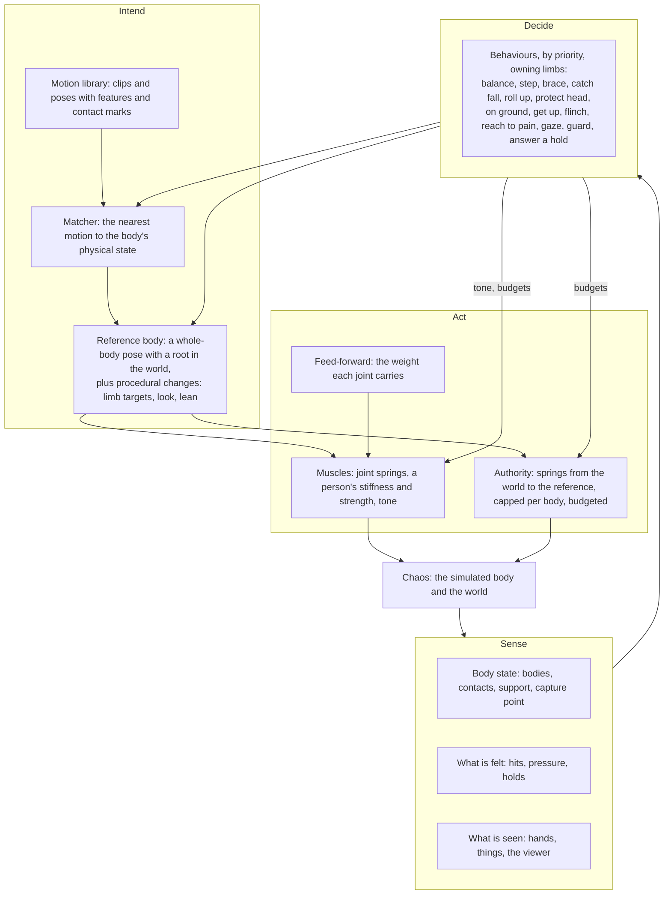

# Active ragdoll, second architecture: audit, causes, design and plan

Written on 26 November 2026 on the owner's request: the NPC's motion reads as mechanical, and the body is to be rebuilt as a
hybrid active ragdoll in the spirit of NaturalMotion's Euphoria, where animation states what the body intends and the simulation
decides what happens. This document is the audit of what exists, the causes found, the design that follows and the plan of parts
R1 to R9. It keeps the criteria and the measures of `docs/natural-body.md` (the natural-body track, N1 to N9) and replaces that
track's order of work and two of its rules; what it changes is listed in "What this changes in the rules". Every figure in a
criterion is a proposal for the owner to set. The same text is the tab "Active ragdoll 2" of the plan in Claude Docs (without the
diagram of section 5), kept in step by hand.

**Status:** R1, the led get-up, is **on since the owner's decision of 26 November 2026** (`getup.carry` 1). The owner on the
videos: the led get-ups look natural, the ones before do not. The baseline is `led`: 15 scenarios with a get-up have other hashes
than `n2`, and the suite is 126 of 127, since one hand that holds the chest no longer slows a get-up (`grab_getup_held`); that is
the first thing of R2. The decisions of section 10 are taken (26 November): authority is a rule with budgets; the order is
R2, R3, the rest of M4, R4 with new tables, R5, R6, R7, M4b, R9; every part is judged as section 7 says; the natural-body track's parts are
placed in the R parts. **Section 8 of this document is the one order of work of the project** and says where each part of the
natural-body track went; the project's status is in `docs/PRD.md`, "Status". Decisions 18 to 24 were taken in the review of the
audit (26 November). The player's movement in VR (decision 24) is built (26 November, decisions 25 to 28; the owner's look in the
headset is to come); R2 has begun: its step 0, the clean-up, is done (26 November, decisions 9 and 29, every hash kept); next in R2 is decision 17,
then the hold by one hand.

## 1. Audit: what exists

The body as built is described in `docs/natural-body.md`, "Where the body is now", and in `CLAUDE.md`. In short:

| Layer | What exists | Verdict |
| --- | --- | --- |
| Model | 19 bodies (the head its own since 26 November), 80 kg by de Leva's fractions, clinical joint ranges, self-collision, friction by measurement | Sound. Kept |
| Solver set-up | Chaos, 90 Hz in 2 substeps, 64 position iterations on the body, determinism mode, the rebuild kept in step | Sound. Kept |
| Actuation | One spring-damper per joint through Physics Control in force mode, four groups; a "balance assist": springs from the world on pelvis, chest, head and feet | Two jobs on one spring, and a hand from the world. Causes 1 and 2 |
| Target pose | A native animation instance: a stance, three fall poses, a flinch offset, an idle loop, four get-up clips carried over from another skeleton, two-bone placement of legs and arms | Too little motion, chosen by switches. Cause 3 |
| Behaviour | One controller class of about 5800 lines: states Standing, Flinch, Stagger, Falling, Lying, GetUp; capture-point balance with recovery steps; reactions by thresholds | The balance is good. The rest is a state machine that answers at once and the same way. Causes 4 and 5 |
| Tests and tools | 127 scenarios with hashes, push matrix, knockdowns, the stand of 150 falls, grab pulls, sweeps, films, overlays, the scorecard of 26 criteria | The strongest part of the project. Kept, and its gates are re-based. Cause 6 |

What the owner sees (25 and 26 November, in the headset and on videos): the hands and the grab are right; standing and stepping
are accepted; a slap turns the head since the head is its own body; **the get-up is "several clips glued together with pauses"
and ends "like a plank, like a rocket raised on its launcher"**; a lying body is dead; reactions are not noticed or read as
robotic.

What was tried on the natural-body track in two days, and how each ended:

| Part | What was built | Outcome |
| --- | --- | --- |
| N2 | Weight carried by joint torques; the assist as torques of the legs; repairs of target jumps | The torque arrives whole when asked of the drive, but with it on 14 scenarios and the push matrix fail. Four jump repairs are on |
| N3 | Muscles joint by joint, a tone, a brace, a daze | Neutral values only: a man's joint strengths cost the stand 3 to 11 first attempts |
| N4 | Mechanics first: a reflex delay | Off: the world's assist holds the waiting body, the matrix loses 4 to 7 cells |
| N6 | Arms that reach for the floor | Off: the head strikes less (55% to 18%), but the arms add up to 83 J and falls rest after 4 s |
| N5 | Perception, gaze, anticipation, a guarding arm | In the session behind a flag; the gaze is seen, the brace is not |
| N7 | About 25 variants of the clip-following get-up | None changed what the eye sees. Every cut in pauses costs first attempts |

Nine behaviours sit in the tree behind switches at 0. That pattern is itself a finding (cause 6).

## 2. The causes

These are causes, not symptoms: each explains several of the failures above, and each is a property of the design, not of a value.

**Cause 1. One spring does two jobs.** A joint's spring both carries the body's weight and tracks the pose. Weight is carried
only through the spring's error, so the stiffness must be high where weight is carried: legs 800 and spine 600 N·m/rad, two and a
half to three times a person's (C3). A body on stiff springs moves as one piece and returns like a machine. Softness (N3), reflex
delays (N4) and soft catching arms (N6) all need the springs low, and none could be had while the springs hold the body up.

**Cause 2. The root has no actuator, and nothing plans the contacts.** Six of the body's degrees of freedom (where the pelvis is
and how it is turned) can be changed only by what the floor pushes back. Tracking a clip joint by joint says nothing about those
pushes. So the root drifts from the clip, and the design answered with a spring from the world on the pelvis and the feet, and
with a clip that waits. The waits are the pauses; the pelvis pulled upright over feet that friction held is the plank. The clips
were recorded on another body and are *played*, not simulated, in the sample they come from (section 3): nobody ever made them
feasible for a simulated body. No value of clip-following removes this (26 November: 25 variants).

**Cause 3. There is too little motion in the body.** What makes motion read as human is detail, and detail comes from recorded
people or from a learned controller. The body has one stance, three fall poses, one flinch offset and four clips, each chosen
once by a rule. 224 clips of Epic's sample lie on disk (reaches in nine directions, flails, ways of lying, rolls, twenty get-ups,
people shoved, tackled and taken down) and are used only as a yardstick (`pose_prior`).

**Cause 4. Decisions are instant and discrete.** The flinch begins 11 ms after a hit and a step is decided in 30 ms, ten times
sooner than a person (C8 to C10). States switch poses; the same input gives the same answer to the digit.

**Cause 5. Limbs chase points of the world with stiff springs.** Arms sent to the floor behind a turning body do work on it
(83 J). Euphoria's catch-fall does the opposite: arms placed in the trunk's frame toward where the floor will come, soft, with
damping, that buckle on contact.

**Cause 6. The gates were cut around the stiff body.** The push matrix (160 of 160 by a table), the first-attempt count of the
stand and "the same hashes with the switch off" were all tuned on the body of causes 1 and 2. Every structural change misses one
of them by a little and is switched off. And the gates measure outcomes, not the look: on 26 November the plank's measure fell by
35% and the owner saw no change. A design cannot be replaced while each step must beat the old design at the old design's own
tables.

**Cause 7. One class holds everything.** Balance, steps, reactions, the fall, the get-up, perception and the assist share one
controller and one set of springs. A change to one moves the scenarios of the others (14 at a time with the weight torques).

## 3. What others do

Gathered on 26 November 2026. "Read" means read in a source that day; "local" means read on this machine in the engine's source or
in the sample's files; "recalled" means known from the literature and not opened again.

| System | How it works | Source |
| --- | --- | --- |
| Euphoria (GTA IV and V, Red Dead Redemption) | Every joint a spring-damper with stiffness and strength set per limb and over time. Small behaviours run side by side and are arbitrated by priority: body balance, stagger and fall, brace for impact, catch fall, body roll-up, foetal, arms windmill, teeter, high fall, injured on ground, writhe, head look. The balancer places feet from the centre of mass and reports failure; a fall behaviour follows. **The get-up is not simulated:** once the body is down and slow the game blends from the ragdoll's pose into a get-up animation chosen by pose | The behaviour list is read (GTA V's message names); the mechanism and the hand-over are recalled |
| Epic's Game Animation Sample for 5.8, `SandboxCharacter_Mover_Ragdoll` | A powered ragdoll through the Physics Control component and a Physics Control Asset (`PCA_SandboxCharacter`: limbs, sets `ParentSpace_Arms`, `ParentSpace_Legs`, `Worldspace_Feet`, `Worldspace_Pelvis`, profiles `PhysicalAnimation` and `Ragdoll`). While falling, the joint motors track blend spaces (`BS_Ragdoll_Reach` by the direction of impact, `BS_Ragdoll_Flail`), with strengths for arms, head, legs and torso set from curves by the time to impact, and gravity scaled. On the ground: poses and an automatic roll. **The get-up is animation:** a chooser with a pose-search column (`CHT_GetUpMontages`, schema `PSS_Ragdoll` on pelvis, feet and hands) picks one of four montages by the ragdoll's pose and blends out of physics. There is no balance | Local: the sample's assets and Blueprint function names |
| The engine, 5.8 | Physics Control is a released plugin: spring-dampers with force caps, target velocities, control profiles, body modifiers; new in 5.8, drive targets held to joint limits. No term carries weight. No balance controller, no support polygon. Control Rig Physics (beta) runs its own solver inside a rig, apart from the world's. Learning Agents is experimental and has no physics character example. Pose Search is released | Local |
| Research without learning | SIMBICON and "Generalized Biped Walking Control" (Coros 2010): pose tracking, foot placement on an inverted pendulum, forces wanted on the centre of mass turned into torques of the stance leg, weight compensated by feed-forward torques. "Dynamic response for motion capture animation" (Zordan 2005): simulate through the impact, search recorded motion for the best way back, blend. SAMCON (Liu 2010): offline sampling of target offsets until the simulated body reproduces a contact-rich clip such as a roll or a get-up | Recalled |
| Research with learning | DeepMimic, AMP, PHC, MaskedMimic: policies trained by reinforcement that track recorded motion with no outside forces; PHC recovers from falls. They train in GPU simulators with thousands of bodies for days. DReCon (Ubisoft): motion matching gives the target, a policy corrects the joint targets. "Learning to Get Up" (Tao 2022): natural get-ups are slow and statically stable at many moments | Read in part. No shipped game with any of them was found. One public report of Learning Agents on a Chaos ragdoll: a week to a walk |
| Plugins on Fab | Wrappers of physical animation with profile blends and montage recovery. None balances, steps or gets up by simulation | Read |

Three facts decide the design:

1. **No shipped system gets a body up by simulation.** Rockstar and Epic both hand the get-up to animation chosen by pose. The
   owner's reference therefore does not have what this project spent 26 November trying to tune.
2. **Both references drive the fall the way N6 planned and did not finish:** a blend by direction and time to impact, soft limbs,
   strengths on a schedule.
3. **The honest alternative exists only in research,** and needs either a learned policy or an offline optimisation of each clip
   on this body.

## 4. Principles of the new design

1. **Always simulated.** Every body of the character is a simulated rigid body at every moment, collides with everything and
   answers every touch. Nothing is kinematic and nothing is played back. This is FR-18 and it stays.
2. **Animation is intent.** A recorded motion or a pose is what the body tries to do. How hard it may try is a number.
3. **Authority is explicit, bounded and measured.** Besides its muscles the body may be pulled toward its reference by springs
   from the world on every body, each capped at a multiple of that body's own weight. That pull is called authority. It has a
   budget for each behaviour, it is reported in every run, and the plan drives it down. It replaces the "balance assist", which was
   the same thing unnamed, on two bodies, without a budget.
4. **A contact from outside takes authority away.** A hit lets the body go at once; a press or a hold takes the pull away in
   proportion; authority returns by its own clock. What a blow does is decided by the simulation, never by the reference.
5. **Soft by default, stiff on purpose.** Weight is carried by a feed-forward torque, not by error; springs are a person's; tone
   rises to brace and falls to relax.
6. **Motion comes from people.** Poses and clips are picked from a library by the body's physical state (how it lies, how it
   moves, what touches the floor), not by a state's name.
7. **Behaviours are small, parallel and own limbs.** As in Euphoria: each writes targets, tone and authority for the limbs it
   owns, by priority, and reports success or failure.
8. **Variation comes from physics.** No noise is added to make runs differ. The same push on a body that breathes, sways and
   stands a little differently gives a different motion; a run still repeats from its recording.
9. **The look decides.** A behaviour is offered to the owner as a video beside the one before it. Figures guard against
   regressions; they do not vote on naturalness.

## 5. Target architecture

### Layers

| Layer | Responsibility | Classes (new in bold) |
| --- | --- | --- |
| Sense | The body's state and what it feels and sees, read only | `FSandboxBodyProbe`, `FeelFrame`, `UpdatePerception` (kept) |
| Motion library | Clips carried to this body with their contact marks, poses, features for matching; built from text lists, never committed where it is Epic's content | `FSandboxClipPose`, `FSandboxPosePrior` (kept), **`FSandboxMotionLibrary`** |
| Matcher | The clip and the time in it nearest to the body: the pelvis's up direction and height, the places of hands and feet in the pelvis's heading frame, their velocities, what touches the floor | **`FSandboxMotionMatcher`** |
| Reference body | One whole-body pose with a root in the world, each frame: a clip at a time in a frame of the world, blended from where the body is, with limb targets and turns laid on top; fitted to the floor | **`FSandboxReference`**; `USandboxAnimInstance` (kept, fed from it) |
| Muscles | Joint springs with a person's stiffness and caps, a tone, the weight as feed-forward | The controller's muscles, `FSandboxWeightTorques` (kept) |
| Authority | A capped spring from the world on every body toward the reference, with a share per limb; its load reported | **`FSandboxCarry`** (built in R1) |
| Behaviours | Small classes with one interface: what they want (limb targets, tone, authority, a reference), whether they succeed | **`ISandboxBehaviour`**, one class each; the balance and the step are moved out of the controller as they are |
| Supervisor | Which behaviours run, by the body's physical state; budgets of authority; hand-overs | `USandboxBodyController`, cut down to this |

### Authority, exactly

- One spring per body, from the world, on the body's centre of mass, toward where the reference has that body; stiffness, damping
  and caps are per kilogram of the body, so a hand and a pelvis follow alike. The caps are in weights of the body
  (`carry_max_weights` over the floor, `carry_max_up_weights` upward). **The world never pushes a body down:** a body above its
  reference is given the reference at its own height.
- A share from 0 to 1 scales the springs. It rises by a behaviour's ease, falls by its own clock, goes down in proportion to a
  press or a hold from outside (to nothing at `getup.hold_force_n`), and goes to 0 at once on a hit above a threshold (from R2,
  decision 20: a hit takes it away in proportion to its impulse, all of it at that threshold).
- Budgets (**the owner's decision 2 of 26 November 2026**): standing, flinch, stagger and the fall: 0 (the fall's catch is
  muscles only). Lying: 0. The get-up: whatever it takes now (R1: 1.16 of body weight on average), then down part by part (R7);
  the measure is the mean and the peak of the world's force over the body's weight, as today's `assist_force_share`. Any contact
  from outside takes authority away.
- The world's old assist on an upright body (0.006 of body weight standing, an upright torque of up to 150 N·m in a stagger)
  stays until R4 replaces it with torques of the standing legs. It is the one recorded exception to the budget of 0, measured in
  every run (`assist_force_share` by state), and R4 removes it.

### Why authority and not more honest control, now

The honest ways to follow a recorded get-up are a learned policy or an optimisation of every clip on this body (section 3). Both
are parts of this plan (R7, R8), both are research, and neither is certain. Authority gives a body that moves as the recording
does, stays simulated and answers a touch, today; and it makes the dishonest part one number that later parts reduce. That is
also where both of the owner's references stand, except that they stop simulating during a get-up and this body does not.

## 6. Requirements

These add to FR-24 to FR-32 of `docs/natural-body.md`, which stay.

| ID | Requirement | Priority (proposed) | Part |
| --- | --- | --- | --- |
| FR-33 | The body is led by a whole-body reference under an explicit, capped, measured authority; from R4 on no other force acts on it from the world (until then the old assist on an upright body is the one recorded exception, section 5) | Must | R1, R4 |
| FR-34 | A get-up runs at the recording's pace with no pause in a pose, from however the body lies, and can be interrupted by a touch at every moment | Must | R1, R2 |
| FR-35 | Motion is picked from a library by the body's physical state; no pose is chosen by a state's name alone | Must | R2, R3, R5 |
| FR-36 | A fall is driven as the references do it: a blend by direction and time to impact, arms placed in the trunk's frame that give way on contact, the head kept off the floor, a roll-up when there is no time to catch | Must | R3 |
| FR-37 | An upright body is soft: a person's joint stiffness with the weight carried by feed-forward torques, tone that rises and falls, reflexes at a person's delays | Must | R4 |
| FR-38 | A hit is answered by the struck part first and the rest of the body through its joints; the reaction's pose comes from recorded people where a recording exists | Should | R5 |
| FR-39 | Authority in a get-up comes down to a budget set by the owner | Should | R7 |
| FR-40 | Behaviours are separate classes that own limbs by priority; the controller only supervises | Should | R6 (and each part moves what it touches) |
| FR-41 | Every part is shown to the owner as a video beside the body before it, on the desktop and in the headset | Must | Every part |

Criteria: C1 to C26 of `docs/natural-body.md` stay as measures. Three change their role:

- **C1 and C2** (nothing pulls on the body from the world) become the authority budgets of section 5, set by the owner per
  behaviour (decision 2: 0 for an upright, falling or lying body, which R4 reaches; the get-up's budget comes down in R7), no
  longer "0 or the part fails".
- **C19 to C21** (the get-up never holds a pose, mostly at once, in a person's time) are R1's and R2's.
- New, **C27: the get-up's shape.** At the moment the pelvis passes 70 cm the trunk is within 45 degrees of upright and the
  farther foot within 30 cm of the pelvis over the floor (`rise_trunk_deg`, `rise_feet_cm`; today 70 degrees and 37 cm in the
  median of 150). (Corrected on 26 November 2026, the review of the audit: with the led get-up the stand of 150 gives 60 degrees
  and 25 cm in the median, and 65 of 149 get-ups meet both limits; the 22 to 30 degrees quoted below are the four `getup_*`,
  which use only the clips from the back and the front. `docs/testing.md`, "The review of the audit".)

## 7. What this changes in the rules

| Rule today | Change | Why |
| --- | --- | --- |
| Rule 1 of `docs/natural-body.md`: every force comes from inside the body, the assist is driven to zero | Authority is allowed where a budget says so, and is measured | Section 3: no reference meets rule 1 in a get-up; 26 November |
| "A recorded clip is a target for the muscles, not a motion of the body" (`CLAUDE.md`) | A clip is a target for the muscles and for the authority's springs. The body is still never moved, only pushed | The same |
| Every new behaviour keeps every scenario's hashes with its switch off | Kept for switches. But a part that changes the body's base (R4) takes a **new baseline and new tables**, measured on the new body, instead of having to pass the old ones | Cause 6 |
| The push matrix's table and the stand's first-attempt count gate every part | They are reported for every part. They gate only "no worse without a reason written down" | Cause 6 |
| A part is done when its scenarios pass | And when the owner has seen its video beside the one before | Principle 9 |

Rows 1 to 3 were decided with decisions 2 and 4 of section 10, rows 4 and 5 with decision 7, for every part R2 to R9: the push
matrix, the knockdowns and the stand on three seeds (standing and first attempts) are run for every part, a cell or a count that
gets worse is allowed only with its reason written down and a video shown to the owner, and a part is done once the owner has seen
its video beside the body before it.

Unchanged: fixed physics timing and determinism; text as the source of truth; tuning in `Config/Tuning` with no defaults in code;
no Blueprint logic and no Animation Blueprints (Epic's sample is read for its design and its clips, its Blueprints are not used);
the body does not know the pawn; measuring changes nothing; commits on the owner's command.

## 8. Order of work and plan of parts

### The order of work

This is the one order of work of the whole project (the owner's decisions 3, 5 and 6 of 26 November 2026). Every other
document points here; what is done is in `docs/PRD.md`, "Status".

**First, the player's movement in VR** (FR-42, decision 24): the right stick moves the player smoothly, the left stick turns by
a snap, the player's body is a capsule with a capped force (from `docs/recon/m4_part5_body.patch`); the player's side only,
brought forward from M4's part 5. **Built on 26 November 2026** (decisions 25 to 28; `docs/testing.md`, "The player's movement in
the headset"): the suite's 127 scenarios keep their hashes, five scenarios of the body are new, and a session without a person
walks a made-up headset through it (`Tools\play.ps1 -Demo -Walk`, a step of the bootstrap); the owner's look in the headset is
to come, when the owner says the headset is on. Then:

1. **R2**, the get-up from however the body lies. Step 0 is a clean-up of dead switches (decision 9; done on 26 November); then
   the hold by one hand, then the matcher and the fit to the floor.
2. **R3**, the fall as the references drive it.
3. **The rest of M4 and its gate in the headset** (`docs/PRD.md`, M4): part 2 closed, the rest of part 4 (things in the hand),
   part 5 (the desktop's verbs and locomotion; the headset's movement and the capsule come first, above), part 6 (the review in
   the headset).
4. **The toes, yes or no** (N8 D, decision 8), so that R4's new tables are measured on the asset that stays.
5. **R4**, the soft upright body, with a new baseline and new tables; **R8**, the learned controller, as a spike beside it.
6. **R5, R6 and R7** (decisions 3 and 10): reactions from recorded people, life on the floor, authority down.
7. **M4b**, the NPC's own actions (walk to a chair and sit, right a chair, get out from under the table), on the soft body and
   led within the budgets R7 leaves (decision 10).
8. **R9**, variation by physics and the gate.
9. **M5**, polish and the soak.

### Where each part of the natural-body track went

Decision 8 of 26 November 2026. The criteria C1 to C26 of `docs/natural-body.md` stay as measures (section 6 says which change
their role); its order of work is replaced by the list above.

| Part of `docs/natural-body.md` | State on 26 November | Goes to |
| --- | --- | --- |
| N1, the measures and the scorecard | Done | Closed; the measuring base of every R part |
| N2, weight carried by the joints | Four jump repairs on; the weight torques built and not usable yet | R4 (the weight as feed-forward, a person's springs, the assist as leg torques; the jumps left and C25's limit) and R7 (forces through the legs in a get-up) |
| N3, muscle tone | Joint scales and four tone levels built, all neutral | R4. The daze is dropped (measured to do nothing; removed in R2's step 0) |
| N4, the order and timing of reactions | The reflex's delay built, off (put off by the owner) | R4 (mechanics first, a person's delays); the hand to the struck place, R5. Its question of delays against the push table is answered by R4's new tables |
| N5, perception | Steps 1, 2 and 4 built, part of 3 and 5; in the session with `-Perception` | Upright (gaze, anticipation, the guard, the answer to a hold, the expression view, the viewer in recordings): R5. Lying (struggling when held): R6. Its question on the eyes stays open until R5 |
| N6, the fall with an aim | The hand target built; the reach kept off by the owner | R3, which replaces the reach |
| N7, life on the floor and the get-up | About 25 variants of the clip-following get-up, none taken | The get-up: R1 (done) and R2; the authority down: R7; life on the floor: R6. Its question on clips the sample lacks goes to R2 and R6 |
| N8 A, the head; the wrist | The head is the default body; the wrist no-go | Closed; the wrist's asset goes in R2's step 0 |
| N8 B, fingers | Built behind `poses.fingers.weight` 0 | Shown to the owner where they show: `flat` under a hand that carries weight in R2, `splayed` in a fall in R3 |
| N8 C, the skin | Looked at: not needed now | M5 |
| N8 D, toes | No-go on 25 November, put off | Decided yes or no before R4 (item 4 above) |
| N9, variation | Not begun | R9: variation from physics, no added noise; C22 to C24 stay as measures |

### The parts

The order of the R parts themselves is by what the owner sees first.

| Part | What it gives | Depends on |
| --- | --- | --- |
| R1 | The led get-up: the whole body under authority follows the clip at its pace. **On since 26 November (`getup.carry` 1)** | - |
| R2 | The get-up from however the body lies: a matcher over all twenty get-up clips and their mirrors, a roll first when nothing fits, the reference fitted to the floor, the blend from the lying pose | R1 |
| R3 | The fall as the references drive it | The hand target (exists) |
| R4 | The soft upright body: feed-forward weight, a person's springs, tone, reflex delays, the assist as leg torques; a new baseline and new tables | - |
| R5 | Reactions from recorded people: the shoved, tackled and taken-down clips as targets after a hit, the hand to the struck place | R2's matcher, R4 |
| R6 | Life on the floor: breath, settling, stirring, struggling when held | R2 |
| R7 | Authority down: clips made feasible on this body offline, forces through the standing legs instead of the world | R1, R2 |
| R8 | A learned controller: a spike that measures what Chaos can train, then go or no-go | R4 |
| R9 | Variation by physics, and the gate: every table on three seeds, the headset session | All |

### R1. The led get-up (built and switched on on 26 November)

**Design.** `FSandboxCarry` (`SandboxBody`): one world-space control per body, made the first time a led get-up begins, so a run
without it has no such constraint. While getting up with `getup.carry` 1: every body's target is where the clip has it
(`FSandboxClipPose::ReachedBodyAt`: the pose asked of the muscles, chained on this body's proportions) in the clip's frame of the
world; the reference's velocity goes with the target, so the damping does not drag; the clip runs at `getup.rate` and stops only
while the muscles come up, for a press that holds the body down (`getup.hold_force_n`, as before) and at its end until the body
is upright on both feet, an attempt that stands still for `getup.stall_s` being given up (this clause added on 26 November 2026,
the review of the audit, from the code); the clip is not laid over the feet; the old assist on
pelvis and feet is off. The share comes up with `getup.ease_s`, goes over `carry_release_s` after the get-up, goes down in
proportion to a press or a hold, and drops to 0 at once on a hit of `carry_yield_ns` or more, which gives the attempt up. A pelvis
more than `getup.lost_cm` from the clip gives it up as before (something is in the way). The world's force is added to the
assist's share, and a line of the log four times a second says what the world gives and to which bodies.

**Values** (`Config/Tuning/body.json`, `getup.carry_*`): 400 N/m and 4 N·m/rad per kg, damping 0.1 s, caps of 2 weights over
the floor and upward and 4 N·m per kg of each body, release 0.4 s, yield at 60 N·s.

**Results:** see "R1: first results" at the end.

**Left after the switch** (the owner looked at the videos and switched it on, 26 November): one hand that holds the chest is
torn off (`grab_getup_held`), the first thing of R2; the session with a person and the headset (not run); the 19 controls' cost
in the physics step (not measured).

### R2. The get-up from however the body lies

- **Step 0, the clean-up** (decision 9), a commit of its own before R2's code: the dead switches go, code and values. They are
  N7's get-up (`getup.rise` with its values and `rise_clip_back`, `fast_rise` with its values, `slow_from`, `rate_follow_s`,
  `progress_cm`, `progress_window_s`, `progress_pelvis`, `reached_feet`, `gather_s`, `gather_rate`, `end_one_foot`), N2's
  variants not taken (`balance.reach_smooth`, `stagger_brake_follow_s`, `lift_frame_s`), N3's daze (`tone.daze_*`),
  `balance.swing_foot_n_per_m` (a force from the world on an upright body), the overrides of `assist.head` that repeat their
  base value, and the wrist's asset (`npc_body_wrist.json`, `PA_SandboxNPCWrist`). All are neutral, so the suite against `led`
  must keep every hash. The clip-following path (carry 0, also the fallback when a carry cannot be made) stays until R2 is
  accepted. **Done on 26 November 2026** (`docs/testing.md`, "R2, step 0: the clean-up"): every item of the list, with what
  only they used (N7's own rise and its two metrics `rise_began_s` and `rise_wait_s`, the daze's count, the anim instance's
  `SetReachWithWeight`), and the spec field `limits_in` that only the wrist used (decision 29). `balance.swing_foot_n_per_m`
  was not a switch but the swinging foot's spring at 0: its name and value went, the rule stays in the code (the world gives
  a swinging foot no pull). The suite kept all 132 hashes of `walk`; 49 unit tests (the wrist's one went).
- **First, the hold by one hand** (decision 3): a hand that holds a body getting up slows it and two hold it; `grab_getup_held`
  passes again; measured on the stand with `-HoldHands 1` and `2` on three seeds. In numbers (decision 13, the criterion of
  25 November): held by one hand, 20 to 60 of 150 pull free and stand within the 15 s of the hold, the rest stand once let go;
  held by two, at most 5 of 150; the grip of `grab_getup_held` lasts its 500 frames; how much longer a held body takes to stand
  than one nobody holds is reported. Before R1: 46 of 146 and 0 (on the body R1 replaced, `n2on`: 49 of 147); with R1 (seed 1):
  42 of 50 and 3 of 49; on three seeds (measured at step 0): 119 of 150 and 14 of 150, pressed with 300 N 50 of 150 stand under
  it. How (decision 14):
  authority is taken away body by body, the held body and its chain to the pelvis hardly led while the rest are, and the clip's
  pace slows in proportion to the force of the hold (a press goes through the same force), so that a held body struggles instead
  of freezing. Today a press or a hold takes the pull off the whole body at once and the clip waits only from
  `getup.hold_force_n` (450 N), more than one hand's cap of 300 N. (Measured in the review of the audit: two hands that take
  both ankles, or both wrists, of a body getting up and pull it along the floor are left behind and their grips slip within 0.7
  to 1.9 s, while the world gives 0.9 to 2.8 of the body's weight, mostly against the hands; the clip runs on.) The pressed stand (`-PressN 300`, today 15 of 50) is measured
  with it and kept near today's.
- **Authority in R2** (decision 15): no new limit; the mean share of the stand stays at 1.16 of the body's weight or below unless a
  reason is written down, and every step of R2 reports it body by body and by direction (`control.authority`), so that what the fit
  to the floor takes off is seen. Bringing it down is R7's.
- **Found in the audit of 26 November, for this part:** `getup.wait_s` cannot fire under the led get-up (its clip stands still
  with nothing pressing only while the muscles come up and at its end, and at its end `getup.stall_s`, 3 s, gives the attempt up
  before the free wait reaches `wait_s`, 5 s; reasoning corrected in the review of the audit); the overlay draws the get-up's old assist as active
  while its springs are 0 (`GetControlView`); a carry that cannot be made falls back to the clip-following get-up with only a
  warning in the log, so a run would measure the old get-up and pass (decision 17: `control.get_up` says whether the get-up was
  led and why not, a scenario with `getup.carry` 1 whose get-up was not led fails, and a session says so in its log and, on the
  desktop, on the screen); `getup.rise` with the carry on leaves a rising body with no
  force (it goes in step 0).
- **The fingers** (N8 B, decision 8): `flat` under a hand that carries weight, shown to the owner on this part's videos.
- **`FSandboxMotionLibrary`.** Reads the clips a text list names (`Specs/motion_library.json`: the twenty get-ups, the two rolls,
  the ground poses), carries each to this body, mirrors each, and marks contacts (a foot or a hand within a few centimetres of the
  clip's floor and slow). Built at first use; nothing of Epic's is committed.
- **`FSandboxMotionMatcher`.** The lying body against the first second of every get-up: the pelvis's up direction, the trunk's
  direction over the floor, where hands and feet are in the pelvis's heading frame. Returns a clip, a time in it and a frame of
  the world (turned about the vertical). The four `getup.clip_*` rules go. Epic's `PSS_Ragdoll` samples the same bones.
- **A roll first** when the nearest get-up is far: the sample's `M_ragdoll_getup_roll_L` and `_R`, led the same way, then the
  match again.
- **The reference fitted to the floor.** The clip's skeleton and this body differ; today a led foot can hang a few centimetres
  over the floor or be pressed into it, and the world then pushes for nothing. The reference is shifted so that what the clip
  marks as in contact is on the floor, and a foot in contact is aimed with no vertical pull.
- **The start.** From the lying pose into the clip: the muscles' targets and the authority's targets both go from where the body
  is to where the clip is, over the ease, instead of the clip's first pose taken whole (decision 22, which replaces decision 14
  of `docs/natural-body.md`).
- **How long it lies** by how it fell (`getup.rest_per_ns_s` exists), and a get-up that begins while the body still settles.
- **Scenarios:** get-ups from eight ways of lying, from a body laid across a thing, beside the table, under a press; a hit, a
  push and a hold in each phase (C26); dragged by both ankles and by both wrists in each phase, where a hold stronger than the
  body fells it and it is dragged on its muscles alone, then gets up (decision 18); pulled by an arm in each phase, the arm
  yielding or pulled in by the body's state and by the switch that forces either (decision 19, FR-43). A hit takes authority
  away in proportion to its impulse, all of it at `getup.carry_yield_ns`; `getup_hit_strong` asks for the fall its blow causes
  and `getup_push_weak` that its push moves the body (decision 20).
- **Done when:** C19 to C21 and C27 on three seeds; the owner's look. The limits (decision 16): C19, no pose held longer than
  1.0 s and at most 10% of attempts given up (today about 12%; corrected in the review of the audit: 18 of 169 attempts, 10.7%,
  and a pose held up to 2.98 s, longer than 1.0 s in 5 of 150 falls, mostly at the clip's end on one foot); C20, 95% or more stand and 135 or more of 150 at the first attempt
  over the three seeds (today 149 and 139); C21, a median of 2.6 to 4.2 s from the first move to standing (today 3.2 s); C27, the
  trunk within 45 degrees of upright and the farther foot within 30 cm of the pelvis as the pelvis passes 70 cm, on the stand (today
  22 to 30 degrees and 20 to 26 cm on the four `getup_*`; the stand does not report it yet). (Corrected in the review of the
  audit: every run of the stand records both; on the stand of 150 the medians are 60 degrees and 25 cm, and 65 of 149 get-ups
  meet both limits. The four `getup_*` use only the clips from the back and the front.) C27 is read as the median on the stand of
  150 and for each of the four clips apart (decision 21).

### R3. The fall as the references drive it

- **The way and the time.** Every tick while falling: which way (the centre of mass's velocity and the pelvis's lean) and how
  long until the trunk meets something (height and speed; a sweep along the fall for a wall or furniture).
- **The pose is a blend by direction and time to impact** over the sample's nine `M_ragdoll_reach_*` clips and three flails
  (Epic's `BS_Ragdoll_Reach` and `BS_Ragdoll_Flail`), never one pose chosen at the start.
- **Catch fall.** Arms are placed in the trunk's frame toward where the floor will come, at low stiffness with damping, a torque
  cap, and they give way when a hand touches (their strength on a curve of the time to impact, as the sample's
  `Ragdoll_UpdatePhysicsStrengthsFromCurves`). They do not chase a point of the world. This is what N6's reach got wrong.
- **Protect the head.** The neck braced and turned away from the floor; chin to chest going backward.
- **Roll up** when there is no time to catch (a blow of 200 N·s): knees and arms in, the back rounded.
- **Sit down** going backward, **turn to a side** when there is time.
- **The fingers** (N8 B, decision 8): `splayed` with the palms to the floor, shown to the owner on this part's videos.
- N6's reach toward a point of the world (`fall.aim` and its values) is replaced by the catch fall and removed once it lands.
- **Gates:** C14 to C17 by blow and by hand; a fall still rests within 3 s and adds at most 40 J; the three scenarios of C26.

### R4. The soft upright body

One part, one new baseline, because every table moves with it.

- The weight as feed-forward through the drives' targets (N2's finding: asked of the drive, the torque arrives whole).
- Springs swept down to a person's (C3, C4), caps to a person's (C5), with the legs' balance strategies as torques.
- Tone (N3): relaxed arms and neck standing, braced on a hit or a threat, limp at an impact.
- Mechanics first (N4): the reflex and the step at a person's delays.
- The assist on an upright body as torques of the standing legs (N2 step 5), so that no force from the world is left there.
- N2's jumps that are left sorted into defects and jumps by design, and C25's limit set (`docs/natural-body.md`, decision 15;
  until then no part raises the baseline of 439 N·m).
- Real tone levels for anticipation's brace (N5): today every `tone.*` level is 1, so the brace changes no stiffness (left
  until here, decision 12: on today's body the proposed `braced` levels make the forearm 3.4 times stiffer and the chest 1.3,
  and a seen punch moves the chest as far as an unseen one).
- **The fall decided by a pose** (decision 11): the pelvis's tilt that makes an upright body Falling
  (`thresholds.fall_tilt_deg`, 35) is measured against the stance, so a pose the body is asked for crosses it. A punch into the
  belly doubles the body over, the pelvis tilts 36.9 degrees, and it falls; at 45 the same punch is stepped off and the body
  stands (`docs/testing.md`, checks after the audit; videos `Saved\Films\belly_punch_side`, `belly_punch_side_tilt45`). The tilt is
  judged against the pose asked of the muscles; every scenario that doubles over (`strike_punch_belly_falls`, `strike_punch_torso`,
  the kicks into the belly) is run again, and the owner's rule of 25 November is the gate: a punch into the belly doubles over and
  steps, a kick there fells.
- Before this part: the toes, yes or no (N8 D), so that the new tables are measured on the asset that stays.
- **New tables.** The push matrix's table, the knockdown thresholds and the stand are measured again on this body and put to
  the owner as the new tables. The old body stays available as a tuning directory (`-TuningDir`) for comparison.
- **Gate:** the owner's look in the headset: is it softer, does it still stand, does it read as slower than a person.

### R5. Reactions from recorded people

- After a hit the struck part gives way by mechanics (R4). After the reflex delay, the matcher looks among the sample's shoved,
  tackled and taken-down clips (the victims' takes, `*_V`) for the moment nearest to the body's state, and that clip leads the
  muscles with no authority: Zordan's method with the body never leaving the simulation.
- The hand to the struck place, doubling over held at the place that was hit, a look at who struck.
- **N5 for an upright body** (decision 8; `docs/natural-body.md`, N5): the gaze, anticipation and the guard that exist behind
  switches, the answer to a hold (leaning against it, looking at it, the held chain braced, the free hand to the holder; a held arm
  that yields and reaches after the hand or is pulled in, by the body's state, decision 19), the expression view, the viewer in recordings, and N5's questions for the headset. N5's question of eyes and blinking brought
  forward from M5 is put to the owner here.
- **Gate:** the owner's look; C8 to C13.

### R6. Life on the floor

N7's items 1 to 4 and 9 as written there: breath, settling into a way of lying (the sample's ground poses through the matcher),
stirring, lying longer after a harder fall, struggling when held (with N5's answer to a hold for a lying body; a held arm that
yields or is pulled in, decision 19; dragged by a limb on its muscles alone, decision 18).

### R7. Authority down

- **Feasible clips.** For each get-up clip, an offline search on this body (the job queue, sampling in the manner of SAMCON over
  target offsets and timing) for the version that needs the least authority; the cost is the world's force. Chaos repeats, and the
  queue runs eight processes.
- **Forces through the legs.** What authority asks of the pelvis is given as torques of the legs that stand, bounded by what
  the feet can give (the centre of pressure inside the sole, friction): N2's step 5, for the get-up.
- **Contact-aware leading.** A limb that carries weight is support and is not pulled; only free limbs are led.
- **Gate:** the budget the owner sets (proposed: a mean of 0.5 of body weight or less, then 0.25), with the look unchanged.

### R8. A learned controller (research)

- A spike of two days: how many simulated seconds an hour this machine gives with many bodies in one world, and whether one clip
  can be tracked by a small policy that corrects joint targets (DReCon's form), trained with the engine's Learning Agents or a
  trainer of our own on the job queue.
- Go only if the spike shows a clip tracked with less authority than R7 reaches. Python and its packages need the owner's consent.
- Known costs: every change to the body retrains; a policy cannot be read or tuned by name.

### R9. Variation by physics, and the gate

N9 without added noise where physics gives the difference (breath, sway, tone); seeds only for choices among equals. Every
table on three seeds. The headset session with its questions.

## 9. Tests and diagnostics

What exists stays and is the base: scenarios with hashes, the suite, baselines, sweeps, the push matrix, the knockdowns, the
stand on three seeds, grab pulls, films and videos, overlays, the scorecard. Added by this plan:

| What | How |
| --- | --- |
| Authority in every run | `control.get_up.assist_force_share_*` counts it today; R2 adds `control.authority` by behaviour and by body |
| The led get-up on the stand | `Tools\getup-stand.ps1`, `Tools\getup-seeds.ps1` (the carry is on in the files since 26 November); with `-PressN` and `-HoldHands` |
| The get-up's shape | C27 from `rise_trunk_deg` and `rise_feet_cm`, on the stand |
| Videos side by side | `Tools\film.ps1 -Video` of the same scenario with and without a part, same camera; one command to make the pair is made in R2 |
| A matcher's choice | A unit test with made-up lying poses; a table of which clip each of 150 falls took and how each ended |
| The overlay | A layer that draws the reference body as a wire figure beside the simulated one, and the authority's forces as arrows |
| Performance | The suite's physics step per scenario; the led get-up's 19 more constraints are measured in R1's follow-up |

## 10. Decisions for the owner

One at a time, the recommended answer first.

| # | Decision | Options |
| --- | --- | --- |
| 1 | The led get-up, after the videos | **Decided on 26 November 2026: (a), on, and R2 next.** Not chosen: (b) off, and the get-up waits for R7 or R8 |
| 2 | Authority as a rule (section 7): the world may pull on the body where a budget says so | **Decided on 26 November 2026: (a), yes, with the budgets of section 5** (0 standing, flinching, staggering, falling and lying; the get-up what it takes now, then down), and any contact from outside takes authority away. Not chosen: (b) only in the get-up; (c) rule 1 stays and the led get-up is a passing exception |
| 3 | The order | **Decided on 26 November 2026: the get-up, the fall, the soft body.** R2 (first the hold by one hand, then the matcher and the fit to the floor), R3, R4, then R5, R6, R7 and R9, with R8 as a spike beside R4. Not chosen: R4 first; R3 first |
| 4 | New tables with R4 instead of the old gates | **Decided on 26 November 2026: new tables**, measured on the soft body and brought to the owner with videos and a headset session; the body before it stays as a tuning directory. Not chosen: the old tables as gates; the old tables with each lost cell brought one by one |
| 5 | M4's remaining parts and M4b | **Decided on 26 November 2026: after R3.** R2 and R3, then the rest of M4 and its gate in the headset, then R4 and M4b on the soft body. Not chosen: now, beside the track; after R4. (The headset's movement and the player's capsule of part 5 brought forward before R2 by decision 24.) |
| 6 | Where the one order of work and the one status are written (the audit of the documents, 26 November) | **Decided on 26 November 2026: the order in section 8 of this document, the status in `docs/PRD.md`, "Status".** `CLAUDE.md`, `docs/natural-body.md`, PRD's sections and the tabs of the plan point there. Not chosen: both in `docs/PRD.md`; both in `CLAUDE.md` |
| 7 | How R2 and R3 are judged before R4 (section 7, rows 4 and 5) | **Decided on 26 November 2026: as section 7 says, for every part R2 to R9.** The push matrix, the knockdowns and the stand on three seeds are run; worse only with a reason written down and a video; done when the owner has seen the video. Not chosen: the old tables as strict gates until R4; strict gates only for what a part does not touch |
| 8 | Where the parts of the natural-body track go | **Decided on 26 November 2026: the table in section 8.** N5 upright to R5 and lying to R6; the fingers shown in R2 and R3; the toes decided before R4. Not chosen: N5 as a part of its own after R4; the fingers and the toes as `docs/natural-body.md` had them |
| 9 | When the dead switches go | **Decided on 26 November 2026: a clean-up commit as R2's step 0** (the list is in R2). Not chosen: only N7's get-up switches then; each R part removing what it replaces |
| 10 | Where R5, R6, R7 and R9 stand against M4b | **Decided on 26 November 2026: R4, R5, R6, R7, then M4b, then R9 and M5.** M4b's actions are led like the get-up, within a budget (`docs/PRD.md`, M4b), and what R7 builds (a limb that carries weight is support and is not pulled; forces through the legs instead of the world) is what sitting down and lifting a chair need: built first, the actions are made within low budgets and not redone. R5's reactions are the product's core, and M4b is judged by how the body answers a push on the way. If R7's offline search of clips runs long, M4b needs only its contact-aware leading and its forces through the legs. Not chosen: R7 after M4b (its actions brought down afterwards); M4b right after R4; every R part, R9 too, before M4b |
| 11 | A punch into the belly fells the body (`strike_punch_belly_steps` expected a fall) | **Decided on 26 November 2026: a defect, repaired in R4** (R4's "the fall decided by a pose"): the fall comes from the pelvis's tilt threshold that the doubled-over pose crosses, not from lost footing. The scenario is renamed `strike_punch_belly_falls` with its expectations as they are until then. Not chosen: repaired now, before R2, on the body R4 replaces; the fall accepted; nothing |
| 12 | Anticipation's brace in a session with `-Perception` changes no stiffness (every `tone.*` level is 1) | **Decided on 26 November 2026: left until R4**, where tone is built on the soft body. On today's legs (800 N·m/rad) a braced trunk does not show: measured by `-Tune`, the chest gives 1.3 times less braced than relaxed, the forearm 3.4 times, and a seen punch moves the chest 16.6 cm against 15.6 unseen (`docs/testing.md`, N3 and N5 of the night of 25 November). Not chosen: braced levels now for the session only; the brace taken out of anticipation until R4 |
| 13 | "One hand slows a get-up, two hold it", in numbers (R2's first item) | **Decided on 26 November 2026: the criterion of 25 November, on three seeds.** One hand: 20 to 60 of 150 pull free and stand within the 15 s of the hold, the rest after it; two hands: at most 5 of 150; `grab_getup_held`'s grip lasts its 500 frames; the extra time to stand when held is reported. Bounded on both sides: one hand neither holds like two nor is torn off. Not chosen: at most a third with no lower bound and none for two hands; one hand holding like two; decided by a video in the headset |
| 14 | How a hold acts on authority (R2's first item) | **Decided on 26 November 2026: body by body, and the clip slowed by the hold's force.** The held body and its chain to the pelvis are hardly led, the rest are, and the clip's pace goes down in proportion to the force (one hand's 300 N to about a third, 450 N to a stop): the body struggles against the hand instead of freezing (principle 4, locally). The pressed stand is measured with it. Not chosen: the clip waits while held, as on the old path (the pauses the owner called robotic); body by body only (the clip runs away from a held pelvis and the attempt is given up) |
| 15 | Authority's budget in R2 (today a mean of 1.16 of the body's weight, a median of 1.07; peaks within an attempt 2.25 in the median, 3.35 at most) | **Decided on 26 November 2026: no new limit in R2, and no higher than 1.16 without a reason written down**; reported body by body and by direction; bringing it down is R7's (decision 2). A number in R2 would push tuning toward it at the price of first attempts, as capping did in R1. Not chosen: at most 1.0 once the reference is fitted to the floor; 0.5 in R2 |
| 16 | The limits of R2's gate | **Decided on 26 November 2026: as proposed** (R2, "Done when"): C19 1.0 s and 10%; C20 95% and 135 of 150 at the first attempt, the sum of three seeds rather than each (one seed's figure is luck); C21 2.6 to 4.2 s; C27 45 degrees and 30 cm. Not chosen: C21 at a young adult's 2.6 to 2.9 s; limits set after R2's first step |
| 17 | A led get-up whose springs cannot be made goes the old way with only a warning in the log | **Decided on 26 November 2026: a scenario fails, a session says so.** `control.get_up` records whether the get-up was led and why not; a run with `getup.carry` 1 whose get-up was not led is `SCENARIO FAIL`; a session writes it to its log and, on the desktop, on the screen (the headset's HUD draws nothing). Built in R2; it measures, so it keeps every hash. A run must not pass on behaviour it did not ask for. Not chosen: the warning as it is |
| 18 | A hold stronger than the body while it gets up: two hands that drag it along the floor by the ankles or the wrists (measured in the review of the audit: the grips slip within 0.7 to 1.9 s, the world pulls against the hands with 0.9 to 2.8 of the body's weight, the clip runs on, and the body ends standing on one foot at the clip's end for 3 s before it is let go) | **Decided on 26 November 2026: a strong hold fells it.** When a held limb is pulled harder than the body can resist (two hands, a force of the order of `getup.hold_force_n`), the attempt is given up, authority goes to 0 on the whole body at once, the body goes down and is dragged by the limb on its muscles alone (its struggling comes with R6); let go, it gets up again. R2 adds scenarios: dragged by both ankles and by both wrists in each phase of the get-up (sitting up, the crouch, rising), each asking that the grips last the whole pull, that the world gives no force against the hands, that the pelvis travels 1.5 m or more, and that the body gets up afterwards. A person whose legs are pulled from under them goes down and is dragged. Not chosen: struggling in place (decision 14 alone: the clip stops under two hands, the body is hardly dragged and the attempt is given up after `getup.stall_s`); getting up on the free limbs while being dragged |
| 19 | The owner's FR-43 (`docs/PRD.md`): pulled by its arms, the arms answer and reach toward the pull, and as an option the ragdoll pulls them toward itself (measured in the review of the audit: pulled by the wrists while getting up, the arms are only drawn straight by force and the grips slip within 1 to 2 s) | **Decided on 26 November 2026: by the body's state, with a switch.** Two answers of a held arm: to yield, its chain's muscles soften and the arm reaches after the player's hand, the body following; and to pull it in, the chain braces, the elbow bends and the body draws the arm toward itself, so the player's hand falls behind its controller and the controller vibrates. Which one is chosen by the body's state (dazed or relaxed: yields; standing and seeing: pulls in), and a tuning value can force either, so that the owner can compare. Built for a body getting up in R2, standing in R5 (with the answer to a hold), lying in R6 (with the struggle). Both answers are human, and a choice by state keeps the body alive. Not chosen: only a switch, built right after R2's step 0; the NPC taking hold of the player's hands itself, a part of its own after R5 |
| 20 | A hit below `getup.carry_yield_ns` (60 N·s) on a body getting up leaves the world's pull as it was: the world holds the body on its clip against the blow (a push of 30 N·s, `getup_push_weak`: standing 0.29 s later as if nothing had happened); a threshold decides, not the mechanics, as in decision 11. `getup_hit_strong` is felled by its 200 N·s but does not ask for it | **Decided on 26 November 2026: authority goes by the impulse.** A hit takes authority away in proportion to its impulse (none at 0, all of it at `carry_yield_ns`) and it comes back by its own clock, as a press's does; the blow moves the body and the simulation decides what follows (a step, sitting back, a fall). Built in R2. Scenarios: `getup_hit_strong` asks for the fall the blow causes; `getup_push_weak` asks that the push moves the body, filmed for the owner. Principle 4: a hit lets the body go, and the mechanics decide how far. Not chosen: the threshold of 60 kept, only the expectation added to `getup_hit_strong`; every hit above the flinch's 5 N·s taking all the authority at once |
| 21 | C27's limits in R2's gate (decision 16) were set beside "today 22 to 30 degrees and 20 to 26 cm", which are the four `getup_*` (the clips from the back and the front only); on the led stand of 150 the medians are 60 degrees and 25 cm, both limits met in 65 of 149, the side clips at 61 to 63 degrees | **Decided on 26 November 2026: 45 degrees and 30 cm, as the median on the stand of 150 (three seeds) and for each of the four clips apart.** R2 (the fit to the floor, the choice of clip) has to move the get-ups from the sides most. The lean at the start of the rise is the "rocket on its launcher" the owner saw; fitting the gate to what exists would soften the goal. Not chosen: a share of get-ups within both limits (today 65 of 149, aimed at 80% or more); the limits set after R2's first step |
| 22 | `docs/natural-body.md`, decision 14 (25 November: the clip's first pose taken whole as a get-up begins; blending it in did not help the stand) against R2's "The start" (the muscles' and the authority's targets go from the lying pose to the clip over the ease) | **Decided on 26 November 2026: R2's blend.** Decision 14 of the track was made for the clip-following get-up and is replaced: in R2 the start is blended from the lying pose into the clip the matcher chose, whose first pose is near the lying one. Blending in did not help the stand on the old path, but the matcher and the authority change what it meets. A jerk into the first pose is a jump the eye sees. Not chosen: the first pose taken whole and "The start" taken out of R2; a switch and a pair of videos in R2 for the owner's eye |
| 23 | The bootstrap stops at its suite step while `grab_getup_held` fails on purpose until R2, so its later steps (the push matrix, the knockdowns, the stand, the session, the record and replay, the grab demo) do not run by themselves | **Decided on 26 November 2026: a mark "fails on purpose".** A scenario's file may name a `known_failure` (the reason and until when); `Tools\suite.ps1` runs it, prints it as a known failure and does not fail for it, and says so if it passes, for the mark to be taken away (`Scenarios/README.md`). `grab_getup_held` carries it until R2. One known gap must not switch off the checks of everything else. Not chosen: left as it is until R2, the later steps run by hand; a switch of the bootstrap that goes on after a failure |
| 24 | The owner's FR-42 (`docs/PRD.md`, 26 November): in VR the player moves around the room with the stick of the right controller. Today no stick is read for movement, and in a headset the pawn is the middle of the play space, 80 cm from the NPC; the right stick does reach the game (`vr_check3`); the player's body as a capsule exists as `docs/recon/m4_part5_body.patch` | **Decided on 26 November 2026, four answers.** (a) The right stick moves the player smoothly in every direction, relative to where the head looks; the left stick's left and right turn by a snap; both halves of FR-10 kept. (b) Speed in proportion to the stick's tilt up to 1.4 m/s (a walk), with a dead zone and an ease of about 0.2 s; a snap of 30 degrees; no darkening of the view's edges, but a tuning value for it (0: off); all of it in `Config/Tuning/tools.json`, for the owner's first session to judge. (c) The player's body is a capsule with a capped force, from the patch (70 kg, radius 22 cm, half height 80 cm, a spring of 6000 N/m capped at 300 N, as a hand): the stick drives the capsule and the camera follows it; it does not pass through the NPC or the furniture and pushes the NPC no harder than a hand; its hashes checked and a scenario of the capsule walking into a standing NPC. (d) **Now, before R2** (before its step 0), as a small part of its own on the player's side (`SandboxInteraction`; a scenario has no pawn, so the body's hashes stay); the look in the headset when the owner says it is on. Every later look in the headset (FR-41) gains from it: around the body, to a body on the floor, by its legs. Not chosen: (a) both on the right stick, or no snap turn; (b) 1.0 m/s with the edges darkened, or 2.5 m/s and 45 degrees; (c) a capsule against walls and furniture only, or no body until the rest of M4's part 5; (d) after R2, or after R3 with the rest of M4 (decision 5). (Built on 26 November 2026, with decisions 25 to 28.) |
| 25 | The head of a player who walks in the room goes where the capsule cannot (into the NPC or a table): what the view does | **Decided on 26 November 2026: the head goes in, and the view darkens.** The capsule stays outside and pushes with its cap at most; the view darkens as the eyes come within 10 cm of the surface of the NPC or the furniture and is black at the surface and inside (`tools.headset.head_fade_cm`, 0: the head simply goes in), as Half-Life: Alyx does. It is honest and does not make the player sick, and a lean over a body lying on the floor does not darken it. Nothing but the stick, the snap and the player's own head moves the view. Not chosen: the head goes in and nothing darkens (the inside of the mesh is seen); the play space pushed back so that the head never goes in (the view moves while the head does not: what makes players sick, and a lean over a lying body would push the view back) |
| 26 | Where the left stick's snap turn turns about | **Decided on 26 November 2026: about the head.** The head stays where it is in the world and the world turns about it, as nearly every game in a headset does; the body stays where it is. The hands catch up with their new places at `tools.headset.catch_up_speed_mps`, as for a controller found again, and are not flung at the speed of a blow. Not chosen: about the middle of the play space (a player a metre off the middle is carried 52 cm sideways at once, perhaps into the NPC or a table) |
| 27 | The capsule and the stick on the desktop | **Decided on 26 November 2026: the desktop keeps its free camera.** It is a tool: it flies through walls and up, leaves the hands behind, aims the impulse and the drag handle. The desktop's session, its self-test, its demos and their record and replay are as they were. Walking on the desktop stays in M4's part 5, after R3, with the desktop's other verbs. Not chosen: the capsule on the desktop too, WASD moving it and the free flight behind a key; the free camera and a capsule behind a key, two modes |
| 28 | The player's body walked into the standing NPC at the stick's full speed (1.4 m/s): its force cap of 300 N bounds a press, not what a collision delivers, which the mass sets. Measured: 70 kg (the patch's figure) brings 26 N*s into the chest as it touches and 43 N*s into the belly over its press, and the NPC doubles over (the rule made for a fist's blow at 40 N*s) and steps back; 25 kg brings 19 N*s, 10 kg 6 N*s, both stepping back; at 0.5 m/s 70 kg does not double the NPC over | **Decided on 26 November 2026: 10 kg.** A touch while walking is a push of the open hand; the press is still the cap's 300 N, as a hand's; the view does not depend on the body's mass. A body of the NPC that falls onto the player is held up by the cap alone. Not chosen: 25 kg; 70 kg, as decided in 24 (two people colliding while walking, with the doubling over a rule made for a punch) |
| 29 | R2's step 0 removes the wrist's asset (decision 9); the spec field `"limits_in": "child"` (swings limited in the child's frame: a second joint in the asset, the generator's path for it, `FSandboxPoseRig`'s `bInChild` and its unit test) was used by that asset alone | **Decided on 26 November 2026: it goes with the asset.** No asset uses it, the run's hashes are the same, and without its asset the generator's test no longer passes through it: code that nothing checks. A spec that still names it is refused rather than built another way. Not chosen: the asset alone, `limits_in` kept as a possibility of the format |

The owner's statement of the goal with these answers (26 November): the ragdoll is to look and move naturally, as a living
person, and it must be possible to interact with it at every moment. Both halves bind every part: a behaviour that looks right
and cannot be touched is not done, and neither is one that answers every touch and moves like a machine.

## R1: first results (26 November 2026, for the owner's look)

Measured with `-Tune "getup.carry=1"` while the files had 0; since the owner's decision of the same day they have 1. The
measurements, the variants and what went wrong on the way are in `docs/testing.md`, "R1: the led get-up".

| | Today | Led |
| --- | --- | --- |
| The suite with the switch at 0 | 127, baseline `n2` | 127 with the same hashes |
| The stand, three seeds: end standing, at the first attempt | 150, 130 | 149, **139** |
| A get-up, first move to standing | 5.0 s in the median, 2.4 s of it paused | **3.2 s**, paused only while the muscles come up (0.6 s) |
| The trunk from upright and the farther foot from the pelvis as the pelvis passes 70 cm (C27) | 70 degrees, 37 cm (median of 150) | **22 to 30 degrees, 20 to 26 cm** (the four `getup_*`) (Corrected on 26 November 2026: like for like, on the stand of 150, 60 degrees and 25 cm in the median; `docs/testing.md`, "The review of the audit".) |
| The plank's measure, while getting up and after | 1.36 + 0.24 s | 0.10 to 0.20 + 0.22 to 0.58 s (the four `getup_*`) |
| What the world gives, of the body's weight, mean | 0.28 | **1.16** (peaks of 2.5) (Corrected on 26 November 2026: on the stand of 150 the peak within an attempt is 2.25 in the median, 3.01 at the 90th percentile and 3.35 at most; `docs/testing.md`, checks after the audit.) |
| A blow of 200 N·s while getting up | Fells it, it tries again | The same (it is let go at once) |
| Pressed with 300 N, 50 falls | 13 of 50 stand under it (39 of 150) (Corrected on 26 November 2026: 13 is 39 shared by three seeds, of the head body before N2's repairs; the body R1 replaced, `n2on`, gives 14, 15 and 14, 43 of 150.) | 15 of 50 |
| Held by two hands, 50 falls | None pulls free | 3 of 49 pull free |
| Held by one hand, 50 falls | About a third pull free (47 of 146) (Corrected on 26 November 2026: 46 of 146 with `reactions.hold_felt`, 47 before it, both of older bodies; the body R1 replaced, `n2on`, 49 of 147.) | **42 of 50 pull free**, and `grab_getup_held` fails: the grip does not last |
| The suite with the switch at 1 | - | 126 of 127 (`grab_getup_held`) |

What it shows:

- **The motion is the recording's:** the body sits up, rolls over a foot into a crouch and rises with its feet under it. The
  pauses and the lean over feet left behind are gone by the measures; whether it reads as a person is the owner's to say
  (videos `Saved\Films\r1_back_today`, `r1_back_led`, `r1_front_today`, `r1_front_led`, the same camera).
- **It costs authority:** the world gives 1.16 of the body's weight on average, four times today's assist. Most of it is not
  lift. It is the world pulling limbs sideways toward a reference that this body's planted feet and hands are not at (a thigh
  pulled with 200 to 300 N toward a foot 20 cm from where the clip has it). That is R2's fit to the floor and R7's rule that a
  limb which carries weight is not pulled.
- **Capping what the world may lift does not work yet:** at half a weight per body the stand fell to 140 of 150 and 70 at the
  first attempt; at one weight 148 and 107. The legs do not keep up with the recording on their own, as on 26 November.
- **One hand no longer holds a body that gets up.** With the pull taken away in proportion to the press, two hands hold and a
  press of 300 N works as today, but one hand is torn off. Open.

## Sources

- The project: `docs/natural-body.md`, `docs/testing.md` (the sections of 25 and 26 November), `CLAUDE.md`,
  `Source/SandboxBody` (`UpdateGetUp`, `StartGetUp`, `PushTuningToControls`, `UpdateAssistLoad`, `FSandboxClipPose`).
- The engine, read locally: `Engine/Plugins/Animation/PhysicsControl` (`PhysicsControlComponentImpl.cpp`: how a control's target
  and velocity reach the constraint), the Chaos joint solver's drives.
- Epic's Game Animation Sample on this machine: the asset and function names of `SandboxCharacter_Mover_Ragdoll`,
  `PCA_SandboxCharacter`, `CHT_GetUpMontages`, `PSS_Ragdoll`, the ragdoll and interaction clips.
- Euphoria's behaviour names: the public wrapper of GTA V's messages
  (https://nitanmarcel.github.io/shvdn-docs.github.io/class_g_t_a_1_1_natural_motion_1_1_euphoria.html).
- "Learning to Get Up", Tao et al. 2022 (https://arxiv.org/abs/2205.00307); PHC (https://github.com/ZhengyiLuo/PHC); DReCon
  (https://montreal.ubisoft.com/en/drecon-data-driven-responsive-control-of-physics-based-characters/); a report of Learning
  Agents on a Chaos ragdoll (https://www.neuralvfx.com/reinforcement-learning/learning-to-walk-with-unreal-learning-agents/).
- Recalled and not opened: Coros 2010, Zordan 2005, Liu 2010 (SAMCON), SIMBICON, DeepMimic, AMP.
