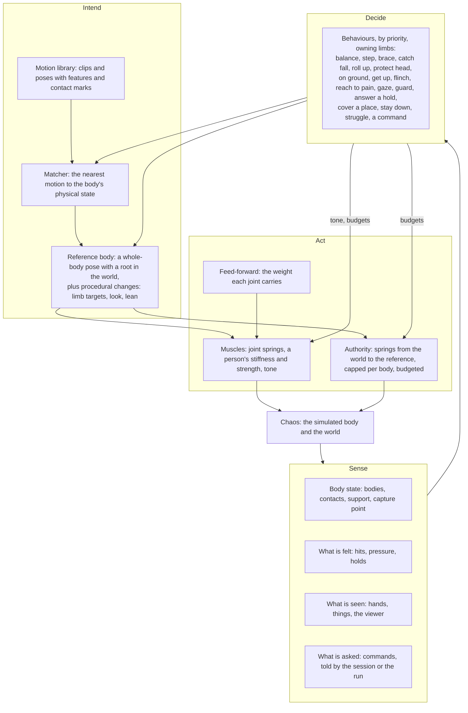

# Active ragdoll, second architecture: audit, causes, design and plan

Written on 26 November 2026 on the owner's request: the NPC's motion reads as mechanical, and the body is to be rebuilt as a
hybrid active ragdoll in the spirit of NaturalMotion's Euphoria, where animation states what the body intends and the simulation
decides what happens. This document is the audit of what exists, the causes found, the design that follows and the plan of parts
R1 to R9. It keeps the criteria and the measures of `docs/natural-body.md` (the natural-body track, N1 to N9) and replaces that
track's order of work and two of its rules; what it changes is listed in "What this changes in the rules". Every figure in a
criterion is a proposal for the owner to set. The same text is the tab "Active ragdoll 2" of the plan in Claude Docs (without the
diagram of section 5), kept in step by hand.

**Status:** R1, the led get-up, is **on since the owner's decision of 26 November 2026** (`getup.carry` 1). The owner on the
videos: the led get-ups look natural, the ones before do not. The baseline is `led`: 15 scenarios with a get-up have other hashes
than `n2`, and the suite is 126 of 127, since one hand that holds the chest no longer slows a get-up (`grab_getup_held`); that is
the first thing of R2. The decisions of section 10 are taken (26 November): authority is a rule with budgets; the order is
R2, R3, the rest of M4, R4 with new tables, R5, R6, R7, M4b, R9; every part is judged as section 7 says; the natural-body track's parts are
placed in the R parts. **Section 8 of this document is the one order of work of the project** and says where each part of the
natural-body track went; the project's status is in `docs/PRD.md`, "Status". Decisions 18 to 24 were taken in the review of the
audit (26 November). The player's movement in VR (decision 24) is built (26 November, decisions 25 to 28; the owner's look in the
headset is to come); R2 has begun: its step 0, the clean-up, is done (26 November, decisions 9 and 29, every hash kept); next in R2 is decision 17,
then the hold by one hand. (What R2 has done since is in section 8; the project's status in `docs/PRD.md`.) **On 27 November 2026 the
owner gave new requirements** (`docs/PRD.md`, FR-44 to FR-55: an arm yanked and pulled, a kick at a leg, a lift and a throw, protection
on the floor and while getting up, a drag and breaking free, commands, a seated body, the groin, the solar plexus and the face): by
the owner's decision 40 of the same day they are placed in section 8, with a new part, **R10, behaviours, protection and commands**,
after R3 and before the rest of M4; decisions 41 to 48 of section 10 are taken too, the recommended answer each time (the owner: "the most natural body, with living
reactions"); left for the owner are two figures to be set from measurements, what two hands may lift (decision 46) and the table of
kicks at a leg (decision 43); their criteria are C28 to C40 of `docs/natural-body.md`.
Nothing of it is built.

## 1. Audit: what exists

The body as built is described in `docs/natural-body.md`, "Where the body is now", and in `CLAUDE.md`. In short:

| Layer | What exists | Verdict |
| --- | --- | --- |
| Model | 19 bodies (the head its own since 26 November), 80 kg by de Leva's fractions, clinical joint ranges, self-collision, friction by measurement | Sound. Kept |
| Solver set-up | Chaos, 90 Hz in 2 substeps, 64 position iterations on the body, determinism mode, the rebuild kept in step | Sound. Kept |
| Actuation | One spring-damper per joint through Physics Control in force mode, four groups; a "balance assist": springs from the world on pelvis, chest, head and feet | Two jobs on one spring, and a hand from the world. Causes 1 and 2 |
| Target pose | A native animation instance: a stance, three fall poses, a flinch offset, an idle loop, four get-up clips carried over from another skeleton, two-bone placement of legs and arms | Too little motion, chosen by switches. Cause 3 |
| Behaviour | One controller class of about 5800 lines: states Standing, Flinch, Stagger, Falling, Lying, GetUp; capture-point balance with recovery steps; reactions by thresholds | The balance is good. The rest is a state machine that answers at once and the same way. Causes 4 and 5 |
| Tests and tools | 127 scenarios with hashes, push matrix, knockdowns, the stand of 150 falls, grab pulls, sweeps, films, overlays, the scorecard of 26 criteria | The strongest part of the project. Kept, and its gates are re-based. Cause 6 |

What the owner sees (25 and 26 November, in the headset and on videos): the hands and the grab are right; standing and stepping
are accepted; a slap turns the head since the head is its own body; **the get-up is "several clips glued together with pauses"
and ends "like a plank, like a rocket raised on its launcher"**; a lying body is dead; reactions are not noticed or read as
robotic.

What was tried on the natural-body track in two days, and how each ended:

| Part | What was built | Outcome |
| --- | --- | --- |
| N2 | Weight carried by joint torques; the assist as torques of the legs; repairs of target jumps | The torque arrives whole when asked of the drive, but with it on 14 scenarios and the push matrix fail. Four jump repairs are on |
| N3 | Muscles joint by joint, a tone, a brace, a daze | Neutral values only: a man's joint strengths cost the stand 3 to 11 first attempts |
| N4 | Mechanics first: a reflex delay | Off: the world's assist holds the waiting body, the matrix loses 4 to 7 cells |
| N6 | Arms that reach for the floor | Off: the head strikes less (55% to 18%), but the arms add up to 83 J and falls rest after 4 s |
| N5 | Perception, gaze, anticipation, a guarding arm | In the session behind a flag; the gaze is seen, the brace is not |
| N7 | About 25 variants of the clip-following get-up | None changed what the eye sees. Every cut in pauses costs first attempts |

Nine behaviours sit in the tree behind switches at 0. That pattern is itself a finding (cause 6).

## 2. The causes

These are causes, not symptoms: each explains several of the failures above, and each is a property of the design, not of a value.

**Cause 1. One spring does two jobs.** A joint's spring both carries the body's weight and tracks the pose. Weight is carried
only through the spring's error, so the stiffness must be high where weight is carried: legs 800 and spine 600 N·m/rad, two and a
half to three times a person's (C3). A body on stiff springs moves as one piece and returns like a machine. Softness (N3), reflex
delays (N4) and soft catching arms (N6) all need the springs low, and none could be had while the springs hold the body up.

**Cause 2. The root has no actuator, and nothing plans the contacts.** Six of the body's degrees of freedom (where the pelvis is
and how it is turned) can be changed only by what the floor pushes back. Tracking a clip joint by joint says nothing about those
pushes. So the root drifts from the clip, and the design answered with a spring from the world on the pelvis and the feet, and
with a clip that waits. The waits are the pauses; the pelvis pulled upright over feet that friction held is the plank. The clips
were recorded on another body and are *played*, not simulated, in the sample they come from (section 3): nobody ever made them
feasible for a simulated body. No value of clip-following removes this (26 November: 25 variants).

**Cause 3. There is too little motion in the body.** What makes motion read as human is detail, and detail comes from recorded
people or from a learned controller. The body has one stance, three fall poses, one flinch offset and four clips, each chosen
once by a rule. 224 clips of Epic's sample lie on disk (reaches in nine directions, flails, ways of lying, rolls, sixteen get-ups,
people shoved, tackled and taken down) and are used only as a yardstick (`pose_prior`).

**Cause 4. Decisions are instant and discrete.** The flinch begins 11 ms after a hit and a step is decided in 30 ms, ten times
sooner than a person (C8 to C10). States switch poses; the same input gives the same answer to the digit.

**Cause 5. Limbs chase points of the world with stiff springs.** Arms sent to the floor behind a turning body do work on it
(83 J). Euphoria's catch-fall does the opposite: arms placed in the trunk's frame toward where the floor will come, soft, with
damping, that buckle on contact.

**Cause 6. The gates were cut around the stiff body.** The push matrix (160 of 160 by a table), the first-attempt count of the
stand and "the same hashes with the switch off" were all tuned on the body of causes 1 and 2. Every structural change misses one
of them by a little and is switched off. And the gates measure outcomes, not the look: on 26 November the plank's measure fell by
35% and the owner saw no change. A design cannot be replaced while each step must beat the old design at the old design's own
tables.

**Cause 7. One class holds everything.** Balance, steps, reactions, the fall, the get-up, perception and the assist share one
controller and one set of springs. A change to one moves the scenarios of the others (14 at a time with the weight torques).

## 3. What others do

Gathered on 26 November 2026. "Read" means read in a source that day; "local" means read on this machine in the engine's source or
in the sample's files; "recalled" means known from the literature and not opened again.

| System | How it works | Source |
| --- | --- | --- |
| Euphoria (GTA IV and V, Red Dead Redemption) | Every joint a spring-damper with stiffness and strength set per limb and over time. Small behaviours run side by side and are arbitrated by priority: body balance, stagger and fall, brace for impact, catch fall, body roll-up, foetal, arms windmill, teeter, high fall, injured on ground, writhe, head look. The balancer places feet from the centre of mass and reports failure; a fall behaviour follows. **The get-up is not simulated:** once the body is down and slow the game blends from the ragdoll's pose into a get-up animation chosen by pose | The behaviour list is read (GTA V's message names); the mechanism and the hand-over are recalled |
| Epic's Game Animation Sample for 5.8, `SandboxCharacter_Mover_Ragdoll` | A powered ragdoll through the Physics Control component and a Physics Control Asset (`PCA_SandboxCharacter`: limbs, sets `ParentSpace_Arms`, `ParentSpace_Legs`, `Worldspace_Feet`, `Worldspace_Pelvis`, profiles `PhysicalAnimation` and `Ragdoll`). While falling, the joint motors track blend spaces (`BS_Ragdoll_Reach` by the direction of impact, `BS_Ragdoll_Flail`), with strengths for arms, head, legs and torso set from curves by the time to impact, and gravity scaled. On the ground: poses and an automatic roll. **The get-up is animation:** a chooser with a pose-search column (`CHT_GetUpMontages`, schema `PSS_Ragdoll` on pelvis, feet and hands) picks one of four montages by the ragdoll's pose and blends out of physics. There is no balance | Local: the sample's assets and Blueprint function names |
| The engine, 5.8 | Physics Control is a released plugin: spring-dampers with force caps, target velocities, control profiles, body modifiers; new in 5.8, drive targets held to joint limits. No term carries weight. No balance controller, no support polygon. Control Rig Physics (beta) runs its own solver inside a rig, apart from the world's. Learning Agents is experimental and has no physics character example. Pose Search is released | Local |
| Research without learning | SIMBICON and "Generalized Biped Walking Control" (Coros 2010): pose tracking, foot placement on an inverted pendulum, forces wanted on the centre of mass turned into torques of the stance leg, weight compensated by feed-forward torques. "Dynamic response for motion capture animation" (Zordan 2005): simulate through the impact, search recorded motion for the best way back, blend. SAMCON (Liu 2010): offline sampling of target offsets until the simulated body reproduces a contact-rich clip such as a roll or a get-up | Recalled |
| Research with learning | DeepMimic, AMP, PHC, MaskedMimic: policies trained by reinforcement that track recorded motion with no outside forces; PHC recovers from falls. They train in GPU simulators with thousands of bodies for days. DReCon (Ubisoft): motion matching gives the target, a policy corrects the joint targets. "Learning to Get Up" (Tao 2022): natural get-ups are slow and statically stable at many moments | Read in part. No shipped game with any of them was found. One public report of Learning Agents on a Chaos ragdoll: a week to a walk |
| Plugins on Fab | Wrappers of physical animation with profile blends and montage recovery. None balances, steps or gets up by simulation | Read |

Three facts decide the design:

1. **No shipped system gets a body up by simulation.** Rockstar and Epic both hand the get-up to animation chosen by pose. The
   owner's reference therefore does not have what this project spent 26 November trying to tune.
2. **Both references drive the fall the way N6 planned and did not finish:** a blend by direction and time to impact, soft limbs,
   strengths on a schedule.
3. **The honest alternative exists only in research,** and needs either a learned policy or an offline optimisation of each clip
   on this body.

## 4. Principles of the new design

1. **Always simulated.** Every body of the character is a simulated rigid body at every moment, collides with everything and
   answers every touch. Nothing is kinematic and nothing is played back. This is FR-18 and it stays.
2. **Animation is intent.** A recorded motion or a pose is what the body tries to do. How hard it may try is a number.
3. **Authority is explicit, bounded and measured.** Besides its muscles the body may be pulled toward its reference by springs
   from the world on every body, each capped at a multiple of that body's own weight. That pull is called authority. It has a
   budget for each behaviour, it is reported in every run, and the plan drives it down. It replaces the "balance assist", which was
   the same thing unnamed, on two bodies, without a budget.
4. **A contact from outside takes authority away.** A hit lets the body go at once; a press or a hold takes the pull away in
   proportion; authority returns by its own clock. What a blow does is decided by the simulation, never by the reference.
5. **Soft by default, stiff on purpose.** Weight is carried by a feed-forward torque, not by error; springs are a person's; tone
   rises to brace and falls to relax.
6. **Motion comes from people.** Poses and clips are picked from a library by the body's physical state (how it lies, how it
   moves, what touches the floor), not by a state's name.
7. **Behaviours are small, parallel and own limbs.** As in Euphoria: each writes targets, tone and authority for the limbs it
   owns, by priority, and reports success or failure.
8. **Variation comes from physics.** No noise is added to make runs differ. The same push on a body that breathes, sways and
   stands a little differently gives a different motion; a run still repeats from its recording.
9. **The look decides.** A behaviour is offered to the owner as a video beside the one before it. Figures guard against
   regressions; they do not vote on naturalness.

## 5. Target architecture

### Layers

| Layer | Responsibility | Classes (new in bold) |
| --- | --- | --- |
| Sense | The body's state and what it feels and sees, read only | `FSandboxBodyProbe`, `FeelFrame`, `UpdatePerception` (kept) |
| Motion library | Clips carried to this body with their contact marks, poses, features for matching; built from text lists, never committed where it is Epic's content | `FSandboxClipPose`, `FSandboxPosePrior` (kept), **`FSandboxMotionLibrary`** |
| Matcher | The clip and the time in it nearest to the body: the pelvis's up direction and height, the places of hands and feet in the pelvis's heading frame, their velocities, what touches the floor | **`FSandboxMotionMatcher`** |
| Reference body | One whole-body pose with a root in the world, each frame: a clip at a time in a frame of the world, blended from where the body is, with limb targets and turns laid on top; fitted to the floor | **`FSandboxReference`**; `USandboxAnimInstance` (kept, fed from it) |
| Muscles | Joint springs with a person's stiffness and caps, a tone, the weight as feed-forward | The controller's muscles, `FSandboxWeightTorques` (kept) |
| Authority | A capped spring from the world on every body toward the reference, with a share per limb; its load reported | **`FSandboxCarry`** (built in R1) |
| Behaviours | Small classes with one interface: what they want (limb targets, tone, authority, a reference), whether they succeed | **`ISandboxBehaviour`**, one class each; the balance and the step are moved out of the controller as they are |
| Supervisor | Which behaviours run, by the body's physical state; budgets of authority; hand-overs | `USandboxBodyController`, cut down to this |

### Authority, exactly

- One spring per body, from the world, on the body's centre of mass, toward where the reference has that body; stiffness, damping
  and caps are per kilogram of the body, so a hand and a pelvis follow alike. The caps are in weights of the body
  (`carry_max_weights` over the floor, `carry_max_up_weights` upward). **The world never pushes a body down:** a body above its
  reference is given the reference at its own height.
- A share from 0 to 1 scales the springs. It rises by a behaviour's ease, falls by its own clock, goes down in proportion to a
  press or a hold from outside (to nothing at `getup.hold_force_n`), and goes to 0 at once on a hit above a threshold (from R2,
  decision 20: a hit takes it away in proportion to its impulse, all of it at that threshold).
- Budgets (**the owner's decision 2 of 26 November 2026**): standing, flinch, stagger and the fall: 0 (the fall's catch is
  muscles only). Lying: 0. The get-up: whatever it takes now (R1: 1.16 of body weight on average), then down part by part (R7);
  the measure is the mean and the peak of the world's force over the body's weight, as today's `assist_force_share`. Any contact
  from outside takes authority away.
- The world's old assist on an upright body (0.006 of body weight standing, an upright torque of up to 150 N·m in a stagger)
  stays until R4 replaces it with torques of the standing legs. It is the one recorded exception to the budget of 0, measured in
  every run (`assist_force_share` by state), and R4 removes it.

### Why authority and not more honest control, now

The honest ways to follow a recorded get-up are a learned policy or an optimisation of every clip on this body (section 3). Both
are parts of this plan (R7, R8), both are research, and neither is certain. Authority gives a body that moves as the recording
does, stays simulated and answers a touch, today; and it makes the dishonest part one number that later parts reduce. That is
also where both of the owner's references stand, except that they stop simulating during a get-up and this body does not.

## 6. Requirements

These add to FR-24 to FR-32 of `docs/natural-body.md`, which stay.

| ID | Requirement | Priority (proposed) | Part |
| --- | --- | --- | --- |
| FR-33 | The body is led by a whole-body reference under an explicit, capped, measured authority; from R4 on no other force acts on it from the world (until then the old assist on an upright body is the one recorded exception, section 5) | Must | R1, R4 |
| FR-34 | A get-up runs at the recording's pace with no pause in a pose, from however the body lies, and can be interrupted by a touch at every moment | Must | R1, R2 |
| FR-35 | Motion is picked from a library by the body's physical state; no pose is chosen by a state's name alone | Must | R2, R3, R5 |
| FR-36 | A fall is driven as the references do it: a blend by direction and time to impact, arms placed in the trunk's frame that give way on contact, the head kept off the floor, a roll-up when there is no time to catch | Must | R3 |
| FR-37 | An upright body is soft: a person's joint stiffness with the weight carried by feed-forward torques, tone that rises and falls, reflexes at a person's delays | Must | R4 |
| FR-38 | A hit is answered by the struck part first and the rest of the body through its joints; the reaction's pose comes from recorded people where a recording exists | Should | R5 |
| FR-39 | Authority in a get-up comes down to a budget set by the owner | Should | R7 |
| FR-40 | Behaviours are separate classes that own limbs by priority; the controller only supervises | Must since 27 November 2026, for the owner's FR-48 to FR-52 (decision 40; Should before) | R10 (decision 40; R6 before), and each part moves what it touches |
| FR-41 | Every part is shown to the owner as a video beside the body before it, on the desktop and in the headset | Must | Every part |

The owner's requirements of 27 November 2026, FR-44 to FR-55, are in `docs/PRD.md` in the owner's words; where each is built is
in section 8 (decision 40); their criteria are C28 to C40 of `docs/natural-body.md`.

Criteria: C1 to C26 of `docs/natural-body.md` stay as measures. Three change their role:

- **C1 and C2** (nothing pulls on the body from the world) become the authority budgets of section 5, set by the owner per
  behaviour (decision 2: 0 for an upright, falling or lying body, which R4 reaches; the get-up's budget comes down in R7), no
  longer "0 or the part fails".
- **C19 to C21** (the get-up never holds a pose, mostly at once, in a person's time) are R1's and R2's.
- New, **C27: the get-up's shape.** At the moment the pelvis passes 70 cm the trunk is within 45 degrees of upright and the
  farther foot within 30 cm of the pelvis over the floor (`rise_trunk_deg`, `rise_feet_cm`; today 70 degrees and 37 cm in the
  median of 150). (Corrected on 26 November 2026, the review of the audit: with the led get-up the stand of 150 gives 60 degrees
  and 25 cm in the median, and 65 of 149 get-ups meet both limits; the 22 to 30 degrees quoted below are the four `getup_*`,
  which use only the clips from the back and the front. `docs/testing.md`, "The review of the audit".)

## 7. What this changes in the rules

| Rule today | Change | Why |
| --- | --- | --- |
| Rule 1 of `docs/natural-body.md`: every force comes from inside the body, the assist is driven to zero | Authority is allowed where a budget says so, and is measured | Section 3: no reference meets rule 1 in a get-up; 26 November |
| "A recorded clip is a target for the muscles, not a motion of the body" (`CLAUDE.md`) | A clip is a target for the muscles and for the authority's springs. The body is still never moved, only pushed | The same |
| Every new behaviour keeps every scenario's hashes with its switch off | Kept for switches. But a part that changes the body's base (R4) takes a **new baseline and new tables**, measured on the new body, instead of having to pass the old ones | Cause 6 |
| The push matrix's table and the stand's first-attempt count gate every part | They are reported for every part. They gate only "no worse without a reason written down" | Cause 6 |
| A part is done when its scenarios pass | And when the owner has seen its video beside the one before | Principle 9 |

Rows 1 to 3 were decided with decisions 2 and 4 of section 10, rows 4 and 5 with decision 7, for every part R2 to R9: the push
matrix, the knockdowns and the stand on three seeds (standing and first attempts) are run for every part, a cell or a count that
gets worse is allowed only with its reason written down and a video shown to the owner, and a part is done once the owner has seen
its video beside the body before it.

Unchanged: fixed physics timing and determinism; text as the source of truth; tuning in `Config/Tuning` with no defaults in code;
no Blueprint logic and no Animation Blueprints (Epic's sample is read for its design and its clips, its Blueprints are not used);
the body does not know the pawn; measuring changes nothing; commits on the owner's command.

## 8. Order of work and plan of parts

### The order of work

This is the one order of work of the whole project (the owner's decisions 3, 5 and 6 of 26 November 2026). Every other
document points here; what is done is in `docs/PRD.md`, "Status".

**First, the player's movement in VR** (FR-42, decision 24): the right stick moves the player smoothly, the left stick turns by
a snap, the player's body is a capsule with a capped force (from `docs/recon/m4_part5_body.patch`); the player's side only,
brought forward from M4's part 5. **Built on 26 November 2026** (decisions 25 to 28; `docs/testing.md`, "The player's movement in
the headset"): the suite's 127 scenarios keep their hashes, five scenarios of the body are new, and a session without a person
walks a made-up headset through it (`Tools\play.ps1 -Demo -Walk`, a step of the bootstrap); the owner's look in the headset is
to come, when the owner says the headset is on.

**Stage 1 of the faster checks** (`docs/fast-checks.md`, SP-0 to SP-3; its decision 9) was built and accepted on 27 November 2026
(its decision 10; every run's hashes kept, the bootstrap 334 to 139 s). By the owner's decision 11 R2 goes on with its step 9 now;
stage 2 of the faster checks waits until after R2. (Changed by the owner's decision 54 of 27 November, after R2's rest: R3 now, stage
2 of the faster checks after R3. R3 was built in the night of 27 to 28 November and waits for the owner's look; stage 2's SP-6, the
assets kept between jobs, was built the same night, every tool's hashes kept, and SP-4, the pool, as far as it is started by hand:
`docs/fast-checks.md`, section 12, decisions 12 and 13; SP-5's start after a build is the rest of stage 2, if the owner wants it.) Then:

1. **R2**, the get-up from however the body lies. Step 0 is a clean-up of dead switches (decision 9; done on 26 November); then
   the hold by one hand, then the matcher and the fit to the floor.
2. **R3**, the fall as the references drive it (its items a to f built behind switches at 0 in the night of 27 to 28 November, for
   the owner's look; decisions 55 to 58); then **R10**, behaviours, protection and commands (the owner's decision 40 of
   27 November 2026; its section below): the choice by priority, staying down and covered, a rise given up, a drag and the struggle,
   the commands of a body on the floor. (R10's steps 1, 2, 4, 5 and 6, and 8 in part, built on 28 November behind switches at 0; decisions 59
   to 68, confirmed by the owner the same day, who decided to switch fear, stay_down, protect and commands on (67). Next in R10: step 3,
   the arbiter, then 7, the rest of 8, 9 and the gate.)
3. **The rest of M4 and its gate in the headset** (`docs/PRD.md`, M4): part 2 closed, the rest of part 4 (things in the hand),
   part 5 (the desktop's verbs and locomotion; the headset's movement and the capsule come first, above), part 6 (the review in
   the headset, which sees R10 too); with the owner's FR-44 to FR-47 (decision 40): the yank, the pull along, the kick at a leg,
   the two-handed lift and the throw, and the pull table and the sweep table made from them.
4. **The toes, yes or no** (N8 D, decision 8), so that R4's new tables are measured on the asset that stays.
5. **R4**, the soft upright body, with a new baseline and new tables (the pull table and the sweep table among them, decision 40);
   **R8**, the learned controller, as a spike beside it.
6. **R5, R6 and R7** (decisions 3 and 10): reactions from recorded people, life on the floor, authority down; R5's and R6's
   behaviours within R10's choice (decision 40).
7. **M4b**, the NPC's own actions (walk to a chair and sit, right a chair, get out from under the table), on the soft body and
   led within the budgets R7 leaves (decision 10); it begins with the seated body of FR-53 and takes the commands that are actions
   (FR-52; decision 40).
8. **R9**, variation by physics and the gate (its seeds came forward to R10, decision 40).
9. **M5**, polish and the soak.

### The owner's new requirements of 27 November 2026 in this order (decision 40, decided the same day)

The owner's requirements of 27 November (`docs/PRD.md`, FR-44 to FR-55) are mostly about **what the body chooses to do**: protect
itself or get up, struggle or lie still, obey a command or not. No part of the list above chooses: the controller switches its states
by thresholds (causes 4 and 7), FR-40 (behaviours that own limbs by priority) was a Should for R6, and R5, R6 and M4b would each have
added rules of their own to one class. Proposed, and taken by the owner on 27 November (decision 40, (a)); the list above has it:

| Order | What | The owner's requirements it takes |
| --- | --- | --- |
| 1, 2 | R2, R3, as they are | - |
| **2a** | **R10, behaviours, protection and commands** (below): the choice by priority (FR-40, made a Must), the player told to the body, fear, staying down and covered while the player stands over it, a rise given up and taken up again, a hit's place covered on the floor and while rising, a drag that ends an attempt, the struggle with its chances drawn from a seed, the commands `get_up`, `give_hand` and `stop` | FR-48 to FR-51; FR-52 in part |
| 3 | The rest of M4, with the player's new verbs: the yank and the pull along (the grab), the kick at a leg (and the kick in the headset by a button), the two-handed lift whose effort shows, the throw; the pull table and the sweep table made; the gate in the headset sees R10 too | FR-44 to FR-47 (the player's side and the tables) |
| 4, 5 | The toes; R4, whose new tables take the pull table and the sweep table, whose soft arm gives to a yank, whose legs follow a pull at a person's delays, and whose fall decided by a pose (decision 11) lets a moderate blow into the groin or the solar plexus bend the body without felling it | FR-44 to FR-46 (the body's answer); FR-54 in part |
| 6 | R5, within R10's choice: the face guarded with both arms, a moderate hit to the face held, the groin and the solar plexus covered, the yanked arm's answer standing (decisions 19 and 48); R6 within it: the curled body and the covered body breathe and stir; R7 | FR-54, FR-55; FR-44 |
| 7 | M4b, which begins with the seated body (the NPC starts in the chair; the seat as support; the three seated verbs), then walks and sits, and takes the commands that are actions: jump, sit down, stand up, come here | FR-52 (the actions), FR-53 |
| 8, 9 | R9 (its seeds came forward to R10), M5 | - |

Why this place for R10: the choices the owner named are between the get-up (R2) and the fall (R3) and what the body does on the
floor, so R10 comes after them; it needs no soft body (its poses are the muscles' work at an authority of 0, and what changes with R4
is their strength, measured again with R4's new tables, decision 4); and M4's gate in the headset then sees the body protect itself.
Not chosen: R10 after R2 and before R3 (the fall it hands over to is not yet built); after R4 (one tuning of the poses,
but the owner's most visible requirements wait for R4, the largest part); no part of its own, spread into R5, R6 and M4b (three parts
building one choice, cause 7 again). The notes in R4, R5, R6, R9 and below say what each part takes; the places are decided, the
designs are proposals until each part's plan.

### Where each part of the natural-body track went

Decision 8 of 26 November 2026. The criteria C1 to C26 of `docs/natural-body.md` stay as measures (section 6 says which change
their role); its order of work is replaced by the list above.

| Part of `docs/natural-body.md` | State on 26 November | Goes to |
| --- | --- | --- |
| N1, the measures and the scorecard | Done | Closed; the measuring base of every R part |
| N2, weight carried by the joints | Four jump repairs on; the weight torques built and not usable yet | R4 (the weight as feed-forward, a person's springs, the assist as leg torques; the jumps left and C25's limit) and R7 (forces through the legs in a get-up) |
| N3, muscle tone | Joint scales and four tone levels built, all neutral | R4. The daze is dropped (measured to do nothing; removed in R2's step 0) |
| N4, the order and timing of reactions | The reflex's delay built, off (put off by the owner) | R4 (mechanics first, a person's delays); the hand to the struck place, R5. Its question of delays against the push table is answered by R4's new tables |
| N5, perception | Steps 1, 2 and 4 built, part of 3 and 5; in the session with `-Perception` | Upright (gaze, anticipation, the guard, the answer to a hold, the expression view, the viewer in recordings): R5. Lying (struggling when held): R6. Its question on the eyes stays open until R5. (Decided on 27 November, decision 40: the player told to the body, the viewer in recordings and the struggle to R10) |
| N6, the fall with an aim | The hand target built; the reach kept off by the owner | R3, which replaces the reach |
| N7, life on the floor and the get-up | About 25 variants of the clip-following get-up, none taken | The get-up: R1 (done) and R2; the authority down: R7; life on the floor: R6. Its question on clips the sample lacks goes to R2 and R6 |
| N8 A, the head; the wrist | The head is the default body; the wrist no-go | Closed; the wrist's asset goes in R2's step 0 |
| N8 B, fingers | Built behind `poses.fingers.weight` 0 | Shown to the owner where they show: `flat` under a hand that carries weight in R2, `splayed` in a fall in R3 |
| N8 C, the skin | Looked at: not needed now | M5 |
| N8 D, toes | No-go on 25 November, put off | Decided yes or no before R4 (item 4 above) |
| N9, variation | Not begun | R9: variation from physics, no added noise; C22 to C24 stay as measures. (Decided on 27 November, decision 40: its seed and its streams, items 1 and 2, to R10, for the chances of FR-50) |

### The parts

The order of the R parts themselves is by what the owner sees first.

| Part | What it gives | Depends on |
| --- | --- | --- |
| R1 | The led get-up: the whole body under authority follows the clip at its pace. **On since 26 November (`getup.carry` 1)** | - |
| R2 | The get-up from however the body lies: a matcher over the get-up clips (sixteen in the sample; corrected on 27 November, "twenty" before) and their mirrors, a roll first when nothing fits, the reference fitted to the floor, the blend from the lying pose | R1 |
| R3 | The fall as the references drive it | The hand target (exists) |
| R4 | The soft upright body: feed-forward weight, a person's springs, tone, reflex delays, the assist as leg torques; a new baseline and new tables | - |
| R5 | Reactions from recorded people: the shoved, tackled and taken-down clips as targets after a hit, the hand to the struck place | R2's matcher, R4 |
| R6 | Life on the floor: breath, settling, stirring, struggling when held | R2 |
| R7 | Authority down: clips made feasible on this body offline, forces through the standing legs instead of the world | R1, R2 |
| R8 | A learned controller: a spike that measures what Chaos can train, then go or no-go | R4 |
| R9 | Variation by physics, and the gate: every table on three seeds, the headset session | All |
| R10 | **Since the owner's decision 40 of 27 November 2026, after R3:** behaviours, protection and commands: the choice by priority (FR-40), the player told to the body, staying down and covered, a rise given up, a drag, the struggle by a seeded chance, the commands of a body on the floor | R2, R3, N5's perception (exists) |

### R1. The led get-up (built and switched on on 26 November)

**Design.** `FSandboxCarry` (`SandboxBody`): one world-space control per body, made the first time a led get-up begins, so a run
without it has no such constraint. While getting up with `getup.carry` 1: every body's target is where the clip has it
(`FSandboxClipPose::ReachedBodyAt`: the pose asked of the muscles, chained on this body's proportions) in the clip's frame of the
world; the reference's velocity goes with the target, so the damping does not drag; the clip runs at `getup.rate` and stops only
while the muscles come up, for a press that holds the body down (`getup.hold_force_n`, as before) and at its end until the body
is upright on both feet, an attempt that stands still for `getup.stall_s` being given up (this clause added on 26 November 2026,
the review of the audit, from the code); the clip is not laid over the feet; the old assist on
pelvis and feet is off. The share comes up with `getup.ease_s`, goes over `carry_release_s` after the get-up, goes down in
proportion to a press or a hold, and drops to 0 at once on a hit of `carry_yield_ns` or more, which gives the attempt up. A pelvis
more than `getup.lost_cm` from the clip gives it up as before (something is in the way). The world's force is added to the
assist's share, and a line of the log four times a second says what the world gives and to which bodies.

**Values** (`Config/Tuning/body.json`, `getup.carry_*`): 400 N/m and 4 N·m/rad per kg, damping 0.1 s, caps of 2 weights over
the floor and upward and 4 N·m per kg of each body, release 0.4 s, yield at 60 N·s.

**Results:** see "R1: first results" at the end.

**Left after the switch** (the owner looked at the videos and switched it on, 26 November): one hand that holds the chest is
torn off (`grab_getup_held`), the first thing of R2; the session with a person and the headset (not run); the 19 controls' cost
in the physics step (not measured).

### R2. The get-up from however the body lies

- **Step 0, the clean-up** (decision 9), a commit of its own before R2's code: the dead switches go, code and values. They are
  N7's get-up (`getup.rise` with its values and `rise_clip_back`, `fast_rise` with its values, `slow_from`, `rate_follow_s`,
  `progress_cm`, `progress_window_s`, `progress_pelvis`, `reached_feet`, `gather_s`, `gather_rate`, `end_one_foot`), N2's
  variants not taken (`balance.reach_smooth`, `stagger_brake_follow_s`, `lift_frame_s`), N3's daze (`tone.daze_*`),
  `balance.swing_foot_n_per_m` (a force from the world on an upright body), the overrides of `assist.head` that repeat their
  base value, and the wrist's asset (`npc_body_wrist.json`, `PA_SandboxNPCWrist`). All are neutral, so the suite against `led`
  must keep every hash. The clip-following path (carry 0, also the fallback when a carry cannot be made) stays until R2 is
  accepted (taken out with R2's rest, 27 November). **Done on 26 November 2026** (`docs/testing.md`, "R2, step 0: the clean-up"): every item of the list, with what
  only they used (N7's own rise and its two metrics `rise_began_s` and `rise_wait_s`, the daze's count, the anim instance's
  `SetReachWithWeight`), and the spec field `limits_in` that only the wrist used (decision 29). `balance.swing_foot_n_per_m`
  was not a switch but the swinging foot's spring at 0: its name and value went, the rule stays in the code (the world gives
  a swinging foot no pull). The suite kept all 132 hashes of `walk`; 49 unit tests (the wrist's one went).
- **Step 2, decision 17 and the authority measured** (done on 26 November 2026, the night, the owner away; `docs/testing.md`, "R2,
  step 2"; every hash kept): `control.get_up.led_attempts`, `not_led_attempts` and `not_led`; a run whose get-up asked for the carry
  and was not led fails on `get_up_led`; a session says so in its log and on the desktop's HUD; the overlay draws the old assist only
  where its springs are not 0 and the carry's pull instead. `control.authority`: what the world gives, by state, by body while
  getting up, by direction. On the stand of 150: 1.16 of the weight, 0.45 of it up, 0.91 over the floor, and 0.12 down: the carry's
  damping brakes a body that rises faster than its reference, so "the world never pushes a body down" holds for the springs' place
  only (decision 30).
- **Step 3, the hold by one hand** (built on 26 November 2026, the night, behind `getup.hold_by_body`; **on since 27 November**, the
  owner's decision after the videos;
  `docs/testing.md`, "R2, step 3"; decisions 31 and 32): a hold takes the pull off its chain at once (the held body, the bodies to
  the pelvis and the pelvis, and everything that hangs from the held body), every body loses it in proportion to the holds' pull (all
  at 450 N), and the clip's pace goes down with the force (300 N: a third, 450 N: a stop; a press counts at 0.15 of its force, and
  450 N of press still hold the body down). On three seeds: one hand 32 of 150 pull free (119 at the switch 0), two hands 2 (14),
  pressed 52 (50); nobody holding, every trial the same; the authority 0.78 under one hand; a body that pulls free of one hand
  stands 2.0 s later than one nobody holds (none later before). `grab_getup_held` passes with it.
- **Step 4, a hit takes authority by its impulse** (decision 20; built on 26 November 2026, the night, behind `getup.hit_by_impulse`;
  **on since 27 November**, the owner's decision after the videos; `docs/testing.md`, "R2, step 4"; decisions 33 to 35): every hit while led takes `impulse / 60 N*s` of
  the pull, comes back over `hit_back_s`, and a blow beyond 60 N*s keeps it off for its excess; no attempt is given up for a hit's size.
  A blow of 200 N*s now fells the body by the mechanics (the pelvis thrown off its clip 0.17 s later); a push of 30 N*s takes half the
  pull and moves the body hardly more than before (half the springs still take it back). The scenarios `getup_hit_strong_yields` and
  `getup_push_weak_yields` held the switch's expectations while it was off; with it on, those expectations are
  `getup_hit_strong`'s and `getup_push_weak`'s and the copies are gone.
- **Step 5** (the carry's damping kept from pushing down; tried and taken out, decision 30) and **step 6** (decision 22's start, built
  behind `getup.start_blend_s`, **0.3 s since 27 November**, the owner's decision after the videos; decision 36): `docs/testing.md`,
  "R2, step 5" and "R2, step 6". Seven scenarios of a push,
  a blow and a hold in the get-up's phases (`getup_phase_*`, C26; a hold only as it sits up, where a scripted hand can find the chest).
- **Step 7, eight ways of lying** (27 November 2026, the night; `docs/testing.md`, "R2, step 7"): a rig lays the body down after its
  control starts (`body.laid_deg`), and `getup_laid_<way>` asks a get-up at the first attempt from the back, the front, both sides and
  the four ways between. They found a defect, put right without a switch: the support frame averaged the feet's turns across the
  seam at 180 degrees, so a body that got up facing away from where it started had its frame half round, stepped to "close" its
  stance and fell. 6 of the stand's 150 trials change (one better on the floor, five at the table, where the get-up is lost anyway).
- **Step 8, the motion library and the matcher** (27 November 2026, behind `getup.match` at 0; `docs/recon/r2_step8_plan.md`;
  `docs/testing.md`, "R2, step 8"; decision 39): `FSandboxMotionLibrary` reads `Specs/motion_library.json` (the sixteen get-ups and the
  two rolls, each also as its mirror image, made on the clip's own skeleton), `FSandboxMotionMatcher` lays the first second of each of
  the eight variants the owner allowed (the four stand clips and their mirrors) on the lying body by its pelvis, trunk, hands, elbows,
  feet and knees and their lean, and `StartGetUp` takes its clip, time and frame; the four `getup.clip_*` stay while the switch is 0.
  At 0 every hash is kept. With it on, on three seeds: 142 of 150 at the first attempt (140), 9.1% of attempts given up (10.2%: C19's
  share within its 10%), 8 poses held over 1.0 s (5, all at the furniture), C27 within both limits in 90 of 150 (67), the median trunk
  29.7 degrees (58.1) but the side clips still 61 to 77; C21's seed medians 2.60 to 2.97 s (3.20: the clip begins 0.4 s in, nearer the
  lying pose); authority 1.18 (1.16); one hand 39 of 150 pull free, two hands 0, pressed with 300 N 49 stand under it (56). With the back
  and front clips alone: 143, 8.0%, 2 poses, C27 in 150 of 150, but C21 2.53 to 2.57 s and authority 1.27. Found: the sample's rolls are
  not a lying body's (they begin 40 cm up, 2 m away, out of a dive's roll), so step 9 cannot be built on them as planned; the two side
  get-ups are two recordings (one is not the other's mirror); C27's 70 cm lies on a step of the side clips' pelvis. For the owner's look:
  the videos `Saved\Films\r2s8_*`.
- **R2's rest** (27 November 2026; `docs/recon/r2_rest_plan.md`; the owner's decisions 49 to 53; `docs/testing.md`, "R2's rest" to
  "R2's gate with everything on"). The matcher switched on (49). **Step 9, the roll by the body's own muscles** (50, replacing the
  sample's rolls, which are a dive's): a body on its side begins its attempt by rolling onto its back or front with no pull from the
  world (`getup.roll`, poses `roll_to_front`, `roll_to_back` found by measurement), the matcher then chooses among the back and front
  clips (decision 38); a price on a late start keeps C21 (51; `match_late_cm_per_s` 40). **Step 10, the fit**: the clip laid on what the
  pelvis lies on (`fit_surface`), the reference raised by the library's fit so that what the recording has on its floor lies on it with
  this body's shapes (`fit_floor`; the recording's hands and feet lay up to 19 cm under it), and no vertical carry spring on a body that
  touches (`fit_free_z`, decision 30's damping downward where it pressed). **Step 11, the drag** (decision 18, `getup.drag`), and one
  place each to give an attempt up (with its kind) and to hold one back, for R10. **Step 12, the held arm** (decision 19 and 48,
  `getup.arm_answer`: yields or is pulled in). **Step 13, the fingers** (decision 8): on (53). The wrists dragged as it kneels and the
  ankles as it rises, and a hold of the chest in the crouch and the rise, came last: a scripted hand that follows a body
  (`follow_bone_s`) catches them (`getup_drag_ankles_rise`, `getup_drag_wrists_crouch`, `getup_phase_crouch_hold`,
  `getup_phase_rise_hold`). With everything on (52), **R2's gate is met** on seeds 1 to 3:
  7.4% of attempts given up, no pose held over 1.0 s, 150 standing and 143 at the first attempt, C21's medians 3.20 s, C27 22 degrees and
  28 cm in the median and by clip, authority 1.12; seeds 4 to 6 5.0% and one pose at a chair. Written down as known: pressed with 300 N,
  98 of 150 stand under it (49 before); a body on the table makes its first attempt on the table's top. **The old clip-following path
  taken out** on the owner's word of 27 November ("finish what remains"; `docs/testing.md`, "R2's rest finished"): `getup.carry`,
  `getup.match`, the four `getup.clip_*` with the rule by the pelvis's lean, and that path's eight values; a get-up whose carry cannot be
  made is given up (`not_led`) and the body stays down. Every hash kept (the suite's 168, baseline `r2final`, and the stand of 150 run by
  run).
- **Found in the night of 26 to 27 November, for the matcher and the fit to the floor** (`docs/testing.md`, "R2's gate today"): the
  side clips themselves rise with the trunk 57 to 63 degrees from upright at 70 cm of pelvis (the body follows them to a few degrees),
  so C27's 45 degrees cannot be met on the sides by following them better: decided with the matcher (decision 38: roll to the back
  or front first, or other clips). With the side clips taken out (a side-lying body getting up by the back
  or front clip, rolled there by the world) C27 is met in 139 of 150 instead of 65, at 15.6% of attempts given up and 1.26 of the
  weight (video `Saved\Films\r2_side_clips_pair`). C19's attempts given up are the table's: 14 of 38 there (36.8%), 1 of 80 on
  the bare floor. And nine of the ten attempts that lose the pelvis lie on or across the
  table or the chair, five lost in their first frame because the clip is laid on the floor under a body that lies 70 to 98 cm above it.
- **First, the hold by one hand** (decision 3): a hand that holds a body getting up slows it and two hold it; `grab_getup_held`
  passes again; measured on the stand with `-HoldHands 1` and `2` on three seeds. In numbers (decision 13, the criterion of
  25 November): held by one hand, 20 to 60 of 150 pull free and stand within the 15 s of the hold, the rest stand once let go;
  held by two, at most 5 of 150; the grip of `grab_getup_held` lasts its 500 frames; how much longer a held body takes to stand
  than one nobody holds is reported. Before R1: 46 of 146 and 0 (on the body R1 replaced, `n2on`: 49 of 147); with R1 (seed 1):
  42 of 50 and 3 of 49; on three seeds (measured at step 0): 119 of 150 and 14 of 150, pressed with 300 N 50 of 150 stand under
  it. How (decision 14):
  authority is taken away body by body, the held body and its chain to the pelvis hardly led while the rest are, and the clip's
  pace slows in proportion to the force of the hold (a press goes through the same force), so that a held body struggles instead
  of freezing. Today a press or a hold takes the pull off the whole body at once and the clip waits only from
  `getup.hold_force_n` (450 N), more than one hand's cap of 300 N. (Measured in the review of the audit: two hands that take
  both ankles, or both wrists, of a body getting up and pull it along the floor are left behind and their grips slip within 0.7
  to 1.9 s, while the world gives 0.9 to 2.8 of the body's weight, mostly against the hands; the clip runs on.) The pressed stand (`-PressN 300`, today 15 of 50) is measured
  with it and kept near today's.
- **Authority in R2** (decision 15): no new limit; the mean share of the stand stays at 1.16 of the body's weight or below unless a
  reason is written down, and every step of R2 reports it body by body and by direction (`control.authority`), so that what the fit
  to the floor takes off is seen. Bringing it down is R7's.
- **Found in the audit of 26 November, for this part:** `getup.wait_s` cannot fire under the led get-up (its clip stands still
  with nothing pressing only while the muscles come up and at its end, and at its end `getup.stall_s`, 3 s, gives the attempt up
  before the free wait reaches `wait_s`, 5 s; reasoning corrected in the review of the audit); the overlay draws the get-up's old assist as active
  while its springs are 0 (`GetControlView`); a carry that cannot be made falls back to the clip-following get-up with only a
  warning in the log, so a run would measure the old get-up and pass (decision 17: `control.get_up` says whether the get-up was
  led and why not, a scenario with `getup.carry` 1 whose get-up was not led fails, and a session says so in its log and, on the
  desktop, on the screen); `getup.rise` with the carry on leaves a rising body with no
  force (it goes in step 0).
- **The fingers** (N8 B, decision 8): `flat` under a hand that carries weight, shown to the owner on this part's videos.
- **`FSandboxMotionLibrary`.** Reads the clips a text list names (`Specs/motion_library.json`: the sixteen get-ups and the two
  rolls; "twenty" before 27 November was wrong; the ground poses go with R6), carries each to this body, mirrors each, and marks
  contacts (a foot or a hand within a few centimetres of the clip's floor and slow). Built at first use; nothing of Epic's is
  committed. **Built in step 8** (below).
- **`FSandboxMotionMatcher`.** The lying body against the first second of every get-up: the pelvis's up direction, the trunk's
  direction over the floor, where hands and feet are in the pelvis's heading frame. Returns a clip, a time in it and a frame of
  the world (turned about the vertical). The four `getup.clip_*` rules go. Epic's `PSS_Ragdoll` samples the same bones.
- **A roll first** when the nearest get-up is far: the sample's `M_ragdoll_getup_roll_L` and `_R`, led the same way, then the
  match again.
- **The reference fitted to the floor.** The clip's skeleton and this body differ; today a led foot can hang a few centimetres
  over the floor or be pressed into it, and the world then pushes for nothing. The reference is shifted so that what the clip
  marks as in contact is on the floor, and a foot in contact is aimed with no vertical pull.
- **The start.** From the lying pose into the clip: the muscles' targets and the authority's targets both go from where the body
  is to where the clip is, over the ease, instead of the clip's first pose taken whole (decision 22, which replaces decision 14
  of `docs/natural-body.md`).
- **How long it lies** by how it fell (`getup.rest_per_ns_s` exists), and a get-up that begins while the body still settles.
- **Scenarios:** get-ups from eight ways of lying, from a body laid across a thing, beside the table, under a press; a hit, a
  push and a hold in each phase (C26); dragged by both ankles and by both wrists in each phase, where a hold stronger than the
  body fells it and it is dragged on its muscles alone, then gets up (decision 18); pulled by an arm in each phase, the arm
  yielding or pulled in by the body's state and by the switch that forces either (decision 19, FR-43). A hit takes authority
  away in proportion to its impulse, all of it at `getup.carry_yield_ns`; `getup_hit_strong` asks for the fall its blow causes
  and `getup_push_weak` that its push moves the body (decision 20).
- **Done when:** C19 to C21 and C27 on three seeds; the owner's look. The limits (decision 16): C19, no pose held longer than
  1.0 s and at most 10% of attempts given up (today about 12%; corrected in the review of the audit: 18 of 169 attempts, 10.7%,
  and a pose held up to 2.98 s, longer than 1.0 s in 5 of 150 falls, mostly at the clip's end on one foot); C20, 95% or more stand and 135 or more of 150 at the first attempt
  over the three seeds (today 149 and 139); C21, a median of 2.6 to 4.2 s from the first move to standing (today 3.2 s); C27, the
  trunk within 45 degrees of upright and the farther foot within 30 cm of the pelvis as the pelvis passes 70 cm, on the stand (today
  22 to 30 degrees and 20 to 26 cm on the four `getup_*`; the stand does not report it yet). (Corrected in the review of the
  audit: every run of the stand records both; on the stand of 150 the medians are 60 degrees and 25 cm, and 65 of 149 get-ups
  meet both limits. The four `getup_*` use only the clips from the back and the front.) C27 is read as the median on the stand of
  150 and for each of the four clips apart (decision 21).

### R3. The fall as the references drive it

- **The way and the time.** Every tick while falling: which way (the centre of mass's velocity and the pelvis's lean) and how
  long until the trunk meets something (height and speed; a sweep along the fall for a wall or furniture). (Built as a measure on 27
  November 2026, the night, `FSandboxFallSense`, `control.fall.sense`; nothing acts on it. Free fall of the pelvis, the chest and the
  head, each swept along its own path, foresees the trunk's meeting with the floor or the furniture 0.020 s late at a fall's first
  tick in the median (0.20 s at the 90th percentile), 0.026 s off over the whole fall; the way within 45 degrees in 121 of 143 falls. `docs/testing.md`, "R3, step 1".)
- **The pose is a blend by direction and time to impact** over the sample's nine `M_ragdoll_reach_*` clips and three flails
  (Epic's `BS_Ragdoll_Reach` and `BS_Ragdoll_Flail`), never one pose chosen at the start. (Planned with the arms' strength on the
  time to impact in `docs/recon/r3_step2_plan.md` on 27 November 2026, the night. Its first part built the same night behind
  `fall.blend` at 0, for the owner's look (decision 37): the sample's four reaching poses blended over the arms by the sensed way,
  letting go as the body lies; a hand first in all eight knockdowns, the stand 10 first attempts worse; `docs/testing.md`, "R3, step 2".
  Kept at 0 by the owner on 27 November after the videos, to be worked on: the arms' strength on the time to impact comes next.)
- **Catch fall.** Arms are placed in the trunk's frame toward where the floor will come, at low stiffness with damping, a torque
  cap, and they give way when a hand touches (their strength on a curve of the time to impact, as the sample's
  `Ragdoll_UpdatePhysicsStrengthsFromCurves`). They do not chase a point of the world. This is what N6's reach got wrong.
- **Protect the head.** The neck braced and turned away from the floor; chin to chest going backward.
- **Roll up** when there is no time to catch (a blow of 200 N·s): knees and arms in, the back rounded.
- **Sit down** going backward, **turn to a side** when there is time.
- **The fingers** (N8 B, decision 8): `splayed` with the palms to the floor, shown to the owner on this part's videos.
- N6's reach toward a point of the world (`fall.aim` and its values) is replaced by the catch fall and removed once it lands.
- **Gates:** C14 to C17 by blow and by hand; a fall still rests within 3 s and adds at most 40 J; the three scenarios of C26.
- **Built in the night of 27 to 28 November 2026, the owner away (decision 54; `docs/recon/r3_plan.md`; `docs/testing.md`, "R3: the
  fall as the references drive it"), every item behind its own switch at 0, every hash of `r3base` kept:** a, the arms' tone on the
  time to impact (`fall.arm_curve`; measured, its brace near the floor cost more than it gave, the values kept give way at the touch);
  b, the catch (`fall.catch`: the arms placed in the chest's frame toward where the floor will be, blended by their joints' turns, a fall
  backward left to the written pose's arms, let go when the fall turns its way round); c, the head kept off the floor (`fall.head`: the
  neck braced, the head's own joint turned away from the floor by the sensed way); d, the curl (`fall.curl`) and e, the sit and the turn
  (`fall.sit`, `fall.turn`), built and measured, **not proposed** (the time to impact does not tell a 200 N*s blow from a shove; the sit
  gained 37 to 49 J; the turn hardly runs); f, the palms (`fall.palms`: the wrist bent back so that the palm faces the floor, 81 to 63
  degrees at the touch; the fingers were spread already). **Proposed, variant A** (a, b, c, f on), measured after the last change (the
  second reading's fixes included): on the scorecard the head strikes in 0% of the falls by blows of 200 N*s (63%), 0.19 m/s at the
  90th percentile (3.00), and in 9% by hand (55%); C14 by blows 100%, by hand 83% (83%); on 96 more falls (blows of 160 and 240 N*s,
  shoves at 3.5 and 4.5 m/s, 24 directions each) 29% by blows (29%) and 16% by hand (44%), C14 by hand 44% (61%): the head item does
  most of it; C16 by hand 5.38 m/s, the forward dive alone; C17 by the knockdowns within its limits (2.94 s, 15.3 J by blows; 2.42 s,
  27.5 J by hand), but three blows of 160 N*s of the 96 rest after 3.1 to 4.0 s (3.56 s today); C25 439 N*m as before, no arm's target
  step over 52 degrees in 120 falls; the push matrix the same in every cell; the stand 150 and 144 (150 and 143), C19 3.8%, no pose held
  over 0.30 s; one hand 46 of 150 pull free (31), two 0, pressed with 300 N 97 stand (98). **Variant B** (A and decision 37's
  `fall.blend`): by hand 9% on the scorecard and 12% on the 96, C14 by hand 67% on the scorecard and 72% on the 96, C16 by hand 0.52
  m/s, but 128 of 150 stand under the press (98) and two blows of the 96 rest after 5.0 and 6.4 s. The three scenarios of C26
  (`fall_phase_catch_hit`, `_push`, `_hold`) pass. **Not met:** C16 by hand (2.0 m/s) for A, and on the larger set C14 by hand (80%) and
  the rest within 3 s for both, by the forward shoves by hand, which throw the body nearly level and reach the floor 0.31 s after it
  falls, and slow tips after blows of 160 N*s. Nine defects that made an arm's target jump were found by measuring the largest target
  step on 120 falls and put right (`docs/testing.md`, "R3"), the last of them the catching elbow's hinge in the two-bone placement, now
  its anatomical axis for the catch alone (the guard's code as before). For the owner: the page of videos
  (https://claude.ai/artifact/Qj8WVh7f3SWzgDeHuWavSZ; `Saved\Films\r3A_*`, `r3B_*`, `r3_item_*`) and decisions 55 to 58. `fall.aim`
  stays until the owner's word.

### R4. The soft upright body

One part, one new baseline, because every table moves with it.

- The weight as feed-forward through the drives' targets (N2's finding: asked of the drive, the torque arrives whole).
- Springs swept down to a person's (C3, C4), caps to a person's (C5), with the legs' balance strategies as torques.
- Tone (N3): relaxed arms and neck standing, braced on a hit or a threat, limp at an impact.
- Mechanics first (N4): the reflex and the step at a person's delays.
- The assist on an upright body as torques of the standing legs (N2 step 5), so that no force from the world is left there.
- N2's jumps that are left sorted into defects and jumps by design, and C25's limit set (`docs/natural-body.md`, decision 15;
  until then no part raises the baseline of 439 N·m).
- Real tone levels for anticipation's brace (N5): today every `tone.*` level is 1, so the brace changes no stiffness (left
  until here, decision 12: on today's body the proposed `braced` levels make the forearm 3.4 times stiffer and the chest 1.3,
  and a seen punch moves the chest as far as an unseen one).
- **The fall decided by a pose** (decision 11): the pelvis's tilt that makes an upright body Falling
  (`thresholds.fall_tilt_deg`, 35) is measured against the stance, so a pose the body is asked for crosses it. A punch into the
  belly doubles the body over, the pelvis tilts 36.9 degrees, and it falls; at 45 the same punch is stepped off and the body
  stands (`docs/testing.md`, checks after the audit; videos `Saved\Films\belly_punch_side`, `belly_punch_side_tilt45`). The tilt is
  judged against the pose asked of the muscles; every scenario that doubles over (`strike_punch_belly_falls`, `strike_punch_torso`,
  the kicks into the belly) is run again, and the owner's rule of 25 November is the gate: a punch into the belly doubles over and
  steps, a kick there fells.
- Before this part: the toes, yes or no (N8 D), so that the new tables are measured on the asset that stays.
- **New tables.** The push matrix's table, the knockdown thresholds and the stand are measured again on this body and put to
  the owner as the new tables. The old body stays available as a tuning directory (`-TuningDir`) for comparison.
- **The owner's requirements of 27 November** (decision 40; `docs/PRD.md`, FR-44 to FR-46, FR-54): the arm that is yanked
  gives toward the pull before the trunk follows (C28: a person's arm springs and a relaxed tone, not a wooden arm); a body pulled
  along leans toward the pull and its feet catch up at a person's delays (C29: a foot lifted from 0.20 s, the waist pull's 0.31 to
  0.32 s); a kick at a leg is stood when weak and fells when strong by the mechanics (C30). The pull table and the sweep table made in
  M4's rest are new tables of this part with the push matrix's. "The fall decided by a pose" above is what lets a moderate blow into the
  groin or the solar plexus bend the body without felling it (C38).
- **Gate:** the owner's look in the headset: is it softer, does it still stand, does it read as slower than a person.

### R5. Reactions from recorded people

- After a hit the struck part gives way by mechanics (R4). After the reflex delay, the matcher looks among the sample's shoved,
  tackled and taken-down clips (the victims' takes, `*_V`) for the moment nearest to the body's state, and that clip leads the
  muscles with no authority: Zordan's method with the body never leaving the simulation.
- The hand to the struck place, doubling over held at the place that was hit, a look at who struck.
- **N5 for an upright body** (decision 8; `docs/natural-body.md`, N5): the gaze, anticipation and the guard that exist behind
  switches, the answer to a hold (leaning against it, looking at it, the held chain braced, the free hand to the holder; a held arm
  that yields and reaches after the hand or is pulled in, by the body's state, decision 19), the expression view, the viewer in recordings, and N5's questions for the headset. N5's question of eyes and blinking brought
  forward from M5 is put to the owner here.
- **The owner's requirements of 27 November** (decision 40; `docs/PRD.md`, FR-44, FR-54, FR-55), as behaviours of R10's
  choice: the player's hands within the face's defensive space (20 to 40 cm) are guarded with both forearms, not one (C36); a moderate
  hit to the face (10 to 35 N·s by the head's sum, decision 43), with no fall, is held by a hand for a second or so (C37); a moderate
  hit into the groin or the solar plexus (40 to 100 N·s by the body's sum) doubles
  the body over with both hands at the place, the groin told apart from the belly along the trunk's line (`reactions.double_over_from`
  and a new edge), and a strong one, from 100 N·s, fells it into R10's curl (C38; decision 43). A yanked or pulled arm gives
  by the mechanics first, within the reflex's delay, whatever the body's state (C28, R4's soft arm); after that a standing body yields
  and its legs follow, and pulls the arm in only when it is braced against the player (decision 48, which narrows decision 19).
- **Gate:** the owner's look; C8 to C13; C36 to C38.

### R6. Life on the floor

N7's items 1 to 4 and 9 as written there: breath, settling into a way of lying (the sample's ground poses through the matcher),
stirring, lying longer after a harder fall, struggling when held (with N5's answer to a hold for a lying body; a held arm that
yields or is pulled in, decision 19; dragged by a limb on its muscles alone, decision 18). (Decided on 27 November, decision 40: the
struggle when dragged is R10's, built first; R6 brings breath, settling and stirring into the protective pose, the curl after a strong
blow into the groin or the solar plexus (C38) and the body that lies covered while the player stands over it, as behaviours of R10's
choice.)

### R7. Authority down

- **Feasible clips.** For each get-up clip, an offline search on this body (the job queue, sampling in the manner of SAMCON over
  target offsets and timing) for the version that needs the least authority; the cost is the world's force. Chaos repeats, and the
  queue runs eight processes.
- **Forces through the legs.** What authority asks of the pelvis is given as torques of the legs that stand, bounded by what
  the feet can give (the centre of pressure inside the sole, friction): N2's step 5, for the get-up.
- **Contact-aware leading.** A limb that carries weight is support and is not pulled; only free limbs are led.
- **Gate:** the budget the owner sets (proposed: a mean of 0.5 of body weight or less, then 0.25), with the look unchanged.

### R8. A learned controller (research)

- A spike of two days: how many simulated seconds an hour this machine gives with many bodies in one world, and whether one clip
  can be tracked by a small policy that corrects joint targets (DReCon's form), trained with the engine's Learning Agents or a
  trainer of our own on the job queue.
- Go only if the spike shows a clip tracked with less authority than R7 reaches. Python and its packages need the owner's consent.
- Known costs: every change to the body retrains; a policy cannot be read or tuned by name.

### R9. Variation by physics, and the gate

N9 without added noise where physics gives the difference (breath, sway, tone); seeds only for choices among equals. Every
table on three seeds. The headset session with its questions. (Decided on 27 November, decision 40: the seed and its streams come
forward to R10, whose chances of FR-50 are choices among two answers the owner named; R9 uses them.)

### R10. Behaviours, protection and commands (placed after R3 by the owner's decision 40, 27 November 2026; its design is a proposal until its plan)

The owner's FR-48 to FR-52 of `docs/PRD.md` ask the body to choose: to lie covered while the player stands over it or to get up, to
give an attempt up when the player comes near or when it is hit or dragged, to struggle or to lie still, to obey a command. R10 is
FR-40 brought forward and made a Must, built for these behaviours and the ones they compete with. Its plan from the code, ten steps,
written in the night of 27 to 28 November: `docs/recon/r10_plan.md`. **Begun on 28 November (05:15 to 06:30, the owner away; `docs/testing.md`,
"R10"), every step behind its own switch at 0, every hash kept:** step 1 (the player told: a scenario's `viewer`, the session's head,
the capsule, a hand's grip, the head in recordings; measure only), step 4 (fear, `behaviour.fear`), step 5 (staying down and lowering,
`behaviour.stay_down`: C33 met on the stand of 150 with a viewer on three seeds, the pelvis at 0.94 m/s and the head at 1.86 at most; the
protective pose `poses.protect_head`; the phase scenarios of C26), step 2 (chance with a seed, nothing draws yet) and step 6
(`behaviour.protect`: a hit on the head, the trunk, the groin or a leg while lying or rising covers that place; C34 met for the head,
the trunk, the groin and a leg struck lying, not for a leg struck as the body kneels, which falls first). Step 7's first measure,
its risk: an arm alone at a person's strength drags a hand that holds it 16 cm off and does not free itself (`docs/testing.md`, "R10").
Step 8 in part: the commands `get_up` and `stop` (`behaviour.commands`; the console's `Sandbox.Command` in sessions and runs and the
desktop's keys U and J, kept in recordings; C39's first motion 0.97 s, 0.84 s held by one hand; refused held by two; on the stand of
150 with the viewer near, 0.49 s in the median, 146 within 1.0 s, all standing). Not begun: steps
3 (the arbiter; one conflict met and settled by a rule for the lowering alone, decision 63), 7's build, 8's `give_hand` and the
controllers' buttons, 9 and 10. Decisions 59 to 66 taken for
the owner; switching any of it on is the owner's, after the videos (decision 67). Read before its plan: `docs/pitfalls.md`,
"Falls and the get-up", "Hands, the grab and blows", "Muscles, poses and the standing body", "Measuring, runs and tests", "The session,
recordings and the headset" (R10 changes what a recording holds).

- **The choice.** `ISandboxBehaviour` (principle 7): each behaviour says what it wants (a pose or limb targets for the limbs it asks for,
  tone, an authority budget, a reference) and whether it succeeds; a supervisor in the controller grants the limbs (the legs, the trunk,
  each arm, the head and neck) by priority every tick, and a behaviour that loses a limb lets it go over the pose's blend, never in a step
  (rule 7 of `docs/natural-body.md`). Priorities, highest first: (1) the fall (R3: the catch, the head kept off the floor); (2) balance and
  the steps of an upright body; (3) protection after a hit, at the struck place, for `behaviour.protect_hold_s`; (4) the guard against a
  seen threat, the face first; (5) the answer to a hold (yield or pull in, decisions 19 and 48; struggling when dragged); (6) a command; (7) the
  disposition's default (decision 41: lie covered while the player stands over a body that is afraid, get up when it is calm); (8) idle
  life (gaze, breath, stirring; R6). What exists moves in only where R10 needs it: the get-up's start and its being given up, the guard,
  the doubling over, the gaze; the balance and the step move with R4 ("each part moves what it touches"). With every new switch at 0
  every hash is kept.
- **Who the player is, for the body.** Told by the session or the run every frame, as holds and things are (`TellSeen`;
  `ESandboxSeenKind::Viewer` exists and nothing tells it today): the hands, the foot, the held things and, in a headset, the head and the
  player's body (the capsule); on the desktop the camera counts as the head. A hand is told with its grip (a fist or open), so that an
  open hand held out is not taken for a fist. A scenario has a `"viewer"` (a place or a path), and a recording keeps the head frame by
  frame (N5's item 6, brought here); a recording made before has no viewer and its replay says so.
- **Fear.** One number, read only by the choice: it rises with each hit the body takes from something that moves, by its impulse, and
  with each threat seen (N5: a hand that closes fast, a fist held at the face); it falls over `behaviour.fear_fade_s` from the last hit
  or threat, whether or not the player stands near. The player's nearness does not raise it; it decides only whether an afraid body stays
  down. `control.behaviour` records it frame by frame with the behaviour that holds each limb.
- **On the floor and getting up (FR-48, FR-49, FR-51).** A lying body that is afraid (`behaviour.fear_stay_down`) while the player is
  within `behaviour.near_cm` does not begin a get-up; it takes the protective pose and watches (the gaze). A get-up under way is given up
  when that becomes true: after its reaction to what it sees (`perception.react_s`, 0.15 s today), the authority goes over
  `getup.carry_release_s` as for any attempt given up and the muscles lower the body into the protective pose; it is lowered, not dropped
  (C33). It begins again once the player is farther than `near_cm` and `behaviour.near_margin_cm` (so that the line is not crossed back
  and forth) or its fear is down, after `getup.rest_s`. A hit at or above `behaviour.protect_from_ns` for its place (decision 45: what the
  struck part sums of one contact, as the head's and the belly's sums are counted today; a sum of the same kind for the chest and the legs
  is new) while it lies or gets up gives the attempt up and covers the struck place. Its own landing is no such hit: contacts with the
  static world are told apart, as the fall's touches are. The covers: the head (both forearms over the head, the knees drawn up), the trunk (the arms across the chest
  or the belly, the knees up, onto a side), the groin (the hands at the groin, the hips and knees flexed), a leg (the knees drawn in, a
  hand to the struck leg) (C34). A hold that drags the body (the pelvis moved by the holds faster than `behaviour.drag_mps` for
  `behaviour.drag_s`, or a pull of `getup.hold_force_n`, decision 18) gives any attempt up and keeps the body from beginning one until it
  is free; a hold that only keeps it in place is a hindrance, struggled against by R2's slowed clip.
- **The struggle (FR-50).** A lying body is dragged by two hands; one does not move it (`grab_drag_fallen_one`: 6 cm, then the grip
  slips). As a drag begins the body draws once whether it struggles in this drag (`behaviour.struggle_chance`, 0.5); if it does, it
  makes an attempt every `behaviour.struggle_every_s`, each with a vigour drawn from `behaviour.struggle_vigour_min` to 1: it pulls the
  held limb in, pushes against the floor with its free legs and twists away, its tone braced in proportion. Whether an attempt frees it
  is the mechanics' (decision 44): a hand's grip lets go by its own rules (left 45 cm behind its target for 0.25 s, or 450 N for 0.1 s);
  the body never opens a grip and knows nothing of the hand (`CLAUDE.md`, the modules). The vigour's range is tuned so that about half of
  the attempts free the body from two hands that drag it at walking pace, counted against the same drags with the struggle off (grips
  also slip with no struggle, and those are not the body's). A hand that holds passes through simulated bodies (`docs/pitfalls.md`,
  "Hands, the grab and blows"), so a kick at it does nothing: what frees the body is the held limb pulled in and the body moving away.
  Whether the body's muscles can bring 450 N or 45 cm against a hand is measured first (a risk). Free, it gets up by the rule above (C35).
- **Chance with a seed.** The draws come from one `FRandomStream` per purpose, made from the run's seed and the purpose's index, drawn
  only when a choice is made (N9's items 1 and 2, brought forward from R9): the same seed gives the same hashes, and a run without the
  behaviour draws nothing. A scenario names its `"seed"`; with 0, when it names none, nothing is drawn and each choice takes its fixed
  answer (it struggles, at the middle of its vigour), so N9's meaning of 0 holds: no variation, the same run every time. A session takes
  a seed from a counter of its own, never the clock, writes it into its log and its recording, and the scenario that replays it has it.
  The stand's `-Seed` is handed to every trial as its scenario's `"seed"`, so that three seeds draw three ways.
  Principle 8 holds: no noise is added; a draw chooses between two answers the owner named, and what each does is the physics'. The
  tables with draws are run on three seeds (C23, C24).
- **Commands (FR-51, FR-52).** A command is told to the body by whoever knows the player, the session or the run, as a hold is
  (`TellCommand`); a scenario has a `command` event, and a recording keeps the commands with their frames, so that a replay repeats. What
  decides a command stays outside the body (`docs/PRD.md`, "Rules that keep it simple": it only asks the controller, and in a scenario its
  answers are recorded); the controller answers each with accepted, done, refused (and why: held, pressed, falling, unable) or
  interrupted, in `control.commands` and its events (C39). R10 builds the commands of a body on the floor: **`get_up`** (it sets the
  disposition aside: it gets up with the player near, one hand hinders it as R2 built and two hold it, a hit of `protect_from_ns`
  interrupts it and it protects, then goes on while the command holds, at most `behaviour.command_tries` times); **`give_hand`** (lying or
  sitting, the nearer hand reaches toward the player's nearest open hand within reach, by N6's hand target, and stays held out until it is
  taken or `behaviour.offer_s` has gone; standing, the same at chest height; taken and pulled up, the get-up begins and the pull helps it,
  decision 47); and **`stop`** (ends the command in force). Jumping and the commands that are actions of M4b (sit down, stand up from the
  chair, come here, step back, turn round) are M4b's. A person gives a command by a key on the desktop (listed on the screen), by
  the controllers' face buttons in the headset (`get_up`, `give_hand`, `stop` first), and by the console in any session (decision 42).
- **Poses.** The protective poses are the muscles' targets at an authority of 0 (section 5: lying, 0). The sample has no recording of a
  person who covers up; its `M_ragdoll_poses_injured` (seven injured states on the floor) and `_OnGround` are read first, frame by frame,
  for what each is (`docs/pitfalls.md`: a clip's name is not what it begins with) and used where one fits; the rest are written as joint
  angles in `Config/Tuning/poses.json`, as `poses.double_over` is (`docs/natural-body.md`, decision 10). A clip pack is the owner's
  decision with its price and licence (Mixamo is free with an Adobe account; its files may not be given away, so like Epic's they would be
  fetched and never committed).
- **The cases where two answers meet.** Each with its rule by default and what a command changes; the owner named the first and asked
  for the others:

  | Case | By default (decision 41) | What a command changes |
  | --- | --- | --- |
  | One hand hinders a get-up, and the body protects itself from a player who stands near (FR-51) | A body the player has hurt is afraid: it lies covered while the player is near; its fear fades over `fear_fade_s` from the last hit, whether or not the player is near, and one that is no longer afraid gets up with the player near, where one hand slows it and two hold it (R2) | `get_up`: up at once with the player near, hindered by one hand, held by two; a hit of `protect_from_ns` interrupts it, it covers, and goes on |
  | A hand that holds, and a drag (FR-50) | A hold that keeps the body in place is hindrance (R2's slowed clip); one that moves the pelvis faster than `drag_mps` for `drag_s`, or pulls with `getup.hold_force_n`, is a drag: the attempt is given up (decision 18), it lies and may struggle | `get_up` waits while it is dragged and begins once it is free |
  | `give_hand`, and the guard against a hand near the face | A hand within 30 cm of the face for 0.3 s is guarded (C36); a fast hand is a threat (N5) | Under `give_hand` a slow open hand within reach is the one it reaches for, even near the face; a fist or a fast hand is still guarded: protection comes before a command |
  | Held by two hands, lifted or thrown (FR-47) | A holding hand is a hold, not a threat: the body answers the hold (decision 19) and its free hand goes to the holder's wrist (R5); a hand that strikes is a hit; thrown and falling, the fall's own protection (R3), never the guard | No command is taken while it is off its feet or held up (refused: held) |
  | A seated body that the player comes up to (FR-53) | What it sees decides: from behind, outside `perception.view_half_angle_deg`, nothing; from the front, the guard as standing; a head pressed to the table is a hold: the hands push on the table and it struggles | `stand_up` (M4b) is refused while the head is held |
  | Hit while in the air | Falling comes first: no guard and no cover until it lies; then the struck place is covered | - |
  | Hit again and again under a command | Each hit of `protect_from_ns` interrupts it; after `command_tries` the command is given up and said | `stop` ends it |
  | Doubled over at the groin or the solar plexus, and a hand near the face | The hand nearer the face goes to it, the other stays at the struck place; the latest pain keeps its hand for `protect_hold_s` | - |
  | Struggling, and a hit while dragged | Protection first for `protect_hold_s`; then the struggle may be drawn again | - |
  | Free of a drag, and the player near (FR-50) | Covered while the player is near and it is afraid; up once the player has stepped away | `get_up`: up at once |
  | The offered hand taken and pulled, and R2's hold (a hold slows the clip by its force, whatever its way, decisions 14 and 31) | - | Under `give_hand` a pull along the clip's way does not slow the clip; it still takes the world's pull away in proportion, as every contact does, so the player's hand does what the world did (decision 47) |
  | `jump` (M4b) while held, pressed, lying or within reach of furniture | Refused, with its reason | - |

- **FR-18 in every new phase (C26).** The protective pose, the abandoned rise, the struggle and the offered hand each get a hit, a push
  and a hold, as the get-up's phases have (`getup_phase_*`).
- **Scenarios:** `protect_near_lying` (a viewer stands 60 cm from a body that lies: no attempt in 10 s; the viewer leaves: standing in
  C21's time); `protect_near_rising_sit`, `_knees`, `_rise` (the viewer comes near as it sits up, kneels, rises: the attempt given up within
  0.5 s, the head under C16's limit); `protect_hit_lying_head`, `_trunk`, `_groin`, `_legs` and `protect_hit_rising_*` (C34);
  `drag_lying_ankles_struggles` and `drag_lying_wrists_struggles` on three seeds, `drag_rising_wrists_falls`, `escape_then_waits` (free with
  the viewer near: covered; the viewer gone: up) (C35); `command_get_up_near`, `command_get_up_held` (one hand slows it, R2's figures),
  `command_give_hand_lying` (the hand within 10 cm of the viewer's open hand within 1.5 s), `command_refused_held` (C39); a `tune_live_*`
  for each switch. The stand gains a viewer (`-Near <cm>`: one that stands by every fallen body for a time and goes) and drags
  (`-Drag 2`: two hands that drag it 2 m by the ankles or the wrists, each drag run again with the struggle off to count the grips that
  slip by themselves), on three seeds.
- **Done when:** C33 to C35 and C39 for its commands, on three seeds where a draw is made; the push matrix, the knockdowns and the stand
  as section 7 says (with the switches at 0 every hash; with them on, the scenarios with a viewer, a drag or a command move, and so do
  those with a hit at or above `protect_from_ns` while getting up: `getup_hit_strong`, the `getup_phase_*_hit` and the stand's trials with
  a blow, each named in the part's report); the owner's look on videos and in the headset at M4's gate.
- **Depends on:** R2 (the get-up it gives up and takes up again), R3 (the fall it hands over to), N5's perception (exists), N6's hand
  target (exists). Not on R4: the choice needs no soft body; its poses' strengths are tuned again with R4's new tables (decision 4).

## 9. Tests and diagnostics

What exists stays and is the base: scenarios with hashes, the suite, baselines, sweeps, the push matrix, the knockdowns, the
stand on three seeds, grab pulls, films and videos, overlays, the scorecard. Added by this plan:

| What | How |
| --- | --- |
| Authority in every run | `control.get_up.assist_force_share_*` counts it today; `control.authority` by state, by body while getting up and by direction (up, over the floor, down), mean and peak in weights (R2's step 2, 26 November 2026) |
| The led get-up on the stand | `Tools\getup-stand.ps1`, `Tools\getup-seeds.ps1` (the carry is on in the files since 26 November); with `-PressN` and `-HoldHands` |
| The get-up's shape | C27 from `rise_trunk_deg` and `rise_feet_cm`, on the stand |
| Videos side by side | `Tools\film.ps1 -Video` of the same scenario with and without a part, same camera; the pair in one command, `Tools\film-pair.ps1` (made in R2's step 3, 26 November 2026) |
| A matcher's choice | A unit test with made-up lying poses; a table of which clip each of 150 falls took and how each ended |
| The overlay | A layer that draws the reference body as a wire figure beside the simulated one, and the authority's forces as arrows |
| Performance | The suite's physics step per scenario; the led get-up's 19 more constraints are measured in R1's follow-up |
| The choice in every run (proposed, R10) | `control.behaviour`: fear, and which behaviour holds each limb, frame by frame; `control.commands`: every command with its answer; the draws with their purpose and seed |
| Protection, drags and commands on many falls (proposed, R10) | `Tools\getup-stand.ps1 -Near <cm>` (a viewer by every fallen body for a time, then gone) and `-Drag 2` (two hands that drag it; each drag again with the struggle off, to count the grips that slip by themselves), on three seeds by `Tools\getup-seeds.ps1` |
| The pull table and the sweep table (proposed, M4's rest and R4) | `Tools\grab-pulls.ps1` with an outcome for every pull, judged as the push matrix's are, and C28's and C29's figures; a table of kicks at the shin, the calf and the knee from four sides at three speeds (C30), its outcomes laid beside the owner's table (decision 43) |

## 10. Decisions for the owner

One at a time, the recommended answer first.

| # | Decision | Options |
| --- | --- | --- |
| 1 | The led get-up, after the videos | **Decided on 26 November 2026: (a), on, and R2 next.** Not chosen: (b) off, and the get-up waits for R7 or R8 |
| 2 | Authority as a rule (section 7): the world may pull on the body where a budget says so | **Decided on 26 November 2026: (a), yes, with the budgets of section 5** (0 standing, flinching, staggering, falling and lying; the get-up what it takes now, then down), and any contact from outside takes authority away. Not chosen: (b) only in the get-up; (c) rule 1 stays and the led get-up is a passing exception |
| 3 | The order | **Decided on 26 November 2026: the get-up, the fall, the soft body.** R2 (first the hold by one hand, then the matcher and the fit to the floor), R3, R4, then R5, R6, R7 and R9, with R8 as a spike beside R4. Not chosen: R4 first; R3 first. (Amended on 27 November 2026 by decision 40: R10 after R3.) |
| 4 | New tables with R4 instead of the old gates | **Decided on 26 November 2026: new tables**, measured on the soft body and brought to the owner with videos and a headset session; the body before it stays as a tuning directory. Not chosen: the old tables as gates; the old tables with each lost cell brought one by one |
| 5 | M4's remaining parts and M4b | **Decided on 26 November 2026: after R3.** R2 and R3, then the rest of M4 and its gate in the headset, then R4 and M4b on the soft body. Not chosen: now, beside the track; after R4. (The headset's movement and the player's capsule of part 5 brought forward before R2 by decision 24.) (Amended on 27 November 2026 by decision 40: the rest of M4 comes after R3 and R10.) |
| 6 | Where the one order of work and the one status are written (the audit of the documents, 26 November) | **Decided on 26 November 2026: the order in section 8 of this document, the status in `docs/PRD.md`, "Status".** `CLAUDE.md`, `docs/natural-body.md`, PRD's sections and the tabs of the plan point there. Not chosen: both in `docs/PRD.md`; both in `CLAUDE.md` |
| 7 | How R2 and R3 are judged before R4 (section 7, rows 4 and 5) | **Decided on 26 November 2026: as section 7 says, for every part R2 to R9.** The push matrix, the knockdowns and the stand on three seeds are run; worse only with a reason written down and a video; done when the owner has seen the video. Not chosen: the old tables as strict gates until R4; strict gates only for what a part does not touch |
| 8 | Where the parts of the natural-body track go | **Decided on 26 November 2026: the table in section 8.** N5 upright to R5 and lying to R6; the fingers shown in R2 and R3; the toes decided before R4. Not chosen: N5 as a part of its own after R4; the fingers and the toes as `docs/natural-body.md` had them. (Amended on 27 November 2026 by decision 40: N5's struggle when lying, the player told to the body and N9's seed go to R10.) |
| 9 | When the dead switches go | **Decided on 26 November 2026: a clean-up commit as R2's step 0** (the list is in R2). Not chosen: only N7's get-up switches then; each R part removing what it replaces |
| 10 | Where R5, R6, R7 and R9 stand against M4b | **Decided on 26 November 2026: R4, R5, R6, R7, then M4b, then R9 and M5.** M4b's actions are led like the get-up, within a budget (`docs/PRD.md`, M4b), and what R7 builds (a limb that carries weight is support and is not pulled; forces through the legs instead of the world) is what sitting down and lifting a chair need: built first, the actions are made within low budgets and not redone. R5's reactions are the product's core, and M4b is judged by how the body answers a push on the way. If R7's offline search of clips runs long, M4b needs only its contact-aware leading and its forces through the legs. Not chosen: R7 after M4b (its actions brought down afterwards); M4b right after R4; every R part, R9 too, before M4b |
| 11 | A punch into the belly fells the body (`strike_punch_belly_steps` expected a fall) | **Decided on 26 November 2026: a defect, repaired in R4** (R4's "the fall decided by a pose"): the fall comes from the pelvis's tilt threshold that the doubled-over pose crosses, not from lost footing. The scenario is renamed `strike_punch_belly_falls` with its expectations as they are until then. Not chosen: repaired now, before R2, on the body R4 replaces; the fall accepted; nothing |
| 12 | Anticipation's brace in a session with `-Perception` changes no stiffness (every `tone.*` level is 1) | **Decided on 26 November 2026: left until R4**, where tone is built on the soft body. On today's legs (800 N·m/rad) a braced trunk does not show: measured by `-Tune`, the chest gives 1.3 times less braced than relaxed, the forearm 3.4 times, and a seen punch moves the chest 16.6 cm against 15.6 unseen (`docs/testing.md`, N3 and N5 of the night of 25 November). Not chosen: braced levels now for the session only; the brace taken out of anticipation until R4 |
| 13 | "One hand slows a get-up, two hold it", in numbers (R2's first item) | **Decided on 26 November 2026: the criterion of 25 November, on three seeds.** One hand: 20 to 60 of 150 pull free and stand within the 15 s of the hold, the rest after it; two hands: at most 5 of 150; `grab_getup_held`'s grip lasts its 500 frames; the extra time to stand when held is reported. Bounded on both sides: one hand neither holds like two nor is torn off. Not chosen: at most a third with no lower bound and none for two hands; one hand holding like two; decided by a video in the headset |
| 14 | How a hold acts on authority (R2's first item) | **Decided on 26 November 2026: body by body, and the clip slowed by the hold's force.** The held body and its chain to the pelvis are hardly led, the rest are, and the clip's pace goes down in proportion to the force (one hand's 300 N to about a third, 450 N to a stop): the body struggles against the hand instead of freezing (principle 4, locally). The pressed stand is measured with it. Not chosen: the clip waits while held, as on the old path (the pauses the owner called robotic); body by body only (the clip runs away from a held pelvis and the attempt is given up). (Amended on 27 November 2026 by decision 47: under `give_hand` a pull along the clip's way does not slow it.) |
| 15 | Authority's budget in R2 (today a mean of 1.16 of the body's weight, a median of 1.07; peaks within an attempt 2.25 in the median, 3.35 at most) | **Decided on 26 November 2026: no new limit in R2, and no higher than 1.16 without a reason written down**; reported body by body and by direction; bringing it down is R7's (decision 2). A number in R2 would push tuning toward it at the price of first attempts, as capping did in R1. Not chosen: at most 1.0 once the reference is fitted to the floor; 0.5 in R2 |
| 16 | The limits of R2's gate | **Decided on 26 November 2026: as proposed** (R2, "Done when"): C19 1.0 s and 10%; C20 95% and 135 of 150 at the first attempt, the sum of three seeds rather than each (one seed's figure is luck); C21 2.6 to 4.2 s; C27 45 degrees and 30 cm. Not chosen: C21 at a young adult's 2.6 to 2.9 s; limits set after R2's first step |
| 17 | A led get-up whose springs cannot be made goes the old way with only a warning in the log | **Decided on 26 November 2026: a scenario fails, a session says so.** `control.get_up` records whether the get-up was led and why not; a run with `getup.carry` 1 whose get-up was not led is `SCENARIO FAIL`; a session writes it to its log and, on the desktop, on the screen (the headset's HUD draws nothing). Built in R2; it measures, so it keeps every hash. A run must not pass on behaviour it did not ask for. Not chosen: the warning as it is |
| 18 | A hold stronger than the body while it gets up: two hands that drag it along the floor by the ankles or the wrists (measured in the review of the audit: the grips slip within 0.7 to 1.9 s, the world pulls against the hands with 0.9 to 2.8 of the body's weight, the clip runs on, and the body ends standing on one foot at the clip's end for 3 s before it is let go) | **Decided on 26 November 2026: a strong hold fells it.** When a held limb is pulled harder than the body can resist (two hands, a force of the order of `getup.hold_force_n`), the attempt is given up, authority goes to 0 on the whole body at once, the body goes down and is dragged by the limb on its muscles alone (its struggling comes with R6); let go, it gets up again. R2 adds scenarios: dragged by both ankles and by both wrists in each phase of the get-up (sitting up, the crouch, rising), each asking that the grips last the whole pull, that the world gives no force against the hands, that the pelvis travels 1.5 m or more, and that the body gets up afterwards. A person whose legs are pulled from under them goes down and is dragged. Not chosen: struggling in place (decision 14 alone: the clip stops under two hands, the body is hardly dragged and the attempt is given up after `getup.stall_s`); getting up on the free limbs while being dragged. (Amended on 27 November 2026 by decision 40: its struggling comes with R10, by the owner's FR-50.) |
| 19 | The owner's FR-43 (`docs/PRD.md`): pulled by its arms, the arms answer and reach toward the pull, and as an option the ragdoll pulls them toward itself (measured in the review of the audit: pulled by the wrists while getting up, the arms are only drawn straight by force and the grips slip within 1 to 2 s) | **Decided on 26 November 2026: by the body's state, with a switch.** Two answers of a held arm: to yield, its chain's muscles soften and the arm reaches after the player's hand, the body following; and to pull it in, the chain braces, the elbow bends and the body draws the arm toward itself, so the player's hand falls behind its controller and the controller vibrates. Which one is chosen by the body's state (dazed or relaxed: yields; standing and seeing: pulls in), and a tuning value can force either, so that the owner can compare. Built for a body getting up in R2, standing in R5 (with the answer to a hold), lying in R6 (with the struggle). Both answers are human, and a choice by state keeps the body alive. Not chosen: only a switch, built right after R2's step 0; the NPC taking hold of the player's hands itself, a part of its own after R5. (Narrowed on 27 November 2026 by decision 48: the arm gives by the mechanics first; a standing body then yields and its legs follow, and pulls the arm in only when it is braced.) |
| 20 | A hit below `getup.carry_yield_ns` (60 N·s) on a body getting up leaves the world's pull as it was: the world holds the body on its clip against the blow (a push of 30 N·s, `getup_push_weak`: standing 0.29 s later as if nothing had happened); a threshold decides, not the mechanics, as in decision 11. `getup_hit_strong` is felled by its 200 N·s but does not ask for it | **Decided on 26 November 2026: authority goes by the impulse.** A hit takes authority away in proportion to its impulse (none at 0, all of it at `carry_yield_ns`) and it comes back by its own clock, as a press's does; the blow moves the body and the simulation decides what follows (a step, sitting back, a fall). Built in R2. Scenarios: `getup_hit_strong` asks for the fall the blow causes; `getup_push_weak` asks that the push moves the body, filmed for the owner. Principle 4: a hit lets the body go, and the mechanics decide how far. Not chosen: the threshold of 60 kept, only the expectation added to `getup_hit_strong`; every hit above the flinch's 5 N·s taking all the authority at once. (Changed in part on 27 November 2026 by decision 45: the authority still goes by the impulse, and above a line by the place the body itself gives the attempt up and covers the place.) |
| 21 | C27's limits in R2's gate (decision 16) were set beside "today 22 to 30 degrees and 20 to 26 cm", which are the four `getup_*` (the clips from the back and the front only); on the led stand of 150 the medians are 60 degrees and 25 cm, both limits met in 65 of 149, the side clips at 61 to 63 degrees | **Decided on 26 November 2026: 45 degrees and 30 cm, as the median on the stand of 150 (three seeds) and for each of the four clips apart.** R2 (the fit to the floor, the choice of clip) has to move the get-ups from the sides most. The lean at the start of the rise is the "rocket on its launcher" the owner saw; fitting the gate to what exists would soften the goal. Not chosen: a share of get-ups within both limits (today 65 of 149, aimed at 80% or more); the limits set after R2's first step |
| 22 | `docs/natural-body.md`, decision 14 (25 November: the clip's first pose taken whole as a get-up begins; blending it in did not help the stand) against R2's "The start" (the muscles' and the authority's targets go from the lying pose to the clip over the ease) | **Decided on 26 November 2026: R2's blend.** Decision 14 of the track was made for the clip-following get-up and is replaced: in R2 the start is blended from the lying pose into the clip the matcher chose, whose first pose is near the lying one. Blending in did not help the stand on the old path, but the matcher and the authority change what it meets. A jerk into the first pose is a jump the eye sees. Not chosen: the first pose taken whole and "The start" taken out of R2; a switch and a pair of videos in R2 for the owner's eye |
| 23 | The bootstrap stops at its suite step while `grab_getup_held` fails on purpose until R2, so its later steps (the push matrix, the knockdowns, the stand, the session, the record and replay, the grab demo) do not run by themselves | **Decided on 26 November 2026: a mark "fails on purpose".** A scenario's file may name a `known_failure` (the reason and until when); `Tools\suite.ps1` runs it, prints it as a known failure and does not fail for it, and says so if it passes, for the mark to be taken away (`Scenarios/README.md`). `grab_getup_held` carries it until R2. One known gap must not switch off the checks of everything else. Not chosen: left as it is until R2, the later steps run by hand; a switch of the bootstrap that goes on after a failure |
| 24 | The owner's FR-42 (`docs/PRD.md`, 26 November): in VR the player moves around the room with the stick of the right controller. Today no stick is read for movement, and in a headset the pawn is the middle of the play space, 80 cm from the NPC; the right stick does reach the game (`vr_check3`); the player's body as a capsule exists as `docs/recon/m4_part5_body.patch` | **Decided on 26 November 2026, four answers.** (a) The right stick moves the player smoothly in every direction, relative to where the head looks; the left stick's left and right turn by a snap; both halves of FR-10 kept. (b) Speed in proportion to the stick's tilt up to 1.4 m/s (a walk), with a dead zone and an ease of about 0.2 s; a snap of 30 degrees; no darkening of the view's edges, but a tuning value for it (0: off); all of it in `Config/Tuning/tools.json`, for the owner's first session to judge. (c) The player's body is a capsule with a capped force, from the patch (70 kg, radius 22 cm, half height 80 cm, a spring of 6000 N/m capped at 300 N, as a hand): the stick drives the capsule and the camera follows it; it does not pass through the NPC or the furniture and pushes the NPC no harder than a hand; its hashes checked and a scenario of the capsule walking into a standing NPC. (d) **Now, before R2** (before its step 0), as a small part of its own on the player's side (`SandboxInteraction`; a scenario has no pawn, so the body's hashes stay); the look in the headset when the owner says it is on. Every later look in the headset (FR-41) gains from it: around the body, to a body on the floor, by its legs. Not chosen: (a) both on the right stick, or no snap turn; (b) 1.0 m/s with the edges darkened, or 2.5 m/s and 45 degrees; (c) a capsule against walls and furniture only, or no body until the rest of M4's part 5; (d) after R2, or after R3 with the rest of M4 (decision 5). (Built on 26 November 2026, with decisions 25 to 28.) |
| 25 | The head of a player who walks in the room goes where the capsule cannot (into the NPC or a table): what the view does | **Decided on 26 November 2026: the head goes in, and the view darkens.** The capsule stays outside and pushes with its cap at most; the view darkens as the eyes come within 10 cm of the surface of the NPC or the furniture and is black at the surface and inside (`tools.headset.head_fade_cm`, 0: the head simply goes in), as Half-Life: Alyx does. It is honest and does not make the player sick, and a lean over a body lying on the floor does not darken it. Nothing but the stick, the snap and the player's own head moves the view. Not chosen: the head goes in and nothing darkens (the inside of the mesh is seen); the play space pushed back so that the head never goes in (the view moves while the head does not: what makes players sick, and a lean over a lying body would push the view back) |
| 26 | Where the left stick's snap turn turns about | **Decided on 26 November 2026: about the head.** The head stays where it is in the world and the world turns about it, as nearly every game in a headset does; the body stays where it is. The hands catch up with their new places at `tools.headset.catch_up_speed_mps`, as for a controller found again, and are not flung at the speed of a blow. Not chosen: about the middle of the play space (a player a metre off the middle is carried 52 cm sideways at once, perhaps into the NPC or a table) |
| 27 | The capsule and the stick on the desktop | **Decided on 26 November 2026: the desktop keeps its free camera.** It is a tool: it flies through walls and up, leaves the hands behind, aims the impulse and the drag handle. The desktop's session, its self-test, its demos and their record and replay are as they were. Walking on the desktop stays in M4's part 5, after R3, with the desktop's other verbs. Not chosen: the capsule on the desktop too, WASD moving it and the free flight behind a key; the free camera and a capsule behind a key, two modes |
| 28 | The player's body walked into the standing NPC at the stick's full speed (1.4 m/s): its force cap of 300 N bounds a press, not what a collision delivers, which the mass sets. Measured: 70 kg (the patch's figure) brings 26 N*s into the chest as it touches and 43 N*s into the belly over its press, and the NPC doubles over (the rule made for a fist's blow at 40 N*s) and steps back; 25 kg brings 19 N*s, 10 kg 6 N*s, both stepping back; at 0.5 m/s 70 kg does not double the NPC over | **Decided on 26 November 2026: 10 kg.** A touch while walking is a push of the open hand; the press is still the cap's 300 N, as a hand's; the view does not depend on the body's mass. A body of the NPC that falls onto the player is held up by the cap alone. Not chosen: 25 kg; 70 kg, as decided in 24 (two people colliding while walking, with the doubling over a rule made for a punch) |
| 29 | R2's step 0 removes the wrist's asset (decision 9); the spec field `"limits_in": "child"` (swings limited in the child's frame: a second joint in the asset, the generator's path for it, `FSandboxPoseRig`'s `bInChild` and its unit test) was used by that asset alone | **Decided on 26 November 2026: it goes with the asset.** No asset uses it, the run's hashes are the same, and without its asset the generator's test no longer passes through it: code that nothing checks. A spec that still names it is refused rather than built another way. Not chosen: the asset alone, `limits_in` kept as a possibility of the format |

| 30 | R2's step 2 measured the authority by direction (`control.authority`): on the stand of 150 the world gives 1.16 of the weight, 0.45 up, 0.91 over the floor and **0.12 down** (up to 1.27 weights in a frame on `getup_back`): section 5's "the world never pushes a body down" holds for the springs' place (a body above its reference is given the reference at its own height), not for their damping, which brakes a body that rises faster than its reference | **Taken for the owner, reversible; to confirm (26 November 2026, the night): recorded and not changed in R2's hold or hit steps**; the damping's downward part is taken up with R2's fit to the floor, behind a switch, measured on the stand, because it changes every led get-up and the fit to the floor changes the same forces. Not chosen: taken off now (every led get-up moves while the hold is being judged: two changes in one); left to R7. (Tried on 27 November behind a switch, R2's step 5 in `docs/testing.md`: taking the damping's downward part off threw bodies off the floor and gave up 18.5% of attempts against 10.7%; it brakes the overshoot of the carry's upward springs. Taken out.) |
| 31 | Decision 14's open questions, put by the owner on 26 November with R2's step 3: (a) the clip's pace in proportion to the force or from a threshold; (b) how two hands and a press add up; (c) what the chain to the pelvis is for a leg, an arm and the head; (d) how much "hardly led" is | **Taken for the owner, reversible; to confirm (26 November 2026, the night; chosen by measurement, seed 1 first, then three seeds; `docs/testing.md`, "R2, step 3").** (a) In proportion from 0 (`getup.hold_slow_from_n` 0): one hand's 300 N leaves a third, as decision 14 says. (b) Holds and a press added as vectors (`hold_sum` 0); **the press counts at 0.15 of its force** in the pace (`hold_press_pace`): counted whole, no body of 26 stood under 300 N (10 before), at 0.3 44 of 150, at 0.15 52 of 150 (50 before); a press of 450 N still holds the body down. (c) **The held body, its chain to the pelvis with the pelvis, and everything that hangs from the held body** (`hold_chain` 3), for a leg, an arm and the head alike: the chain to the pelvis alone let 24 of 26 pull free of one hand (23 before), the legs and, above the hand, the neck, the head and the arms drawing the body out. (d) 0 (`hold_chain_share`), **and every body loses the pull in proportion to the holds' pull, all of it at 450 N** (`hold_rest_full_n`, as a press does): without it 13 of 26 pulled free. One hand then 32 of 150, two 2. Each is a setting, so that the owner can compare. Not chosen: a threshold of 100 N or more (a hand's 300 N would leave more than a third); the sizes of the forces added (two hands pulling apart count twice; equal here, both hands pull alike); the chain without the pelvis or the held body alone (25 of 26 pulled free); a falloff along the chain (25 of 26). (Amended on 27 November 2026 by decision 47: under `give_hand` a pull along the clip's way does not slow it.) |
| 32 | Whether R2's hold (`getup.hold_by_body`) is switched on | **Taken for the owner, reversible; to confirm: 0 in the files until the owner has seen its videos** (`Saved\Films\r2s3_hold1_pair`, `r2s3_hold2_pair`), as R1 was. With it on the suite is 132 of 132 (measured, `Saved\Suites\r2s3_on`); `grab_getup_held`'s `known_failure` comes off in the change that puts it at 1. Not chosen: on at once (a body that answers a hand differently, not yet seen by the owner). **Confirmed by the owner on 27 November after the videos: on** (`getup.hold_by_body` 1; the suite 151 of 151, the mark gone, baseline `hold`) |

| 33 | Decision 20 as built (R2's step 4): a push of 30 N*s takes half of the world's pull, and half of the carry's springs (200 N/m per kg, damped near critically) takes the push back within a tenth of a second: `getup_push_weak`'s chest goes 2.4 cm off its target against 2.1, its pelvis as before. Only a push that takes all of the pull is seen (at `carry_yield_ns` 30 the chest goes 16 to 22 cm in the middle of a get-up, the pelvis still as before) | **Taken for the owner, reversible; to confirm: `carry_yield_ns` stays 60, the owner's figure**, and the alternative is filmed beside it (`Saved\Films\r2s4_push_yield_pair`). Not chosen: 30 now (the figure the owner gave is 60; with the switch on, 60 means only "all at"; with it off it is still the threshold that gives an attempt up) |
| 34 | Decision 20's "comes back by its own clock", and a blow beyond `carry_yield_ns` | **Taken for the owner, reversible; to confirm: `getup.hit_back_s` 0.6 and `getup.hit_overflow` 1** (what a blow takes beyond the whole share is owed: 200 N*s keep the world off for 1.4 s). With the share stopping at 0, a clock of 1.5 s or less let the world put a body hit with 200 N*s back on its feet, and the clocks of 2 and 3 s that let it fall did so on the edge of `lost_cm` (the pelvis 41 and 40 cm off); with the excess owed it falls 0.17 s after the blow at every clock tried (0.4 to 1.0 s). Not chosen: a clock of 2 to 3 s (on the edge; a push's half share then lingers); the threshold kept for blows of 60 or more (decision 20 says the mechanics decide) |
| 35 | Whether decision 20's rule (`getup.hit_by_impulse`) is switched on | **Taken for the owner, reversible; to confirm: 0 in the files until the owner has seen its videos** (`Saved\Films\r2s4_hit_pair`, `r2s4_push_pair`). With it on every scenario meets its expectations but the copies' `tuning_changes`, which the override by `-Tune` makes 0 (measured, `Saved\Suites\r2s4_on`; 7 with other hashes, each with a hit while led); the copies `getup_hit_strong_yields` and `getup_push_weak_yields` hold its expectations until then, and go when it is switched on, their expectations moving to `getup_hit_strong` and `getup_push_weak`. **Confirmed by the owner on 27 November after the videos: on** (`getup.hit_by_impulse` 1; the copies gone, their expectations in the two scenarios, whose hashes are now the copies' to the bit; the suite 149 of 149, baseline `hit`) |

| 36 | Decision 22 built (R2's step 6, behind `getup.start_blend_s`): the start crosses from the body's own pose to the clip's first pose. On the stand of 150 at 0.3 s it is within the noise of today's (138 first attempts against 139, 11.6% of attempts given up against 10.7%); at 0.6 s 141 and 14.1%; the pose held still at the start (C19) goes; the muscles' target no longer jumps to the clip's first pose | **Taken for the owner, reversible; to confirm: 0 in the files until the owner has seen `Saved\Films\r2s6_start_pair`**; if the blend reads better, 0.3 s (no figure of the stand moves beyond its noise). Not chosen: 0.6 s now (more attempts lost); the blend left unbuilt until the matcher (decision 22 says the matcher's clip, whose first pose is nearer the lying one). Measured again at the night's end: at 0.3 s the largest jump of the muscles' target in the suite's get-ups goes from 105 to 75 degrees, 84 to 34 in `getup_pressed` (`docs/testing.md`, "The whole night read once more"). **Confirmed by the owner on 27 November after the videos: 0.3 s** (the suite 149 of 149, baseline `start`; the stand 150, 140 at the first attempt, 10.2% of attempts given up with the hold and the hit) |
| 37 | R3's blend of the fall's pose by its way (R3's step 2, the night of 26 to 27 November, behind `fall.blend`): over the whole body the sample's reaching poses held a leg in the air after the body lay (they are poses of a body in the air), and the plan's other halves (the flails by the time to impact, the arms' strength on it) were not built in the night | **Taken for the owner, reversible; to confirm: the blend lies over the arms only, by direction only, and goes as the body lies; 0 in the files until the owner has seen `Saved\Films\knockdown_spine_04_000_200_pair`, `_180_200_pair`, `_315_200_pair`, and by hand `Saved\Films\shove_135_pair`, `shove_225_pair`.** With it on: a hand meets the floor first in all eight knockdowns (five today), the head's speed at the floor is lower in three and higher in three; by hand the head strikes in 45% of the falls (55%) at 3.88 m/s (4.16), by blows touching it in 88% (75%) at 3.69 m/s (3.00); every fall by blows rests within 2.12 s, one by hand only after 3.36 s; the falls' own energy at most 19.4 J (14.2 today; the 40 J limit untouched); the stand of 150 stands 150 of 150 but 130 at the first attempt instead of 140 and gives up 20.6% of attempts instead of 14.3% (the bodies lie with their arms elsewhere). Not chosen: the whole body (the legs held up); a share of the written pose (left at 1 to be seen whole; at 0.5 the head is slower than at either end by blows in four of six falls, one fall rests after 3.03 s, the stand 135 at the first attempt: `docs/testing.md`, "R3, step 2"). **Confirmed by the owner on 27 November after the videos: stays 0, to be worked on**: the figures pull both ways (better by hand, worse by blows, the stand and one rest worse); next comes the plan's other half, the arms' strength on the time to impact and their giving way at the touch, then new videos |
| 38 | The side clips and C27 (found in the night of 26 to 27 November): the sample's side get-ups rise with the trunk 57 to 63 degrees from upright at 70 cm of pelvis, so C27's 45 degrees cannot be met by following them (67 of 150 meet it); without them a body on its side is rolled to its back or front by the world and gets up by B or F (139 of 150), at 15.6% of attempts given up instead of 10.7% and 1.26 of the weight instead of 1.16 (video `Saved\Films\r2_side_clips_pair`) | **The owner's decision, 27 November: decided with R2's matcher**, nothing changed now: the matcher chooses a roll to the back or the front first (the sample's roll clips) or other clips, and C27 is judged there. Not chosen: the side clips taken out now (more attempts given up, more pull from the world); a limit of its own for a get-up from the side |
| 39 | Which get-ups R2's matcher may choose in its step 8 (the sample has sixteen get-ups, not twenty: stand, crouch, walk and run, each from the back, the front and both sides; only the stand clips end standing in place, the crouch ones in a crouch, the walk and run ones 5 to 8.7 m away) | **The owner's decision, 27 November 2026, before the code: (a), the four stand clips and their mirror images**; the other twelve get-ups and the two rolls read, mirrored and scored for the report only. Not chosen: (b) all sixteen with their mirrors, each ended where its recording first stands; (c) the back and front stand clips with their mirrors only, a body on its side rolled to them by the world until step 9 (measured in step 8 as a variant) |

| 40 | Where the owner's requirements of 27 November (`docs/PRD.md`, FR-44 to FR-55) go, and whether a part of their own is made | **Decided by the owner on 27 November 2026: (a), R10, behaviours, protection and commands, a part of its own after R3 and before the rest of M4**, with the other requirements placed as section 8 says (the player's verbs and their tables in M4's rest, the body's answers in R4 and R5, the seated body first in M4b). It amends decided ones, each named and marked there: decisions 3 and 5 (R10 comes between R3 and the rest of M4), decision 8 (N5's struggle when lying and N9's seed go to R10, not R6 and R9), decision 18's "its struggling comes with R6" (R10), and the steps of M4b in `docs/PRD.md` (a step 0 before the walk); decision 10's place of M4b after R7 stands. Not chosen: (b) R10 after R2 and before R3 (the fall it hands over to is not built); (c) R10 after R4 and before R5 (its poses tuned once, but the most visible requirements wait for the largest part); (d) no part of its own, the choices spread over R5, R6 and M4b (three parts building one choice in one class, cause 7) |
| 41 | The default when two answers meet (the owner's FR-51): a body that one hand hinders as it gets up, or a body that lies covered while the player stands near | **Decided by the owner on 27 November 2026: (a), by fear.** A body the player has hurt is afraid: it lies covered while the player is near; the fear fades over `behaviour.fear_fade_s` (proposed 15 s) from the last hit or threat, whether or not the player stands near (nearness alone does not feed it), and a body that is no longer afraid gets up with the player near, where one hand hinders it (R2); the command `get_up` sets the fear aside at once. A person who was beaten cowers while the one who beat them stands over them and, left alone long enough, tries to rise; both of the owner's answers appear, and a very long `fear_fade_s` is answer (b). Not chosen: (b) covered whenever the player is near, up only once the player has stepped away or on `get_up`; (c) always getting up, as today, and covering only after a hit, the approach mattering only under a command or a tuning value |
| 42 | How a command is given | **Decided by the owner on 27 November 2026: (a).** In a scenario a `command` event and in any session the console (`Sandbox.Command <name>`); on the desktop keys, listed on the screen; in the headset, where no text is read (the owner, 24 November), two or three of the controllers' face buttons for `get_up`, `give_hand` and `stop` now, and the rest by the same buttons once M4b has them; speech later, with the language model of the ideas after M5. Not chosen: (b) speech now (a speech engine to install: the owner's consent, and its answers are not repeatable unless recorded as commands); (c) gestures (a beckoning hand, an open hand held out), whose likeness to blows and holds would have to be measured first (C12) |
| 43 | Where a moderate blow ends and a strong one begins (FR-46, FR-54, FR-55) | **Decided by the owner on 27 November 2026: (a), by the body's own sum of the hit, as the doubling over is counted.** The groin and the solar plexus: moderate from 40 N·s (`reactions.double_over_ns`) to 100 N·s, strong from 100 (a punch with weight behind it sums 53 to 64 by the body, a kick there 80 to 205); the face: moderate from 10 N·s to the knockdown's 35, strong from 35 (`reactions.knockdown_head_ns`); a kick at a leg: no threshold, the mechanics decide, and the sweep table's outcomes are laid beside a table the owner sets after seeing it. Not chosen: (b) "strong" is whatever fells the body by the mechanics, the curl following every fall that began with a blow into the groin or the solar plexus; (c) other figures, set after the films |
| 44 | The two chances of FR-50 ("it may begin to push with its legs, a chance of 50%", "each attempt to break free must have a chance of 50%") against the rules that the body never opens the player's grip and that the mechanics decide | **Decided by the owner on 27 November 2026: (a), the first chance is drawn once a drag, whether it struggles in it; each attempt then has a vigour drawn from a range, and whether it frees the body is the grip's own rules** (45 cm behind for 0.25 s, 450 N for 0.1 s); the range is tuned so that about half of the attempts free it from two hands that drag it at walking pace (one hand does not drag a lying body), counted against the same drags with the struggle off (C35, three seeds). The owner's "each attempt 50%" is then a measured share, not a coin that opens a grip. Not chosen: (b) a coin for each attempt, strong or weak, strong ones made strong enough to free it (the mechanics would decide nothing); (c) the grip opened by a rule of the player's side when the body struggles, a chance in the hand (the hand would decide by the body's state, which the modules' rule forbids) |
| 45 | Which hit gives a get-up up (FR-49: "if it is hit, the attempt to get up is interrupted and it falls again"), against decision 20 (a push of 30 N·s takes half the pull and the get-up goes on, `getup_push_weak`) | **Decided by the owner on 27 November 2026: (a), by the place, by what the struck part sums of one contact** (the head's sum and the belly's exist; one of the same kind for the chest and the legs is new): the head from 10 N·s (a punch does, an open hand's 7 to 9 does not), the trunk, the groin and the legs from 40 N·s (the doubling over's line: a punch with weight behind it and a kick do, a jab and a push of 30 N·s do not). Below it the get-up goes on as decision 20 has it, and `getup_push_weak` keeps its one attempt. It changes decision 20 in part, and says so: the authority still goes by the impulse, but above the line the body itself gives the attempt up (an intent), where decision 20 had only the mechanics decide what follows. Not chosen: (b) every hit above the flinch's 5 N·s (a slap ends every get-up); (c) one line of 20 N·s for every place |
| 46 | What two hands may lift (FR-47: "lift it a little, it must be felt as an effort"): two hands of 300 N give 600 N against the body's 785, so a standing body keeps 185 N on its feet and a lying one comes up to 34 cm and slips | **Decided by the owner on 27 November 2026: (a), measured first in M4's rest** (two hands at 300, 400 and 450 N on the chest of a standing and of a lying body: the feet's load, the rise, the hands' lag, the grip's slips and tears, R2's hold and drag figures), shown as a pair of videos; the figure is then put to the owner with them. Not chosen: (b) 300 N as it is (the body is drawn onto its toes and staggers, it is not lifted off); (c) 450 N a hand when both hold one body, now (it changes R2's two-hand hold and decision 18's drag, measured on the stand) |
| 47 | The offered hand taken and pulled up (FR-52's `give_hand`) against decisions 14 and 31 (a hold slows the get-up's clip by its force, whatever its way) | **Decided by the owner on 27 November 2026: (a), built with R10's `give_hand`: under `give_hand` a pull along the way the clip takes the held body does not slow the clip**, and a pull against it is a hold as today; the rule that any contact from outside takes the world's pull away in proportion (`CLAUDE.md`, decision 2, principle 4) is kept: the player's hand does what the world did, and the body rises on it. Not chosen: (b) as today (the player who helps holds the body back); (c) a helping pull that also leaves the world's pull whole (it would change the rule of authority: two pulls from outside at once) |
| 48 | The owner's FR-44 and FR-45 (standing, the arm "stretches the right way and the body after it", the body "stretches toward where it is pulled") against decision 19 (a held arm yields when the body is dazed or relaxed, and is pulled in when it stands and sees) | **Decided by the owner on 27 November 2026: (a), mechanics first, then a standing body yields.** Within the reflex's delay the arm gives by the mechanics whatever the state (C28 is read there); after it, a standing body yields and its legs follow the pull (FR-45, C29), and it pulls the arm in only when it is braced against the player (afraid, or the hand seen coming); the tuning value that forces either answer stays. It narrows decision 19's "standing and seeing: pulls in" to "standing and braced". Not chosen: (b) decision 19 as it is (a standing body that sees the player pulls in, so the owner's yield shows only in the reflex's delay); (c) always yield standing, the pull-in only by the switch |

| 49 | Whether R2's matcher (`getup.match`, step 8) is switched on before the rest of R2 (`docs/recon/r2_rest_plan.md`). On three seeds against the files: 142 of 150 at the first attempt (140), 9.1% of attempts given up (10.2%), C27 within both limits in 90 of 150 (67), C21's seed medians 2.60 to 2.97 s (3.20), authority 1.18 (1.16), 8 poses held over 1.0 s (5, all at the furniture), one hand 39 of 150 pull free (31), two hands 0, pressed with 300 N 49 stand under it (56); videos `Saved\Films\r2s8_*` | **Decided by the owner on 27 November 2026: (a), on now**, `getup_held`'s hands sent to the body (`at_bone`), a new baseline, every later step built on it and the 1.18 of authority the fit's to bring down or to explain at the gate. Not chosen: (b) left at 0 in the files until R2's gate, the rest built under `-Tune "getup.match=1"` (the baseline would measure a body nobody keeps); (c) off, the rest of R2 built on the old rule |
| 50 | What replaces R2's step 9 (a roll first) for a body on its side, now that the sample's rolls are a dive's (`docs/testing.md`, "R2, step 8"), and with it decision 38's "a roll to the back or the front first, or other clips" | **Decided by the owner on 27 November 2026: (a), the body rolls itself by its muscles** (`docs/recon/r2_rest_plan.md`, step 9), at an authority of 0, by a pose written as joint angles (`poses.roll_to_back`, `roll_to_front`), then the matcher among the back and front clips; the roll's time part of the get-up; the world's roll measured beside it as the fallback, the choice by the videos. Not chosen: (b) the world rolls it: the side clips taken out of the matcher's list, measured in step 8 (143 at the first attempt, 8.0% given up, C27 150 of 150, but C21 2.53 to 2.57 s and authority 1.27); (c) other recorded clips, Mixamo (free with an Adobe account, never committed) or a pack on Fab (price read from its page before buying), days of work and the owner's account |
| 51 | The matcher's window (`getup.match_window_s`, 1 s) against C21's lower limit (2.6 s): a clip started late ends sooner (the ease's 0.6 s and 2.6 s of clip less the start); at a window of 0.5 s C21 is 2.70 s but 12.3 to 13.9% of attempts are given up | **Decided by the owner on 27 November 2026: (a), the window kept at 1 s and C21 judged at the gate** with the roll's time counted from the first move; only if its median is then under 2.6 s, a price on a late start (`getup.match_late_cm_per_s`) swept on three seeds. Not chosen: (b) the window cut to 0.6 s, every get-up at least 2.6 s by construction, at the price of attempts given up; (c) C21's lower limit read below 2.6 s for a body that already lies where the recording is, with the reason written (changes decision 16) |
| 52 | Whether R2's rest is switched on, after the videos (`docs/testing.md`, "R2's gate with everything on"): the roll (`getup.roll`), the price on a late start (`match_late_cm_per_s` 40), the three fits (`fit_surface`, `fit_floor`, `fit_free_z`), the drag (`getup.drag`, decision 18) and the held arm by state (`getup.arm_answer` 1, decision 19). With all of them R2's gate is met on seeds 1 to 3 (7.4% given up, no pose over 1.0 s, 150 and 143, C21 3.20 s, C27 22 deg and 28 cm and by clip, authority 1.12); seeds 4 to 6: 5.0%, one pose at a chair 2.98 s; one hand 31 of 150 pull free, two 0; pressed with 300 N 98 of 150 stand under it (49 today); a body on the table makes its first attempt on the table's top, its legs up in the air (`r2_on_trial40_pair`) | **Decided by the owner on 27 November 2026, after the videos: (a), everything on.** The pressed stand (98 of 150 stand under 300 N) and the first attempt made on the table's top are written down as known; what a body on furniture should do is M4b's. Not chosen (52): (b) everything but the fit to the surface (`fit_surface` 0: the clip on the floor last stood on, as today; measured: 11.2% given up and 2 poses of 2.98 s, the gate not met, `r2_on_nosurf`); (c) nothing yet, the videos looked at again after M4b's furniture |
| 53 | The fingers (decision 8, N8 B: `flat` under a hand that carries weight, shown in R2): whether `poses.fingers.weight` goes to 1. Outside the physics (the bodies' hashes are the same, the bones' are not); with it, rest standing and lying, half a fist in a flinch, spread in a fall, flat under a hand the body rises on; a hand on its edge still has two fingers in the floor. Video `Saved\Films\r2s13_fingers_pair` | **Decided by the owner on 27 November 2026: (a), on** (1 in `Config/Tuning/poses.json`). Not chosen: (b) left at 0, the fingers taken up again in R3 |
| 54 | What comes after R2: stage 2 of the faster checks (decision 11: "stage 2 after R2") or R3 | **Decided by the owner on 27 November 2026, at the start of the evening's autonomous window: R3 now, stage 2 of the faster checks after R3.** It changes the order of decision 11. R3's items in the owner's order: the arms' strength on the time to impact (decision 37's next step), the catch fall, the head kept off the floor, the roll-up when there is no time, sitting down and turning to a side, the fingers spread with the palms to the floor; N6's `fall.aim` stays until the owner's word after the videos. Plan: `docs/recon/r3_plan.md` |
| 55 | R3's values, which the switches would switch on (`docs/testing.md`, "R3": measured on the scorecard's 24 falls, then on every table) | **Confirmed by the owner on 28 November 2026.** **Taken for the owner, reversible; to confirm (28 November 2026, the night):** the arms' curve flat until the touch (`arm_far_stiffness` and `arm_brace_stiffness` 1) and soft at it (0.4 of the stiffness, 2.5 times the damping); the catch aimed at a trunk foreseen 70 degrees over, 1.0 along the way for each unit down, at 0.9 of the arm, no catch backward (`catch_back` 0), let go once the way turns 60 degrees (`catch_turn_deg`); the neck 3 times as stiff, the head turned 35 degrees going backward, 50 forward, 35 sideways; the palm bent back by 0.6 of a right angle; a catch begun only while the time to impact is at least the placement's 0.15 s; the catch kept until the body lies (`catch_let_go_at_trunk` 0). Not chosen: a brace near the floor (2.0 to 3.0 from 0.2 or 0.5 s: a hand ahead in the forward falls by hand, 83%, but the head struck in 27% of them, rests of 4.6 s, 41 J); the catch backward (37 to 50 J, over the owner's 40); the palm at 0.8 (no figure better, the wrist nearer its range); the catch let go as the trunk touches (no arm's target turned over on 120 falls, but two sideways knockdowns rested after 6.3 s and never) |
| 56 | How a catching arm is blended in and out: by where the hand is (the hand target's own way) or by the joints' turns (the guard's way) | **Confirmed by the owner on 28 November 2026.** **Taken for the owner, reversible; to confirm: by the joints' turns** (`fall.catch_joint_blend` 1). By where the hand is the head struck in 9% of the scorecard's falls by hand (measured before the elbow's anatomical hinge), but the hand passed near its shoulder and the elbow's target turned over by up to 175 degrees in a frame in 3 of 174 scenarios (a target that jumps puts energy in; C25's companion figure); by the joints, with the elbow's pole across the reach and its anatomical hinge (`docs/testing.md`, "R3"), no arm's target step in 120 falls is over 52 degrees (the suite's largest, 88.9, is a get-up's; 102.2 today) and the head strikes in 9% of the scorecard's falls by hand (16% of the 96 more). Not chosen: by where the hand is, until its flips are found and mended (`fall.catch_joint_blend` 0 to look at it); by where the hand is coming in and by the joints going out (measured: the flips came back in three other scenarios) |
| 57 | R3's items d (curl up when there is no time) and e (sit down going backward, turn to a side) | **Confirmed by the owner on 28 November 2026.** **Taken for the owner, reversible; to confirm: built behind `fall.curl`, `fall.sit`, `fall.turn` at 0, not proposed.** The sensed time to impact at a fall's first tick is 0.25 to 0.40 s for blows of 200 N*s and for shoves by hand alike, so "no time" does not single the blow out: at 0.3 s only the sideways blows curl (the head 0.18 m/s instead of 0.44, 26.9 J instead of 15.3), at 0.45 s every fall curls and the head strikes in 45% by hand; the sit gained 37 to 49 J (by the legs' give instead, no figure better); the turn needs 0.35 s and a way that leans to a side, and where it ran the head struck more. Measured too, by the owner's words "a blow of 200 N*s": the curl by the blow that felled it (`fall.curl_from_ns` 150): on 41 blows the head struck in 34% (27% with A) and a fall gained 67 J. Videos `Saved\Films\r3_item_curl`, `r3_item_sit`. Not chosen: dropped (the switches cost nothing at 0) |
| 58 | C14 and C16 by hand with the catch on: the forward shoves by hand (two fists through the back at 4 m/s) throw the body nearly level; it reaches the floor 0.31 s after it becomes a fall, the arms arrive behind the chest (on 96 more falls C14 by hand 44% with A, 61% today; 83% on the scorecard's six, as today) and the face meets the floor at 5 to 6 m/s whatever the arms do | **For the owner (not taken): whether R3 is switched on, as A (`fall.catch`, `fall.arm_curve`, `fall.head`, `fall.palms` 1) or B (A and `fall.blend` 1), with C16 by hand and C14 by hand on the larger set written as known**, or held back until the arms answer earlier. Recommended: **A**, after the videos (https://claude.ai/artifact/Qj8WVh7f3SWzgDeHuWavSZ): the head strikes in 0% of the scorecard's falls by blows (63%) and 9% by hand (55%), 29% and 16% of 96 more (29%, 44%), every figure of the get-up as it was (the press 97, one hand 46, two 0, the stand 150 and 144, no pose held over 0.30 s); B also keeps the head's speed by hand down (0.52 m/s on the scorecard; C14 by hand 72% on 96 falls) but 128 of 150 stand under a press of 300 N (98) and two blows of 160 N*s rest after 5.0 and 6.4 s. The forward dive is the stagger's to answer, before the fall begins (the arms' reaction to a shove while the body still stands: R4's reflexes and R5's reactions). Not chosen: braced arms from the fall's start (C14 by hand 83%, but more head strikes and longer rests, decision 55) |

| 59 | How a get-up under way is lowered when the body is afraid and the player comes near (R10, step 5; C33: lowered, not dropped) | **Confirmed by the owner on 28 November 2026.** **Taken for the owner, reversible; to confirm (28 November 2026, the owner away; `docs/testing.md`, "R10"):** the get-up's clip runs back, led as it rose, to where the attempt began, at 0.7 of its pace (`behaviour.lower_rate`), its pace turned from forward to back over 0.3 s (`lower_turn_s`) and lowered where the clip's pelvis would come down faster than 0.8 m/s (`lower_max_mps`), then the attempt is given up (`ESandboxGiveUp::Afraid`) and the world's pull let go over 1.5 s (`lower_release_s`); a body that hangs on the world's pull near the floor as it is run back ends there. On the three lowering scenarios the pelvis comes down at 0.14 to 0.90 m/s and the head at 0.82 to 1.17; on the stand of 150 with a viewer 0.94 and 1.86 at most (50 attempts turned back; 1.02 before `lower_max_mps`). Not chosen: the plan's "given up at once, the world let go over `getup.carry_release_s`, the muscles lower it" (measured as the lowering ended by the pelvis's or the chest's height: the head of a kneeling body at 1.4 to 2.9 m/s); run back to the clip's own start (a body that began sitting against the chair was lost, 3.1 m/s); a slower run back (0.4 or 0.5: the rise's pelvis 1.10 to 1.19 m/s, the head up to 2.0) |
| 60 | C33's "an attempt given up within 0.5 s" for a lowered attempt | **Confirmed by the owner on 28 November 2026.** **Taken for the owner, to confirm:** read as turned back within 0.5 s (it stops rising and goes down 0.16 s after the player comes near, `perception.react_s` and a frame); the attempt is given up formally when its lowering ends, 0.6 to 2.5 s later (`control.behaviour.lowerings`). Not chosen: given up within 0.5 s with the body dropped from there (decision 59) |
| 61 | The protective pose (`poses.protect_head`), the sample's poses read first (R10, step 5) | **Confirmed by the owner on 28 November 2026.** **Taken for the owner, to confirm:** written as joint angles (both forearms over the face and the head, the knees drawn up, the chin in; the arms of four tried on a pinned body, `Saved\Films\r10_pose_*`), held lying by muscles of its own (spine 200, neck 40, arms 120, legs 200 N*m/rad, damping 0.15 s), in over 0.5 s. The sample's `M_ragdoll_poses_injured` and `_OnGround` read frame by frame have a hand at the face and the other across the chest, or both hands at the face standing bent, not both forearms over a lying head: not used. Not chosen: a clip pack (the owner's, with its price and licence); the lying state's own muscles (arms 6, legs 10 N*m/rad: the pose would not show) |
| 62 | Fear's and staying down's values (R10, steps 4 and 5) | **Confirmed by the owner on 28 November 2026.** **Taken for the owner, to confirm:** 0.02 a N*s of a contact's hit (50 N*s fill it), 0.2 a threat, gone in a straight line over 15 s (decision 41's proposal); afraid from 0.2 (a fall by a blow of 200 N*s stays afraid 12 s); near within 120 cm over the floor of the nearest body, no longer near beyond 150; up again `getup.rest_s` after the player has gone. Not chosen: afraid at any fear above 0 (a slap's 0.14 would keep the body down 15 s); near measured from the pelvis alone (a player at the feet of a lying body would be 1.4 m away) |
| 63 | Two users of one arm before the arbiter (step 3): R2's held arm and R10's lowering | **Confirmed by the owner on 28 November 2026** (until step 3's arbiter). **Taken for the owner, to confirm:** while a get-up is lowered the held arm is not answered (it goes with the body; the hand still holds it). Answered, it turned the upper arm's target over by 159 degrees in a frame (`protect_phase_lowering_hold`). Step 3 gives the arm to one of the two by priority. Not chosen: the lowering waits while an arm is held (a hold would keep an afraid body rising) |
| 64 | Who the player is for the body (R10, step 1) | **Confirmed by the owner on 28 November 2026.** **Taken for the owner, to confirm:** the head (the camera on the desktop, as section 8 has it; the headset's head) and the player's capsule are viewers; distances over the floor to the nearest body of the character; the session tells the head always (only while a recording runs if it records, as the hands); a recording keeps the head with each frame's targets, all frames or none. Not chosen: the head only while the body perceives (`-Perception`): a behaviour would then depend on a switch of looking |
| 65 | Step 6 now (C34; decision 45's lines: 10 N*s on the head, 40 on the trunk, the groin and the legs) | **Confirmed by the owner on 28 November 2026.** **Taken for the owner, to confirm:** `behaviour.protect` covers the struck place for 3 s (`protect_hold_s`, not set by any decision) after a hit on it while lying or rising (the head, the trunk, the groin as the pelvis struck from the front, a leg; each by its own pose), and gives the attempt up; C34 met for the head, the trunk, the groin and a leg struck lying, not for a leg struck kneeling (1.07 s, it falls first); a press of 300 N rising sums 40 N*s too and counts (the body's own sum, as decision 45 says); the world's pull then goes over the get-up's own 0.4 s (a hit takes authority away; a kneeling body falls onto its face before it covers, the head at 1.90 m/s; at 1.5 s 1.83, at 3 s 1.13, measured and not taken). Not chosen: the head alone (built first, 06:20; the other places the same morning); presses left out of the sum (a rule of its own, not decision 45's) |
| 66 | A session's seed (R10, step 2) | **Confirmed by the owner on 28 November 2026.** **Taken for the owner, to confirm:** from a counter of the sessions' own in `Saved\Play\session_seed.txt` (1 the first), said in the log and written into the scenario that replays each recording. Not chosen: the clock (never read in simulation code); a seed asked for by `play.ps1` (left for when something draws) |
| 68 | How a command reaches the body before the keys and buttons (R10, step 8 in part; decision 42) | **Confirmed by the owner on 28 November 2026.** **Taken for the owner, to confirm:** the console's `Sandbox.Command get_up|stop` in any session and as a scenario's `console` event (no event type of its own), and the desktop's keys U and J that send it, told to every body of the world, kept in a session's recording at its frame and replayed; `get_up` refused while the body stands, falls, is held by two hands, is pressed down or held up; an attempt given up or a cover after a hit interrupts it, ended after `command_tries` (3); the first attempt for it waits `command_react_s` (0.3 s, a spoken word) from the command and for the body to lie still `perception.react_s`, later ones rest as always; `stop` ends it; `give_hand` and the controllers' face buttons come next. Not chosen: a `command` event type now (the console event does the same) |
| 67 | Which of R10's switches go on, after the videos (`Saved\Films\r10_staydown_lying`, `r10_staydown_rise`, `r10_protect_hit`, each `pair.mp4`, the switch at 0 on the left) | **Decided by the owner on 28 November 2026: all four on** (`behaviour.fear`, `stay_down`, `protect`, `commands` 1 in `Config/Tuning/body.json`; switched on that morning, `docs/testing.md`, "R10 switched on"). **For the owner (not taken), as it was put:** `behaviour.fear` with `behaviour.stay_down` (C33 met on three seeds; with all three on and no player near, the push matrix and the stand keep every hash and the knockdowns their figures; with them on, a session's desktop camera near a fallen body keeps it down while it is afraid), and `behaviour.protect` (the head, the trunk, the groin, a leg; videos `r10_protect_trunk`, `r10_protect_legs` too), and `behaviour.commands` (the console and the keys U and J; it acts only when told: with it on alone the suite keeps 204 hashes of 205, `command_refused_off` the one that moves, as it must; videos `r10_command_get_up`, `r10_command_lowering_up`, each `film.mp4`). Recommended: all three, after the videos. Nothing is switched on |

The owner's statement of the goal with these answers (26 November): the ragdoll is to look and move naturally, as a living
person, and it must be possible to interact with it at every moment. Both halves bind every part: a behaviour that looks right
and cannot be touched is not done, and neither is one that answers every touch and moves like a machine.

## R1: first results (26 November 2026, for the owner's look)

Measured with `-Tune "getup.carry=1"` while the files had 0; since the owner's decision of the same day they have 1. The
measurements, the variants and what went wrong on the way are in `docs/testing.md`, "R1: the led get-up".

| | Today | Led |
| --- | --- | --- |
| The suite with the switch at 0 | 127, baseline `n2` | 127 with the same hashes |
| The stand, three seeds: end standing, at the first attempt | 150, 130 | 149, **139** |
| A get-up, first move to standing | 5.0 s in the median, 2.4 s of it paused | **3.2 s**, paused only while the muscles come up (0.6 s) |
| The trunk from upright and the farther foot from the pelvis as the pelvis passes 70 cm (C27) | 70 degrees, 37 cm (median of 150) | **22 to 30 degrees, 20 to 26 cm** (the four `getup_*`) (Corrected on 26 November 2026: like for like, on the stand of 150, 60 degrees and 25 cm in the median; `docs/testing.md`, "The review of the audit".) |
| The plank's measure, while getting up and after | 1.36 + 0.24 s | 0.10 to 0.20 + 0.22 to 0.58 s (the four `getup_*`) |
| What the world gives, of the body's weight, mean | 0.28 | **1.16** (peaks of 2.5) (Corrected on 26 November 2026: on the stand of 150 the peak within an attempt is 2.25 in the median, 3.01 at the 90th percentile and 3.35 at most; `docs/testing.md`, checks after the audit.) |
| A blow of 200 N·s while getting up | Fells it, it tries again | The same (it is let go at once) |
| Pressed with 300 N, 50 falls | 13 of 50 stand under it (39 of 150) (Corrected on 26 November 2026: 13 is 39 shared by three seeds, of the head body before N2's repairs; the body R1 replaced, `n2on`, gives 14, 15 and 14, 43 of 150.) | 15 of 50 |
| Held by two hands, 50 falls | None pulls free | 3 of 49 pull free |
| Held by one hand, 50 falls | About a third pull free (47 of 146) (Corrected on 26 November 2026: 46 of 146 with `reactions.hold_felt`, 47 before it, both of older bodies; the body R1 replaced, `n2on`, 49 of 147.) | **42 of 50 pull free**, and `grab_getup_held` fails: the grip does not last |
| The suite with the switch at 1 | - | 126 of 127 (`grab_getup_held`) |

What it shows:

- **The motion is the recording's:** the body sits up, rolls over a foot into a crouch and rises with its feet under it. The
  pauses and the lean over feet left behind are gone by the measures; whether it reads as a person is the owner's to say
  (videos `Saved\Films\r1_back_today`, `r1_back_led`, `r1_front_today`, `r1_front_led`, the same camera).
- **It costs authority:** the world gives 1.16 of the body's weight on average, four times today's assist. Most of it is not
  lift. It is the world pulling limbs sideways toward a reference that this body's planted feet and hands are not at (a thigh
  pulled with 200 to 300 N toward a foot 20 cm from where the clip has it). That is R2's fit to the floor and R7's rule that a
  limb which carries weight is not pulled.
- **Capping what the world may lift does not work yet:** at half a weight per body the stand fell to 140 of 150 and 70 at the
  first attempt; at one weight 148 and 107. The legs do not keep up with the recording on their own, as on 26 November.
- **One hand no longer holds a body that gets up.** With the pull taken away in proportion to the press, two hands hold and a
  press of 300 N works as today, but one hand is torn off. Open.

## Sources

- The project: `docs/natural-body.md`, `docs/testing.md` (the sections of 25 and 26 November), `CLAUDE.md`,
  `Source/SandboxBody` (`UpdateGetUp`, `StartGetUp`, `PushTuningToControls`, `UpdateAssistLoad`, `FSandboxClipPose`).
- The engine, read locally: `Engine/Plugins/Animation/PhysicsControl` (`PhysicsControlComponentImpl.cpp`: how a control's target
  and velocity reach the constraint), the Chaos joint solver's drives.
- Epic's Game Animation Sample on this machine: the asset and function names of `SandboxCharacter_Mover_Ragdoll`,
  `PCA_SandboxCharacter`, `CHT_GetUpMontages`, `PSS_Ragdoll`, the ragdoll and interaction clips.
- Euphoria's behaviour names: the public wrapper of GTA V's messages
  (https://nitanmarcel.github.io/shvdn-docs.github.io/class_g_t_a_1_1_natural_motion_1_1_euphoria.html).
- "Learning to Get Up", Tao et al. 2022 (https://arxiv.org/abs/2205.00307); PHC (https://github.com/ZhengyiLuo/PHC); DReCon
  (https://montreal.ubisoft.com/en/drecon-data-driven-responsive-control-of-physics-based-characters/); a report of Learning
  Agents on a Chaos ragdoll (https://www.neuralvfx.com/reinforcement-learning/learning-to-walk-with-unreal-learning-agents/).
- Recalled and not opened: Coros 2010, Zordan 2005, Liu 2010 (SAMCON), SIMBICON, DeepMimic, AMP.
